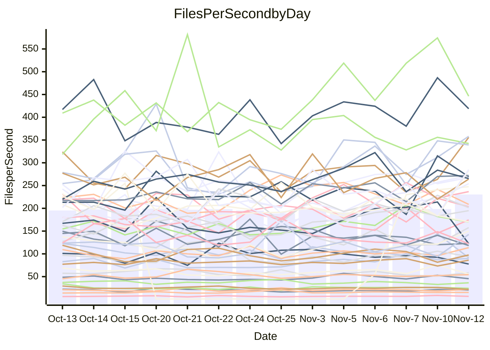

<!---
# This file is auto-generated. Do not edit.
# cspell:disable
--->
# Performance Report

Daily Performance

Time to Process Files

| Repository                                      | Elapsed | Min/Avg/Max          |    SD | SD Graph                |
| ----------------------------------------------- | ------: | :------------------: | ----: | ----------------------- |
| AdaDoom3/AdaDoom3                    |    3.52 | 1.8 /   2.8 /   3.5  |  0.46 | `    ┣━━┻━━╋━━┻●━┫    ` |
| alexiosc/megistos                    |    5.59 | 3.9 /   6.4 /   9.3  |  1.34 | `    ┣━━┻●━╋━━┻━━┫    ` |
| apollographql/apollo-server          |    3.10 | 1.4 /   2.4 /   3.3  |  0.43 | `    ┣━━┻━━╋━━┻●━┫    ` |
| aspnetboilerplate/aspnetboilerplate  |    5.76 | 5.3 /   7.9 /  10.2  |  1.59 | `    ┣━●┻━━╋━━┻━━┫    ` |
| aws-amplify/docs                     |   11.66 | 7.4 /  13.0 /  15.4  |  2.11 | `    ┣━━┻●━╋━━┻━━┫    ` |
| Azure/azure-rest-api-specs           |    8.94 | 6.2 /   9.9 /  12.2  |  1.81 | `    ┣━━┻●━╋━━┻━━┫    ` |
| bitjson/typescript-starter           |    1.12 | 0.7 /   1.0 /   1.3  |  0.17 | `     ┣━┻━━╋●━┻━┫     ` |
| caddyserver/caddy                    |    4.92 | 2.4 /   4.0 /   4.8  |  0.68 | `    ┣━━┻━━╋━━┻●━┫    ` |
| canada-ca/open-source-logiciel-libre |    0.97 | 0.7 /   1.0 /   1.4  |  0.18 | `     ┣━┻━●╋━━┻━┫     ` |
| chef/chef                            |    5.51 | 0.0 /   1.6 /   5.5  |  2.21 | `    ┣━━┻━━╋━━┻━●┫    ` |
| dart-lang/sdk                        |   54.51 | 34.1 /  57.7 /  76.1 |  9.33 | `  ┣━━━┻━━●╋━━━┻━━━┫  ` |
| django/django                        |   12.31 | 7.6 /  12.8 /  15.6  |  2.49 | `   ┣━━━┻━●╋━━┻━━━┫   ` |
| eslint/eslint                        |   10.34 | 5.8 /   9.2 /  11.8  |  1.82 | `    ┣━━┻━━╋━●┻━━┫    ` |
| exonum/exonum                        |    3.60 | 2.1 /   3.1 /   3.9  |  0.50 | `    ┣━━┻━━╋━━●━━┫    ` |
| flutter/samples                      |   12.18 | 6.6 /  10.2 /  13.0  |  2.02 | `    ┣━━┻━━╋━━●━━┫    ` |
| gitbucket/gitbucket                  |    2.77 | 2.0 /   3.2 /   4.5  |  0.57 | `    ┣━━┻●━╋━━┻━━┫    ` |
| googleapis/google-cloud-cpp          |   82.62 | 72.6 / 117.0 / 144.0 | 21.49 | `  ┣●━━┻━━━╋━━━┻━━━┫  ` |
| graphql/express-graphql              |    1.15 | 0.7 /   1.1 /   1.4  |  0.18 | `     ┣━┻━━╋●━┻━┫     ` |
| graphql/graphql-js                   |    2.89 | 2.1 /   3.4 /   4.4  |  0.70 | `    ┣━━┻●━╋━━┻━━┫    ` |
| graphql/graphql-relay-js             |    1.17 | 0.7 /   1.1 /   1.4  |  0.17 | `     ┣━┻━━╋●━┻━┫     ` |
| graphql/graphql-spec                 |    1.11 | 0.8 /   1.3 /   1.6  |  0.21 | `     ┣━┻●━╋━━┻━┫     ` |
| iluwatar/java-design-patterns        |    9.74 | 7.4 /  11.4 /  14.6  |  2.14 | `    ┣━━●━━╋━━┻━━┫    ` |
| ktaranov/sqlserver-kit               |    6.14 | 3.3 /   5.3 /   6.8  |  1.13 | `    ┣━━┻━━╋━●┻━━┫    ` |
| liriliri/licia                       |    3.05 | 2.2 /   3.6 /   4.7  |  0.70 | `    ┣━━┻●━╋━━┻━━┫    ` |
| MartinThoma/LaTeX-examples           |    5.41 | 3.8 /   5.9 /   7.5  |  1.11 | `    ┣━━┻━●╋━━┻━━┫    ` |
| mdx-js/mdx                           |    1.30 | 1.2 /   1.7 /   2.1  |  0.27 | `     ┣●┻━━╋━━┻━┫     ` |
| microsoft/TypeScript-Website         |    4.22 | 3.1 /   4.9 /   6.0  |  0.80 | `    ┣━━┻●━╋━━┻━━┫    ` |
| MicrosoftDocs/PowerShell-Docs        |   24.71 | 15.9 /  23.6 /  28.1 |  3.15 | `   ┣━━━┻━━╋●━┻━━━┫   ` |
| neovim/nvim-lspconfig                |    5.67 | 3.1 /   5.3 /  10.2  |  1.25 | `    ┣━━┻━━╋●━┻━━┫    ` |
| pagekit/pagekit                      |    3.48 | 2.1 /   3.3 /   4.1  |  0.59 | `    ┣━━┻━━╋●━┻━━┫    ` |
| php/php-src                          |   14.76 | 13.6 /  22.2 /  28.0 |  4.19 | `   ┣●━━┻━━╋━━┻━━━┫   ` |
| plasticrake/tplink-smarthome-api     |    1.46 | 0.8 /   1.2 /   1.6  |  0.23 | `     ┣━┻━━╋━━●━┫     ` |
| prettier/prettier                    |    8.21 | 4.5 /   7.6 /   9.3  |  1.27 | `    ┣━━┻━━╋●━┻━━┫    ` |
| pycontribs/jira                      |    1.52 | 1.0 /   1.4 /   1.9  |  0.21 | `     ┣━┻━━╋●━┻━┫     ` |
| RustPython/RustPython                |    9.84 | 6.5 /  10.8 /  13.4  |  2.13 | `    ┣━━┻●━╋━━┻━━┫    ` |
| shoelace-style/shoelace              |    3.04 | 1.7 /   2.6 /   3.5  |  0.45 | `    ┣━━┻━━╋━━●━━┫    ` |
| slint-ui/slint                       |   19.47 | 11.7 /  19.1 /  23.9 |  3.70 | `   ┣━━━┻━━●━━┻━━━┫   ` |
| SoftwareBrothers/admin-bro           |    2.43 | 1.5 /   2.4 /   3.2  |  0.41 | `    ┣━━┻━━●━━┻━━┫    ` |
| sveltejs/svelte                      |   23.33 | 13.4 /  21.5 /  27.1 |  4.21 | `   ┣━━━┻━━╋●━┻━━━┫   ` |
| TheAlgorithms/Python                 |    4.13 | 3.9 /   6.0 /   7.6  |  1.11 | `    ┣●━┻━━╋━━┻━━┫    ` |
| twbs/bootstrap                       |    1.78 | 1.2 /   1.9 /   2.5  |  0.31 | `     ┣━┻━●╋━━┻━┫     ` |
| typescript-cheatsheets/react         |    1.24 | 0.8 /   1.2 /   1.4  |  0.17 | `     ┣━┻━━╋●━┻━┫     ` |
| typescript-eslint/typescript-eslint  |    4.23 | 2.5 /   4.0 /   4.8  |  0.77 | `    ┣━━┻━━╋●━┻━━┫    ` |
| vitest-dev/vitest                    |   11.65 | 6.4 /  10.4 /  13.1  |  2.06 | `    ┣━━┻━━╋━●┻━━┫    ` |
| w3c/aria-practices                   |    3.32 | 2.1 /   3.1 /   4.2  |  0.56 | `    ┣━━┻━━╋●━┻━━┫    ` |
| w3c/specberus                        |    1.29 | 1.1 /   1.7 /   2.3  |  0.33 | `     ┣━●━━╋━━┻━┫     ` |
| webdeveric/webpack-assets-manifest   |    1.19 | 0.8 /   1.2 /   1.3  |  0.16 | `     ┣━┻━━╋●━┻━┫     ` |
| webpack/webpack                      |    8.17 | 5.3 /   8.2 /  10.7  |  1.69 | `    ┣━━┻━━●━━┻━━┫    ` |
| wireapp/wire-desktop                 |    1.58 | 0.9 /   1.4 /   1.7  |  0.24 | `     ┣━┻━━╋━●┻━┫     ` |
| wireapp/wire-webapp                  |   12.76 | 8.5 /  13.6 /  18.3  |  2.93 | `   ┣━━━┻━●╋━━┻━━━┫   ` |

Note:
- Elapsed time is in seconds.

Files per Second over Time

| Repository                                      | Files |   Sec |    Fps |     Rel | Trend Fps              |    N |
| ----------------------------------------------- | ----: | ----: | -----: | ------: | ---------------------- | ---: |
| AdaDoom3/AdaDoom3                    |   103 |  3.52 |  29.27 | -22.39% | `▆▂▄█▂▂█▂▄▂▃▅▃▂▄▃▂▂▅▁` |   45 |
| alexiosc/megistos                    |   583 |  5.59 | 104.30 |   9.57% | `▂▅█▃▆█▅▇▂▁▃▃▂▃▅▅▅▅▃▅` |   45 |
| apollographql/apollo-server          |   256 |  3.10 |  82.54 | -24.39% | `▄▃▂▄▄▂▁▃▂▂▃▇▂▃▂▄█▅▃▁` |   45 |
| aspnetboilerplate/aspnetboilerplate  |  2308 |  5.76 | 400.87 |  32.03% | `▂██▆▇▃▅█▂▂▅▅▇▂▂▄▅▇▃▇` |   45 |
| aws-amplify/docs                     |  3039 | 11.66 | 260.73 |   7.57% | `▂▁▃▂▅▂▂▄█▂▃▂▂▂▂▂▇▁▄▃` |   45 |
| Azure/azure-rest-api-specs           |  2625 |  8.94 | 293.58 |   6.77% | `▄▄▂█▂▇▇▂█▆▂▂▇▂▂▅▂▄▂▄` |   45 |
| bitjson/typescript-starter           |    20 |  1.12 |  17.90 | -11.49% | `▃▃▂▃▅▅▁▄▇▃▂█▃▃▃▅▇▂▆▃` |   45 |
| caddyserver/caddy                    |   414 |  4.92 |  84.16 | -18.47% | `▂▇▂▂▅▄█▂▁▂▂▁▂▅▂▂▂▄▇▁` |   45 |
| canada-ca/open-source-logiciel-libre |     7 |  0.97 |   7.23 |   4.91% | `▄▂▄▃▂▅▆▄▄▂▂▄▃▄▂█▅▅▃▄` |   45 |
| chef/chef                            |  1041 |  5.51 | 189.00 | 115.94% | `▁▁▁▁▁▁▁▁▁▁▁▇█▇▅█▅▆█▅` |   44 |
| dart-lang/sdk                        | 11864 | 54.51 | 217.65 |   3.07% | `▂▁▂▇▄▂▄▂▃▂▂▄▄▂▄▂▂▃█▃` |   45 |
| django/django                        |  2945 | 12.31 | 239.19 |  -0.88% | `▄▁▄▂▄▂▂▂▇█▄▁▂▂▂▂▂▄▅▃` |   45 |
| eslint/eslint                        |  2090 | 10.34 | 202.06 | -14.87% | `▂▅███▂▂▂▂▁▂▂▂▁▂██▄█▂` |   45 |
| exonum/exonum                        |   421 |  3.60 | 116.88 | -16.79% | `▅▆▂▅▂▂▂█▂▆▃█▅▂▃▅▃▅▂▂` |   45 |
| flutter/samples                      |  1703 | 12.18 | 139.82 | -19.55% | `▅▂▅▅▁▄▂▆▃█▂▇▆█▂▄▂▆█▂` |   45 |
| gitbucket/gitbucket                  |   427 |  2.77 | 153.90 |  10.51% | `▃▃█▂▅▂▅██▅▁▅▅▂▃▃▂▃▅▅` |   45 |
| googleapis/google-cloud-cpp          | 22119 | 82.62 | 267.71 |  35.79% | `▂▁▄▂▂▂▁▁▅▇▂█▇█▄▂▄▂█▇` |   45 |
| graphql/express-graphql              |    26 |  1.15 |  22.69 |  -9.71% | `▂▆▂▂▃▁▃▂█▂▄▄▄▄▄▃▇▃▂▃` |   45 |
| graphql/graphql-js                   |   562 |  2.89 | 194.79 |  12.42% | `▂▂▂▂▄▂▂▂▂▂▂▄▂█▂▂▂▂▃▅` |   45 |
| graphql/graphql-relay-js             |    28 |  1.17 |  24.01 |  -8.66% | `▃▄▆▃▃▃▄▃▃▂▂▃█▅▂▆▃▃▃▃` |   45 |
| graphql/graphql-spec                 |    19 |  1.11 |  17.19 |  10.98% | `▂▂█▃▃▅▄▃▆▂▂█▂▅▂▅▂▂▂▄` |   45 |
| iluwatar/java-design-patterns        |  2239 |  9.74 | 229.80 |  12.54% | `▅▃█▂▄▁▅▄▄▂▆▂▅▂▄▂▇▅▂▅` |   45 |
| ktaranov/sqlserver-kit               |   490 |  6.14 |  79.78 | -18.24% | `█▇▅█▂▂▄▂▂▅▁▂▄▅▃▂▁▇▂▂` |   45 |
| liriliri/licia                       |  1442 |  3.05 | 472.88 |  12.47% | `▂▁▄▂▂▂▂▇▆▂█▂▂▂▄▄█▂▂▅` |   45 |
| MartinThoma/LaTeX-examples           |  1414 |  5.41 | 261.31 |   5.15% | `▆▂▂▇▂▂█▂█▅▅▅▄▅▄▂▇▂▄▄` |   45 |
| mdx-js/mdx                           |   139 |  1.30 | 106.78 |  30.01% | `▂▂▄▆▃▄▁▅▄▆▂▂▂▇▅█▂▃▂▇` |   45 |
| microsoft/TypeScript-Website         |   810 |  4.22 | 191.81 |  17.93% | `▂▂▆▄▂▂▄▂▁▁▂▄▄▃▇▂█▂▂▅` |   45 |
| MicrosoftDocs/PowerShell-Docs        |  3127 | 24.71 | 126.54 |  -6.36% | `▂▆▃▇▄▃▄▄▄▄▂▃▃▄▃▇▄█▃▄` |   45 |
| neovim/nvim-lspconfig                |   891 |  5.67 | 157.02 | -11.26% | `▃▆▇▅▃▃▇▃▃█▆▅▃▅▅▅▇▄▁▃` |   45 |
| pagekit/pagekit                      |   741 |  3.48 | 212.63 |  -8.03% | `▅▇▂▂▂▂▄▂▂▄▁▅█▂▂▂▆▂▂▂` |   45 |
| php/php-src                          |  2401 | 14.76 | 162.68 |  44.50% | `▇▄▂▂▂▅▂▂▇▂▇▂▁▅▄▂▂▂▅█` |   45 |
| plasticrake/tplink-smarthome-api     |    62 |  1.46 |  42.34 | -20.43% | `▁██▆▂▂▂▂▂▃▇▂▅▂▄▂▂▇▆▂` |   45 |
| prettier/prettier                    |  2818 |  8.21 | 343.25 |  -8.98% | `█▃▂▅▂▂▂▆▂▁▂▄▆▂▂▅▂▂▃▃` |   45 |
| pycontribs/jira                      |    78 |  1.52 |  51.42 | -10.73% | `▄▂█▃▇▃▅▄▃█▅▂▅▃▃▄▂▃▅▃` |   45 |
| RustPython/RustPython                |  1077 |  9.84 | 109.48 |   8.29% | `▁▁▁▇▂█▇▁▄█▁▄▄▃▄▁▂▂▂▄` |   45 |
| shoelace-style/shoelace              |   440 |  3.04 | 144.50 | -18.13% | `▃█▂▃▆▅▃▃▆█▃▃█▁▅▃▃▅▆▃` |   45 |
| slint-ui/slint                       |  5152 | 19.47 | 264.64 |  -0.74% | `▂▄▂▂▄▇▃▂█▂▂█▂▄▄▂▂▂▄▄` |   45 |
| SoftwareBrothers/admin-bro           |   441 |  2.43 | 181.68 |  -6.22% | `▂▅▄▃█▁▃▃▅▂▃██▃▂▅▃▇▅▃` |   45 |
| sveltejs/svelte                      |  9241 | 23.33 | 396.16 | -11.70% | `▂▇▂▂▄▂▆▂█▂▂▂▂█▂▂██▄▂` |   45 |
| TheAlgorithms/Python                 |  1640 |  4.13 | 396.94 |  39.00% | `▃▂▂▄▄▄▂▃▁▂▅█▇▂▂▂▅▂▅▇` |   45 |
| twbs/bootstrap                       |   152 |  1.78 |  85.37 |   3.87% | `▂▃▂▄▅▄▄▄█▃▃▄▂▂▇▄▂▁▄▄` |   45 |
| typescript-cheatsheets/react         |    24 |  1.24 |  19.34 |  -7.24% | `▃▆▃█▂▅▃▅▃▅█▃▂▆▃▃▂▃▆▃` |   45 |
| typescript-eslint/typescript-eslint  |   887 |  4.23 | 209.78 |  -9.35% | `▂▁▂█▄▃▃▃▂▃▁▅▂▄▄▅▁██▃` |   45 |
| vitest-dev/vitest                    |  2963 | 11.65 | 254.29 | -14.01% | `▂▄▇▄▂▇▂█▂▇▂▇▂▃▂▄▄▄█▂` |   45 |
| w3c/aria-practices                   |   417 |  3.32 | 125.64 | -10.50% | `▅▃▄▃▂▄▇▃█▅▃▅▅▆▃▃▂▃▃▃` |   45 |
| w3c/specberus                        |   190 |  1.29 | 147.18 |  26.45% | `▆▆▂▂▄▄▄▂▂▂▃▆▂▄▅█▃▂▇▇` |   45 |
| webdeveric/webpack-assets-manifest   |    55 |  1.19 |  46.26 |  -5.29% | `▇█▄▇▂█▂▂▃▇▂▂▂▂▃▂▅▇▂▃` |   45 |
| webpack/webpack                      |  1545 |  8.17 | 189.13 |  -2.84% | `▄▄▂▄▄▂▁█▂▂▂▇▇▁▇▄▁▄▂▃` |   45 |
| wireapp/wire-desktop                 |    86 |  1.58 |  54.41 | -13.13% | `▂▂▂▂▂▂▅▂▂▃▆██▁▃█▇▁▂▂` |   45 |
| wireapp/wire-webapp                  |  3138 | 12.76 | 245.95 |  12.63% | `▇▁▂▂▃▂██▂▂▄▂▂▂█▂▂▇▄▅` |   45 |

Data Throughput

| Repository                                      | Files |   Sec |     Kps |     Rel | Trend Kps              |    N |
| ----------------------------------------------- | ----: | ----: | ------: | ------: | ---------------------- | ---: |
| AdaDoom3/AdaDoom3                    |   103 |  3.52 |  621.97 | -22.39% | `▆▂▄█▂▂█▂▄▂▃▅▃▂▄▃▂▂▅▁` |   45 |
| alexiosc/megistos                    |   583 |  5.59 |  819.57 |   9.57% | `▂▅█▃▆█▅▇▂▁▃▃▂▃▅▅▅▅▃▅` |   45 |
| apollographql/apollo-server          |   256 |  3.10 |  681.95 | -24.36% | `▄▃▂▄▄▂▁▃▂▂▃▇▂▃▂▄█▅▃▁` |   45 |
| aspnetboilerplate/aspnetboilerplate  |  2308 |  5.76 |  988.97 |  32.13% | `▂██▆▇▃▅█▂▂▅▅▇▂▂▄▅▇▃▇` |   45 |
| aws-amplify/docs                     |  3039 | 11.66 | 1025.50 |   7.67% | `▂▁▃▂▅▂▂▄█▂▃▂▂▂▂▂▇▁▄▃` |   45 |
| Azure/azure-rest-api-specs           |  2625 |  8.94 |  937.99 |   8.61% | `▄▄▂█▃▇▇▂█▆▂▂▇▂▂▅▂▄▂▄` |   45 |
| bitjson/typescript-starter           |    20 |  1.12 |   71.61 | -11.49% | `▃▃▂▃▅▅▁▄▇▃▂█▃▃▃▅▇▂▆▃` |   45 |
| caddyserver/caddy                    |   414 |  4.92 |  823.13 | -17.56% | `▂▇▂▂▅▄█▂▁▂▂▂▂▅▂▂▂▄▇▂` |   45 |
| canada-ca/open-source-logiciel-libre |     7 |  0.97 |   59.95 |   4.91% | `▄▂▄▃▂▅▆▄▄▂▂▄▃▄▂█▅▅▃▄` |   45 |
| chef/chef                            |  1041 |  5.51 |  931.41 | -20.83% | `▂▅▄▂▂▁▂▅▆█▅▂▇▂▃▇▁`    |   16 |
| dart-lang/sdk                        | 11864 | 54.51 | 1529.63 |   3.18% | `▂▁▂▇▄▂▄▂▃▂▂▄▄▂▄▂▂▃█▃` |   45 |
| django/django                        |  2945 | 12.31 | 1554.45 |  -0.78% | `▄▁▄▂▄▂▂▂▇█▄▁▂▂▂▂▂▄▅▃` |   45 |
| eslint/eslint                        |  2090 | 10.34 | 1431.56 | -14.83% | `▂▅███▂▂▂▂▁▂▂▂▁▂██▄█▂` |   45 |
| exonum/exonum                        |   421 |  3.60 | 1117.96 | -16.79% | `▅▆▂▅▂▂▂█▂▆▃█▅▂▃▅▃▅▂▂` |   45 |
| flutter/samples                      |  1703 | 12.18 |  833.43 | -19.55% | `▅▂▅▅▁▄▂▆▃█▂▇▆█▂▄▂▆█▂` |   45 |
| gitbucket/gitbucket                  |   427 |  2.77 |  759.76 |  10.89% | `▃▃█▂▅▂▅██▅▁▅▅▂▃▃▂▃▅▅` |   45 |
| googleapis/google-cloud-cpp          | 22119 | 82.62 | 2355.86 |  36.42% | `▂▁▄▂▂▂▁▁▅▇▂█▇█▄▂▄▂█▇` |   45 |
| graphql/express-graphql              |    26 |  1.15 |  103.85 |  -9.71% | `▂▆▂▂▃▁▃▂█▂▄▄▄▄▄▃▇▃▂▃` |   45 |
| graphql/graphql-js                   |   562 |  2.89 | 1481.38 |  12.56% | `▂▂▂▂▄▂▂▂▂▂▂▄▂█▂▂▂▂▃▅` |   45 |
| graphql/graphql-relay-js             |    28 |  1.17 |   94.34 |  -8.66% | `▃▄▆▃▃▃▄▃▃▂▂▃█▅▂▆▃▃▃▃` |   45 |
| graphql/graphql-spec                 |    19 |  1.11 |  577.96 |  10.98% | `▂▂█▃▃▅▄▃▆▂▂█▂▅▂▅▂▂▂▄` |   45 |
| iluwatar/java-design-patterns        |  2239 |  9.74 |  713.02 |  12.54% | `▅▃█▂▄▁▅▄▄▂▆▂▅▂▄▂▇▅▂▅` |   45 |
| ktaranov/sqlserver-kit               |   490 |  6.14 | 1209.06 | -18.23% | `█▇▅█▂▂▄▂▂▅▁▂▄▅▃▂▁▇▂▂` |   45 |
| liriliri/licia                       |  1442 |  3.05 |  567.00 |  12.47% | `▂▁▄▂▂▂▂▇▆▂█▂▂▂▄▄█▂▂▅` |   45 |
| MartinThoma/LaTeX-examples           |  1414 |  5.41 |  542.95 |   5.15% | `▆▂▂▇▂▂█▂█▅▅▅▄▅▄▂▇▂▄▄` |   45 |
| mdx-js/mdx                           |   139 |  1.30 |  503.18 |  30.01% | `▂▂▄▆▃▄▁▅▄▆▂▂▂▇▅█▂▃▂▇` |   45 |
| microsoft/TypeScript-Website         |   810 |  4.22 | 1359.03 |  20.80% | `▂▂▆▄▂▂▄▂▁▁▂▄▄▃▇▂█▂▂▅` |   45 |
| MicrosoftDocs/PowerShell-Docs        |  3127 | 24.71 | 1352.33 |  -6.36% | `▂▆▃▇▄▃▄▄▄▄▂▃▃▄▃▇▄█▃▄` |   45 |
| neovim/nvim-lspconfig                |   891 |  5.67 |  498.20 | -10.98% | `▃▆▇▅▃▃▇▃▃█▆▅▃▅▅▅▇▄▁▃` |   45 |
| pagekit/pagekit                      |   741 |  3.48 |  443.34 |  -8.03% | `▅▇▂▂▂▂▄▂▂▄▁▅█▂▂▂▆▂▂▂` |   45 |
| php/php-src                          |  2401 | 14.76 | 2896.50 |  44.57% | `▇▄▂▂▂▅▂▂▇▂▇▂▁▅▄▂▂▂▅█` |   45 |
| plasticrake/tplink-smarthome-api     |    62 |  1.46 |  228.75 | -20.43% | `▁██▆▂▂▂▂▂▃▇▂▅▂▄▂▂▇▆▂` |   45 |
| prettier/prettier                    |  2818 |  8.21 |  476.50 |  -9.50% | `█▃▂▅▂▂▂▆▂▁▂▄▆▂▂▅▂▂▃▃` |   45 |
| pycontribs/jira                      |    78 |  1.52 |  462.14 |  11.03% | `▄▂▇▃▇▃▅▄▂█▅▂▄▃▃▆▄▅█▅` |   45 |
| RustPython/RustPython                |  1077 |  9.84 | 3179.27 |   8.46% | `▁▁▁▇▂█▇▁▄█▁▄▄▄▄▁▂▂▂▄` |   45 |
| shoelace-style/shoelace              |   440 |  3.04 |  697.87 | -18.13% | `▃█▂▃▆▅▃▃▆█▃▃█▁▅▃▃▅▆▃` |   45 |
| slint-ui/slint                       |  5152 | 19.47 | 1583.53 |  -0.03% | `▂▅▂▂▄▇▃▂█▂▂█▂▄▄▂▂▂▄▄` |   45 |
| SoftwareBrothers/admin-bro           |   441 |  2.43 |  400.43 |  -6.22% | `▂▅▄▃█▁▃▃▅▂▃██▃▂▅▃▇▅▃` |   45 |
| sveltejs/svelte                      |  9241 | 23.33 |  274.02 | -11.69% | `▂▇▂▂▄▂▆▂█▂▂▂▂█▂▂██▄▂` |   45 |
| TheAlgorithms/Python                 |  1640 |  4.13 | 1138.53 |  39.05% | `▃▂▂▄▄▄▂▃▁▂▅█▇▂▂▂▅▂▅▇` |   45 |
| twbs/bootstrap                       |   152 |  1.78 |  725.05 |   4.48% | `▂▃▂▄▅▄▄▄█▃▃▄▂▂▇▄▂▁▄▄` |   45 |
| typescript-cheatsheets/react         |    24 |  1.24 |  174.86 |  -7.24% | `▃▆▃█▂▅▃▅▃▅█▃▂▆▃▃▂▃▆▃` |   45 |
| typescript-eslint/typescript-eslint  |   887 |  4.23 |  717.79 |  -9.22% | `▂▁▂█▄▃▃▃▂▃▁▅▂▄▄▅▁██▃` |   45 |
| vitest-dev/vitest                    |  2963 | 11.65 |  771.55 | -13.42% | `▂▄▇▄▂▇▂█▂▇▂▇▂▃▂▄▄▄█▂` |   45 |
| w3c/aria-practices                   |   417 |  3.32 | 1182.89 | -10.50% | `▅▃▄▃▂▄▇▃█▅▃▅▅▆▃▃▂▃▃▃` |   45 |
| w3c/specberus                        |   190 |  1.29 |  481.82 |  26.45% | `▆▆▂▂▄▄▄▂▂▂▃▆▂▄▅█▃▂▇▇` |   45 |
| webdeveric/webpack-assets-manifest   |    55 |  1.19 |  106.82 |  -5.29% | `▇█▄▇▂█▂▂▃▇▂▂▂▂▃▂▅▇▂▃` |   45 |
| webpack/webpack                      |  1545 |  8.17 | 1730.37 |   0.27% | `▄▄▂▄▄▁▁█▂▂▂▇▇▁▇▅▁▄▂▄` |   45 |
| wireapp/wire-desktop                 |    86 |  1.58 |  239.15 | -13.02% | `▂▂▂▂▂▂▅▂▂▃▆██▁▃█▇▁▂▂` |   45 |
| wireapp/wire-webapp                  |  3138 | 12.76 | 1164.13 |  13.43% | `▇▁▂▂▃▂██▂▂▄▂▂▂█▂▂▇▄▅` |   45 |

