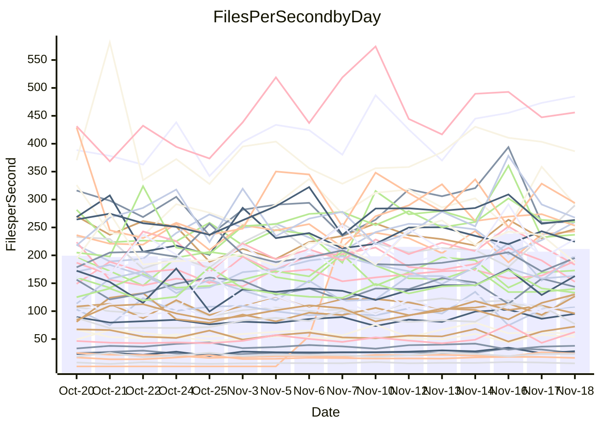

<!---
# This file is auto-generated. Do not edit.
# cspell:disable
--->
# Performance Report

Daily Performance

Time to Process Files

| Repository                                      | Elapsed | Min/Avg/Max          |    SD | SD Graph                |
| ----------------------------------------------- | ------: | :------------------: | ----: | ----------------------- |
| AdaDoom3/AdaDoom3                    |    3.11 | 1.7 /   2.8 /   3.5  |  0.52 | `    ┣━━┻━━╋━●┻━━┫    ` |
| alexiosc/megistos                    |    7.07 | 3.9 /   6.1 /   9.3  |  1.30 | `    ┣━━┻━━╋━●┻━━┫    ` |
| apollographql/apollo-server          |    2.63 | 1.5 /   2.4 /   3.3  |  0.39 | `    ┣━━┻━━╋●━┻━━┫    ` |
| aspnetboilerplate/aspnetboilerplate  |    6.85 | 5.0 /   7.8 /  10.2  |  1.56 | `    ┣━━┻●━╋━━┻━━┫    ` |
| aws-amplify/docs                     |    9.57 | 7.4 /  12.1 /  15.4  |  2.42 | `    ┣━━●━━╋━━┻━━┫    ` |
| Azure/azure-rest-api-specs           |   10.44 | 6.2 /   9.6 /  12.2  |  1.68 | `    ┣━━┻━━╋━●┻━━┫    ` |
| bitjson/typescript-starter           |    0.80 | 0.6 /   1.0 /   1.3  |  0.17 | `     ┣━●━━╋━━┻━┫     ` |
| caddyserver/caddy                    |    2.71 | 2.5 /   3.9 /   5.3  |  0.73 | `    ┣●━┻━━╋━━┻━━┫    ` |
| canada-ca/open-source-logiciel-libre |    1.23 | 0.7 /   1.0 /   1.4  |  0.17 | `     ┣━┻━━╋━━●━┫     ` |
| chef/chef                            |    5.54 | 0.0 /   2.5 /   5.9  |  2.39 | `    ┣━━┻━━╋━━┻●━┫    ` |
| dart-lang/sdk                        |   62.21 | 34.1 /  56.1 /  76.8 | 10.35 | `  ┣━━━┻━━━╋━●━┻━━━┫  ` |
| django/django                        |   14.42 | 7.6 /  12.6 /  15.6  |  2.26 | `    ┣━━┻━━╋━━●━━┫    ` |
| eslint/eslint                        |    9.96 | 5.7 /   8.7 /  11.8  |  1.86 | `    ┣━━┻━━╋━●┻━━┫    ` |
| exonum/exonum                        |    3.39 | 2.1 /   3.0 /   3.9  |  0.54 | `    ┣━━┻━━╋━●┻━━┫    ` |
| flutter/samples                      |    7.97 | 6.6 /  10.3 /  14.0  |  2.18 | `    ┣━━●━━╋━━┻━━┫    ` |
| gitbucket/gitbucket                  |    2.88 | 2.0 /   3.0 /   4.5  |  0.61 | `    ┣━━┻━●╋━━┻━━┫    ` |
| googleapis/google-cloud-cpp          |  125.14 | 72.6 / 111.2 / 144.0 | 22.32 | `  ┣━━━┻━━━╋━━●┻━━━┫  ` |
| graphql/express-graphql              |    0.95 | 0.7 /   1.0 /   1.4  |  0.18 | `     ┣━┻━●╋━━┻━┫     ` |
| graphql/graphql-js                   |    3.63 | 2.1 /   3.3 /   4.4  |  0.65 | `    ┣━━┻━━╋●━┻━━┫    ` |
| graphql/graphql-relay-js             |    1.16 | 0.7 /   1.1 /   1.4  |  0.17 | `     ┣━┻━━╋●━┻━┫     ` |
| graphql/graphql-spec                 |    1.02 | 0.8 /   1.2 /   1.6  |  0.21 | `     ┣━●━━╋━━┻━┫     ` |
| iluwatar/java-design-patterns        |   10.46 | 7.4 /  11.2 /  14.6  |  2.14 | `    ┣━━┻━●╋━━┻━━┫    ` |
| ktaranov/sqlserver-kit               |    4.53 | 3.2 /   5.1 /   6.8  |  1.17 | `    ┣━━┻━●╋━━┻━━┫    ` |
| liriliri/licia                       |    2.64 | 2.2 /   3.6 /   4.7  |  0.70 | `    ┣━●┻━━╋━━┻━━┫    ` |
| MartinThoma/LaTeX-examples           |    4.65 | 3.8 /   5.7 /   7.5  |  1.03 | `    ┣━━●━━╋━━┻━━┫    ` |
| mdx-js/mdx                           |    1.54 | 1.1 /   1.7 /   2.1  |  0.29 | `     ┣━┻●━╋━━┻━┫     ` |
| microsoft/TypeScript-Website         |    6.05 | 3.1 /   5.0 /   6.4  |  0.83 | `    ┣━━┻━━╋━━┻●━┫    ` |
| MicrosoftDocs/PowerShell-Docs        |   20.77 | 14.6 /  23.5 /  28.1 |  3.07 | `   ┣━━━●━━╋━━┻━━━┫   ` |
| neovim/nvim-lspconfig                |    6.06 | 3.1 /   5.2 /  10.2  |  1.20 | `    ┣━━┻━━╋━●┻━━┫    ` |
| pagekit/pagekit                      |    2.62 | 2.0 /   3.2 /   4.1  |  0.58 | `    ┣━━●━━╋━━┻━━┫    ` |
| php/php-src                          |   19.73 | 13.9 /  22.3 /  28.0 |  4.13 | `   ┣━━━┻●━╋━━┻━━━┫   ` |
| plasticrake/tplink-smarthome-api     |    1.33 | 0.8 /   1.2 /   1.6  |  0.22 | `     ┣━┻━━╋━●┻━┫     ` |
| prettier/prettier                    |    6.92 | 4.4 /   7.5 /   9.3  |  1.24 | `    ┣━━┻━●╋━━┻━━┫    ` |
| pycontribs/jira                      |    0.94 | 0.9 /   1.4 /   1.9  |  0.23 | `     ●━┻━━╋━━┻━┫     ` |
| RustPython/RustPython                |    8.15 | 7.1 /  11.0 /  13.4  |  2.07 | `    ┣━●┻━━╋━━┻━━┫    ` |
| shoelace-style/shoelace              |    2.45 | 1.7 /   2.6 /   3.5  |  0.44 | `    ┣━━┻━●╋━━┻━━┫    ` |
| slint-ui/slint                       |   18.71 | 12.5 /  19.7 /  24.1 |  3.69 | `   ┣━━━┻━●╋━━┻━━━┫   ` |
| SoftwareBrothers/admin-bro           |    2.57 | 1.5 /   2.4 /   3.2  |  0.40 | `    ┣━━┻━━╋●━┻━━┫    ` |
| sveltejs/svelte                      |   19.06 | 13.4 /  22.3 / 100.8 | 10.73 | `   ┣━━┻━━●╋━━━┻━━┫   ` |
| TheAlgorithms/Python                 |    5.29 | 3.7 /   5.8 /   7.6  |  1.16 | `    ┣━━┻━●╋━━┻━━┫    ` |
| twbs/bootstrap                       |    2.11 | 1.2 /   1.8 /   2.5  |  0.32 | `     ┣━┻━━╋━●┻━┫     ` |
| typescript-cheatsheets/react         |    0.95 | 0.8 /   1.1 /   1.4  |  0.17 | `     ┣━●━━╋━━┻━┫     ` |
| typescript-eslint/typescript-eslint  |    3.40 | 2.6 /   4.0 /   4.8  |  0.66 | `    ┣━━●━━╋━━┻━━┫    ` |
| vitest-dev/vitest                    |    9.43 | 6.4 /  10.3 /  13.0  |  2.07 | `    ┣━━┻━●╋━━┻━━┫    ` |
| w3c/aria-practices                   |    3.49 | 2.0 /   3.0 /   4.2  |  0.56 | `    ┣━━┻━━╋━●┻━━┫    ` |
| w3c/specberus                        |    1.55 | 1.1 /   1.8 /   2.7  |  0.32 | `     ┣━┻●━╋━━┻━┫     ` |
| webdeveric/webpack-assets-manifest   |    0.85 | 0.7 /   1.2 /   1.6  |  0.18 | `     ●━┻━━╋━━┻━┫     ` |
| webpack/webpack                      |    7.52 | 5.3 /   8.3 /  10.7  |  1.54 | `    ┣━━┻●━╋━━┻━━┫    ` |
| wireapp/wire-desktop                 |    1.62 | 0.9 /   1.4 /   1.9  |  0.25 | `     ┣━┻━━╋━●┻━┫     ` |
| wireapp/wire-webapp                  |   11.94 | 8.5 /  14.6 /  20.4  |  3.15 | `   ┣━━━●━━╋━━┻━━━┫   ` |

Note:
- Elapsed time is in seconds.

Files per Second over Time

| Repository                                      | Files |    Sec |    Fps |     Rel | Trend Fps              |    N |
| ----------------------------------------------- | ----: | -----: | -----: | ------: | ---------------------- | ---: |
| AdaDoom3/AdaDoom3                    |   103 |   3.11 |  33.16 | -13.31% | `▅▇▁▂▂▂█▂▂▄▇▂▄▂▁▅▂▂▅▂` |   63 |
| alexiosc/megistos                    |   583 |   7.07 |  82.44 | -17.19% | `▃▅▂▅▆▇▅▅██▅▅▆▄█▅▂▄▅▃` |   63 |
| apollographql/apollo-server          |   256 |   2.63 |  97.19 | -10.43% | `▆▃▄▃▄▇▃▃▇▇▃▃█▃▄▃▃▃▅▃` |   63 |
| aspnetboilerplate/aspnetboilerplate  |  2308 |   6.85 | 336.75 |   9.21% | `▂▂▄▂▂▄█▄▂▂▂█▆▂▄▄▄▂▃▄` |   63 |
| aws-amplify/docs                     |  3039 |   9.57 | 317.40 |  20.70% | `█▇▃█▇▆▂▂▅▂▅▅█▅▆▂▆▂▃▇` |   63 |
| Azure/azure-rest-api-specs           |  2626 |  10.44 | 251.45 | -10.79% | `▂▆▄▄█▂▂▅▂▅▃▄▇▅▅▂▂▅▂▃` |   63 |
| bitjson/typescript-starter           |    20 |   0.80 |  25.11 |  20.84% | `▃▅▅▄▃▅▇▃▃▄▃▇▂▃▇█▇▅▇▇` |   63 |
| caddyserver/caddy                    |   429 |   2.71 | 158.35 |  46.33% | `▅▂▆▅▂▆▅▄▂▄▇▃▆▅▂▁▃▅▅█` |   63 |
| canada-ca/open-source-logiciel-libre |     7 |   1.23 |   5.68 | -19.93% | `▂▆▇▃▇▄▆▅▂▅▅▃█▇▄█▅▃▅▂` |   63 |
| chef/chef                            |  1041 |   5.54 | 188.00 |  45.74% | `▅▇▅▅▆▅▆▅▆▅▇██▅▆▆▆▇▇▅` |   62 |
| dart-lang/sdk                        | 11882 |  62.21 | 191.00 | -12.89% | `▅█▄▆▆▇▂▃▃▃▅▆▆▅▁▅█▂▂▃` |   63 |
| django/django                        |  2945 |  14.42 | 204.18 | -15.49% | `▂▂▄▄█▂▂▂▂▄▆▂▄▃▇▂▂▂▄▂` |   63 |
| eslint/eslint                        |  2090 |   9.96 | 209.93 | -16.91% | `▄▇▄▄▃▄▂▄▂█▄▂▇█▁▅▃▄▄▂` |   63 |
| exonum/exonum                        |   421 |   3.39 | 124.22 | -13.98% | `▇▂█▅▂█▂▇█▄▄▂▄▂█▅▂▅▅▃` |   63 |
| flutter/samples                      |  1681 |   7.97 | 210.88 |  21.85% | `▂▂▂▂▂▄█▃▁▃█▅▂▇▁▆▂▆▄▆` |   63 |
| gitbucket/gitbucket                  |   427 |   2.88 | 148.37 |   0.39% | `▆█▂▆▆▅▂▅█▅▄▃▃▆▄▅▆▆▆▄` |   63 |
| googleapis/google-cloud-cpp          | 22252 | 125.14 | 177.82 | -14.64% | `▄▄▅▂▂▄▅▅▂█▂▂▂█▂▄▄▅█▂` |   63 |
| graphql/express-graphql              |    26 |   0.95 |  27.32 |   6.62% | `▅▃▆▂▃▃▃▂▃▇▃▄▇██▆▆▄▂▅` |   63 |
| graphql/graphql-js                   |   562 |   3.63 | 154.80 | -11.67% | `▄▆▄▇▂▄▂▄▂█▆▄▄▂▃▆▂▆▂▃` |   63 |
| graphql/graphql-relay-js             |    28 |   1.16 |  24.22 | -10.02% | `▄▃▂█▄▃▃▂▇▃▂▄▇▆▂▂▄▇▂▃` |   63 |
| graphql/graphql-spec                 |    20 |   1.02 |  19.69 |  23.72% | `▂▄▂▄▅▂▄▅▄█▄▂▃▅▅▅▅▃▃▆` |   63 |
| iluwatar/java-design-patterns        |  2239 |  10.46 | 214.14 |   2.51% | `▄▅▂▂██▄▅▅▄▂▂▆▆▂▅▆▃▁▄` |   63 |
| ktaranov/sqlserver-kit               |   490 |   4.53 | 108.09 |   5.08% | `▄▃▂▄▂▄███▄▆█▅▁█▂▁▄▄▄` |   63 |
| liriliri/licia                       |  1470 |   2.64 | 556.81 |  32.48% | `▂▃▅▂▂▂▃▅▄▅▅▇▂▅▄▂█▇▂▇` |   63 |
| MartinThoma/LaTeX-examples           |  1414 |   4.65 | 304.17 |  18.08% | `█▃▃▂▆▄▇▅▆▆▅▂▃▇▅▂▆▄▃▇` |   63 |
| mdx-js/mdx                           |   139 |   1.54 |  90.15 |   8.31% | `▂▆▃▂▅▄▂▂▅▄▆▂▂▇█▆▅▂▂▄` |   63 |
| microsoft/TypeScript-Website         |   809 |   6.05 | 133.65 | -17.07% | `▃▂▃▆▆▃▆▇▃▆▃▇█▂▃▂▂▃▃▂` |   63 |
| MicrosoftDocs/PowerShell-Docs        |  3127 |  20.77 | 150.54 |  10.88% | `▂▂▂▂▂▅▂▄▄█▂▂▂▅▄▄▂▂▂▄` |   63 |
| neovim/nvim-lspconfig                |   891 |   6.06 | 147.11 | -18.62% | `▃▃█▄▅▄▅▃▄▃▅▆█▆▆▄▅▅▂▃` |   63 |
| pagekit/pagekit                      |   741 |   2.62 | 282.51 |  17.98% | `▂█▄▅▂▄▃▂▂▂▅▄█▂▂▂▄▆▂▅` |   63 |
| php/php-src                          |  2401 |  19.73 | 121.70 |   8.83% | `▂▅▂▂▄▄▂▅▅▅██▂▅▂▄▂▄▂▄` |   63 |
| plasticrake/tplink-smarthome-api     |    62 |   1.33 |  46.62 | -13.11% | `▃▂▆▂▂▆▄▃▅▂▇██▂▅▆▄▅▅▃` |   63 |
| prettier/prettier                    |  2748 |   6.92 | 397.02 |   3.24% | `▂▂▄▄▄▂█▂▂▃▄▄▄▃▂▄▄▄▂▃` |   63 |
| pycontribs/jira                      |    78 |   0.94 |  82.77 |  41.21% | `▂▆▂▃▂▂▆▃▄▇▆█▆▂▄▄▆█▃█` |   63 |
| RustPython/RustPython                |  1090 |   8.15 | 133.80 |  31.65% | `▂▂▁▄▆▄▄▁▅▄▄▂▄▂▄█▂█▄▆` |   63 |
| shoelace-style/shoelace              |   440 |   2.45 | 179.93 |   4.66% | `▂▂▇▂▅▂█▂▂▆▂▂▃▃▂▂▅▅▅▄` |   63 |
| slint-ui/slint                       |  5168 |  18.71 | 276.15 |   3.60% | `█▂█▂▂▂▄▅▂▂▅▂▂██▄▂▅▂▄` |   63 |
| SoftwareBrothers/admin-bro           |   441 |   2.57 | 171.79 | -11.48% | `▅▆█▃▃▃▂▃▂▂▃▃▅▇▅▃▅▇▃▃` |   63 |
| sveltejs/svelte                      |  9245 |  19.06 | 485.12 |   7.22% | `▁▅▅█▅▇█▇▆▅▆▅▇▆▆▆▄▆▅▆` |   63 |
| TheAlgorithms/Python                 |  1640 |   5.29 | 310.30 |   5.38% | `▂▁█▂▇▅▄▇▅▂▄▄▅▇▂▁▄▂▂▄` |   63 |
| twbs/bootstrap                       |   152 |   2.11 |  71.89 | -16.25% | `▂▄▂▂▄▄▆▅█▅▆▆▂▆▂▇▃▅▇▂` |   63 |
| typescript-cheatsheets/react         |    24 |   0.95 |  25.25 |  15.49% | `▅▃▇▅▅█▇▃▃▄█▃▇▃█▃▄▆▃▆` |   63 |
| typescript-eslint/typescript-eslint  |   900 |   3.40 | 264.60 |  15.29% | `▃▂▆█▃▃█▆▃▂▃▃▃▇▃█▃▇▃▇` |   63 |
| vitest-dev/vitest                    |  2967 |   9.43 | 314.75 |   4.70% | `▂▂█▂▂▁▄▅▄▄▂▂▄▂▅▆▅▄▂▄` |   63 |
| w3c/aria-practices                   |   417 |   3.49 | 119.43 | -16.76% | `▃▃▅▄▂▇▄▃▇▄▇▂▃▆▂▄▃█▅▂` |   63 |
| w3c/specberus                        |   190 |   1.55 | 122.79 |  11.01% | `▆▄▃▄▆▃▄▁▅▄█▆▄▅▃▄▃▇▆▆` |   63 |
| webdeveric/webpack-assets-manifest   |    55 |   0.85 |  64.65 |  33.28% | `▃▁▃▂▂▂▄▂▃▄▆▃▃█▃▂▂▃█▆` |   63 |
| webpack/webpack                      |  1552 |   7.52 | 206.52 |   7.04% | `▂▃▂▅▂▅█▂▂▅▇▃▅▅▄▃▂▆▃▅` |   63 |
| wireapp/wire-desktop                 |    86 |   1.62 |  53.22 | -16.42% | `▅▃▄▄▆▄▇▄▄▇▇█▅▃▆▄▂▂▅▂` |   63 |
| wireapp/wire-webapp                  |  4006 |  11.94 | 335.51 |  54.47% | `▂▂█▂▂▂▂▂▄▂▂█▃▂▃▇▃█▃█` |   63 |

Data Throughput

| Repository                                      | Files |    Sec |     Kps |     Rel | Trend Kps              |    N |
| ----------------------------------------------- | ----: | -----: | ------: | ------: | ---------------------- | ---: |
| AdaDoom3/AdaDoom3                    |   103 |   3.11 |  704.83 | -13.31% | `▅▇▁▂▂▂█▂▂▄▇▂▄▂▁▅▂▂▅▂` |   63 |
| alexiosc/megistos                    |   583 |   7.07 |  647.76 | -17.19% | `▃▅▂▅▆▇▅▅██▅▅▆▄█▅▂▄▅▃` |   63 |
| apollographql/apollo-server          |   256 |   2.63 |  803.72 | -10.33% | `▆▃▄▃▄▇▃▃▇▇▃▃█▃▄▃▃▃▅▃` |   63 |
| aspnetboilerplate/aspnetboilerplate  |  2308 |   6.85 |  830.78 |   9.21% | `▂▂▄▂▂▄█▄▂▂▂█▆▂▄▄▄▂▃▄` |   63 |
| aws-amplify/docs                     |  3039 |   9.57 | 1248.41 |  20.76% | `█▇▃█▇▆▂▂▅▂▅▅█▅▆▂▆▂▃▇` |   63 |
| Azure/azure-rest-api-specs           |  2626 |  10.44 |  810.26 |  -9.29% | `▂▆▄▄█▂▃▅▂▆▃▄▇▅▅▂▂▅▂▃` |   63 |
| bitjson/typescript-starter           |    20 |   0.80 |  100.43 |  20.84% | `▃▅▅▄▃▅▇▃▃▄▃▇▂▃▇█▇▅▇▇` |   63 |
| caddyserver/caddy                    |   429 |   2.71 | 1545.46 |  46.54% | `▅▂▆▅▂▆▅▄▃▄▇▃▆▅▂▁▃▅▅█` |   63 |
| canada-ca/open-source-logiciel-libre |     7 |   1.23 |   47.06 | -19.93% | `▂▆▇▃▇▄▆▅▂▅▅▃█▇▄█▅▃▅▂` |   63 |
| chef/chef                            |  1041 |   5.54 |  927.20 | -19.75% | `▂▆▂▁▃▂▄▂▄▂▅██▂▅▄▄▆▆▂` |   34 |
| dart-lang/sdk                        | 11882 |  62.21 | 1341.91 | -12.88% | `▅█▄▆▆▇▂▃▃▃▅▆▆▅▁▅█▂▂▃` |   63 |
| django/django                        |  2945 |  14.42 | 1328.32 | -15.38% | `▂▂▄▄█▂▂▂▂▄▆▂▄▃▇▂▂▂▄▂` |   63 |
| eslint/eslint                        |  2090 |   9.96 | 1489.49 | -16.78% | `▄▇▄▄▃▄▂▄▂█▄▂▇█▁▅▃▄▄▂` |   63 |
| exonum/exonum                        |   421 |   3.39 | 1188.19 | -13.98% | `▇▂█▅▂█▂▇█▄▄▂▄▂█▅▂▅▅▃` |   63 |
| flutter/samples                      |  1681 |   7.97 | 1279.85 |  23.89% | `▂▂▂▂▂▄█▃▁▃█▅▂▇▁▆▂▆▄▆` |   63 |
| gitbucket/gitbucket                  |   427 |   2.88 |  733.52 |   0.66% | `▆█▂▆▆▅▂▅█▅▄▃▃▆▄▅▇▆▆▄` |   63 |
| googleapis/google-cloud-cpp          | 22252 | 125.14 | 1575.30 | -13.92% | `▄▄▅▂▂▄▅▅▂█▂▂▂█▂▄▄▅█▃` |   63 |
| graphql/express-graphql              |    26 |   0.95 |  125.04 |   6.62% | `▅▃▆▂▃▃▃▂▃▇▃▄▇██▆▆▄▂▅` |   63 |
| graphql/graphql-js                   |   562 |   3.63 | 1177.51 | -11.81% | `▄▆▄▇▂▄▂▄▂█▆▄▄▂▃▆▂▆▂▃` |   63 |
| graphql/graphql-relay-js             |    28 |   1.16 |   95.16 | -10.02% | `▄▃▂█▄▃▃▂▇▃▂▄▇▆▂▂▄▇▂▃` |   63 |
| graphql/graphql-spec                 |    20 |   1.02 |  639.95 |  19.89% | `▂▄▂▄▅▂▄▅▄█▄▂▃▅▄▄▄▃▂▅` |   63 |
| iluwatar/java-design-patterns        |  2239 |  10.46 |  664.42 |   2.51% | `▄▅▂▂██▄▅▅▄▂▂▆▆▂▅▆▃▁▄` |   63 |
| ktaranov/sqlserver-kit               |   490 |   4.53 | 1638.08 |   5.09% | `▄▃▂▄▂▄███▄▆█▅▁█▂▁▄▄▄` |   63 |
| liriliri/licia                       |  1470 |   2.64 |  774.99 |  51.65% | `▂▂▄▂▂▁▂▄▃▄▄▅▂▄▅▃█▇▃▇` |   63 |
| MartinThoma/LaTeX-examples           |  1414 |   4.65 |  632.01 |  18.08% | `█▃▃▂▆▄▇▅▆▆▅▂▃▇▅▂▆▄▃▇` |   63 |
| mdx-js/mdx                           |   139 |   1.54 |  424.79 |   8.31% | `▂▆▃▂▅▄▂▂▅▄▆▂▂▇█▆▅▂▂▄` |   63 |
| microsoft/TypeScript-Website         |   809 |   6.05 |  826.99 | -24.59% | `▄▄▄██▄▆▇▃▆▃▆█▂▃▂▂▃▃▂` |   63 |
| MicrosoftDocs/PowerShell-Docs        |  3127 |  20.77 | 1608.77 |  10.88% | `▂▂▂▂▂▅▂▄▄█▂▂▂▅▄▄▂▂▂▄` |   63 |
| neovim/nvim-lspconfig                |   891 |   6.06 |  467.08 | -18.43% | `▃▃█▄▅▄▅▃▄▃▅▆█▆▆▄▅▅▂▃` |   63 |
| pagekit/pagekit                      |   741 |   2.62 |  589.05 |  17.98% | `▂█▄▅▂▄▃▂▂▂▅▄█▂▂▂▄▆▂▅` |   63 |
| php/php-src                          |  2401 |  19.73 | 2167.73 |   8.89% | `▂▅▂▂▄▄▂▅▅▅██▂▅▂▄▂▄▂▄` |   63 |
| plasticrake/tplink-smarthome-api     |    62 |   1.33 |  251.92 | -13.11% | `▃▂▆▂▂▆▄▃▅▂▇██▂▅▆▄▅▅▃` |   63 |
| prettier/prettier                    |  2748 |   6.92 |  566.93 |   5.66% | `▂▂▄▄▄▂█▂▂▃▄▄▄▃▂▄▄▄▂▃` |   63 |
| pycontribs/jira                      |    78 |   0.94 |  743.89 |  58.84% | `▃▆▃▃▃▃▆▄▅▇▆█▆▃▅▅▆█▄█` |   63 |
| RustPython/RustPython                |  1090 |   8.15 | 3885.19 |  32.13% | `▂▂▂▄▆▄▄▁▅▄▄▂▄▂▄█▂█▄▆` |   63 |
| shoelace-style/shoelace              |   440 |   2.45 |  869.00 |   4.66% | `▂▂▇▂▅▂█▂▂▆▂▂▃▃▂▂▅▅▅▄` |   63 |
| slint-ui/slint                       |  5168 |  18.71 | 1655.16 |   3.91% | `█▂█▂▂▂▄▅▂▂▅▂▂██▄▂▅▂▄` |   63 |
| SoftwareBrothers/admin-bro           |   441 |   2.57 |  378.65 | -11.48% | `▅▆█▃▃▃▂▃▂▂▃▃▅▇▅▃▅▇▃▃` |   63 |
| sveltejs/svelte                      |  9245 |  19.06 |  336.83 |   7.59% | `▁▅▅█▅▇█▇▆▅▆▅▇▆▆▆▄▆▅▆` |   63 |
| TheAlgorithms/Python                 |  1640 |   5.29 |  890.02 |   5.39% | `▂▁█▂▇▅▄▇▅▂▄▄▅▇▂▁▄▂▂▄` |   63 |
| twbs/bootstrap                       |   152 |   2.11 |  613.93 | -15.59% | `▂▄▂▂▄▄▆▅█▅▆▆▂▆▂▇▃▅▇▂` |   63 |
| typescript-cheatsheets/react         |    24 |   0.95 |  228.28 |  15.49% | `▅▃▇▅▅█▇▃▃▄█▃▇▃█▃▄▆▃▆` |   63 |
| typescript-eslint/typescript-eslint  |   900 |   3.40 |  922.85 |  17.39% | `▂▂▅█▃▃█▅▃▂▃▃▃▇▃█▃▇▃▇` |   63 |
| vitest-dev/vitest                    |  2967 |   9.43 |  956.34 |   5.12% | `▂▂█▂▂▁▄▅▄▄▂▂▄▂▅▆▅▄▂▄` |   63 |
| w3c/aria-practices                   |   417 |   3.49 | 1124.46 | -16.76% | `▃▃▅▄▂▇▄▃▇▄▇▂▃▆▂▄▃█▅▂` |   63 |
| w3c/specberus                        |   190 |   1.55 |  401.99 |  11.01% | `▆▄▃▄▆▃▄▁▅▄█▆▄▅▃▄▃▇▆▆` |   63 |
| webdeveric/webpack-assets-manifest   |    55 |   0.85 |  149.29 |  33.28% | `▃▁▃▂▂▂▄▂▃▄▆▃▃█▃▂▂▃█▆` |   63 |
| webpack/webpack                      |  1552 |   7.52 | 1975.51 |  13.46% | `▂▃▃▅▂▅█▂▂▅▇▃▆▅▅▃▃▇▃▆` |   63 |
| wireapp/wire-desktop                 |    86 |   1.62 |  233.91 | -16.38% | `▅▃▄▄▆▄▇▄▄▇▇█▅▃▆▄▂▂▅▂` |   63 |
| wireapp/wire-webapp                  |  4006 |  11.94 | 1469.52 |  44.14% | `▂▂█▂▂▂▂▂▄▂▂█▃▂▂▆▂▇▂▇` |   63 |

