<!---
# This file is auto-generated. Do not edit.
# cspell:disable
--->
# Performance Report

```mermaid
xychart-beta
    title Files Per Second by Day
    y-axis Files per Second
    x-axis Date [Nov-3, Nov-5, Nov-6, Nov-7, Nov-10, Nov-12, Nov-13, Nov-14, Nov-16, Nov-17, Nov-18, Nov-19, Nov-20, Nov-21, Nov-23, Nov-24, Nov-25, Nov-26, Nov-27, Nov-28]
    bar [197.53, 191.30, 204.37, 213.67, 198.26, 215.23, 208.25, 210.82, 238.97, 206.65, 217.84, 229.81, 204.28, 204.72, 212.49, 215.65, 228.99, 242.53, 248.30, 245.41]
    line [19.46, 21.60, 21.45, 21.30, 18.35, 21.09, 25.51, 23.62, 19.35, 23.58, 25.01, 19.06, 21.71, 18.60, 25.05, 18.57, 22.48, 21.02, 25.02, 23.93]
    line [27.62, 26.37, 26.13, 26.22, 26.38, 27.41, 29.67, 28.01, 34.46, 24.62, 26.88, 29.05, 27.58, 29.46, 33.73, 27.92, 32.26, 26.40, 33.12, 27.19]
    line [115.43, 104.61, 103.62, 96.31, 144.08, 103.66, 113.77, 116.66, 96.10, 99.72, 110.04, 130.67, 118.22, 109.21, 109.94, 92.27, 110.41, 112.83, 94.59, 123.21]
    line [59.05, 63.00, 65.34, 56.44, 75.90, 53.22, 66.88, 79.34, 60.36, 62.89, 61.13, 74.10, 59.99, 68.53, 50.18, 67.03, 58.14, 75.00, 57.65, 66.70]
    line [249.43, 256.58, 231.73, 207.54, 241.66, 256.57, 253.87, 246.51, 201.92, 227.28, 273.31, 278.44, 234.26, 208.12, 248.05, 217.79, 238.74, 281.53, 222.75, 247.23]
    line [14.31, 14.75, 16.57, 15.81, 15.06, 15.24, 15.00, 17.22, 18.21, 17.91, 18.25, 19.44, 15.85, 19.63, 15.59, 14.87, 17.04, 16.83, 18.75, 17.76]
    line [17.58, 19.22, 19.85, 18.09, 21.66, 21.06, 21.89, 20.40, 19.08, 26.32, 22.99, 22.31, 17.30, 21.45, 20.67, 17.71, 21.53, 21.54, 21.12, 18.79]
    line [144.51, 175.00, 199.16, 202.30, 213.91, 179.15, 174.06, 184.56, 213.36, 190.95, 178.24, 181.48, 176.13, 207.99, 209.21, 218.59, 222.36, 187.74, 206.31, 220.95]
    line [211.71, 193.66, 223.97, 234.72, 257.12, 235.87, 229.04, 217.57, 263.96, 230.17, 237.48, 225.46, 241.65, 180.78, 293.43, 257.61, 239.26, 265.48, 278.84, 282.12]
    line [6.55, 6.95, 6.80, 6.70, 8.74, 6.68, 7.36, 7.28, 8.89, 7.86, 7.37, 8.95, 8.51, 5.96, 6.86, 9.12, 7.04, 6.34, 7.48, 6.49]
    line [101.68, 106.46, 99.98, 103.28, 96.07, 116.03, 123.18, 116.39, 119.25, 88.82, 121.42, 116.77, 119.13, 133.04, 131.42, 92.70, 111.61, 106.98, 150.54, 112.40]
    line [217.96, 178.42, 209.10, 170.02, 221.91, 185.33, 201.98, 169.69, 248.53, 198.86, 209.17, 248.49, 197.83, 196.05, 238.36, 196.70, 228.50, 223.50, 237.10, 227.48]
    line [83.10, 87.87, 82.40, 100.31, 86.94, 80.60, 83.49, 81.08, 112.95, 109.00, 80.57, 96.66, 86.29, 73.57, 94.99, 104.85, 92.60, 92.71, 95.18, 101.07]
    line [198.17, 161.08, 151.81, 202.09, 145.44, 169.46, 196.60, 191.20, 142.18, 169.19, 181.94, 218.95, 173.37, 148.92, 222.58, 208.58, 166.33, 196.86, 159.88, 227.94]
    line [252.23, 256.11, 274.23, 277.54, 254.29, 279.19, 250.20, 259.75, 302.13, 263.51, 269.60, 209.51, 279.56, 252.28, 295.42, 201.43, 290.55, 243.66, 274.98, 289.76]
    line [221.29, 193.06, 210.68, 191.30, 228.42, 202.21, 222.67, 207.51, 251.74, 216.50, 204.65, 215.27, 209.30, 212.61, 204.74, 173.27, 227.69, 263.34, 279.98, 232.90]
    line [281.78, 290.77, 294.19, 235.16, 263.73, 318.29, 305.89, 320.49, 393.89, 258.23, 282.90, 271.83, 281.13, 317.78, 254.31, 239.07, 274.19, 305.88, 362.43, 342.40]
    line [169.82, 175.50, 190.52, 198.14, 183.09, 171.50, 148.66, 179.60, 221.70, 154.91, 174.70, 152.47, 182.03, 155.80, 201.43, 145.12, 174.50, 202.14, 180.65, 171.75]
    line [109.66, 99.65, 92.58, 95.73, 92.52, 104.99, 95.65, 134.65, 74.54, 103.19, 97.14, 112.35, 90.90, 123.07, 100.34, 81.20, 100.95, 81.94, 127.89, 95.78]
    line [109.58, 126.12, 106.10, 121.67, 121.71, 115.58, 104.23, 106.50, 113.74, 93.16, 128.26, 117.29, 104.16, 110.80, 141.51, 113.78, 125.50, 127.08, 135.02, 126.04]
    line [255.29, 291.36, 336.81, 274.44, 312.01, 318.04, 285.73, 302.25, 248.86, 358.68, 275.32, 367.42, 349.18, 246.71, 283.63, 321.34, 361.86, 307.70, 314.64, 295.74]
    line [217.89, 245.63, 237.62, 186.76, 315.24, 273.68, 279.33, 261.66, 360.61, 232.56, 262.68, 260.50, 261.27, 283.01, 276.41, 217.54, 267.60, 261.78, 271.82, 249.62]
    line [197.71, 169.15, 174.81, 153.55, 160.37, 166.32, 171.57, 173.57, 158.65, 163.60, 180.83, 187.20, 198.17, 153.08, 196.42, 212.25, 182.62, 192.95, 184.84, 198.77]
    line [91.01, 101.64, 110.52, 105.15, 81.62, 92.24, 104.72, 102.11, 85.32, 114.70, 113.79, 84.79, 94.70, 119.03, 83.33, 79.58, 108.73, 104.90, 86.38, 99.55]
    line [93.87, 81.75, 97.21, 92.97, 105.80, 92.86, 100.80, 118.00, 101.99, 110.02, 106.56, 100.86, 89.90, 80.84, 102.36, 111.01, 104.27, 109.93, 125.28, 113.30]
    line [247.84, 350.22, 344.89, 251.52, 348.16, 311.63, 278.27, 336.11, 250.48, 328.56, 294.90, 291.94, 292.58, 248.71, 280.57, 372.61, 351.95, 347.51, 373.44, 340.78]
    line [394.96, 403.82, 355.89, 328.31, 356.02, 358.21, 384.78, 430.42, 410.61, 403.44, 362.79, 349.62, 425.99, 404.00, 391.92, 328.37, 388.44, 469.22, 401.95, 442.55]
    line [319.42, 234.42, 265.85, 278.09, 219.92, 239.43, 278.17, 251.99, 378.34, 291.11, 251.52, 237.49, 280.27, 262.12, 289.40, 286.83, 266.94, 278.92, 316.55, 291.76]
    line [154.52, 129.77, 140.65, 119.71, 140.68, 139.42, 159.42, 151.36, 113.27, 158.34, 153.96, 144.89, 151.69, 135.05, 130.36, 129.62, 160.69, 170.60, 193.91, 178.31]
    line [403.12, 433.88, 424.28, 380.40, 486.76, 425.45, 369.94, 444.86, 455.23, 473.19, 418.11, 350.16, 435.36, 434.19, 503.88, 339.40, 435.51, 398.87, 450.81, 420.64]
    line [46.86, 57.12, 50.26, 44.96, 52.89, 47.17, 42.40, 48.87, 75.68, 43.23, 59.94, 45.01, 51.72, 48.28, 45.99, 45.47, 50.75, 51.41, 56.14, 56.26]
    line [139.03, 134.52, 140.79, 136.42, 120.17, 137.59, 146.37, 146.54, 175.32, 128.97, 152.20, 131.62, 147.72, 139.79, 155.08, 167.65, 164.18, 159.14, 153.31, 165.48]
    line [223.12, 252.36, 209.33, 256.35, 222.55, 205.03, 213.07, 209.57, 179.17, 233.46, 264.64, 250.26, 235.07, 278.49, 210.89, 194.33, 336.10, 299.00, 339.79, 285.06]
    line [1.00, 1.00, 55.24, 229.88, 240.51, 230.78, 203.89, 243.63, 187.42, 237.86, 226.45, 217.28, 251.44, 276.01, 215.80, 281.10, 250.08, 231.72, 238.42, 244.75]
    line [49.02, 56.78, 61.66, 53.00, 51.36, 56.25, 54.79, 68.17, 45.48, 63.62, 67.01, 61.66, 55.18, 66.89, 63.80, 47.48, 61.31, 53.13, 62.05, 57.76]
    line [254.06, 244.83, 256.05, 214.61, 270.08, 289.61, 327.30, 261.54, 269.45, 273.83, 237.58, 246.50, 236.20, 294.11, 241.99, 285.48, 300.54, 251.64, 251.34, 291.68]
    line [23.30, 25.53, 24.38, 26.29, 26.08, 26.42, 24.81, 25.86, 33.28, 31.19, 24.38, 21.77, 24.56, 20.83, 24.39, 21.39, 23.34, 25.50, 28.27, 25.36]
    line [81.22, 78.86, 85.82, 89.51, 73.32, 84.82, 80.81, 99.19, 102.74, 86.40, 87.53, 104.19, 83.22, 77.11, 77.91, 84.31, 95.41, 93.31, 74.86, 93.58]
    line [137.28, 119.47, 154.44, 118.56, 120.82, 163.18, 162.73, 145.60, 177.40, 158.43, 146.21, 169.65, 160.77, 141.62, 138.65, 127.45, 159.04, 166.59, 168.10, 170.46]
    line [50.11, 54.79, 52.56, 50.32, 52.20, 51.35, 49.71, 59.15, 44.39, 57.39, 55.71, 44.49, 58.88, 49.62, 59.77, 45.57, 52.81, 52.28, 58.35, 46.99]
    line [202.25, 187.81, 196.52, 208.74, 184.16, 182.55, 186.64, 195.17, 205.52, 171.16, 220.75, 207.26, 156.32, 199.17, 181.40, 162.62, 178.33, 224.32, 193.87, 217.32]
    line [141.07, 131.24, 125.88, 123.88, 148.80, 131.70, 144.48, 146.46, 173.42, 140.77, 145.68, 184.15, 168.82, 204.20, 186.48, 154.50, 176.84, 207.53, 179.84, 155.26]
    line [111.86, 126.91, 104.86, 118.31, 94.15, 120.34, 103.60, 127.14, 124.11, 101.43, 119.96, 142.34, 103.04, 107.23, 129.02, 93.63, 106.75, 126.98, 126.44, 107.02]
    line [156.42, 171.45, 162.38, 206.93, 182.01, 158.84, 156.97, 177.01, 134.15, 134.60, 150.67, 224.37, 150.96, 174.91, 192.91, 185.63, 176.63, 162.23, 170.07, 188.48]
    line [285.18, 230.89, 239.86, 212.69, 220.64, 249.81, 250.50, 234.95, 220.08, 243.07, 257.31, 233.28, 201.28, 243.15, 277.09, 286.97, 242.27, 274.36, 262.05, 232.25]
    line [33.69, 35.67, 39.33, 36.78, 32.79, 39.05, 40.14, 41.86, 31.03, 36.52, 40.13, 42.13, 42.40, 32.38, 32.42, 48.09, 38.79, 37.84, 36.70, 39.60]
    line [438.31, 518.91, 437.11, 518.64, 574.29, 444.36, 416.74, 489.48, 492.83, 447.31, 482.01, 422.75, 424.60, 433.90, 437.27, 355.97, 412.55, 410.45, 547.64, 594.44]
    line [262.94, 287.92, 322.31, 236.45, 283.86, 284.35, 279.96, 284.82, 309.10, 256.69, 274.41, 222.36, 256.68, 233.31, 311.00, 282.89, 306.98, 317.08, 257.43, 296.79]
    line [201.59, 181.36, 222.61, 220.01, 183.65, 245.06, 262.64, 218.43, 242.38, 236.75, 212.37, 292.14, 199.00, 204.82, 248.07, 244.43, 223.45, 241.04, 255.30, 284.77]
    line [183.56, 164.82, 210.07, 254.11, 186.18, 246.80, 210.80, 204.64, 291.50, 194.63, 239.67, 252.69, 203.66, 166.41, 192.08, 243.14, 272.16, 300.43, 304.76, 286.69]
```

Daily Performance

Time to Process Files

| Repository                                      | Elapsed | Min/Avg/Max          |    SD | SD Graph                |
| ----------------------------------------------- | ------: | :------------------: | ----: | ----------------------- |
| AdaDoom3/AdaDoom3                    |    3.18 | 1.7 /   2.8 /   3.8  |  0.53 | `    ┣━━┻━━╋━●┻━━┫    ` |
| alexiosc/megistos                    |    5.21 | 3.6 /   6.0 /   9.3  |  1.26 | `    ┣━━┻●━╋━━┻━━┫    ` |
| apollographql/apollo-server          |    1.67 | 1.5 /   2.4 /   3.3  |  0.39 | `    ┣●━┻━━╋━━┻━━┫    ` |
| aspnetboilerplate/aspnetboilerplate  |    5.86 | 4.5 /   7.6 /   9.8  |  1.47 | `    ┣━●┻━━╋━━┻━━┫    ` |
| aws-amplify/docs                     |    6.84 | 7.4 /  12.0 /  15.4  |  2.21 | `   ●┣━━┻━━╋━━┻━━┫    ` |
| Azure/azure-rest-api-specs           |   11.58 | 5.8 /   9.5 /  12.2  |  1.80 | `    ┣━━┻━━╋━━┻●━┫    ` |
| bitjson/typescript-starter           |    0.93 | 0.6 /   1.0 /   1.3  |  0.17 | `     ┣━┻━●╋━━┻━┫     ` |
| caddyserver/caddy                    |    4.41 | 2.3 /   3.8 /   5.3  |  0.75 | `    ┣━━┻━━╋━●┻━━┫    ` |
| canada-ca/open-source-logiciel-libre |    1.12 | 0.7 /   1.0 /   1.4  |  0.17 | `     ┣━┻━━╋━●┻━┫     ` |
| chef/chef                            |    4.81 | 0.0 /   3.7 /   5.9  |  1.96 | `    ┣━━┻━━╋━●┻━━┫    ` |
| dart-lang/sdk                        |   47.31 | 32.3 /  54.0 /  76.8 | 10.77 | `  ┣━━━┻━●━╋━━━┻━━━┫  ` |
| django/django                        |   13.34 | 7.6 /  12.4 /  15.6  |  2.18 | `    ┣━━┻━━╋●━┻━━┫    ` |
| eslint/eslint                        |    9.26 | 5.7 /   8.4 /  11.8  |  1.72 | `    ┣━━┻━━╋━●┻━━┫    ` |
| exonum/exonum                        |    2.64 | 1.8 /   2.9 /   3.9  |  0.59 | `    ┣━━┻━●╋━━┻━━┫    ` |
| flutter/samples                      |    8.82 | 6.6 /  10.0 /  14.0  |  2.09 | `    ┣━━┻●━╋━━┻━━┫    ` |
| gitbucket/gitbucket                  |    2.55 | 1.9 /   2.9 /   4.5  |  0.56 | `    ┣━━┻●━╋━━┻━━┫    ` |
| googleapis/google-cloud-cpp          |   66.90 | 53.9 / 103.0 / 144.0 | 23.93 | `  ┣━●━┻━━━╋━━━┻━━━┫  ` |
| graphql/express-graphql              |    0.98 | 0.7 /   1.1 /   1.4  |  0.18 | `     ┣━┻━●╋━━┻━┫     ` |
| graphql/graphql-js                   |    2.49 | 1.9 /   3.2 /   4.4  |  0.61 | `    ┣━●┻━━╋━━┻━━┫    ` |
| graphql/graphql-relay-js             |    0.69 | 0.7 /   1.0 /   1.4  |  0.18 | `     ●━┻━━╋━━┻━┫     ` |
| graphql/graphql-spec                 |    0.93 | 0.8 /   1.2 /   1.6  |  0.21 | `     ┣●┻━━╋━━┻━┫     ` |
| iluwatar/java-design-patterns        |   10.54 | 6.3 /  10.7 /  14.5  |  2.08 | `    ┣━━┻━━●━━┻━━┫    ` |
| ktaranov/sqlserver-kit               |    5.82 | 3.2 /   5.1 /   7.0  |  1.11 | `    ┣━━┻━━╋━●┻━━┫    ` |
| liriliri/licia                       |    3.24 | 2.2 /   3.6 /   4.7  |  0.69 | `    ┣━━┻━●╋━━┻━━┫    ` |
| MartinThoma/LaTeX-examples           |    3.56 | 3.8 /   5.5 /   7.2  |  1.02 | `    ●━━┻━━╋━━┻━━┫    ` |
| mdx-js/mdx                           |    1.24 | 1.1 /   1.6 /   2.2  |  0.29 | `     ┣●┻━━╋━━┻━┫     ` |
| microsoft/TypeScript-Website         |    4.17 | 3.1 /   4.9 /   6.4  |  0.86 | `    ┣━━●━━╋━━┻━━┫    ` |
| MicrosoftDocs/PowerShell-Docs        |   21.81 | 11.7 /  21.3 /  28.1 |  4.20 | `   ┣━━━┻━━●━━┻━━━┫   ` |
| neovim/nvim-lspconfig                |    3.08 | 3.0 /   4.9 /  10.2  |  1.15 | `    ┣●━┻━━╋━━┻━━┫    ` |
| pagekit/pagekit                      |    2.67 | 2.0 /   3.1 /   4.2  |  0.58 | `    ┣━━┻●━╋━━┻━━┫    ` |
| php/php-src                          |   23.61 | 14.3 /  21.6 /  28.0 |  3.97 | `   ┣━━━┻━━╋━●┻━━━┫   ` |
| plasticrake/tplink-smarthome-api     |    1.30 | 0.8 /   1.2 /   1.6  |  0.22 | `     ┣━┻━━╋●━┻━┫     ` |
| prettier/prettier                    |    5.38 | 4.4 /   7.4 /   9.5  |  1.27 | `    ┣●━┻━━╋━━┻━━┫    ` |
| pycontribs/jira                      |    1.07 | 0.9 /   1.4 /   1.9  |  0.23 | `     ┣━●━━╋━━┻━┫     ` |
| RustPython/RustPython                |   12.20 | 7.1 /  11.1 /  13.7  |  2.00 | `    ┣━━┻━━╋━●┻━━┫    ` |
| shoelace-style/shoelace              |    2.62 | 1.5 /   2.5 /   3.5  |  0.44 | `    ┣━━┻━━●━━┻━━┫    ` |
| slint-ui/slint                       |   21.79 | 13.1 /  19.7 /  24.2 |  3.46 | `   ┣━━━┻━━╋━●┻━━━┫   ` |
| SoftwareBrothers/admin-bro           |    2.43 | 1.5 /   2.2 /   3.2  |  0.41 | `     ┣━┻━━╋━●┻━┫     ` |
| sveltejs/svelte                      |   18.21 | 13.4 /  21.9 / 100.8 |  9.42 | `   ┣━━┻━━●╋━━━┻━━┫   ` |
| TheAlgorithms/Python                 |    6.11 | 3.5 /   5.8 /   7.8  |  1.19 | `    ┣━━┻━━╋●━┻━━┫    ` |
| twbs/bootstrap                       |    1.34 | 1.2 /   1.8 /   2.5  |  0.30 | `     ┣●┻━━╋━━┻━┫     ` |
| typescript-cheatsheets/react         |    1.05 | 0.8 /   1.1 /   1.4  |  0.17 | `     ┣━┻━●╋━━┻━┫     ` |
| typescript-eslint/typescript-eslint  |    4.17 | 2.6 /   3.9 /   5.7  |  0.65 | `    ┣━━┻━━╋●━┻━━┫    ` |
| vitest-dev/vitest                    |    8.47 | 6.2 /  10.1 /  13.0  |  2.00 | `    ┣━━●━━╋━━┻━━┫    ` |
| w3c/aria-practices                   |    2.46 | 2.0 /   3.0 /   3.9  |  0.51 | `    ┣━━●━━╋━━┻━━┫    ` |
| w3c/specberus                        |    1.51 | 1.1 /   1.7 /   2.7  |  0.32 | `     ┣━┻━●╋━━┻━┫     ` |
| webdeveric/webpack-assets-manifest   |    1.30 | 0.7 /   1.1 /   1.6  |  0.19 | `     ┣━┻━━╋━●┻━┫     ` |
| webpack/webpack                      |    8.92 | 5.3 /   8.3 /  10.8  |  1.55 | `    ┣━━┻━━╋●━┻━━┫    ` |
| wireapp/wire-desktop                 |    1.21 | 0.9 /   1.4 /   2.0  |  0.25 | `     ┣━┻●━╋━━┻━┫     ` |
| wireapp/wire-webapp                  |   17.88 | 8.5 /  14.9 /  20.8  |  3.33 | `   ┣━━━┻━━╋━━●━━━┫   ` |

Note:
- Elapsed time is in seconds.

Files per Second over Time

| Repository                                      | Files |   Sec |    Fps |     Rel | Trend Fps              |    N |
| ----------------------------------------------- | ----: | ----: | -----: | ------: | ---------------------- | ---: |
| AdaDoom3/AdaDoom3                    |   103 |  3.18 |  32.44 | -15.35% | `▇▂█▇▃▂▃▃█▆▃▃▂▁▅▇▃█▅▃` |   87 |
| alexiosc/megistos                    |   583 |  5.21 | 111.97 |   9.54% | `▄▂▃▃▃█▃▄▃▆█▂▆▅█▃▅▆▃▅` |   87 |
| apollographql/apollo-server          |   257 |  1.67 | 153.67 |  39.75% | `▂▃▂▃▆▇▆▃▅▃▅▃▃▂▃▄▃▄▆█` |   87 |
| aspnetboilerplate/aspnetboilerplate  |  2308 |  5.86 | 394.02 |  24.08% | `▅▁▃▅▅█▆▂█▂▂▄▅▇▂▄▄▂▄▅` |   87 |
| aws-amplify/docs                     |  3039 |  6.84 | 444.30 |  68.18% | `▄▂▂▅▅▅▃▄▂▂▂▂▃▂▂▄▂▂▂█` |   87 |
| Azure/azure-rest-api-specs           |  2628 | 11.58 | 226.86 | -21.04% | `▃▁█▂▆▂▂▄▇▂█▂▂▂▃▂▅▄▄▂` |   86 |
| bitjson/typescript-starter           |    20 |  0.93 |  21.54 |   3.91% | `▃▃██▃▆▆▃▆▆▆▇▄▁██▃▃▃▅` |   87 |
| caddyserver/caddy                    |   429 |  4.41 |  97.38 | -14.32% | `▂▄▆▂▁▂▂▃▄▅▂▂▄▄▇█▂▄▄▂` |   87 |
| canada-ca/open-source-logiciel-libre |     7 |  1.12 |   6.28 | -12.41% | `█▆▇▃▃▄▃▃▃▃▆▃▇█▄▂▃▃▅▃` |   87 |
| chef/chef                            |  1044 |  4.81 | 217.17 |  14.77% | `▇▇▇▇▆▆▆▅▆▇▇▆█▆▆▆▇▇▆▆` |   86 |
| dart-lang/sdk                        | 11893 | 47.31 | 251.40 |   9.49% | `▄▂▂▂▂█▄▄▃▅▅▂▃▂█▅█▄▅▄` |   87 |
| django/django                        |  2945 | 13.34 | 220.70 | -10.63% | `▅▅▂▂▂▄▄▄▆▂▅▂█▂▃▂▄▂▂▂` |   87 |
| eslint/eslint                        |  2090 |  9.26 | 225.62 | -13.13% | `▃▆▇▃▄▃▅▇▅▃▃▃▃█▆▃▃▆▃▃` |   87 |
| exonum/exonum                        |   421 |  2.64 | 159.40 |   5.74% | `▂▂▃▅▃█▇▂▇▅▂▄▃▇▆█▆▂█▄` |   87 |
| flutter/samples                      |  1681 |  8.82 | 190.56 |   7.49% | `▂▆▃▄▅▃▇█▄█▃▅▇▅▂▃▃▂▆▅` |   87 |
| gitbucket/gitbucket                  |   437 |  2.55 | 171.15 |  12.92% | `▃▄▅▃▅▅▄▃▆▅▇▃▃█▃▅▆▆▃▅` |   87 |
| googleapis/google-cloud-cpp          | 22253 | 66.90 | 332.62 |  45.83% | `▃▁▆▃▅▅▅█▅▆▃▃▃▆▆▆▆▃▄▆` |   86 |
| graphql/express-graphql              |    26 |  0.98 |  26.40 |   4.77% | `▂▃▂▇▂▂▅▃▃▄█▂▆▄█▃▇▃▃▅` |   87 |
| graphql/graphql-js                   |   562 |  2.49 | 225.95 |  25.81% | `▅▂▂▅▂▃▂▆▃▄▅▄▃▂▂▃█▆▂▅` |   87 |
| graphql/graphql-relay-js             |    28 |  0.69 |  40.63 |  45.09% | `▄▃▃▆▆▇▃▂▂▄▅▄▄▅█▅▂▂▂█` |   87 |
| graphql/graphql-spec                 |    20 |  0.93 |  21.46 |  30.02% | `▃▅▂▇▃▃▃▂▇▂▇▃▃▅▅█▃▆▃▇` |   87 |
| iluwatar/java-design-patterns        |  2239 | 10.54 | 212.36 |  -2.91% | `▂▂▄▃▃▇▄▇▅▃▃█▅▄█▅▅▃▄▃` |   87 |
| ktaranov/sqlserver-kit               |   490 |  5.82 |  84.22 | -17.38% | `▂▄▂▂▇▄▂▃▂▂▂▃██▆▄▂▅▄▂` |   87 |
| liriliri/licia                       |  1481 |  3.24 | 456.98 |   7.50% | `▂▆█▃▃▇▃▃▆▆▄▃▅█▇▃▆▂▅▆` |   87 |
| MartinThoma/LaTeX-examples           |  1414 |  3.56 | 397.21 |  49.93% | `▁▂▅▇▃▆▂▂▁▅▂▄▄▂▅▄▂▆▂█` |   87 |
| mdx-js/mdx                           |   139 |  1.24 | 112.47 |  28.14% | `▆▂▄▆▅▇▆▇▆▆▃▂▆▆▂▅█▅▃▇` |   87 |
| microsoft/TypeScript-Website         |   814 |  4.17 | 195.05 |  16.42% | `▅▂▃▃▆█▃▇▃▃▂▃▃▃▆▄▆▃▆▆` |   87 |
| MicrosoftDocs/PowerShell-Docs        |  3127 | 21.81 | 143.34 |  -6.82% | `▃▄▄▃▅▅▅▅▃█▅▇▄▅▅▃▅▂▃▂` |   87 |
| neovim/nvim-lspconfig                |   893 |  3.08 | 290.20 |  52.94% | `▅▅▇▆▅▅▅▆▃▅▃▃▃▃█▅▃▄██` |   87 |
| pagekit/pagekit                      |   741 |  2.67 | 277.39 |  12.58% | `▃▄▄▂▂▄▅▅▂▃▆█▂▄▂▂▄▄▂▅` |   87 |
| php/php-src                          |  2401 | 23.61 | 101.68 | -11.76% | `▂▅▃▂▃▂▅▅▆▃▃██▆▃▄▃▃▅▃` |   87 |
| plasticrake/tplink-smarthome-api     |    62 |  1.30 |  47.63 | -10.67% | `▂▂▆▃▆▂▁▅▄▅▂▄▂▆▂█▂▄▂▃` |   87 |
| prettier/prettier                    |  2776 |  5.38 | 515.55 |  32.26% | `▂▃▅▄▃▃▃▃▇▄▇█▃▃▅▅▅▂▅▆` |   87 |
| pycontribs/jira                      |    78 |  1.07 |  72.96 |  23.62% | `▃▅██▄▃▃▃▃▃▇▄█▆▆▃▄▃▅█` |   87 |
| RustPython/RustPython                |  1094 | 12.20 |  89.65 | -11.31% | `▁▇▇▂▄▂▅▅▃█▂▂▂▂▂▂▇▃▃▃` |   87 |
| shoelace-style/shoelace              |   440 |  2.62 | 167.81 |  -6.14% | `▅▂▃▇▃▃▃█▅▃▃▃▆▃▃▃▆▆▃▃` |   87 |
| slint-ui/slint                       |  5215 | 21.79 | 239.30 | -11.32% | `▄▁▃▅▅▂▅▆▁▂▃▅▂▅█▅▃▅▆▂` |   87 |
| SoftwareBrothers/admin-bro           |   441 |  2.43 | 181.63 | -12.56% | `▄▃▃▇▇▅▃▄▅▅▇▆▃▆▅█▆▄█▃` |   87 |
| sveltejs/svelte                      | 10116 | 18.21 | 555.40 |  20.17% | `▄▄▄▄▅▄▄▄▄▄▄▅▇▄▅▆▅█▆▆` |   87 |
| TheAlgorithms/Python                 |  1640 |  6.11 | 268.51 |  -9.72% | `▂▁▂▂▆▂▂▆▂▇▂▂▂▆▄█▂▆█▃` |   87 |
| twbs/bootstrap                       |   153 |  1.34 | 113.99 |  32.30% | `▄█▅▂▇▅▃▇▅▇▇▃▃▃▂▃▆▃▄█` |   87 |
| typescript-cheatsheets/react         |    24 |  1.05 |  22.82 |   1.96% | `▂▂▇▂▃▇▃▄▃▄▃▅▅▇█▂█▃▅▄` |   87 |
| typescript-eslint/typescript-eslint  |   900 |  4.17 | 215.65 |  -9.37% | `▅▄▃▅▃▄▃▆▅▆▇▄█▃▇▄█▆▅▃` |   87 |
| vitest-dev/vitest                    |  2974 |  8.47 | 351.29 |  14.30% | `▄▄█▄▆▂▂▅▄▂▄▂█▂▂▂▃▂▂▅` |   87 |
| w3c/aria-practices                   |   417 |  2.46 | 169.35 |  15.94% | `▅▆▆▃▇▃▃▅▇▃▃▇▅▃▇▃▄█▃▅` |   87 |
| w3c/specberus                        |   190 |  1.51 | 126.04 |   7.75% | `▅▇▅▄█▄▆▇▇▂▇▆▇▃█▇▆▄▇▆` |   87 |
| webdeveric/webpack-assets-manifest   |    57 |  1.30 |  43.71 | -13.74% | `▃▃▄▃█▄█▂▅▃▅▃▅▇▆▃▄█▆▃` |   87 |
| webpack/webpack                      |  1572 |  8.92 | 176.23 |  -9.65% | `▂▂▅▂▂▃▂▆█▂▅██▂▂▂▃▇▆▃` |   87 |
| wireapp/wire-desktop                 |    90 |  1.21 |  74.58 |  16.28% | `▅▂▃▄▃▅▇▇▄██▂▃▃▄▄▆▄▄▆` |   87 |
| wireapp/wire-webapp                  |  4070 | 17.88 | 227.65 |  -7.06% | `▂▄▅▇▆▇▅▅▇▅▃▅█▄▃█▅▇▃▃` |   87 |

Data Throughput

| Repository                                      | Files |   Sec |     Kps |     Rel | Trend Kps              |    N |
| ----------------------------------------------- | ----: | ----: | ------: | ------: | ---------------------- | ---: |
| AdaDoom3/AdaDoom3                    |   103 |  3.18 |  689.44 | -15.35% | `▇▂█▇▃▂▃▃█▆▃▃▂▁▅▇▃█▅▃` |   87 |
| alexiosc/megistos                    |   583 |  5.21 |  879.85 |   9.54% | `▄▂▃▃▃█▃▄▃▆█▂▆▅█▃▅▆▃▅` |   87 |
| apollographql/apollo-server          |   257 |  1.67 | 1267.03 |  39.50% | `▂▃▃▃▆▇▆▃▅▃▅▃▃▂▃▄▃▄▆█` |   87 |
| aspnetboilerplate/aspnetboilerplate  |  2308 |  5.86 |  972.07 |  24.08% | `▅▁▃▅▅█▆▂█▂▂▄▅▇▂▄▄▂▄▅` |   87 |
| aws-amplify/docs                     |  3039 |  6.84 | 1747.51 |  68.21% | `▄▂▂▅▅▅▃▄▂▂▂▂▃▂▂▄▂▂▂█` |   87 |
| Azure/azure-rest-api-specs           |  2628 | 11.58 |  737.65 | -19.77% | `▃▁█▂▆▂▂▄▇▂█▂▂▂▄▂▅▄▄▂` |   86 |
| bitjson/typescript-starter           |    20 |  0.93 |   86.15 |   3.91% | `▃▃██▃▆▆▃▆▆▆▇▄▁██▃▃▃▅` |   87 |
| caddyserver/caddy                    |   429 |  4.41 |  952.26 | -14.26% | `▂▄▆▃▁▂▂▃▄▅▂▂▄▄▇█▂▄▄▂` |   87 |
| canada-ca/open-source-logiciel-libre |     7 |  1.12 |   52.00 | -12.41% | `█▆▇▃▃▄▃▃▃▃▆▃▇█▄▂▃▃▅▃` |   87 |
| chef/chef                            |  1044 |  4.81 | 1067.13 |  -8.05% | `▇▅▇▆▄▃▄▂▃▆▇▃█▄▃▄▆▆▃▃` |   69 |
| dart-lang/sdk                        | 11893 | 47.31 | 1768.33 |   9.58% | `▄▂▂▂▂█▄▅▃▅▅▂▃▂█▅█▄▅▄` |   87 |
| django/django                        |  2945 | 13.34 | 1436.32 | -10.55% | `▅▅▂▂▂▄▄▄▆▂▅▃█▂▃▂▄▂▂▂` |   87 |
| eslint/eslint                        |  2090 |  9.26 | 1604.50 | -12.90% | `▃▆▇▃▄▃▅▇▅▃▃▃▃█▆▃▃▆▃▃` |   87 |
| exonum/exonum                        |   421 |  2.64 | 1524.70 |   5.74% | `▂▂▃▅▃█▇▂▇▅▂▄▃▇▆█▆▂█▄` |   87 |
| flutter/samples                      |  1681 |  8.82 | 1156.48 |   8.53% | `▃▆▃▄▅▃▇█▄█▃▅▇▅▃▃▃▂▆▅` |   87 |
| gitbucket/gitbucket                  |   437 |  2.55 |  855.77 |  14.03% | `▃▃▅▃▅▅▄▃▆▅▇▃▃█▃▅▆▆▃▅` |   87 |
| googleapis/google-cloud-cpp          | 22253 | 66.90 | 2949.66 |  46.54% | `▃▁▆▄▅▅▅█▅▆▃▃▃▆▆▆▆▃▄▆` |   86 |
| graphql/express-graphql              |    26 |  0.98 |  120.84 |   4.77% | `▂▃▂▇▂▂▅▃▃▄█▂▆▄█▃▇▃▃▅` |   87 |
| graphql/graphql-js                   |   562 |  2.49 | 1718.77 |  25.68% | `▅▂▂▅▂▃▂▆▃▄▅▄▃▂▂▃█▆▂▅` |   87 |
| graphql/graphql-relay-js             |    28 |  0.69 |  159.63 |  45.09% | `▄▃▃▆▆▇▃▂▂▄▅▄▄▅█▅▂▂▂█` |   87 |
| graphql/graphql-spec                 |    20 |  0.93 |  697.33 |  27.72% | `▃▅▂▇▃▃▃▂▇▂▇▃▃▄▅█▂▆▃▇` |   87 |
| iluwatar/java-design-patterns        |  2239 | 10.54 |  658.89 |  -2.91% | `▂▂▄▃▃▇▄▇▅▃▃█▅▄█▅▅▃▄▃` |   87 |
| ktaranov/sqlserver-kit               |   490 |  5.82 | 1276.41 | -17.38% | `▂▄▂▂▇▄▂▃▂▂▂▃██▆▄▂▅▄▂` |   87 |
| liriliri/licia                       |  1481 |  3.24 |  644.28 |  17.33% | `▃▆█▄▄▇▄▄▇▇▄▄▆█▇▄▆▃▆▆` |   87 |
| MartinThoma/LaTeX-examples           |  1414 |  3.56 |  825.32 |  49.93% | `▁▂▅▇▃▆▂▂▁▅▂▄▄▂▅▄▂▆▂█` |   87 |
| mdx-js/mdx                           |   139 |  1.24 |  529.97 |  28.14% | `▆▂▄▆▅▇▆▇▆▆▃▂▆▆▂▅█▅▃▇` |   87 |
| microsoft/TypeScript-Website         |   814 |  4.17 | 1184.94 |   8.55% | `▅▂▃▃▆█▃▇▃▃▂▃▃▃▆▃▆▃▆▆` |   87 |
| MicrosoftDocs/PowerShell-Docs        |  3127 | 21.81 | 1531.90 |  -6.82% | `▃▄▄▃▅▅▅▅▃█▅▇▄▅▅▃▅▂▃▂` |   87 |
| neovim/nvim-lspconfig                |   893 |  3.08 |  921.95 |  53.20% | `▅▅▇▆▅▅▅▆▃▅▃▃▃▃█▅▃▄██` |   87 |
| pagekit/pagekit                      |   741 |  2.67 |  578.37 |  12.58% | `▃▄▄▂▂▄▅▅▂▃▆█▂▄▂▂▄▄▂▅` |   87 |
| php/php-src                          |  2401 | 23.61 | 1812.19 | -11.69% | `▂▅▃▂▃▂▅▅▆▃▃██▆▃▄▃▃▅▃` |   87 |
| plasticrake/tplink-smarthome-api     |    62 |  1.30 |  257.34 | -10.67% | `▂▂▆▃▆▂▁▅▄▅▂▄▂▆▂█▂▄▂▃` |   87 |
| prettier/prettier                    |  2776 |  5.38 |  730.80 |  33.31% | `▂▃▅▄▃▃▃▃▇▄▇█▃▃▅▅▅▂▅▆` |   87 |
| pycontribs/jira                      |    78 |  1.07 |  655.75 |  30.50% | `▄▆██▅▄▄▄▄▄▇▅█▆▆▄▅▄▅█` |   87 |
| RustPython/RustPython                |  1094 | 12.20 | 2605.03 | -11.12% | `▁▇▇▂▄▂▅▅▃█▂▂▂▂▂▂▇▃▃▃` |   87 |
| shoelace-style/shoelace              |   440 |  2.62 |  810.42 |  -6.14% | `▅▂▃▇▃▃▃█▅▃▃▃▆▃▃▃▆▆▃▃` |   87 |
| slint-ui/slint                       |  5215 | 21.79 | 1434.63 | -11.32% | `▄▁▃▅▅▂▅▆▁▂▃▅▂▅█▅▃▅▆▂` |   87 |
| SoftwareBrothers/admin-bro           |   441 |  2.43 |  400.32 | -12.56% | `▄▃▃▇▇▅▃▄▅▅▇▆▃▆▅█▆▄█▃` |   87 |
| sveltejs/svelte                      | 10116 | 18.21 |  397.44 |  23.35% | `▃▄▄▄▅▄▄▄▄▄▄▅▇▄▅▆▅█▆▆` |   87 |
| TheAlgorithms/Python                 |  1640 |  6.11 |  770.16 |  -9.72% | `▂▁▂▂▆▂▂▆▂▇▂▂▂▆▄█▂▆█▃` |   87 |
| twbs/bootstrap                       |   153 |  1.34 |  985.64 |  34.20% | `▄█▅▂▇▆▃▇▅▇▇▃▃▃▃▃▆▄▄█` |   87 |
| typescript-cheatsheets/react         |    24 |  1.05 |  206.31 |   1.96% | `▂▂▇▂▃▇▃▄▃▄▃▅▅▇█▂█▃▅▄` |   87 |
| typescript-eslint/typescript-eslint  |   900 |  4.17 |  754.76 |  -8.21% | `▅▄▃▅▃▄▃▆▅▆▇▄█▃▇▄█▆▅▃` |   87 |
| vitest-dev/vitest                    |  2974 |  8.47 | 1066.85 |  14.44% | `▄▄█▄▆▂▂▅▄▃▄▂█▂▂▂▃▂▂▅` |   87 |
| w3c/aria-practices                   |   417 |  2.46 | 1594.41 |  15.94% | `▅▆▆▃▇▃▃▅▇▃▃▇▅▃▇▃▄█▃▅` |   87 |
| w3c/specberus                        |   190 |  1.51 |  412.61 |   7.75% | `▅▇▅▄█▄▆▇▇▂▇▆▇▃█▇▆▄▇▆` |   87 |
| webdeveric/webpack-assets-manifest   |    57 |  1.30 |  101.21 | -13.54% | `▃▃▄▃█▄█▂▅▃▅▃▅▇▆▃▄█▆▃` |   87 |
| webpack/webpack                      |  1572 |  8.92 | 1796.96 |  -1.49% | `▂▂▅▃▃▃▃▆█▃▅██▂▃▃▃▇▇▃` |   87 |
| wireapp/wire-desktop                 |    90 |  1.21 |  340.58 |  19.93% | `▅▂▃▄▃▅▇▇▅██▂▄▃▄▄▆▄▄▆` |   87 |
| wireapp/wire-webapp                  |  4070 | 17.88 | 1009.13 |  -9.86% | `▂▄▅▇▆▇▅▅▇▅▃▄█▄▃█▄▇▃▃` |   87 |

