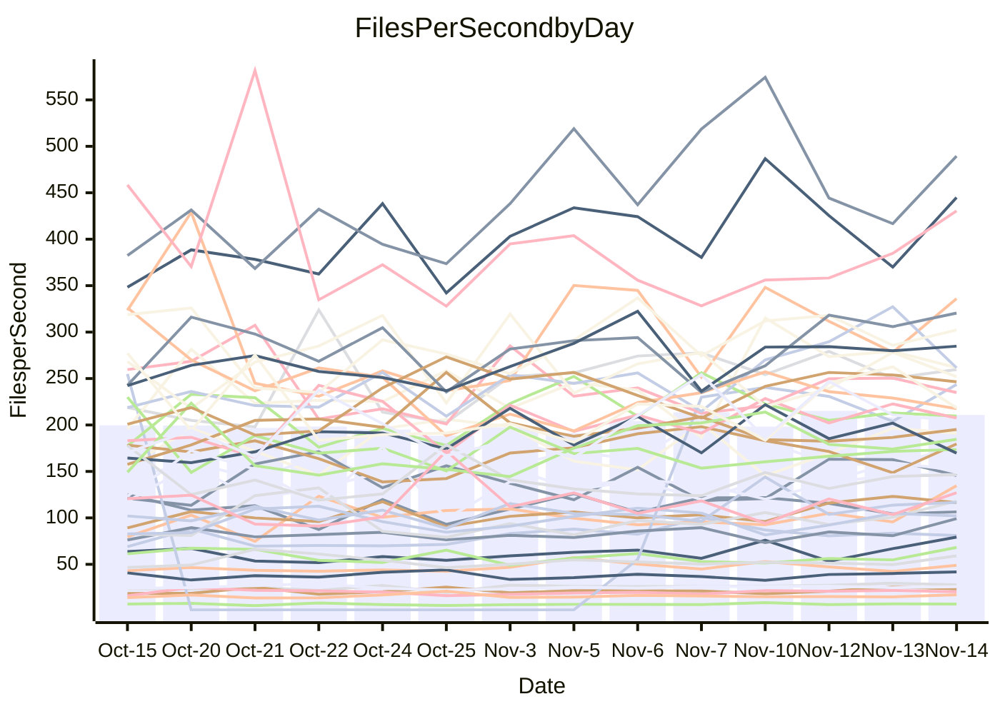

<!---
# This file is auto-generated. Do not edit.
# cspell:disable
--->
# Performance Report

Daily Performance

Time to Process Files

| Repository                                      | Elapsed | Min/Avg/Max          |    SD | SD Graph                |
| ----------------------------------------------- | ------: | :------------------: | ----: | ----------------------- |
| AdaDoom3/AdaDoom3                    |    2.49 | 1.7 /   2.8 /   3.5  |  0.52 | `    ┣━━┻●━╋━━┻━━┫    ` |
| alexiosc/megistos                    |    4.99 | 3.9 /   6.2 /   9.3  |  1.31 | `    ┣━━●━━╋━━┻━━┫    ` |
| apollographql/apollo-server          |    1.68 | 1.5 /   2.4 /   3.3  |  0.39 | `    ┣●━┻━━╋━━┻━━┫    ` |
| aspnetboilerplate/aspnetboilerplate  |    5.93 | 5.0 /   7.8 /  10.2  |  1.58 | `    ┣━●┻━━╋━━┻━━┫    ` |
| aws-amplify/docs                     |    8.69 | 7.4 /  12.2 /  15.4  |  2.43 | `    ┣●━┻━━╋━━┻━━┫    ` |
| Azure/azure-rest-api-specs           |    7.19 | 6.2 /   9.6 /  12.2  |  1.68 | `    ┣●━┻━━╋━━┻━━┫    ` |
| bitjson/typescript-starter           |    1.17 | 0.6 /   1.0 /   1.3  |  0.17 | `     ┣━┻━━╋━●┻━┫     ` |
| caddyserver/caddy                    |    3.15 | 2.5 /   3.9 /   4.9  |  0.72 | `    ┣━━●━━╋━━┻━━┫    ` |
| canada-ca/open-source-logiciel-libre |    0.75 | 0.7 /   1.0 /   1.4  |  0.17 | `     ┣●┻━━╋━━┻━┫     ` |
| chef/chef                            |    3.31 | 0.0 /   2.3 /   5.9  |  2.43 | `    ┣━━┻━━╋●━┻━━┫    ` |
| dart-lang/sdk                        |   44.32 | 34.1 /  56.0 /  76.1 | 10.09 | `  ┣━━━●━━━╋━━━┻━━━┫  ` |
| django/django                        |   11.29 | 7.6 /  12.6 /  15.6  |  2.30 | `    ┣━━┻●━╋━━┻━━┫    ` |
| eslint/eslint                        |    6.23 | 5.7 /   8.8 /  11.8  |  1.85 | `    ┣━●┻━━╋━━┻━━┫    ` |
| exonum/exonum                        |    2.90 | 2.1 /   3.0 /   3.9  |  0.54 | `    ┣━━┻━●╋━━┻━━┫    ` |
| flutter/samples                      |   12.22 | 6.6 /  10.3 /  14.0  |  2.16 | `    ┣━━┻━━╋━━●━━┫    ` |
| gitbucket/gitbucket                  |    3.47 | 2.0 /   3.1 /   4.5  |  0.62 | `    ┣━━┻━━╋━●┻━━┫    ` |
| googleapis/google-cloud-cpp          |  128.56 | 72.6 / 112.4 / 144.0 | 22.38 | `  ┣━━━┻━━━╋━━●┻━━━┫  ` |
| graphql/express-graphql              |    0.80 | 0.7 /   1.1 /   1.4  |  0.17 | `     ┣●┻━━╋━━┻━┫     ` |
| graphql/graphql-js                   |    2.97 | 2.1 /   3.3 /   4.4  |  0.65 | `    ┣━━┻●━╋━━┻━━┫    ` |
| graphql/graphql-relay-js             |    0.79 | 0.7 /   1.1 /   1.4  |  0.17 | `     ┣●┻━━╋━━┻━┫     ` |
| graphql/graphql-spec                 |    1.33 | 0.8 /   1.2 /   1.6  |  0.22 | `     ┣━┻━━╋●━┻━┫     ` |
| iluwatar/java-design-patterns        |    8.89 | 7.4 /  11.2 /  14.6  |  2.12 | `    ┣━━●━━╋━━┻━━┫    ` |
| ktaranov/sqlserver-kit               |    4.18 | 3.2 /   5.1 /   6.8  |  1.16 | `    ┣━━┻●━╋━━┻━━┫    ` |
| liriliri/licia                       |    4.03 | 2.2 /   3.6 /   4.7  |  0.70 | `    ┣━━┻━━╋━●┻━━┫    ` |
| MartinThoma/LaTeX-examples           |    6.55 | 3.8 /   5.7 /   7.5  |  1.05 | `    ┣━━┻━━╋━●┻━━┫    ` |
| mdx-js/mdx                           |    1.90 | 1.2 /   1.7 /   2.1  |  0.28 | `     ┣━┻━━╋●━┻━┫     ` |
| microsoft/TypeScript-Website         |    3.95 | 3.1 /   5.0 /   6.0  |  0.81 | `    ┣━●┻━━╋━━┻━━┫    ` |
| MicrosoftDocs/PowerShell-Docs        |   25.04 | 14.6 /  23.5 /  28.1 |  3.16 | `   ┣━━━┻━━╋━●┻━━━┫   ` |
| neovim/nvim-lspconfig                |    3.40 | 3.1 /   5.2 /  10.2  |  1.20 | `    ┣●━┻━━╋━━┻━━┫    ` |
| pagekit/pagekit                      |    2.08 | 2.0 /   3.2 /   4.1  |  0.58 | `    ●━━┻━━╋━━┻━━┫    ` |
| php/php-src                          |   25.62 | 13.9 /  22.2 /  28.0 |  4.22 | `   ┣━━━┻━━╋━━●━━━┫   ` |
| plasticrake/tplink-smarthome-api     |    0.86 | 0.8 /   1.2 /   1.6  |  0.22 | `     ┣●┻━━╋━━┻━┫     ` |
| prettier/prettier                    |    6.19 | 4.4 /   7.6 /   9.3  |  1.27 | `    ┣━━●━━╋━━┻━━┫    ` |
| pycontribs/jira                      |    1.13 | 1.0 /   1.4 /   1.9  |  0.22 | `     ┣━●━━╋━━┻━┫     ` |
| RustPython/RustPython                |   10.00 | 7.2 /  11.1 /  13.4  |  2.02 | `    ┣━━┻●━╋━━┻━━┫    ` |
| shoelace-style/shoelace              |    2.80 | 1.7 /   2.6 /   3.5  |  0.46 | `    ┣━━┻━━╋●━┻━━┫    ` |
| slint-ui/slint                       |   23.73 | 12.5 /  19.7 /  24.1 |  3.60 | `   ┣━━━┻━━╋━━┻●━━┫   ` |
| SoftwareBrothers/admin-bro           |    2.13 | 1.5 /   2.4 /   3.2  |  0.41 | `    ┣━━┻●━╋━━┻━━┫    ` |
| sveltejs/svelte                      |   17.47 | 13.4 /  22.5 / 100.8 | 11.21 | `   ┣━━┻━●━╋━━━┻━━┫   ` |
| TheAlgorithms/Python                 |    5.00 | 3.7 /   5.8 /   7.6  |  1.15 | `    ┣━━┻●━╋━━┻━━┫    ` |
| twbs/bootstrap                       |    2.30 | 1.2 /   1.8 /   2.5  |  0.30 | `     ┣━┻━━╋━━┻●┫     ` |
| typescript-cheatsheets/react         |    0.87 | 0.8 /   1.1 /   1.4  |  0.17 | `     ┣●┻━━╋━━┻━┫     ` |
| typescript-eslint/typescript-eslint  |    4.45 | 2.6 /   4.0 /   4.8  |  0.69 | `    ┣━━┻━━╋━●┻━━┫    ` |
| vitest-dev/vitest                    |    8.92 | 6.4 /  10.3 /  13.0  |  2.10 | `    ┣━━┻●━╋━━┻━━┫    ` |
| w3c/aria-practices                   |    3.42 | 2.1 /   3.0 /   4.2  |  0.55 | `    ┣━━┻━━╋━●┻━━┫    ` |
| w3c/specberus                        |    1.95 | 1.1 /   1.8 /   2.7  |  0.33 | `     ┣━┻━━╋●━┻━┫     ` |
| webdeveric/webpack-assets-manifest   |    1.25 | 0.8 /   1.2 /   1.6  |  0.17 | `     ┣━┻━━╋●━┻━┫     ` |
| webpack/webpack                      |    7.37 | 5.3 /   8.3 /  10.7  |  1.59 | `    ┣━━┻●━╋━━┻━━┫    ` |
| wireapp/wire-desktop                 |    1.18 | 0.9 /   1.4 /   1.9  |  0.25 | `     ┣━┻●━╋━━┻━┫     ` |
| wireapp/wire-webapp                  |   16.21 | 8.5 /  14.3 /  18.4  |  2.99 | `   ┣━━━┻━━╋━●┻━━━┫   ` |

Note:
- Elapsed time is in seconds.

Files per Second over Time

| Repository                                      | Files |    Sec |    Fps |     Rel | Trend Fps              |    N |
| ----------------------------------------------- | ----: | -----: | -----: | ------: | ---------------------- | ---: |
| AdaDoom3/AdaDoom3                    |   103 |   2.49 |  41.30 |   7.56% | `▁▂▄▇▂▄▇▅▇▁▂▂▂█▂▂▄▇▂▄` |   57 |
| alexiosc/megistos                    |   583 |   4.99 | 116.88 |  18.97% | `▅▄▂▂▅▄▃▃▅▂▅▆▇▅▅██▅▅▆` |   57 |
| apollographql/apollo-server          |   256 |   1.68 | 152.29 |  40.60% | `▂▃▃▆▆▃▅▆▃▄▃▄▇▃▃▇▇▃▃█` |   57 |
| aspnetboilerplate/aspnetboilerplate  |  2308 |   5.93 | 389.33 |  26.23% | `▆▄▂▄▂▅▄▂▂▄▂▂▄█▄▂▂▂█▆` |   57 |
| aws-amplify/docs                     |  3039 |   8.69 | 349.75 |  33.77% | `▃▂█▇▄▂█▆▆▂▆▅▅▂▂▄▂▄▄▆` |   57 |
| Azure/azure-rest-api-specs           |  2625 |   7.19 | 365.28 |  30.00% | `▄▃▂▂█▄▂▂▅▄▄▇▂▂▄▂▅▃▃▆` |   57 |
| bitjson/typescript-starter           |    20 |   1.17 |  17.16 | -15.85% | `▂▂█▂▂▄▇▂▄▄▃▃▄▆▂▂▃▂▆▂` |   57 |
| caddyserver/caddy                    |   414 |   3.15 | 131.24 |  21.71% | `▁▁▆▁▆▅█▄▂▆▄▁▅▄▃▂▄▆▂▅` |   57 |
| canada-ca/open-source-logiciel-libre |     7 |   0.75 |   9.37 |  33.98% | `▅▃▃▃▃▇▅▂▆▇▃▇▄▆▅▂▅▅▃█` |   57 |
| chef/chef                            |  1041 |   3.31 | 314.15 | 170.79% | `▅█▅▅▅▆▆▅▇▅▅▆▅▆▅▆▅▇██` |   56 |
| dart-lang/sdk                        | 11864 |  44.32 | 267.69 |  22.06% | `▄▅▄█▂▂▄▅█▄▆▆▇▂▃▃▃▅▆▆` |   57 |
| django/django                        |  2945 |  11.29 | 260.76 |   7.69% | `▃▅▂▂▄▇▄▂▂▄▄█▂▂▂▂▄▆▂▄` |   57 |
| eslint/eslint                        |  2090 |   6.23 | 335.67 |  34.57% | `▂▅▇▂▅▄█▄▇▄▄▃▄▂▄▂█▄▂▇` |   57 |
| exonum/exonum                        |   421 |   2.90 | 145.01 |   1.11% | `▂▇▂▇▁▅▅▇▂█▅▂█▂▇█▄▄▂▄` |   57 |
| flutter/samples                      |  1703 |  12.22 | 139.40 | -19.48% | `▂▃█▂▁▂▄▂▂▂▂▂▄█▃▁▃█▅▂` |   57 |
| gitbucket/gitbucket                  |   427 |   3.47 | 123.18 | -15.55% | `▅▃▃▇█▆▃▆█▂▆▆▅▂▅█▅▄▃▃` |   57 |
| googleapis/google-cloud-cpp          | 22119 | 128.56 | 172.05 | -16.44% | `▇█▂▇▂▇█▄▅▅▂▂▄▆▅▂█▂▂▂` |   57 |
| graphql/express-graphql              |    26 |   0.80 |  32.45 |  29.12% | `▃▄▄█▃█▅▆▃▆▂▃▃▄▂▃▇▃▅▇` |   57 |
| graphql/graphql-js                   |   562 |   2.97 | 189.26 |   7.95% | `▅▃▆▂▄▂▇▄▆▄▇▂▄▂▄▂█▆▄▄` |   57 |
| graphql/graphql-relay-js             |    28 |   0.79 |  35.32 |  32.80% | `▃▅▅▄▅▂█▄▃▂█▄▂▃▂▇▃▂▄▆` |   57 |
| graphql/graphql-spec                 |    19 |   1.33 |  14.26 |  -9.86% | `▄▇▃▃▂▁▂▂▄▂▄▅▂▄▅▄█▄▂▃` |   57 |
| iluwatar/java-design-patterns        |  2239 |   8.89 | 251.87 |  21.10% | `▅▂▂▂█▄▄▄▅▂▂██▄▅▅▄▂▂▆` |   57 |
| ktaranov/sqlserver-kit               |   490 |   4.18 | 117.25 |  14.32% | `▂▂▄▇█▄▃▄▃▂▄▂▄▇██▄▅█▅` |   57 |
| liriliri/licia                       |  1442 |   4.03 | 357.79 | -13.94% | `▅▁▇█▂▂▂▂▃▅▂▃▂▃▆▄▅▅▇▂` |   57 |
| MartinThoma/LaTeX-examples           |  1414 |   6.55 | 215.90 | -16.07% | `▄▄█▂▂█▂▇▂▃▂▅▄▆▅▅▅▄▂▂` |   57 |
| mdx-js/mdx                           |   139 |   1.90 |  73.17 | -10.47% | `▇▂▂▂▁█▃▂▇▄▂▆▅▃▂▆▄▇▂▃` |   57 |
| microsoft/TypeScript-Website         |   809 |   3.95 | 204.72 |  25.94% | `▇▃▂▂█▂▆▃▂▂▆▅▃▆▇▃▆▂▆█` |   57 |
| MicrosoftDocs/PowerShell-Docs        |  3127 |  25.04 | 124.89 |  -8.29% | `▂▂▂▅▂▄█▂▂▂▂▂▅▂▄▄█▂▂▂` |   57 |
| neovim/nvim-lspconfig                |   891 |   3.40 | 261.76 |  46.58% | `▄▅▅▂█▇▄▃▃█▄▅▄▅▃▄▃▅▅█` |   57 |
| pagekit/pagekit                      |   741 |   2.08 | 356.30 |  49.89% | `▂█▂▂▇▃▂▂█▄▅▂▄▂▂▂▂▄▄▇` |   57 |
| php/php-src                          |  2401 |  25.62 |  93.73 | -16.95% | `█▇▂▁▅▂▂▂▅▂▂▄▄▂▅▅▅██▂` |   57 |
| plasticrake/tplink-smarthome-api     |    62 |   0.86 |  71.83 |  35.42% | `▂▅▂▄▂▄▂▃▂▆▂▂▆▄▃▅▂▇██` |   57 |
| prettier/prettier                    |  2818 |   6.19 | 455.37 |  18.81% | `▂▂▂▂▅▂▄▂▂▄▄▄▂█▂▂▃▄▄▄` |   57 |
| pycontribs/jira                      |    78 |   1.13 |  68.88 |  18.46% | `▃▂▆▂▄▃▇▂▆▂▃▂▂▆▄▅▇▆█▆` |   57 |
| RustPython/RustPython                |  1077 |  10.00 | 107.71 |   7.85% | `▅▂▂▂▂▆█▂▂▂▄▇▅▄▂▆▅▄▂▅` |   57 |
| shoelace-style/shoelace              |   440 |   2.80 | 157.00 |  -9.29% | `▂▂▅▂▃▄▄▂▂▇▂▅▂█▂▂▆▂▂▃` |   57 |
| slint-ui/slint                       |  5152 |  23.73 | 217.14 | -17.84% | `▄▂▂▁▂▄▅█▂█▂▂▂▄▅▂▂▅▂▂` |   57 |
| SoftwareBrothers/admin-bro           |   441 |   2.13 | 207.36 |   8.31% | `▃▅▂▂▄▂▃▅▆█▃▃▃▂▃▂▂▃▃▅` |   57 |
| sveltejs/svelte                      |  9241 |  17.47 | 529.04 |  17.61% | `▅▄▆▅▆▆▇▁▅▅█▅▇█▇▆▅▆▅▇` |   57 |
| TheAlgorithms/Python                 |  1640 |   5.00 | 327.74 |  11.02% | `▇▂▅▄▂▆▂▂▁█▂▇▅▄▇▅▂▄▄▅` |   57 |
| twbs/bootstrap                       |   152 |   2.30 |  66.05 | -22.25% | `▄▃▃▃▄▆▄▂▄▂▂▄▄▆▅█▅▆▆▂` |   57 |
| typescript-cheatsheets/react         |    24 |   0.87 |  27.47 |  26.91% | `▃▄▂▄▃▃█▅▃▇▅▅▇▆▃▃▃█▃▇` |   57 |
| typescript-eslint/typescript-eslint  |   887 |   4.45 | 199.51 | -13.55% | `▃▂▆▃▃▇▇▃▂▆█▃▃█▆▃▂▃▃▃` |   57 |
| vitest-dev/vitest                    |  2963 |   8.92 | 332.17 |  11.10% | `▂▄▁█▂▁▄▂▂█▂▂▁▄▄▄▄▂▂▄` |   57 |
| w3c/aria-practices                   |   417 |   3.42 | 121.84 | -14.36% | `▃▃▅▇▂▅▅▃▃▅▅▃█▄▃█▄█▃▃` |   57 |
| w3c/specberus                        |   190 |   1.95 |  97.46 | -12.45% | `█▃▃▇▃▄▃▆▄▃▄▆▃▄▁▅▄█▆▄` |   57 |
| webdeveric/webpack-assets-manifest   |    55 |   1.25 |  44.15 |  -7.70% | `▄▆▅▃▄▃▃▄▁▅▃▂▃▅▃▄▅█▄▄` |   57 |
| webpack/webpack                      |  1545 |   7.37 | 209.77 |   8.65% | `▄▅▅▅▃▂█▂▃▂▅▂▄█▂▂▅▆▂▅` |   57 |
| wireapp/wire-desktop                 |    86 |   1.18 |  73.06 |  14.73% | `▂▃▂▃▂▁▃▅▃▄▄▆▄▇▄▄▇▇█▅` |   57 |
| wireapp/wire-webapp                  |  3138 |  16.21 | 193.55 |  -9.98% | `▅▃▂▃▄▂▅▂▃█▂▂▂▂▂▄▂▂█▃` |   57 |

Data Throughput

| Repository                                      | Files |    Sec |     Kps |     Rel | Trend Kps              |    N |
| ----------------------------------------------- | ----: | -----: | ------: | ------: | ---------------------- | ---: |
| AdaDoom3/AdaDoom3                    |   103 |   2.49 |  877.75 |   7.56% | `▁▂▄▇▂▄▇▅▇▁▂▂▂█▂▂▄▇▂▄` |   57 |
| alexiosc/megistos                    |   583 |   4.99 |  918.43 |  18.97% | `▅▄▂▂▅▄▃▃▅▂▅▆▇▅▅██▅▅▆` |   57 |
| apollographql/apollo-server          |   256 |   1.68 | 1258.16 |  40.64% | `▂▃▃▆▆▃▅▆▃▄▃▄▇▃▃▇▇▃▃█` |   57 |
| aspnetboilerplate/aspnetboilerplate  |  2308 |   5.93 |  960.51 |  26.25% | `▆▄▂▄▂▅▄▂▂▄▂▂▄█▄▂▂▂█▆` |   57 |
| aws-amplify/docs                     |  3039 |   8.69 | 1375.64 |  33.84% | `▃▂█▇▄▂█▆▆▂▆▅▅▂▂▄▂▄▄▆` |   57 |
| Azure/azure-rest-api-specs           |  2625 |   7.19 | 1167.10 |  31.33% | `▄▃▂▂█▄▂▂▅▄▄▇▂▂▄▂▅▃▃▆` |   57 |
| bitjson/typescript-starter           |    20 |   1.17 |   68.63 | -15.85% | `▂▂█▂▂▄▇▂▄▄▃▃▄▆▂▂▃▂▆▂` |   57 |
| caddyserver/caddy                    |   414 |   3.15 | 1283.52 |  22.23% | `▁▁▆▁▆▅█▄▂▆▄▁▅▄▃▂▄▆▂▅` |   57 |
| canada-ca/open-source-logiciel-libre |     7 |   0.75 |   77.60 |  33.98% | `▅▃▃▃▃▇▅▂▆▇▃▇▄▆▅▂▅▅▃█` |   57 |
| chef/chef                            |  1041 |   3.31 | 1548.12 |  35.98% | `▂█▂▁▂▄▃▂▆▂▁▃▂▄▂▄▂▅██` |   28 |
| dart-lang/sdk                        | 11864 |  44.32 | 1881.28 |  22.11% | `▄▅▄█▂▃▄▅█▄▆▆▇▂▃▃▃▅▆▆` |   57 |
| django/django                        |  2945 |  11.29 | 1694.61 |   7.74% | `▃▅▂▂▄▇▄▂▂▄▄█▂▂▂▂▄▆▂▄` |   57 |
| eslint/eslint                        |  2090 |   6.23 | 2378.13 |  34.60% | `▂▅▇▂▅▄█▄▇▄▄▃▄▂▄▂█▄▂▇` |   57 |
| exonum/exonum                        |   421 |   2.90 | 1387.08 |   1.11% | `▂▇▂▇▁▅▅▇▂█▅▂█▂▇█▄▄▂▄` |   57 |
| flutter/samples                      |  1703 |  12.22 |  830.92 | -19.48% | `▂▃█▂▁▂▄▂▂▂▂▂▄█▃▁▃█▅▂` |   57 |
| gitbucket/gitbucket                  |   427 |   3.47 |  608.13 | -15.42% | `▅▃▃▇█▆▃▆█▂▆▆▅▂▅█▅▄▃▃` |   57 |
| googleapis/google-cloud-cpp          | 22119 | 128.56 | 1514.01 | -16.22% | `▇█▂▇▂▇█▄▅▅▂▂▄▆▅▂█▂▂▂` |   57 |
| graphql/express-graphql              |    26 |   0.80 |  148.53 |  29.12% | `▃▄▄█▃█▅▆▃▆▂▃▃▄▂▃▇▃▅▇` |   57 |
| graphql/graphql-js                   |   562 |   2.97 | 1439.35 |   7.77% | `▅▃▆▂▄▂▇▄▆▄▇▂▄▂▄▂█▆▄▄` |   57 |
| graphql/graphql-relay-js             |    28 |   0.79 |  138.74 |  32.80% | `▃▅▅▄▅▂█▄▃▂█▄▂▃▂▇▃▂▄▆` |   57 |
| graphql/graphql-spec                 |    19 |   1.33 |  479.44 |  -9.86% | `▄▇▃▃▂▁▂▂▄▂▄▅▂▄▅▄█▄▂▃` |   57 |
| iluwatar/java-design-patterns        |  2239 |   8.89 |  781.49 |  21.10% | `▅▂▂▂█▄▄▄▅▂▂██▄▅▅▄▂▂▆` |   57 |
| ktaranov/sqlserver-kit               |   490 |   4.18 | 1776.95 |  14.33% | `▂▂▄▇█▄▃▄▃▂▄▂▄▇██▄▅█▅` |   57 |
| liriliri/licia                       |  1442 |   4.03 |  429.00 | -13.94% | `▅▁▇█▂▂▂▂▃▅▂▃▂▃▆▄▅▅▇▂` |   57 |
| MartinThoma/LaTeX-examples           |  1414 |   6.55 |  448.60 | -16.07% | `▄▄█▂▂█▂▇▂▃▂▅▄▆▅▅▅▄▂▂` |   57 |
| mdx-js/mdx                           |   139 |   1.90 |  344.78 | -10.47% | `▇▂▂▂▁█▃▂▇▄▂▆▅▃▂▆▄▇▂▃` |   57 |
| microsoft/TypeScript-Website         |   809 |   3.95 | 1266.01 |  13.29% | `▇▄▂▂█▃▆▃▃▃▆▆▃▄▅▂▄▁▅▆` |   57 |
| MicrosoftDocs/PowerShell-Docs        |  3127 |  25.04 | 1334.73 |  -8.29% | `▂▂▂▅▂▄█▂▂▂▂▂▅▂▄▄█▂▂▂` |   57 |
| neovim/nvim-lspconfig                |   891 |   3.40 |  830.53 |  46.88% | `▄▅▅▂█▇▄▃▃█▄▅▄▅▃▄▃▅▅█` |   57 |
| pagekit/pagekit                      |   741 |   2.08 |  742.90 |  49.89% | `▂█▂▂▇▃▂▂█▄▅▂▄▂▂▂▂▄▄▇` |   57 |
| php/php-src                          |  2401 |  25.62 | 1668.78 | -16.93% | `█▇▂▁▅▂▂▂▅▂▂▄▄▂▅▅▅██▂` |   57 |
| plasticrake/tplink-smarthome-api     |    62 |   0.86 |  388.12 |  35.42% | `▂▅▂▄▂▄▂▃▂▆▂▂▆▄▃▅▂▇██` |   57 |
| prettier/prettier                    |  2818 |   6.19 |  632.16 |  18.43% | `▂▂▂▂▅▂▄▂▂▄▄▄▂█▂▂▃▄▄▄` |   57 |
| pycontribs/jira                      |    78 |   1.13 |  619.05 |  35.79% | `▄▃▆▃▅▄▇▃▇▃▄▃▃▆▄▅▇▆█▆` |   57 |
| RustPython/RustPython                |  1077 |  10.00 | 3127.75 |   8.28% | `▅▂▂▂▂▆█▂▂▂▄▇▅▄▂▆▅▄▂▅` |   57 |
| shoelace-style/shoelace              |   440 |   2.80 |  758.25 |  -9.29% | `▂▂▅▂▃▄▄▂▂▇▂▅▂█▂▂▆▂▂▃` |   57 |
| slint-ui/slint                       |  5152 |  23.73 | 1299.33 | -17.66% | `▄▂▂▂▂▄▅█▂█▂▂▂▄▅▂▂▅▂▂` |   57 |
| SoftwareBrothers/admin-bro           |   441 |   2.13 |  457.04 |   8.31% | `▃▅▂▂▄▂▃▅▆█▃▃▃▂▃▂▂▃▃▅` |   57 |
| sveltejs/svelte                      |  9241 |  17.47 |  365.94 |  17.60% | `▅▄▆▅▆▆▇▁▅▅█▅▇█▇▆▅▆▅▇` |   57 |
| TheAlgorithms/Python                 |  1640 |   5.00 |  940.05 |  11.03% | `▇▂▅▄▂▆▂▂▁█▂▇▅▄▇▅▂▄▄▅` |   57 |
| twbs/bootstrap                       |   152 |   2.30 |  561.02 | -21.99% | `▄▃▃▃▄▆▄▂▄▂▂▄▄▆▅█▅▆▆▂` |   57 |
| typescript-cheatsheets/react         |    24 |   0.87 |  248.38 |  26.91% | `▃▄▂▄▃▃█▅▃▇▅▅▇▆▃▃▃█▃▇` |   57 |
| typescript-eslint/typescript-eslint  |   887 |   4.45 |  682.64 | -13.50% | `▃▃▆▃▃▇▇▃▂▆█▃▃█▆▃▂▃▃▃` |   57 |
| vitest-dev/vitest                    |  2963 |   8.92 | 1007.82 |  11.48% | `▂▄▁█▂▁▄▂▂█▂▂▁▄▄▄▄▂▂▄` |   57 |
| w3c/aria-practices                   |   417 |   3.42 | 1147.14 | -14.36% | `▃▃▅▇▂▅▅▃▃▅▅▃█▄▃█▄█▃▃` |   57 |
| w3c/specberus                        |   190 |   1.95 |  319.06 | -12.45% | `█▃▃▇▃▄▃▆▄▃▄▆▃▄▁▅▄█▆▄` |   57 |
| webdeveric/webpack-assets-manifest   |    55 |   1.25 |  101.94 |  -7.70% | `▄▆▅▃▄▃▃▄▁▅▃▂▃▅▃▄▅█▄▄` |   57 |
| webpack/webpack                      |  1545 |   7.37 | 1919.12 |  10.79% | `▄▅▅▅▃▂█▂▃▃▅▂▄█▂▂▅▆▃▅` |   57 |
| wireapp/wire-desktop                 |    86 |   1.18 |  321.14 |  14.80% | `▂▃▂▃▂▁▃▅▃▄▄▆▄▇▄▄▇▇█▅` |   57 |
| wireapp/wire-webapp                  |  3138 |  16.21 |  916.13 |  -9.78% | `▅▂▂▃▄▂▅▂▂█▂▂▂▂▂▄▂▂█▃` |   57 |

