<!---
# This file is auto-generated. Do not edit.
# cspell:disable
--->
# Performance Report

```mermaid
xychart-beta
    title Files Per Second by Day
    y-axis Files per Second
    x-axis Date [Sep-22, Sep-24, Sep-27, Sep-28, Sep-29, Sep-30, Oct-1, Oct-2, Oct-8, Oct-9, Oct-10, Oct-11, Oct-13, Oct-14, Oct-15, Oct-20, Oct-21]
    bar [203.41, 191.85, 190.34, 190.33, 191.42, 191.65, 187.17, 187.29, 194.39, 192.05, 218.83, 197.10, 195.24, 197.65, 199.65, 199.37, 196.79]
    line [121.18, 70.33, 81.37, 68.55, 70.46, 78.07, 69.43, 66.84, 65.37, 64.09, 65.74, 75.83, 77.12, 81.28, 76.22, 89.41, 79.60]
    line [15.06, 15.07, 17.30, 20.40, 18.84, 16.01, 18.80, 15.62, 18.14, 15.49, 15.23, 15.94, 13.89, 14.53, 14.11, 17.05, 13.85]
    line [56.03, 61.86, 55.07, 50.38, 50.26, 50.11, 43.90, 42.10, 56.81, 48.66, 45.19, 43.33, 48.66, 51.39, 43.09, 46.53, 43.54]
    line [6.48, 7.18, 7.27, 6.94, 7.83, 6.98, 6.40, 6.43, 8.18, 6.76, 7.44, 7.30, 6.32, 6.65, 7.26, 7.96, 5.55]
    line [470.19, 256.56, 257.27, 291.74, 296.65, 268.66, 245.94, 244.92, 242.23, 245.65, 270.12, 330.98, 278.79, 265.30, 323.42, 429.01, 245.01]
    line [155.16, 146.16, 150.57, 146.25, 172.87, 161.95, 149.25, 258.77, 151.43, 150.43, 254.02, 168.57, 231.71, 166.56, 155.07, 196.36, 171.90]
    line [77.71, 78.68, 74.59, 96.62, 94.86, 81.46, 69.18, 73.06, 66.65, 96.25, 112.51, 78.91, 82.77, 89.92, 69.05, 88.06, 69.61]
    line [254.54, 210.42, 205.10, 287.53, 207.85, 231.21, 200.22, 207.10, 331.74, 203.63, 192.81, 213.97, 213.28, 213.47, 195.94, 281.48, 223.48]
    line [144.59, 151.47, 163.76, 164.48, 145.07, 153.00, 154.07, 155.61, 136.07, 148.26, 141.19, 185.69, 154.55, 171.82, 141.67, 160.22, 141.81]
    line [55.17, 51.26, 53.54, 77.09, 47.84, 59.17, 54.01, 70.63, 55.18, 49.90, 84.72, 57.64, 57.38, 56.41, 61.33, 67.41, 66.13]
    line [166.11, 165.94, 180.17, 169.69, 179.61, 173.13, 150.88, 153.50, 149.45, 170.98, 162.38, 193.61, 167.04, 174.22, 149.10, 223.58, 156.27]
    line [72.96, 83.85, 90.86, 105.55, 94.80, 87.05, 82.35, 80.71, 82.95, 74.90, 76.80, 94.05, 96.82, 93.39, 82.69, 80.94, 123.93]
    line [21.10, 33.29, 22.21, 22.99, 25.81, 22.79, 21.40, 20.78, 24.57, 21.27, 19.07, 21.50, 21.24, 19.97, 18.63, 18.81, 25.32]
    line [253.01, 268.39, 293.97, 280.40, 292.26, 260.88, 404.51, 328.53, 305.64, 243.36, 444.70, 255.37, 254.42, 262.77, 318.79, 326.00, 239.93]
    line [99.03, 101.47, 103.27, 100.93, 105.22, 117.10, 120.39, 97.23, 97.90, 123.96, 100.36, 115.55, 122.73, 114.09, 102.09, 96.85, 112.31]
    line [105.51, 103.82, 101.18, 119.72, 101.30, 101.24, 103.40, 125.70, 125.48, 99.76, 158.05, 114.31, 137.32, 128.51, 125.12, 108.27, 113.06]
    line [449.44, 342.12, 376.67, 347.31, 443.48, 368.45, 332.70, 302.48, 422.03, 338.21, 306.48, 376.46, 318.53, 395.99, 458.46, 370.45, 581.53]
    line [277.45, 216.60, 208.75, 228.82, 225.46, 221.92, 198.17, 351.24, 197.76, 198.13, 208.30, 202.68, 201.79, 267.21, 259.65, 268.53, 307.28]
    line [182.34, 183.11, 178.48, 227.71, 175.37, 193.07, 180.70, 197.68, 174.97, 189.16, 226.87, 200.18, 179.39, 183.41, 164.40, 159.49, 171.10]
    line [205.09, 247.61, 251.50, 220.80, 227.59, 212.73, 213.55, 197.04, 208.25, 194.51, 251.63, 210.60, 231.31, 197.08, 254.89, 1.00, 1.00]
    line [221.75, 221.55, 237.73, 242.39, 246.40, 245.33, 214.25, 212.38, 215.08, 238.25, 274.47, 219.66, 252.51, 199.34, 218.85, 204.99, 197.92]
    line [196.97, 192.51, 179.82, 187.80, 186.23, 183.20, 182.62, 177.99, 183.70, 179.89, 233.14, 207.50, 218.41, 222.25, 177.43, 233.06, 229.37]
    line [50.42, 46.36, 61.34, 51.99, 46.51, 53.11, 48.59, 73.40, 59.94, 62.62, 55.56, 54.77, 45.21, 54.60, 46.67, 49.27, 66.25]
    line [117.29, 122.97, 147.55, 130.31, 120.84, 131.56, 115.38, 110.82, 116.53, 214.42, 116.00, 118.77, 144.83, 149.59, 117.74, 156.35, 121.08]
    line [249.23, 243.91, 273.74, 252.33, 270.33, 282.14, 249.68, 432.83, 249.77, 263.65, 247.10, 235.41, 323.97, 255.64, 242.67, 316.16, 297.94]
    line [22.79, 25.90, 22.55, 24.52, 26.32, 24.36, 24.04, 25.09, 23.35, 22.45, 21.51, 25.71, 29.42, 23.92, 24.25, 24.95, 26.96]
    line [35.26, 55.80, 33.99, 34.03, 41.23, 40.49, 30.44, 33.53, 33.57, 32.29, 33.27, 34.79, 37.33, 39.68, 40.77, 33.11, 37.81]
    line [177.91, 241.32, 177.39, 178.05, 221.01, 182.74, 163.48, 169.32, 168.97, 278.92, 166.54, 166.53, 170.79, 205.75, 183.07, 186.73, 165.39]
    line [76.31, 85.79, 97.01, 82.92, 84.16, 84.72, 77.34, 87.34, 75.86, 81.29, 136.91, 94.03, 101.02, 99.02, 79.59, 103.01, 74.73]
    line [20.13, 19.16, 18.74, 19.48, 22.38, 21.10, 27.10, 18.00, 23.58, 17.31, 20.37, 21.44, 22.38, 20.97, 16.04, 25.16, 22.03]
    line [168.42, 145.10, 149.37, 134.63, 171.73, 154.69, 140.49, 131.94, 134.65, 137.28, 142.04, 172.94, 162.65, 143.57, 178.30, 170.91, 182.97]
    line [226.40, 290.41, 225.84, 287.60, 216.33, 247.70, 277.53, 288.63, 233.16, 374.71, 397.16, 261.34, 217.24, 217.08, 218.73, 236.08, 220.88]
    line [78.73, 86.02, 82.17, 86.87, 92.07, 92.00, 84.24, 92.67, 106.68, 84.76, 82.82, 101.29, 118.90, 100.19, 82.72, 84.05, 109.59]
    line [98.57, 98.01, 93.82, 94.62, 89.71, 106.79, 118.50, 123.61, 91.76, 95.32, 93.61, 112.00, 123.43, 125.94, 120.60, 124.47, 93.34]
    line [179.83, 171.82, 219.08, 181.95, 180.26, 215.27, 175.03, 168.70, 269.72, 161.18, 172.81, 172.65, 208.47, 179.72, 157.56, 178.54, 204.92]
    line [113.84, 158.94, 91.50, 106.48, 102.03, 106.46, 94.98, 113.77, 93.63, 125.18, 87.00, 104.77, 109.42, 96.45, 89.22, 106.77, 99.95]
    line [220.97, 216.09, 223.67, 208.59, 258.02, 244.00, 208.42, 273.15, 264.14, 216.71, 266.75, 228.80, 223.08, 230.72, 200.81, 218.77, 189.13]
    line [366.33, 321.23, 484.87, 422.08, 444.64, 410.96, 351.78, 368.84, 361.47, 370.09, 351.86, 414.54, 417.07, 482.80, 348.28, 388.55, 378.31]
    line [50.54, 47.43, 56.40, 49.96, 64.67, 50.46, 44.40, 48.96, 71.61, 56.00, 55.29, 59.99, 68.80, 62.02, 63.75, 67.15, 53.54]
    line [140.55, 188.49, 125.20, 157.87, 127.91, 135.21, 124.24, 125.20, 125.79, 225.70, 154.24, 126.07, 127.29, 146.49, 121.12, 113.50, 158.05]
    line [249.81, 370.77, 255.08, 280.21, 227.10, 239.56, 208.40, 216.14, 204.22, 251.15, 211.26, 222.05, 242.35, 194.13, 326.19, 270.15, 236.87]
    line [163.66, 174.86, 123.76, 140.60, 149.87, 128.75, 160.37, 148.80, 127.97, 206.50, 122.84, 138.06, 149.67, 132.46, 123.48, 172.40, 152.34]
    line [398.12, 385.90, 416.89, 405.74, 428.96, 399.50, 398.65, 384.43, 625.58, 373.38, 382.28, 469.75, 409.07, 437.77, 382.49, 431.43, 368.45]
    line [25.29, 24.28, 26.03, 27.14, 29.89, 26.22, 25.83, 25.33, 31.76, 42.94, 27.61, 25.97, 34.21, 25.09, 23.71, 23.43, 25.33]
    line [154.00, 162.49, 123.69, 144.71, 125.72, 134.25, 127.46, 121.17, 173.95, 124.58, 216.72, 133.97, 123.87, 165.74, 177.89, 125.02, 140.68]
    line [234.84, 298.34, 266.72, 232.18, 229.70, 240.06, 392.72, 229.48, 222.78, 224.66, 204.36, 254.42, 277.26, 251.58, 268.24, 217.93, 267.67]
    line [133.29, 206.55, 172.23, 156.59, 180.95, 179.76, 145.22, 129.53, 157.39, 199.58, 152.82, 170.97, 185.75, 186.96, 229.89, 148.98, 188.53]
    line [220.86, 165.88, 186.63, 165.05, 169.83, 183.91, 159.55, 166.58, 162.12, 169.35, 265.31, 194.05, 178.95, 189.91, 170.29, 194.31, 165.66]
    line [197.54, 195.96, 190.07, 228.82, 222.46, 205.73, 192.21, 184.58, 245.51, 246.82, 245.36, 219.50, 226.50, 197.43, 277.21, 193.99, 275.35]
    line [243.96, 239.11, 261.23, 266.19, 247.38, 252.69, 432.16, 234.56, 233.40, 238.56, 234.64, 256.33, 219.99, 259.48, 242.38, 264.24, 274.64]
```

Daily Performance

Time to Process Files

| Repository                                      | Elapsed | Min/Avg/Max          |    SD | SD Graph                |
| ----------------------------------------------- | ------: | :------------------: | ----: | ----------------------- |
| AdaDoom3/AdaDoom3                    |    2.44 | 1.7 /   2.8 /   3.4  |  0.47 | `    ┣━━┻●━╋━━┻━━┫    ` |
| alexiosc/megistos                    |    5.42 | 3.9 /   6.7 /   8.1  |  1.09 | `    ┣━━●━━╋━━┻━━┫    ` |
| apollographql/apollo-server          |    1.95 | 1.4 /   2.4 /   3.1  |  0.40 | `    ┣━━●━━╋━━┻━━┫    ` |
| aspnetboilerplate/aspnetboilerplate  |    9.31 | 4.9 /   8.3 /   9.8  |  1.46 | `    ┣━━┻━━╋━●┻━━┫    ` |
| aws-amplify/docs                     |   14.14 | 7.4 /  12.6 /  14.6  |  2.09 | `   ┣━━━┻━━╋━●┻━━━┫   ` |
| Azure/azure-rest-api-specs           |   11.38 | 6.0 /  10.4 /  12.2  |  1.37 | `    ┣━━┻━━╋━●┻━━┫    ` |
| bitjson/typescript-starter           |    0.74 | 0.7 /   1.0 /   1.2  |  0.15 | `     ┣●┻━━╋━━┻━┫     ` |
| caddyserver/caddy                    |    3.49 | 2.2 /   3.6 /   4.6  |  0.63 | `    ┣━━┻━●╋━━┻━━┫    ` |
| canada-ca/open-source-logiciel-libre |    1.24 | 0.7 /   1.0 /   1.3  |  0.15 | `     ┣━┻━━╋━━┻●┫     ` |
| chef/chef                            |    0.00 | 0.0 /   4.5 /   5.5  |  1.28 | `●   ┣━━┻━━╋━━┻━━┫    ` |
| dart-lang/sdk                        |   42.85 | 38.8 /  56.0 /  65.4 |  7.47 | `  ┣●━━┻━━━╋━━━┻━━━┫  ` |
| django/django                        |    8.69 | 8.4 /  13.2 /  15.3  |  1.97 | `  ●┣━━━┻━━╋━━┻━━━┫   ` |
| eslint/eslint                        |   11.10 | 5.5 /   9.4 /  11.5  |  1.47 | `    ┣━━┻━━╋━━┻●━┫    ` |
| exonum/exonum                        |    3.77 | 2.0 /   3.3 /   3.8  |  0.50 | `    ┣━━┻━━╋━━●━━┫    ` |
| flutter/samples                      |   12.49 | 7.2 /  11.2 /  14.9  |  1.80 | `    ┣━━┻━━╋━●┻━━┫    ` |
| gitbucket/gitbucket                  |    3.83 | 1.9 /   3.2 /   3.8  |  0.47 | `    ┣━━┻━━╋━━┻●━┫    ` |
| googleapis/google-cloud-cpp          |  136.71 | 74.3 / 122.8 / 144.1 | 16.48 | `  ┣━━━┻━━━╋━━━●━━━┫  ` |
| graphql/express-graphql              |    1.26 | 0.7 /   1.1 /   1.3  |  0.15 | `     ┣━┻━━╋━━●━┫     ` |
| graphql/graphql-js                   |    4.09 | 2.1 /   3.3 /   4.0  |  0.56 | `    ┣━━┻━━╋━━┻●━┫    ` |
| graphql/graphql-relay-js             |    0.93 | 0.7 /   1.1 /   1.4  |  0.17 | `     ┣━┻●━╋━━┻━┫     ` |
| graphql/graphql-spec                 |    1.43 | 0.8 /   1.2 /   1.4  |  0.18 | `     ┣━┻━━╋━━●━┫     ` |
| iluwatar/java-design-patterns        |   12.63 | 8.0 /  12.4 /  14.6  |  1.70 | `    ┣━━┻━━●━━┻━━┫    ` |
| ktaranov/sqlserver-kit               |    6.60 | 3.5 /   5.6 /   6.8  |  0.89 | `    ┣━━┻━━╋━━●━━┫    ` |
| liriliri/licia                       |    4.50 | 2.4 /   3.6 /   4.5  |  0.59 | `    ┣━━┻━━╋━━┻●━┫    ` |
| MartinThoma/LaTeX-examples           |    7.46 | 4.3 /   6.2 /   7.4  |  0.77 | `    ┣━━┻━━╋━━┻━●┫    ` |
| mdx-js/mdx                           |    1.98 | 1.0 /   1.7 /   2.1  |  0.27 | `     ┣━┻━━╋━━●━┫     ` |
| microsoft/TypeScript-Website         |    5.39 | 3.1 /   4.9 /   6.3  |  0.67 | `    ┣━━┻━━╋━●┻━━┫    ` |
| MicrosoftDocs/PowerShell-Docs        |   24.61 | 14.4 /  23.0 /  29.6 |  3.56 | `   ┣━━━┻━━╋━●┻━━━┫   ` |
| neovim/nvim-lspconfig                |    5.72 | 3.1 /   5.2 /   6.6  |  0.83 | `    ┣━━┻━━╋━●┻━━┫    ` |
| pagekit/pagekit                      |    3.78 | 1.9 /   3.3 /   4.1  |  0.54 | `    ┣━━┻━━╋━━●━━┫    ` |
| php/php-src                          |   26.42 | 13.6 /  23.0 /  29.3 |  3.70 | `   ┣━━━┻━━╋━━●━━━┫   ` |
| plasticrake/tplink-smarthome-api     |    0.94 | 0.7 /   1.2 /   1.5  |  0.19 | `     ┣●┻━━╋━━┻━┫     ` |
| prettier/prettier                    |    4.85 | 4.4 /   7.5 /   9.0  |  1.23 | `   ●┣━━┻━━╋━━┻━━┫    ` |
| pycontribs/jira                      |    1.22 | 0.8 /   1.4 /   1.8  |  0.24 | `     ┣━┻●━╋━━┻━┫     ` |
| RustPython/RustPython                |    9.70 | 6.5 /  10.7 /  12.6  |  1.53 | `    ┣━━┻●━╋━━┻━━┫    ` |
| shoelace-style/shoelace              |    2.37 | 1.6 /   2.6 /   3.4  |  0.45 | `    ┣━━┻━●╋━━┻━━┫    ` |
| slint-ui/slint                       |   19.21 | 11.0 /  18.1 /  22.4 |  2.82 | `   ┣━━━┻━━╋●━┻━━━┫   ` |
| SoftwareBrothers/admin-bro           |    2.57 | 1.6 /   2.4 /   2.9  |  0.31 | `     ┣━┻━━╋━●┻━┫     ` |
| sveltejs/svelte                      |   26.16 | 13.2 /  22.2 /  25.4 |  2.97 | `   ┣━━━┻━━╋━━┻━●━┫   ` |
| TheAlgorithms/Python                 |    5.60 | 3.8 /   6.1 /   7.3  |  0.94 | `    ┣━━┻●━╋━━┻━━┫    ` |
| twbs/bootstrap                       |    1.67 | 1.0 /   1.7 /   2.3  |  0.31 | `     ┣━┻━━●━━┻━┫     ` |
| typescript-cheatsheets/react         |    1.22 | 0.7 /   1.1 /   1.4  |  0.18 | `     ┣━┻━━╋━●┻━┫     ` |
| typescript-eslint/typescript-eslint  |    4.52 | 2.4 /   3.8 /   4.8  |  0.71 | `    ┣━━┻━━╋━━●━━┫    ` |
| vitest-dev/vitest                    |   12.34 | 6.4 /  10.4 /  13.1  |  1.49 | `    ┣━━┻━━╋━━┻●━┫    ` |
| w3c/aria-practices                   |    2.70 | 2.0 /   3.1 /   3.6  |  0.46 | `    ┣━━┻●━╋━━┻━━┫    ` |
| w3c/specberus                        |    1.83 | 1.2 /   1.7 /   2.2  |  0.29 | `     ┣━┻━━╋●━┻━┫     ` |
| webdeveric/webpack-assets-manifest   |    1.31 | 0.7 /   1.1 /   1.4  |  0.14 | `     ┣━┻━━╋━━●━┫     ` |
| webpack/webpack                      |    9.55 | 5.0 /   7.9 /   9.9  |  1.36 | `    ┣━━┻━━╋━━┻●━┫    ` |
| wireapp/wire-desktop                 |    1.62 | 0.9 /   1.3 /   1.7  |  0.20 | `     ┣━┻━━╋━━┻●┫     ` |
| wireapp/wire-webapp                  |   11.76 | 9.1 /  14.1 /  16.4  |  1.84 | `   ┣━━●┻━━╋━━┻━━━┫   ` |

Note:
- Elapsed time is in seconds.

Files per Second over Time

| Repository                                      | Files |    Sec |    Fps |     Rel | Trend Fps              |    N |
| ----------------------------------------------- | ----: | -----: | -----: | ------: | ---------------------- | ---: |
| AdaDoom3/AdaDoom3                    |   103 |   2.44 |  42.23 |  12.41% | `▂▂▅▂▂▂▂▂▂▆▂█▂▂▄▅▃▂▂▅` |   46 |
| alexiosc/megistos                    |   583 |   5.42 | 107.65 |  18.67% | `▂▂▆▂▇▂▂▂▂▁█▂▃▅▄▂▂▃█▅` |   46 |
| apollographql/apollo-server          |   256 |   1.95 | 131.07 |  18.27% | `▄▂▂▂▂▂▅█▂▆▄█▁▂▂▃▂▂▂▅` |   46 |
| aspnetboilerplate/aspnetboilerplate  |  2308 |   9.31 | 247.94 | -14.32% | `▂▂▅█▂▃▂▇▂▂▅▂▄▂▂▄█▇▂▂` |   46 |
| aws-amplify/docs                     |  3039 |  14.14 | 214.94 | -14.07% | `▇█▂▂▆▂▆▁▁▂▁▂▁▁▂▂▁▃▂▁` |   45 |
| Azure/azure-rest-api-specs           |  2598 |  11.38 | 228.37 | -10.92% | `▃▂▂▃▅▃▃▅▂▂▂▂▃█▂▃▃▅▇▂` |   46 |
| bitjson/typescript-starter           |    20 |   0.74 |  26.88 |  28.15% | `▂▄▂▆▂▅▂█▅▅▅▂▂▇▅▁█▅▂▇` |   46 |
| caddyserver/caddy                    |   396 |   3.49 | 113.45 |   8.64% | `▅▂▂▃▂▂█▁▁▁█▂▄▁▂▂▅▂▁▄` |   46 |
| canada-ca/open-source-logiciel-libre |     7 |   1.24 |   5.67 | -19.49% | `▃▄▂▂█▆▃▄▃▂▄▂▁▂▇▄▃█▁▂` |   46 |
| chef/chef                            |     0 |   0.00 |   0.00 | -99.51% | `▆█▇▇▆█▆▇▇█▇▇▆▆▆█▁▁▁▁` |   46 |
| dart-lang/sdk                        | 11786 |  42.85 | 275.06 |  28.67% | `▅▅▂▅▂█▂▂▅▅▂▄▂▂▃▇▂▂▇▇` |   46 |
| django/django                        |  2935 |   8.69 | 337.61 |  48.11% | `▂▂▂▂▂▂▂▂▂▁▂▇▇▂▂▄▂█▅█` |   46 |
| eslint/eslint                        |  2087 |  11.10 | 188.09 | -17.62% | `▂▂▂▂▂▄▂▂▂▄▂▂▂▄▂▂█▂▄▁` |   46 |
| exonum/exonum                        |   421 |   3.77 | 111.76 | -16.08% | `█▂▂▂▂▂▁▂▂▄▅▅▂▂▇▂▇▂▃▁` |   46 |
| flutter/samples                      |  1703 |  12.49 | 136.32 | -13.24% | `▂▃▅█▅▃▃▃▃▅▄▂▃▃▄▅▆▂█▂` |   46 |
| gitbucket/gitbucket                  |   427 |   3.83 | 111.63 | -19.16% | `█▄▂▁▄▂▂▂▃▂▂▃▅▃▂▂▁▁▇▁` |   46 |
| googleapis/google-cloud-cpp          | 22069 | 136.71 | 161.43 | -12.17% | `▂██▅▂▂▃▂▂▄▂▂▄▂▅▂▂▅▂▂` |   46 |
| graphql/express-graphql              |    26 |   1.26 |  20.70 | -17.04% | `▂▂▂█▄▅▁▂▆█▂▂▂▆▂▃▂▅▇▁` |   46 |
| graphql/graphql-js                   |   551 |   4.09 | 134.56 | -21.74% | `▂█▂▄▁▆▂▂█▄▇▁▇▂▂▂▁▇▅▁` |   46 |
| graphql/graphql-relay-js             |    28 |   0.93 |  30.14 |  11.53% | `█▃▁▂▂▆▂▃▇▆▄▁▄▄▁▂▂▂▁▄` |   46 |
| graphql/graphql-spec                 |    19 |   1.43 |  13.25 | -18.64% | `▃▃▂▂█▄▃▁▁▂▂▂▅▁▁▂▇▂▂▁` |   46 |
| iluwatar/java-design-patterns        |  2239 |  12.63 | 177.22 |  -4.27% | `█▂▂▂▂▂▂▃▂▃▂▂▄▂█▃▂▄▁▃` |   46 |
| ktaranov/sqlserver-kit               |   490 |   6.60 |  74.23 | -17.50% | `▂█▂▂▃▅▇▂█▂▂▂█▅▂▂▇▁▂▁` |   46 |
| liriliri/licia                       |  1442 |   4.50 | 320.72 | -22.84% | `▃▂▂▁▅▄▃▇▂▅▄▅▄▅█▂▄▂▄▁` |   46 |
| MartinThoma/LaTeX-examples           |  1414 |   7.46 | 189.58 | -18.30% | `▄▅▂▅▂▃▂▃█▂▂▂▂▂▁▃▂▂▂▁` |   46 |
| mdx-js/mdx                           |   139 |   1.98 |  70.24 | -15.57% | `▅█▄▂▁▂▇▂▃▃▆█▆▂▂▂▄▄▂▂` |   46 |
| microsoft/TypeScript-Website         |   765 |   5.39 | 141.80 | -10.76% | `▃▂█▇▁▄▆▂▂▅▂▅▂▄▅▂▂▄▂▂` |   46 |
| MicrosoftDocs/PowerShell-Docs        |  3127 |  24.61 | 127.06 |  -9.08% | `▂█▄▂▂▂▃▄▃▂▂▇▄▇▂▆▂▂▄▂` |   46 |
| neovim/nvim-lspconfig                |   884 |   5.72 | 154.42 | -12.00% | `▃▃▆▄▂▂█▂▁▆▂▄▂▅▂▂▄▇▂▂` |   46 |
| pagekit/pagekit                      |   741 |   3.78 | 196.16 | -15.63% | `▃▅▇▂▂▁▃▅▂▅▂▂█▁▂▂▂▃▁▂` |   46 |
| php/php-src                          |  2392 |  26.42 |  90.54 | -15.93% | `▂▂▂▇▂▂▄▄▂▆▄█▂▃▄▄▆▃▂▂` |   46 |
| plasticrake/tplink-smarthome-api     |    62 |   0.94 |  66.14 |  23.62% | `▆▅█▂▂▂▇▅▁▂▃▂▆█▃▃▄▂▇▇` |   46 |
| prettier/prettier                    |  2768 |   4.85 | 570.35 |  50.99% | `▂▁▂▇▂▁▃▂▂▂▂▆▂▃▂▅▂▄██` |   46 |
| pycontribs/jira                      |    80 |   1.22 |  65.59 |  10.43% | `▂█▂▂▂▂▅▇▂▂▆▆▂▃▂▄█▃▅▅` |   46 |
| RustPython/RustPython                |  1048 |   9.70 | 108.04 |  14.98% | `▂▂▄▄▂▆▃▂▂█▅▄▄▄▁▂▂▂▄▄` |   46 |
| shoelace-style/shoelace              |   440 |   2.37 | 185.41 |   6.06% | `▅▂▂▅▂▂█▂▅▄▄█▂▃▄▇▃▂▅▄` |   46 |
| slint-ui/slint                       |  4753 |  19.21 | 247.41 |  -0.78% | `▂▁▂▂▆▄▂▂▂▂█▂▆▂▂▄▂▂▄▃` |   46 |
| SoftwareBrothers/admin-bro           |   441 |   2.57 | 171.69 |  -9.39% | `▃▆▃▄█▂▅▃▅▁▃▃▃▂▅▂▂▂▂▃` |   46 |
| sveltejs/svelte                      |  9212 |  26.16 | 352.19 | -16.16% | `▂▂▄▂▂▄▂█▁▄▂▁▇▂▂▂▁▄▂▁` |   46 |
| TheAlgorithms/Python                 |  1640 |   5.60 | 293.09 |   7.19% | `▃▂▁▂▂▂▂▁▅█▂▂▂▁▄▂█▁▄▄` |   46 |
| twbs/bootstrap                       |   152 |   1.67 |  91.18 |  18.70% | `▂▂▃▄█▃▂▂▂▄▅▃▄█▃▄█▃▃▆` |   46 |
| typescript-cheatsheets/react         |    24 |   1.22 |  19.66 | -12.25% | `▃▂▂▃▂▃▇▄▃▆▂▃▅▃▁▂▃▂█▃` |   46 |
| typescript-eslint/typescript-eslint  |   886 |   4.52 | 195.94 | -18.75% | `▄▂▂▂▃▅▂▃▁█▁▂▂▁▁▇█▂▅▂` |   46 |
| vitest-dev/vitest                    |  2900 |  12.34 | 235.08 | -15.53% | `▂█▂▂▂▂▂▄▂▄▁▄▂▂▂▄▄▅▂▂` |   46 |
| w3c/aria-practices                   |   417 |   2.70 | 154.39 |  10.16% | `█▂▂▂▇▁▂▄▄▆▂▂▄▁▄▂▇▄▄▄` |   46 |
| w3c/specberus                        |   190 |   1.83 | 103.55 |  -8.06% | `▃█▂▇▃▇▂▂▃█▇█▅▇▁▅▂▅▅▃` |   46 |
| webdeveric/webpack-assets-manifest   |    55 |   1.31 |  42.05 | -14.60% | `▅▄▄▃▃▂▂▄▂█▄▇▃▄█▃▄▄▄▂` |   45 |
| webpack/webpack                      |  1510 |   9.55 | 158.06 | -19.11% | `▂▃▂▅▂▃▃▂▄▂█▂▇▂▁▂▄▂▇▂` |   46 |
| wireapp/wire-desktop                 |    84 |   1.62 |  51.78 |  -8.78% | `▃▃▇▂▂▇▃▂█▆▂▃▃█▃▄▆▄▃▂` |   46 |
| wireapp/wire-webapp                  |  2760 |  11.76 | 234.69 |  19.33% | `▂▅█▁▂▂▆▂▂█▂▂▄█▂▂▇▂▄▅` |   46 |

Data Throughput

| Repository                                      | Files |    Sec |     Kps |     Rel | Trend Kps              |    N |
| ----------------------------------------------- | ----: | -----: | ------: | ------: | ---------------------- | ---: |
| AdaDoom3/AdaDoom3                    |   103 |   2.44 |  897.52 |  12.41% | `▂▂▅▂▂▂▂▂▂▆▂█▂▂▄▅▃▂▂▅` |   46 |
| alexiosc/megistos                    |   583 |   5.42 |  845.88 |  18.67% | `▂▂▆▂▇▂▂▂▂▁█▂▃▅▄▂▂▃█▅` |   46 |
| apollographql/apollo-server          |   256 |   1.95 | 1082.35 |  18.27% | `▄▂▂▂▂▂▅█▂▆▄█▁▂▂▃▂▂▂▅` |   46 |
| aspnetboilerplate/aspnetboilerplate  |  2308 |   9.31 |  611.69 | -13.82% | `▂▂▅█▂▃▂▇▂▂▅▂▄▂▂▄█▇▂▂` |   46 |
| aws-amplify/docs                     |  3039 |  14.14 |  844.28 | -14.10% | `▇█▂▂▆▂▆▁▁▂▁▂▁▁▂▂▁▃▂▁` |   45 |
| Azure/azure-rest-api-specs           |  2598 |  11.38 |  715.18 |  -9.45% | `▃▂▂▃▅▃▃▅▂▂▂▂▃█▂▃▃▅▇▂` |   46 |
| bitjson/typescript-starter           |    20 |   0.74 |  107.53 |  28.15% | `▂▄▂▆▂▅▂█▅▅▅▂▂▇▅▁█▅▂▇` |   46 |
| caddyserver/caddy                    |   396 |   3.49 | 1090.34 |  13.98% | `▅▂▂▃▂▂█▁▂▁█▂▅▂▂▂▅▂▂▄` |   46 |
| canada-ca/open-source-logiciel-libre |     7 |   1.24 |   46.95 | -19.49% | `▃▄▂▂█▆▃▄▃▂▄▂▁▂▇▄▃█▁▂` |   46 |
| chef/chef                            |  1037 |   4.07 | 1253.33 |  17.29% | `▄▄▃▄▃█▄▄▃▇▃▄▃█▆▃▃▂▃█` |   42 |
| dart-lang/sdk                        | 11786 |  42.85 | 1929.14 |  28.87% | `▅▅▂▅▂█▂▂▅▅▂▄▂▂▃▇▂▂▇▇` |   46 |
| django/django                        |  2935 |   8.69 | 2190.49 |  48.59% | `▂▂▂▂▂▂▂▂▂▁▂▇▇▂▂▄▂█▅█` |   46 |
| eslint/eslint                        |  2087 |  11.10 | 1330.68 | -17.52% | `▂▂▂▂▂▄▂▂▂▄▂▂▂▄▂▂█▂▄▁` |   46 |
| exonum/exonum                        |   421 |   3.77 | 1069.04 | -16.08% | `█▂▂▂▂▂▁▂▂▄▅▅▂▂▇▂▇▂▃▁` |   46 |
| flutter/samples                      |  1703 |  12.49 |  812.58 | -13.24% | `▂▃▅█▅▃▃▃▃▅▄▂▃▃▄▅▆▂█▂` |   46 |
| gitbucket/gitbucket                  |   427 |   3.83 |  546.64 | -19.37% | `█▄▂▁▄▂▂▂▃▂▂▃▄▃▂▂▁▁▇▁` |   46 |
| googleapis/google-cloud-cpp          | 22069 | 136.71 | 1410.50 | -12.11% | `▂██▅▂▂▃▂▂▄▂▂▄▂▅▂▂▅▂▂` |   46 |
| graphql/express-graphql              |    26 |   1.26 |   94.73 | -17.04% | `▂▂▂█▄▅▁▂▆█▂▂▂▆▂▃▂▅▇▁` |   46 |
| graphql/graphql-js                   |   551 |   4.09 | 1024.74 | -20.21% | `▂█▂▄▁▆▂▂█▄▇▁▇▂▂▂▂█▅▁` |   46 |
| graphql/graphql-relay-js             |    28 |   0.93 |  118.40 |  11.53% | `█▃▁▂▂▆▂▃▇▆▄▁▄▄▁▂▂▂▁▄` |   46 |
| graphql/graphql-spec                 |    19 |   1.43 |  445.71 | -18.64% | `▃▃▂▂█▄▃▁▁▂▂▂▅▁▁▂▇▂▂▁` |   46 |
| iluwatar/java-design-patterns        |  2239 |  12.63 |  549.88 |  -4.27% | `█▂▂▂▂▂▂▃▂▃▂▂▄▂█▃▂▄▁▃` |   46 |
| ktaranov/sqlserver-kit               |   490 |   6.60 | 1124.62 | -17.49% | `▂█▂▂▃▅▇▂█▂▂▂█▅▂▂▇▁▂▁` |   46 |
| liriliri/licia                       |  1442 |   4.50 |  384.56 | -22.84% | `▃▂▂▁▅▄▃▇▂▅▄▅▄▅█▂▄▂▄▁` |   46 |
| MartinThoma/LaTeX-examples           |  1414 |   7.46 |  393.92 | -18.24% | `▄▅▂▅▂▃▂▃█▂▂▂▂▂▁▃▂▂▂▁` |   46 |
| mdx-js/mdx                           |   139 |   1.98 |  331.00 | -15.57% | `▅█▄▂▁▂▇▂▃▃▆█▆▂▂▂▄▄▂▂` |   46 |
| microsoft/TypeScript-Website         |   765 |   5.39 |  977.98 | -10.75% | `▃▂█▇▁▄▆▂▂▅▂▅▂▄▅▂▂▄▂▂` |   46 |
| MicrosoftDocs/PowerShell-Docs        |  3127 |  24.61 | 1357.87 |  -9.08% | `▂█▄▂▂▂▃▄▃▂▂▇▄▇▂▆▂▂▄▂` |   46 |
| neovim/nvim-lspconfig                |   884 |   5.72 |  488.25 |  -8.34% | `▃▃▆▄▂▂█▂▁▆▂▅▂▅▂▂▄▇▂▂` |   46 |
| pagekit/pagekit                      |   741 |   3.78 |  408.99 | -15.63% | `▃▅▇▂▂▁▃▅▂▅▂▂█▁▂▂▂▃▁▂` |   46 |
| php/php-src                          |  2392 |  26.42 | 1611.72 | -15.72% | `▂▂▂▇▂▂▄▄▂▆▄█▂▃▄▄▆▃▂▂` |   46 |
| plasticrake/tplink-smarthome-api     |    62 |   0.94 |  357.36 |  23.62% | `▆▅█▂▂▂▇▅▁▂▃▂▆█▃▃▄▂▇▇` |   46 |
| prettier/prettier                    |  2768 |   4.85 |  797.42 |  50.11% | `▂▁▂█▂▁▃▂▂▂▂▆▂▃▂▅▂▄██` |   46 |
| pycontribs/jira                      |    80 |   1.22 |  463.21 |  10.43% | `▂█▂▂▂▂▅▇▂▂▆▆▂▃▂▄█▃▅▅` |   46 |
| RustPython/RustPython                |  1048 |   9.70 | 3109.58 |  15.40% | `▃▂▄▄▂▇▃▃▂█▅▄▄▄▂▂▂▂▄▄` |   46 |
| shoelace-style/shoelace              |   440 |   2.37 |  895.43 |   6.06% | `▅▂▂▅▂▂█▂▅▄▄█▂▃▄▇▃▂▅▄` |   46 |
| slint-ui/slint                       |  4753 |  19.21 | 1456.37 |   0.58% | `▂▁▂▂▆▄▂▂▂▂█▂▆▂▂▄▂▂▄▃` |   46 |
| SoftwareBrothers/admin-bro           |   441 |   2.57 |  378.41 |  -9.39% | `▃▆▃▄█▂▅▃▅▁▃▃▃▂▅▂▂▂▂▃` |   46 |
| sveltejs/svelte                      |  9212 |  26.16 |  243.38 | -16.16% | `▂▂▄▂▂▄▂█▁▄▂▁▇▂▂▂▁▄▂▁` |   46 |
| TheAlgorithms/Python                 |  1640 |   5.60 |  840.50 |   7.94% | `▃▂▁▂▂▂▂▁▅█▂▂▂▁▄▂█▁▄▄` |   46 |
| twbs/bootstrap                       |   152 |   1.67 |  768.45 |  21.07% | `▂▂▃▄█▃▂▂▂▄▆▃▄█▃▄█▃▃▆` |   46 |
| typescript-cheatsheets/react         |    24 |   1.22 |  177.76 | -12.25% | `▃▂▂▃▂▃▇▄▃▆▂▃▅▃▁▂▃▂█▃` |   46 |
| typescript-eslint/typescript-eslint  |   886 |   4.52 |  669.63 | -18.09% | `▄▂▂▂▃▅▂▃▁█▁▂▂▁▁▇█▂▅▂` |   46 |
| vitest-dev/vitest                    |  2900 |  12.34 |  707.03 | -13.68% | `▂█▂▂▂▂▂▄▂▄▁▄▂▂▂▄▄▅▂▂` |   46 |
| w3c/aria-practices                   |   417 |   2.70 | 1453.58 |  10.22% | `█▂▂▂▇▁▂▄▄▆▂▂▄▁▄▂▇▄▄▄` |   46 |
| w3c/specberus                        |   190 |   1.83 |  338.97 |  -8.06% | `▃█▂▇▃▇▂▂▃█▇█▅▇▁▅▂▅▅▃` |   46 |
| webdeveric/webpack-assets-manifest   |    55 |   1.31 |   97.09 | -14.60% | `▅▄▄▃▃▂▂▄▂█▄▇▃▄█▃▄▄▄▂` |   45 |
| webpack/webpack                      |  1510 |   9.55 | 1451.84 |  -7.51% | `▂▂▂▄▁▂▂▂▄▂█▂▇▂▂▂▅▃█▂` |   46 |
| wireapp/wire-desktop                 |    84 |   1.62 |  226.83 |  -5.01% | `▃▃▇▂▂▇▃▂█▆▂▃▃█▄▅▇▄▃▃` |   46 |
| wireapp/wire-webapp                  |  2760 |  11.76 | 1081.28 |  20.99% | `▂▅█▂▂▂▆▂▂█▂▂▄█▃▂▇▂▄▅` |   46 |

