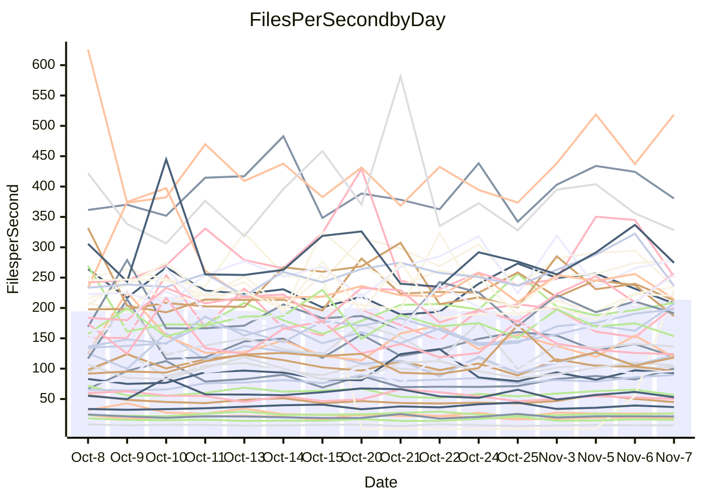

<!---
# This file is auto-generated. Do not edit.
# cspell:disable
--->
# Performance Report

Daily Performance

Time to Process Files

| Repository                                      | Elapsed | Min/Avg/Max          |    SD | SD Graph                |
| ----------------------------------------------- | ------: | :------------------: | ----: | ----------------------- |
| AdaDoom3/AdaDoom3                    |    2.55 | 1.8 /   2.9 /   3.5  |  0.45 | `    ┣━━┻●━╋━━┻━━┫    ` |
| alexiosc/megistos                    |    5.66 | 3.9 /   6.6 /   9.3  |  1.36 | `    ┣━━┻●━╋━━┻━━┫    ` |
| apollographql/apollo-server          |    2.75 | 1.4 /   2.5 /   3.3  |  0.42 | `    ┣━━┻━━╋━●┻━━┫    ` |
| aspnetboilerplate/aspnetboilerplate  |    9.05 | 5.1 /   8.0 /  10.2  |  1.61 | `    ┣━━┻━━╋━●┻━━┫    ` |
| aws-amplify/docs                     |   13.86 | 7.4 /  12.8 /  15.4  |  2.29 | `    ┣━━┻━━╋━●┻━━┫    ` |
| Azure/azure-rest-api-specs           |   10.44 | 6.2 /  10.0 /  12.2  |  1.75 | `    ┣━━┻━━╋●━┻━━┫    ` |
| bitjson/typescript-starter           |    1.13 | 0.7 /   1.0 /   1.3  |  0.17 | `     ┣━┻━━╋━●┻━┫     ` |
| caddyserver/caddy                    |    4.61 | 2.3 /   3.9 /   4.8  |  0.68 | `    ┣━━┻━━╋━━●━━┫    ` |
| canada-ca/open-source-logiciel-libre |    1.19 | 0.7 /   1.0 /   1.4  |  0.18 | `     ┣━┻━━╋━●┻━┫     ` |
| chef/chef                            |    5.32 | 0.0 /   2.0 /   5.5  |  2.35 | `    ┣━━┻━━╋━━┻●━┫    ` |
| dart-lang/sdk                        |   47.82 | 35.8 /  57.1 /  76.1 |  8.91 | `  ┣━━━●━━━╋━━━┻━━━┫  ` |
| django/django                        |   13.67 | 7.6 /  13.1 /  15.6  |  2.44 | `   ┣━━━┻━━╋●━┻━━━┫   ` |
| eslint/eslint                        |   10.60 | 5.8 /   9.5 /  11.8  |  1.65 | `    ┣━━┻━━╋━●┻━━┫    ` |
| exonum/exonum                        |    3.40 | 2.0 /   3.1 /   3.9  |  0.53 | `    ┣━━┻━━╋●━┻━━┫    ` |
| flutter/samples                      |   12.19 | 6.6 /  10.4 /  13.0  |  1.97 | `    ┣━━┻━━╋━━●━━┫    ` |
| gitbucket/gitbucket                  |    3.51 | 1.9 /   3.2 /   4.5  |  0.58 | `    ┣━━┻━━╋━●┻━━┫    ` |
| googleapis/google-cloud-cpp          |  101.82 | 72.6 / 118.0 / 144.0 | 21.03 | `  ┣━━━┻●━━╋━━━┻━━━┫  ` |
| graphql/express-graphql              |    0.99 | 0.7 /   1.1 /   1.4  |  0.18 | `     ┣━┻━●╋━━┻━┫     ` |
| graphql/graphql-js                   |    3.97 | 2.1 /   3.3 /   4.4  |  0.70 | `    ┣━━┻━━╋━━●━━┫    ` |
| graphql/graphql-relay-js             |    1.21 | 0.7 /   1.1 /   1.4  |  0.18 | `     ┣━┻━━╋━●┻━┫     ` |
| graphql/graphql-spec                 |    1.47 | 0.8 /   1.2 /   1.6  |  0.21 | `     ┣━┻━━╋━━●━┫     ` |
| iluwatar/java-design-patterns        |   10.34 | 7.4 /  11.7 /  14.6  |  2.14 | `    ┣━━┻●━╋━━┻━━┫    ` |
| ktaranov/sqlserver-kit               |    5.64 | 3.3 /   5.3 /   6.8  |  1.11 | `    ┣━━┻━━╋●━┻━━┫    ` |
| liriliri/licia                       |    3.40 | 2.3 /   3.6 /   4.7  |  0.67 | `    ┣━━┻━●╋━━┻━━┫    ` |
| MartinThoma/LaTeX-examples           |    5.24 | 3.8 /   6.0 /   7.5  |  1.05 | `    ┣━━┻●━╋━━┻━━┫    ` |
| mdx-js/mdx                           |    1.50 | 1.2 /   1.7 /   2.1  |  0.28 | `     ┣━┻●━╋━━┻━┫     ` |
| microsoft/TypeScript-Website         |    3.13 | 3.1 /   4.9 /   6.3  |  0.80 | `    ●━━┻━━╋━━┻━━┫    ` |
| MicrosoftDocs/PowerShell-Docs        |   25.62 | 14.4 /  23.4 /  28.1 |  3.37 | `   ┣━━━┻━━╋━●┻━━━┫   ` |
| neovim/nvim-lspconfig                |    4.55 | 3.1 /   5.2 /   6.8  |  1.01 | `    ┣━━┻●━╋━━┻━━┫    ` |
| pagekit/pagekit                      |    3.48 | 2.1 /   3.3 /   4.1  |  0.59 | `    ┣━━┻━━╋●━┻━━┫    ` |
| php/php-src                          |   21.24 | 13.6 /  22.3 /  28.0 |  4.21 | `   ┣━━━┻━●╋━━┻━━━┫   ` |
| plasticrake/tplink-smarthome-api     |    1.13 | 0.8 /   1.2 /   1.6  |  0.22 | `     ┣━┻━●╋━━┻━┫     ` |
| prettier/prettier                    |    8.64 | 4.5 /   7.6 /   9.3  |  1.30 | `    ┣━━┻━━╋━━●━━┫    ` |
| pycontribs/jira                      |    1.49 | 0.9 /   1.4 /   1.9  |  0.23 | `     ┣━┻━━╋●━┻━┫     ` |
| RustPython/RustPython                |    9.89 | 6.5 /  10.6 /  13.3  |  2.04 | `    ┣━━┻━●╋━━┻━━┫    ` |
| shoelace-style/shoelace              |    2.44 | 1.7 /   2.6 /   3.5  |  0.47 | `    ┣━━┻━●╋━━┻━━┫    ` |
| slint-ui/slint                       |   17.81 | 11.7 /  18.8 /  23.4 |  3.55 | `   ┣━━━┻━●╋━━┻━━━┫   ` |
| SoftwareBrothers/admin-bro           |    2.69 | 1.5 /   2.4 /   3.2  |  0.39 | `    ┣━━┻━━╋━●┻━━┫    ` |
| sveltejs/svelte                      |   24.38 | 13.2 /  21.6 /  27.1 |  4.09 | `   ┣━━━┻━━╋━●┻━━━┫   ` |
| TheAlgorithms/Python                 |    6.89 | 3.9 /   6.1 /   7.6  |  1.08 | `    ┣━━┻━━╋━●┻━━┫    ` |
| twbs/bootstrap                       |    1.36 | 1.1 /   1.9 /   2.3  |  0.30 | `     ●━┻━━╋━━┻━┫     ` |
| typescript-cheatsheets/react         |    1.26 | 0.8 /   1.2 /   1.4  |  0.17 | `     ┣━┻━━╋●━┻━┫     ` |
| typescript-eslint/typescript-eslint  |    3.73 | 2.5 /   4.1 /   4.8  |  0.69 | `    ┣━━┻━●╋━━┻━━┫    ` |
| vitest-dev/vitest                    |   11.48 | 6.4 /  10.5 /  13.1  |  2.02 | `    ┣━━┻━━╋━●┻━━┫    ` |
| w3c/aria-practices                   |    3.56 | 2.0 /   3.0 /   4.2  |  0.57 | `    ┣━━┻━━╋━━●━━┫    ` |
| w3c/specberus                        |    1.49 | 1.2 /   1.7 /   2.3  |  0.33 | `     ┣━┻●━╋━━┻━┫     ` |
| webdeveric/webpack-assets-manifest   |    1.22 | 0.8 /   1.2 /   1.4  |  0.16 | `     ┣━┻━━╋●━┻━┫     ` |
| webpack/webpack                      |    5.71 | 5.3 /   8.3 /  10.4  |  1.60 | `    ┣●━┻━━╋━━┻━━┫    ` |
| wireapp/wire-desktop                 |    1.36 | 0.9 /   1.4 /   1.7  |  0.24 | `     ┣━┻━━●━━┻━┫     ` |
| wireapp/wire-webapp                  |    8.48 | 8.8 /  13.7 /  18.3  |  2.77 | `   ┣●━━┻━━╋━━┻━━━┫   ` |

Note:
- Elapsed time is in seconds.

Files per Second over Time

| Repository                                      | Files |    Sec |    Fps |     Rel | Trend Fps              |    N |
| ----------------------------------------------- | ----: | -----: | -----: | ------: | ---------------------- | ---: |
| AdaDoom3/AdaDoom3                    |   103 |   2.55 |  40.43 |   8.70% | `▅▂▂▂▂▆▂▄█▂▂█▂▄▂▃▅▃▂▄` |   49 |
| alexiosc/megistos                    |   583 |   5.66 | 103.07 |  10.32% | `▂█▂▃▂▂▅▇▂▅▇▅▆▂▁▃▃▂▃▅` |   49 |
| apollographql/apollo-server          |   256 |   2.75 |  93.07 | -13.99% | `▃▃▃▅▂▄▃▃▅▄▃▁▃▂▂▃█▃▃▂` |   49 |
| aspnetboilerplate/aspnetboilerplate  |  2308 |   9.05 | 255.00 | -15.74% | `▂▂▅▇▅▂██▆▇▃▅█▂▂▅▅▇▂▂` |   49 |
| aws-amplify/docs                     |  3039 |  13.86 | 219.25 | -11.70% | `▂▁▂▅▄▂▁▃▂▅▂▂▄█▂▃▂▂▂▂` |   49 |
| Azure/azure-rest-api-specs           |  2607 |  10.44 | 249.78 |  -7.83% | `▄▂▄▅▁▄▄▂█▂▇▇▂█▆▂▂▇▂▂` |   49 |
| bitjson/typescript-starter           |    20 |   1.13 |  17.76 | -12.44% | `▃▃▂█▃▃▃▂▃▅▅▁▄▇▃▂█▃▃▃` |   49 |
| caddyserver/caddy                    |   402 |   4.61 |  87.23 | -15.55% | `▂▆▂▂▅▂▇▂▂▅▄█▂▁▂▂▁▂▅▂` |   49 |
| canada-ca/open-source-logiciel-libre |     7 |   1.19 |   5.90 | -14.55% | `▃█▅▂▇▅▂▄▃▂▅▇▅▅▂▂▅▃▅▃` |   49 |
| chef/chef                            |  1040 |   5.32 | 195.59 | 106.52% | `▁▁▁▁▁▁▁▁▁▁▁▁▁▁▁▁▇█▇▅` |   48 |
| dart-lang/sdk                        | 11839 |  47.82 | 247.58 |  16.53% | `▃▂▃▂▂▃▁▂█▅▃▄▂▃▃▃▅▅▃▅` |   49 |
| django/django                        |  2941 |  13.67 | 215.14 |  -8.59% | `▂█▁▆▁▃▁▃▂▃▂▂▁▆▇▄▁▁▂▂` |   49 |
| eslint/eslint                        |  2087 |  10.60 | 196.91 | -13.96% | `▂▂▂▇▄▂▅███▂▂▂▂▁▂▂▂▁▂` |   49 |
| exonum/exonum                        |   421 |   3.40 | 123.76 | -11.02% | `█▅▂▁▂▅▅▂▄▂▂▂█▂▆▃▇▅▂▃` |   49 |
| flutter/samples                      |  1703 |  12.19 | 139.70 | -17.86% | `▃▃▄▆▂▅▂▅▅▁▄▂▆▃█▂▇▆█▂` |   49 |
| gitbucket/gitbucket                  |   427 |   3.51 | 121.82 | -13.28% | `▃▃▂▃▃▃▃█▂▅▂▅██▅▁▅▅▂▃` |   49 |
| googleapis/google-cloud-cpp          | 22116 | 101.82 | 217.21 |  11.39% | `▂▂▂▂▂▂▁▄▂▂▂▁▁▅▇▂█▇█▄` |   49 |
| graphql/express-graphql              |    26 |   0.99 |  26.32 |   5.14% | `▂▆▁█▂▂▆▂▂▃▁▃▂█▂▄▄▄▄▄` |   49 |
| graphql/graphql-js                   |   556 |   3.97 | 140.06 | -20.52% | `▅█▇▂▁▂▂▂▂▄▂▂▂▂▂▂▄▂█▂` |   49 |
| graphql/graphql-relay-js             |    28 |   1.21 |  23.12 | -13.80% | `▂▃▂▃▆▃▄▆▃▃▃▄▃▃▂▂▃█▅▂` |   49 |
| graphql/graphql-spec                 |    19 |   1.47 |  12.89 | -17.90% | `▁▂▂▂▆▂▂█▃▃▅▄▃▆▂▂█▂▅▂` |   49 |
| iluwatar/java-design-patterns        |  2239 |  10.34 | 216.54 |   9.08% | `█▃▄▂▂▅▃█▂▄▁▅▄▄▂▆▂▅▂▄` |   49 |
| ktaranov/sqlserver-kit               |   490 |   5.64 |  86.84 | -11.52% | `▂█▂▂▁▇▆▄▇▂▂▄▂▂▅▁▂▃▄▂` |   49 |
| liriliri/licia                       |  1442 |   3.40 | 424.21 |   2.69% | `▂▂▇█▂▂▁▄▂▂▂▂▇▇▂█▂▃▂▄` |   49 |
| MartinThoma/LaTeX-examples           |  1414 |   5.24 | 269.85 |  10.90% | `▃▇▆▄▂▆▂▂▇▂▂█▂█▅▅▅▄▅▄` |   49 |
| mdx-js/mdx                           |   139 |   1.50 |  92.47 |  12.74% | `▅▄▆▅█▂▂▄▇▃▄▂▆▄▆▂▂▂█▅` |   49 |
| microsoft/TypeScript-Website         |   765 |   3.13 | 244.63 |  51.35% | `▇▂▄▄▇▂▃▇▄▃▃▅▃▂▂▂▅▄▄█` |   49 |
| MicrosoftDocs/PowerShell-Docs        |  3127 |  25.62 | 122.05 | -10.92% | `▄▄█▄▄▂█▃█▅▃▄▅▄▄▂▄▄▄▄` |   49 |
| neovim/nvim-lspconfig                |   889 |   4.55 | 195.38 |  10.27% | `▂▂▂▂▄▂▅▇▄▁▂▇▂▂█▆▄▂▅▄` |   49 |
| pagekit/pagekit                      |   741 |   3.48 | 213.14 |  -8.24% | `▅▆▄▂▂▅▇▂▂▂▂▄▂▂▄▁▅█▂▂` |   49 |
| php/php-src                          |  2403 |  21.24 | 113.14 |   0.79% | `▂▁▇▂▅█▅▂▂▂▅▂▂▇▂▇▂▂▅▄` |   49 |
| plasticrake/tplink-smarthome-api     |    62 |   1.13 |  54.86 |   2.48% | `▂▂▃▁▆▁██▆▂▂▂▂▂▃▇▂▅▂▄` |   49 |
| prettier/prettier                    |  2791 |   8.64 | 322.95 | -14.75% | `▂▂▂▅▅█▃▂▅▂▂▂▆▂▁▂▄▆▂▂` |   49 |
| pycontribs/jira                      |    80 |   1.49 |  53.67 |  -7.86% | `▃▃▅▂▅▄▂█▃▇▃▅▄▃█▅▂▅▃▃` |   49 |
| RustPython/RustPython                |  1069 |   9.89 | 108.09 |   6.07% | `▂▁▂▇▅▁▁▁▇▂█▇▁▄█▁▄▄▃▄` |   49 |
| shoelace-style/shoelace              |   440 |   2.44 | 180.00 |   2.30% | `█▂▂▂▅▂▇▂▃▅▄▂▃▅▆▂▃▇▁▄` |   49 |
| slint-ui/slint                       |  5027 |  17.81 | 282.23 |   6.63% | `▄█▂▂▂▂▄▂▂▄▇▃▂█▂▂█▂▄▄` |   49 |
| SoftwareBrothers/admin-bro           |   441 |   2.69 | 163.80 | -15.11% | `▆▃▃▂▂▂▅▄▃█▁▃▃▅▂▃██▃▂` |   49 |
| sveltejs/svelte                      |  9223 |  24.38 | 378.35 | -14.92% | `▅▄▄█▂▂▇▂▂▄▂▆▂█▂▂▂▂█▂` |   49 |
| TheAlgorithms/Python                 |  1640 |   6.89 | 238.02 | -14.74% | `▂▂▂▆▆▃▂▂▄▄▄▂▃▁▂▅█▇▂▂` |   49 |
| twbs/bootstrap                       |   152 |   1.36 | 111.79 |  39.39% | `▆▂▅▂▃▂▂▂▄▅▄▄▄█▃▃▄▂▂▇` |   49 |
| typescript-cheatsheets/react         |    24 |   1.26 |  19.07 |  -9.54% | `▄▃▂█▃▂▆▃▇▂▅▃▅▃▅█▃▂▅▃` |   49 |
| typescript-eslint/typescript-eslint  |   887 |   3.73 | 237.55 |   5.15% | `▃▄▂▂▃▂▁▂█▄▃▃▃▂▃▁▅▂▄▄` |   49 |
| vitest-dev/vitest                    |  2948 |  11.48 | 256.89 | -11.22% | `▂▁▂▆▂▂▄█▄▂█▂█▂█▂█▂▃▂` |   49 |
| w3c/aria-practices                   |   417 |   3.56 | 117.23 | -17.99% | `█▃▂▂▇▅▃▄▃▂▄▆▃▇▅▂▅▄▅▂` |   49 |
| w3c/specberus                        |   190 |   1.49 | 127.67 |  10.50% | `█▃▃▂▇▇▇▃▂▅▄▄▃▂▂▃▇▃▄▅` |   49 |
| webdeveric/webpack-assets-manifest   |    55 |   1.22 |  45.20 |  -6.15% | `▂▂▂█▃▇█▄▇▂█▂▂▃▇▂▂▂▃▃` |   49 |
| webpack/webpack                      |  1540 |   5.71 | 269.49 |  40.10% | `█▂▂▂▃▄▄▂▄▄▁▁█▂▂▂▇▇▁▇` |   49 |
| wireapp/wire-desktop                 |    86 |   1.36 |  63.42 |   3.14% | `▂▄▂▅▇▃▃▂▂▂▂▆▃▂▄▆██▂▄` |   49 |
| wireapp/wire-webapp                  |  2803 |   8.48 | 330.69 |  55.17% | `▇▂▇█▂▇▁▂▂▃▂██▂▂▄▂▂▂█` |   49 |

Data Throughput

| Repository                                      | Files |    Sec |     Kps |     Rel | Trend Kps              |    N |
| ----------------------------------------------- | ----: | -----: | ------: | ------: | ---------------------- | ---: |
| AdaDoom3/AdaDoom3                    |   103 |   2.55 |  859.18 |   8.70% | `▅▂▂▂▂▆▂▄█▂▂█▂▄▂▃▅▃▂▄` |   49 |
| alexiosc/megistos                    |   583 |   5.66 |  809.88 |  10.32% | `▂█▂▃▂▂▅▇▂▅▇▅▆▂▁▃▃▂▃▅` |   49 |
| apollographql/apollo-server          |   256 |   2.75 |  768.57 | -13.99% | `▃▃▃▅▂▄▃▃▅▄▃▁▃▂▂▃█▃▃▂` |   49 |
| aspnetboilerplate/aspnetboilerplate  |  2308 |   9.05 |  629.10 | -15.58% | `▂▂▅▇▅▂██▆▇▃▅█▂▂▅▅▇▂▂` |   49 |
| aws-amplify/docs                     |  3039 |  13.86 |  861.70 | -11.69% | `▂▁▂▅▄▂▁▃▂▅▂▂▄█▂▃▂▂▂▂` |   49 |
| Azure/azure-rest-api-specs           |  2607 |  10.44 |  785.93 |  -7.12% | `▄▂▄▅▁▄▄▂█▃▇▇▂█▆▂▂▇▂▂` |   49 |
| bitjson/typescript-starter           |    20 |   1.13 |   71.06 | -12.44% | `▃▃▂█▃▃▃▂▃▅▅▁▄▇▃▂█▃▃▃` |   49 |
| caddyserver/caddy                    |   402 |   4.61 |  852.13 | -13.85% | `▃▆▂▂▅▂▇▃▂▅▅█▂▂▂▂▂▂▅▂` |   49 |
| canada-ca/open-source-logiciel-libre |     7 |   1.19 |   48.87 | -14.55% | `▃█▅▂▇▅▂▄▃▂▅▇▅▅▂▂▅▃▅▃` |   49 |
| chef/chef                            |  1040 |   5.32 |  964.24 | -13.23% | `▂▄▂▃▂▄▂▂▂▅▄▂▂▁▂▅▆█▅▂` |   20 |
| dart-lang/sdk                        | 11839 |  47.82 | 1739.93 |  16.75% | `▃▂▃▂▂▃▁▂█▅▃▄▂▃▃▃▅▅▃▅` |   49 |
| django/django                        |  2941 |  13.67 | 1397.88 |  -8.45% | `▂█▁▆▁▃▁▃▂▃▂▂▁▆▇▄▁▁▂▂` |   49 |
| eslint/eslint                        |  2087 |  10.60 | 1395.37 | -13.87% | `▂▂▂▇▄▂▅███▂▂▂▂▁▂▂▂▁▂` |   49 |
| exonum/exonum                        |   421 |   3.40 | 1183.79 | -11.02% | `█▅▂▁▂▅▅▂▄▂▂▂█▂▆▃▇▅▂▃` |   49 |
| flutter/samples                      |  1703 |  12.19 |  832.70 | -17.86% | `▃▃▄▆▂▅▂▅▅▁▄▂▆▃█▂▇▆█▂` |   49 |
| gitbucket/gitbucket                  |   427 |   3.51 |  601.40 | -12.89% | `▃▃▂▃▃▃▃█▂▅▂▅██▅▁▅▅▂▃` |   49 |
| googleapis/google-cloud-cpp          | 22116 | 101.82 | 1905.14 |  11.64% | `▂▂▂▂▂▂▁▄▂▂▂▁▁▅▇▂█▇█▄` |   49 |
| graphql/express-graphql              |    26 |   0.99 |  120.44 |   5.14% | `▂▆▁█▂▂▆▂▂▃▁▃▂█▂▄▄▄▄▄` |   49 |
| graphql/graphql-js                   |   556 |   3.97 | 1070.07 | -19.77% | `▅█▇▂▁▂▂▂▂▄▂▂▂▂▂▂▄▂█▂` |   49 |
| graphql/graphql-relay-js             |    28 |   1.21 |   90.83 | -13.80% | `▂▃▂▃▆▃▄▆▃▃▃▄▃▃▂▂▃█▅▂` |   49 |
| graphql/graphql-spec                 |    19 |   1.47 |  433.67 | -17.90% | `▁▂▂▂▆▂▂█▃▃▅▄▃▆▂▂█▂▅▂` |   49 |
| iluwatar/java-design-patterns        |  2239 |  10.34 |  671.88 |   9.08% | `█▃▄▂▂▅▃█▂▄▁▅▄▄▂▆▂▅▂▄` |   49 |
| ktaranov/sqlserver-kit               |   490 |   5.64 | 1316.02 | -11.51% | `▂█▂▂▁▇▆▄▇▂▂▄▂▂▅▁▂▃▄▂` |   49 |
| liriliri/licia                       |  1442 |   3.40 |  508.64 |   2.69% | `▂▂▇█▂▂▁▄▂▂▂▂▇▇▂█▂▃▂▄` |   49 |
| MartinThoma/LaTeX-examples           |  1414 |   5.24 |  560.68 |  10.90% | `▃▇▆▄▂▆▂▂▇▂▂█▂█▅▅▅▄▅▄` |   49 |
| mdx-js/mdx                           |   139 |   1.50 |  435.74 |  12.74% | `▅▄▆▅█▂▂▄▇▃▄▂▆▄▆▂▂▂█▅` |   49 |
| microsoft/TypeScript-Website         |   765 |   3.13 | 1688.14 |  51.39% | `▇▂▄▄▇▂▃▇▄▃▃▅▃▂▂▂▅▄▄█` |   49 |
| MicrosoftDocs/PowerShell-Docs        |  3127 |  25.62 | 1304.33 | -10.92% | `▄▄█▄▄▂█▃█▅▃▄▅▄▄▂▄▄▄▄` |   49 |
| neovim/nvim-lspconfig                |   889 |   4.55 |  617.78 |  10.59% | `▂▂▂▂▄▂▅▇▄▁▂▇▂▂█▆▄▂▅▄` |   49 |
| pagekit/pagekit                      |   741 |   3.48 |  444.40 |  -8.24% | `▅▆▄▂▂▅▇▂▂▂▂▄▂▂▄▁▅█▂▂` |   49 |
| php/php-src                          |  2403 |  21.24 | 2013.31 |   0.79% | `▂▁▇▂▅█▅▂▂▂▅▂▂▇▂▇▂▂▅▄` |   49 |
| plasticrake/tplink-smarthome-api     |    62 |   1.13 |  296.43 |   2.48% | `▂▂▃▁▆▁██▆▂▂▂▂▂▃▇▂▅▂▄` |   49 |
| prettier/prettier                    |  2791 |   8.64 |  450.24 | -15.01% | `▂▂▂▅▅█▃▂▅▂▂▂▆▂▁▂▄▆▂▂` |   49 |
| pycontribs/jira                      |    80 |   1.49 |  379.06 |  -7.86% | `▃▃▅▂▅▄▂█▃▇▃▅▄▃█▅▂▅▃▃` |   49 |
| RustPython/RustPython                |  1069 |   9.89 | 3118.91 |   5.05% | `▂▁▂▇▅▁▁▁▇▂█▇▁▄█▁▄▄▄▄` |   49 |
| shoelace-style/shoelace              |   440 |   2.44 |  869.31 |   2.30% | `█▂▂▂▅▂▇▂▃▅▄▂▃▅▆▂▃▇▁▄` |   49 |
| slint-ui/slint                       |  5027 |  17.81 | 1695.82 |   8.25% | `▄█▂▂▂▂▅▂▂▄▇▃▂█▂▂█▂▄▄` |   49 |
| SoftwareBrothers/admin-bro           |   441 |   2.69 |  361.03 | -15.11% | `▆▃▃▂▂▂▅▄▃█▁▃▃▅▂▃██▃▂` |   49 |
| sveltejs/svelte                      |  9223 |  24.38 |  261.89 | -14.84% | `▅▄▄█▂▂▇▂▂▄▂▆▂█▂▂▂▂█▂` |   49 |
| TheAlgorithms/Python                 |  1640 |   6.89 |  682.72 | -14.66% | `▂▂▂▆▆▃▂▂▄▄▄▂▃▁▂▅█▇▂▂` |   49 |
| twbs/bootstrap                       |   152 |   1.36 |  945.07 |  40.26% | `▆▂▅▂▃▂▃▂▄▅▄▄▄█▃▃▄▂▂▇` |   49 |
| typescript-cheatsheets/react         |    24 |   1.26 |  172.44 |  -9.54% | `▄▃▂█▃▂▆▃▇▂▅▃▅▃▅█▃▂▅▃` |   49 |
| typescript-eslint/typescript-eslint  |   887 |   3.73 |  812.28 |   5.35% | `▃▄▂▂▃▂▁▂█▄▃▃▃▂▃▁▅▂▄▄` |   49 |
| vitest-dev/vitest                    |  2948 |  11.48 |  776.60 | -10.59% | `▂▂▂▆▂▂▄█▄▂█▂█▂█▂█▂▄▂` |   49 |
| w3c/aria-practices                   |   417 |   3.56 | 1103.72 | -17.99% | `█▃▂▂▇▅▃▄▃▂▄▆▃▇▅▂▅▄▅▂` |   49 |
| w3c/specberus                        |   190 |   1.49 |  417.94 |  10.50% | `█▃▃▂▇▇▇▃▂▅▄▄▃▂▂▃▇▃▄▅` |   49 |
| webdeveric/webpack-assets-manifest   |    55 |   1.22 |  104.37 |  -6.15% | `▂▂▂█▃▇█▄▇▂█▂▂▃▇▂▂▂▃▃` |   49 |
| webpack/webpack                      |  1540 |   5.71 | 2343.31 |  39.09% | `█▂▂▂▃▄▄▂▄▄▁▁█▂▂▂▇▇▁▇` |   49 |
| wireapp/wire-desktop                 |    86 |   1.36 |  278.77 |   4.12% | `▃▄▃▅▇▃▃▃▂▂▃▆▃▂▄▆██▂▄` |   49 |
| wireapp/wire-webapp                  |  2803 |   8.48 | 1577.14 |  58.25% | `▇▂▇█▂▇▁▂▂▃▂██▂▂▄▂▂▂█` |   49 |

