<!---
# This file is auto-generated. Do not edit.
# cspell:disable
--->
# Performance Report

```mermaid
xychart-beta
    title Files Per Second by Day
    y-axis Files per Second
    x-axis Date [Oct-22, Oct-24, Oct-25, Nov-3, Nov-5, Nov-6, Nov-7, Nov-10, Nov-12, Nov-13, Nov-14, Nov-16, Nov-17, Nov-18, Nov-19, Nov-20, Nov-21]
    bar [198.31, 195.08, 188.50, 197.53, 191.30, 204.37, 213.67, 198.26, 215.23, 208.25, 210.82, 238.97, 206.65, 217.84, 229.81, 204.28, 204.72]
    line [1.00, 1.00, 1.00, 1.00, 1.00, 55.24, 229.88, 240.51, 230.78, 203.89, 243.63, 187.42, 237.86, 226.45, 217.28, 251.44, 276.01]
    line [14.03, 17.10, 21.05, 14.31, 14.75, 16.57, 15.81, 15.06, 15.24, 15.00, 17.22, 18.21, 17.91, 18.25, 19.44, 15.85, 19.63]
    line [17.74, 20.58, 25.51, 19.46, 21.60, 21.45, 21.30, 18.35, 21.09, 25.51, 23.62, 19.35, 23.58, 25.01, 19.06, 21.71, 18.60]
    line [61.14, 54.40, 46.46, 50.11, 54.79, 52.56, 50.32, 52.20, 51.35, 49.71, 59.15, 44.39, 57.39, 55.71, 44.49, 58.88, 49.62]
    line [132.34, 85.53, 79.17, 93.87, 81.75, 97.21, 92.97, 105.80, 92.86, 100.80, 118.00, 101.99, 110.02, 106.56, 100.86, 89.90, 80.84]
    line [87.44, 119.66, 93.04, 109.58, 126.12, 106.10, 121.67, 121.71, 115.58, 104.23, 106.50, 113.74, 93.16, 128.26, 117.29, 104.16, 110.80]
    line [261.40, 251.33, 188.47, 211.71, 193.66, 223.97, 234.72, 257.12, 235.87, 229.04, 217.57, 263.96, 230.17, 237.48, 225.46, 241.65, 180.78]
    line [21.51, 20.05, 16.33, 17.58, 19.22, 19.85, 18.09, 21.66, 21.06, 21.89, 20.40, 19.08, 26.32, 22.99, 22.31, 17.30, 21.45]
    line [123.30, 100.60, 107.93, 109.66, 99.65, 92.58, 95.73, 92.52, 104.99, 95.65, 134.65, 74.54, 103.19, 97.14, 112.35, 90.90, 123.07]
    line [166.38, 141.94, 145.19, 156.42, 171.45, 162.38, 206.93, 182.01, 158.84, 156.97, 177.01, 134.15, 134.60, 150.67, 224.37, 150.96, 174.91]
    line [145.85, 195.93, 206.22, 198.17, 161.08, 151.81, 202.09, 145.44, 169.46, 196.60, 191.20, 142.18, 169.19, 181.94, 218.95, 173.37, 148.92]
    line [97.68, 108.35, 88.82, 115.43, 104.61, 103.62, 96.31, 144.08, 103.66, 113.77, 116.66, 96.10, 99.72, 110.04, 130.67, 118.22, 109.21]
    line [171.36, 132.38, 156.15, 137.28, 119.47, 154.44, 118.56, 120.82, 163.18, 162.73, 145.60, 177.40, 158.43, 146.21, 169.65, 160.77, 141.62]
    line [8.36, 6.66, 5.63, 6.55, 6.95, 6.80, 6.70, 8.74, 6.68, 7.36, 7.28, 8.89, 7.86, 7.37, 8.95, 8.51, 5.96]
    line [362.57, 438.35, 342.13, 403.12, 433.88, 424.28, 380.40, 486.76, 425.45, 369.94, 444.86, 455.23, 473.19, 418.11, 350.16, 435.36, 434.19]
    line [112.56, 95.92, 84.60, 91.01, 101.64, 110.52, 105.15, 81.62, 92.24, 104.72, 102.11, 85.32, 114.70, 113.79, 84.79, 94.70, 119.03]
    line [169.56, 175.04, 150.51, 197.71, 169.15, 174.81, 153.55, 160.37, 166.32, 171.57, 173.57, 158.65, 163.60, 180.83, 187.20, 198.17, 153.08]
    line [323.88, 213.93, 202.52, 252.23, 256.11, 274.23, 277.54, 254.29, 279.19, 250.20, 259.75, 302.13, 263.51, 269.60, 209.51, 279.56, 252.28]
    line [54.31, 52.03, 65.25, 49.02, 56.78, 61.66, 53.00, 51.36, 56.25, 54.79, 68.17, 45.48, 63.62, 67.01, 61.66, 55.18, 66.89]
    line [70.25, 69.88, 71.42, 83.10, 87.87, 82.40, 100.31, 86.94, 80.60, 83.49, 81.08, 112.95, 109.00, 80.57, 96.66, 86.29, 73.57]
    line [114.90, 176.25, 99.39, 139.03, 134.52, 140.79, 136.42, 120.17, 137.59, 146.37, 146.54, 175.32, 128.97, 152.20, 131.62, 147.72, 139.79]
    line [192.78, 191.37, 174.29, 217.96, 178.42, 209.10, 170.02, 221.91, 185.33, 201.98, 169.69, 248.53, 198.86, 209.17, 248.49, 197.83, 196.05]
    line [42.59, 43.99, 42.66, 46.86, 57.12, 50.26, 44.96, 52.89, 47.17, 42.40, 48.87, 75.68, 43.23, 59.94, 45.01, 51.72, 48.28]
    line [226.53, 225.12, 258.41, 217.89, 245.63, 237.62, 186.76, 315.24, 273.68, 279.33, 261.66, 360.61, 232.56, 262.68, 260.50, 261.27, 283.01]
    line [230.93, 258.25, 236.94, 247.84, 350.22, 344.89, 251.52, 348.16, 311.63, 278.27, 336.11, 250.48, 328.56, 294.90, 291.94, 292.58, 248.71]
    line [95.97, 117.43, 90.38, 101.68, 106.46, 99.98, 103.28, 96.07, 116.03, 123.18, 116.39, 119.25, 88.82, 121.42, 116.77, 119.13, 133.04]
    line [193.68, 239.98, 273.35, 249.43, 256.58, 231.73, 207.54, 241.66, 256.57, 253.87, 246.51, 201.92, 227.28, 273.31, 278.44, 234.26, 208.12]
    line [146.04, 158.31, 152.20, 144.51, 175.00, 199.16, 202.30, 213.91, 179.15, 174.06, 184.56, 213.36, 190.95, 178.24, 181.48, 176.13, 207.99]
    line [334.74, 372.46, 327.93, 394.96, 403.82, 355.89, 328.31, 356.02, 358.21, 384.78, 430.42, 410.61, 403.44, 362.79, 349.62, 425.99, 404.00]
    line [285.04, 317.95, 223.78, 319.42, 234.42, 265.85, 278.09, 219.92, 239.43, 278.17, 251.99, 378.34, 291.11, 251.52, 237.49, 280.27, 262.12]
    line [206.57, 197.43, 256.60, 202.25, 187.81, 196.52, 208.74, 184.16, 182.55, 186.64, 195.17, 205.52, 171.16, 220.75, 207.26, 156.32, 199.17]
    line [242.72, 225.43, 169.80, 221.29, 193.06, 210.68, 191.30, 228.42, 202.21, 222.67, 207.51, 251.74, 216.50, 204.65, 215.27, 209.30, 212.61]
    line [36.24, 41.43, 44.03, 33.69, 35.67, 39.33, 36.78, 32.79, 39.05, 40.14, 41.86, 31.03, 36.52, 40.13, 42.13, 42.40, 32.38]
    line [163.77, 138.75, 142.39, 169.82, 175.50, 190.52, 198.14, 183.09, 171.50, 148.66, 179.60, 221.70, 154.91, 174.70, 152.47, 182.03, 155.80]
    line [235.04, 291.68, 276.40, 255.29, 291.36, 336.81, 274.44, 312.01, 318.04, 285.73, 302.25, 248.86, 358.68, 275.32, 367.42, 349.18, 246.71]
    line [206.33, 217.49, 201.10, 285.18, 230.89, 239.86, 212.69, 220.64, 249.81, 250.50, 234.95, 220.08, 243.07, 257.31, 233.28, 201.28, 243.15]
    line [21.92, 27.33, 19.75, 27.62, 26.37, 26.13, 26.22, 26.38, 27.41, 29.67, 28.01, 34.46, 24.62, 26.88, 29.05, 27.58, 29.46]
    line [29.32, 24.14, 22.37, 23.30, 25.53, 24.38, 26.29, 26.08, 26.42, 24.81, 25.86, 33.28, 31.19, 24.38, 21.77, 24.56, 20.83]
    line [219.16, 256.62, 209.53, 254.06, 244.83, 256.05, 214.61, 270.08, 289.61, 327.30, 261.54, 269.45, 273.83, 237.58, 246.50, 236.20, 294.11]
    line [176.10, 196.37, 177.90, 223.12, 252.36, 209.33, 256.35, 222.55, 205.03, 213.07, 209.57, 179.17, 233.46, 264.64, 250.26, 235.07, 278.49]
    line [432.30, 394.44, 373.62, 438.31, 518.91, 437.11, 518.64, 574.29, 444.36, 416.74, 489.48, 492.83, 447.31, 482.01, 422.75, 424.60, 433.90]
    line [268.60, 304.78, 235.63, 281.78, 290.77, 294.19, 235.16, 263.73, 318.29, 305.89, 320.49, 393.89, 258.23, 282.90, 271.83, 281.13, 317.78]
    line [82.04, 84.51, 76.34, 81.22, 78.86, 85.82, 89.51, 73.32, 84.82, 80.81, 99.19, 102.74, 86.40, 87.53, 104.19, 83.22, 77.11]
    line [51.87, 58.31, 54.40, 59.05, 63.00, 65.34, 56.44, 75.90, 53.22, 66.88, 79.34, 60.36, 62.89, 61.13, 74.10, 59.99, 68.53]
    line [91.16, 101.08, 171.93, 111.86, 126.91, 104.86, 118.31, 94.15, 120.34, 103.60, 127.14, 124.11, 101.43, 119.96, 142.34, 103.04, 107.23]
    line [131.79, 149.18, 160.21, 154.52, 129.77, 140.65, 119.71, 140.68, 139.42, 159.42, 151.36, 113.27, 158.34, 153.96, 144.89, 151.69, 135.05]
    line [119.01, 125.81, 178.69, 141.07, 131.24, 125.88, 123.88, 148.80, 131.70, 144.48, 146.46, 173.42, 140.77, 145.68, 184.15, 168.82, 204.20]
    line [183.43, 189.64, 191.38, 201.59, 181.36, 222.61, 220.01, 183.65, 245.06, 262.64, 218.43, 242.38, 236.75, 212.37, 292.14, 199.00, 204.82]
    line [257.62, 251.09, 236.85, 262.94, 287.92, 322.31, 236.45, 283.86, 284.35, 279.96, 284.82, 309.10, 256.69, 274.41, 222.36, 256.68, 233.31]
    line [237.49, 201.27, 167.00, 183.56, 164.82, 210.07, 254.11, 186.18, 246.80, 210.80, 204.64, 291.50, 194.63, 239.67, 252.69, 203.66, 166.41]
```

Daily Performance

Time to Process Files

| Repository                                      | Elapsed | Min/Avg/Max          |    SD | SD Graph                |
| ----------------------------------------------- | ------: | :------------------: | ----: | ----------------------- |
| AdaDoom3/AdaDoom3                    |    3.20 | 1.7 /   2.8 /   3.5  |  0.52 | `    ┣━━┻━━╋━●┻━━┫    ` |
| alexiosc/megistos                    |    6.95 | 3.9 /   6.1 /   9.3  |  1.27 | `    ┣━━┻━━╋━●┻━━┫    ` |
| apollographql/apollo-server          |    2.76 | 1.5 /   2.4 /   3.3  |  0.40 | `    ┣━━┻━━╋━━●━━┫    ` |
| aspnetboilerplate/aspnetboilerplate  |    9.11 | 5.0 /   7.9 /  10.2  |  1.48 | `    ┣━━┻━━╋━━●━━┫    ` |
| aws-amplify/docs                     |   10.05 | 7.4 /  12.1 /  15.4  |  2.40 | `    ┣━━●━━╋━━┻━━┫    ` |
| Azure/azure-rest-api-specs           |   11.26 | 6.2 /   9.7 /  12.2  |  1.71 | `    ┣━━┻━━╋━━●━━┫    ` |
| bitjson/typescript-starter           |    0.78 | 0.6 /   1.0 /   1.3  |  0.17 | `     ┣━●━━╋━━┻━┫     ` |
| caddyserver/caddy                    |    3.71 | 2.5 /   3.9 /   5.3  |  0.73 | `    ┣━━┻━●╋━━┻━━┫    ` |
| canada-ca/open-source-logiciel-libre |    1.19 | 0.7 /   1.0 /   1.4  |  0.17 | `     ┣━┻━━╋━━●━┫     ` |
| chef/chef                            |    5.09 | 0.0 /   3.0 /   5.9  |  2.30 | `    ┣━━┻━━╋━━●━━┫    ` |
| dart-lang/sdk                        |   48.05 | 34.1 /  56.3 /  76.8 | 10.43 | `  ┣━━━┻●━━╋━━━┻━━━┫  ` |
| django/django                        |   13.02 | 7.6 /  12.7 /  15.6  |  2.14 | `    ┣━━┻━━●━━┻━━┫    ` |
| eslint/eslint                        |    7.78 | 5.7 /   8.6 /  11.8  |  1.81 | `    ┣━━┻━●╋━━┻━━┫    ` |
| exonum/exonum                        |    2.96 | 2.0 /   3.0 /   3.9  |  0.54 | `    ┣━━┻━━●━━┻━━┫    ` |
| flutter/samples                      |   12.01 | 6.6 /  10.3 /  14.0  |  2.14 | `    ┣━━┻━━╋━●┻━━┫    ` |
| gitbucket/gitbucket                  |    2.62 | 2.0 /   3.0 /   4.5  |  0.59 | `    ┣━━┻●━╋━━┻━━┫    ` |
| googleapis/google-cloud-cpp          |  133.72 | 72.6 / 108.9 / 144.0 | 22.26 | `  ┣━━━┻━━━╋━━━┻●━━┫  ` |
| graphql/express-graphql              |    1.26 | 0.7 /   1.1 /   1.4  |  0.17 | `     ┣━┻━━╋━━●━┫     ` |
| graphql/graphql-js                   |    3.69 | 2.1 /   3.3 /   4.4  |  0.62 | `    ┣━━┻━━╋━●┻━━┫    ` |
| graphql/graphql-relay-js             |    1.21 | 0.7 /   1.1 /   1.4  |  0.17 | `     ┣━┻━━╋━●┻━┫     ` |
| graphql/graphql-spec                 |    1.07 | 0.8 /   1.2 /   1.6  |  0.22 | `     ┣━┻●━╋━━┻━┫     ` |
| iluwatar/java-design-patterns        |    8.93 | 7.4 /  11.0 /  14.5  |  2.08 | `    ┣━━●━━╋━━┻━━┫    ` |
| ktaranov/sqlserver-kit               |    3.56 | 3.2 /   5.0 /   7.0  |  1.11 | `    ┣━●┻━━╋━━┻━━┫    ` |
| liriliri/licia                       |    2.91 | 2.2 /   3.6 /   4.7  |  0.71 | `    ┣━━●━━╋━━┻━━┫    ` |
| MartinThoma/LaTeX-examples           |    4.61 | 3.8 /   5.6 /   7.2  |  1.03 | `    ┣━━●━━╋━━┻━━┫    ` |
| mdx-js/mdx                           |    1.96 | 1.1 /   1.7 /   2.1  |  0.28 | `     ┣━┻━━╋━●┻━┫     ` |
| microsoft/TypeScript-Website         |    3.98 | 3.1 /   5.0 /   6.4  |  0.85 | `    ┣━●┻━━╋━━┻━━┫    ` |
| MicrosoftDocs/PowerShell-Docs        |   13.35 | 13.7 /  22.9 /  28.1 |  3.56 | ` ● ┣━━━┻━━╋━━┻━━━┫   ` |
| neovim/nvim-lspconfig                |    4.11 | 3.1 /   5.2 /  10.2  |  1.18 | `    ┣━━●━━╋━━┻━━┫    ` |
| pagekit/pagekit                      |    3.55 | 2.0 /   3.1 /   4.1  |  0.59 | `    ┣━━┻━━╋━●┻━━┫    ` |
| php/php-src                          |   19.81 | 13.9 /  22.1 /  28.0 |  4.17 | `   ┣━━━┻●━╋━━┻━━━┫   ` |
| plasticrake/tplink-smarthome-api     |    1.07 | 0.8 /   1.2 /   1.6  |  0.22 | `     ┣━┻●━╋━━┻━┫     ` |
| prettier/prettier                    |    8.57 | 4.4 /   7.6 /   9.3  |  1.19 | `    ┣━━┻━━╋━━●━━┫    ` |
| pycontribs/jira                      |    1.08 | 0.9 /   1.4 /   1.9  |  0.23 | `     ┣━●━━╋━━┻━┫     ` |
| RustPython/RustPython                |    9.37 | 7.1 /  11.0 /  13.4  |  2.05 | `    ┣━━●━━╋━━┻━━┫    ` |
| shoelace-style/shoelace              |    2.84 | 1.7 /   2.6 /   3.5  |  0.44 | `    ┣━━┻━━╋●━┻━━┫    ` |
| slint-ui/slint                       |   17.45 | 12.5 /  19.9 /  24.2 |  3.69 | `   ┣━━━┻●━╋━━┻━━━┫   ` |
| SoftwareBrothers/admin-bro           |    2.48 | 1.5 /   2.3 /   3.2  |  0.41 | `    ┣━━┻━━╋●━┻━━┫    ` |
| sveltejs/svelte                      |   24.43 | 13.4 /  21.9 / 100.8 | 10.26 | `   ┣━━┻━━━╋●━━┻━━┫   ` |
| TheAlgorithms/Python                 |    5.63 | 3.7 /   5.8 /   7.6  |  1.13 | `    ┣━━┻━━●━━┻━━┫    ` |
| twbs/bootstrap                       |    1.75 | 1.2 /   1.8 /   2.5  |  0.32 | `     ┣━┻━●╋━━┻━┫     ` |
| typescript-cheatsheets/react         |    1.30 | 0.8 /   1.1 /   1.4  |  0.17 | `     ┣━┻━━╋━━●━┫     ` |
| typescript-eslint/typescript-eslint  |    4.42 | 2.6 /   4.0 /   5.7  |  0.65 | `    ┣━━┻━━╋━●┻━━┫    ` |
| vitest-dev/vitest                    |   11.88 | 6.4 /  10.2 /  13.0  |  2.09 | `    ┣━━┻━━╋━━●━━┫    ` |
| w3c/aria-practices                   |    3.33 | 2.0 /   3.0 /   4.2  |  0.55 | `    ┣━━┻━━╋●━┻━━┫    ` |
| w3c/specberus                        |    1.97 | 1.1 /   1.8 /   2.7  |  0.33 | `     ┣━┻━━╋━●┻━┫     ` |
| webdeveric/webpack-assets-manifest   |    1.11 | 0.7 /   1.1 /   1.6  |  0.18 | `     ┣━┻━●╋━━┻━┫     ` |
| webpack/webpack                      |    6.81 | 5.3 /   8.2 /  10.8  |  1.55 | `    ┣━━●━━╋━━┻━━┫    ` |
| wireapp/wire-desktop                 |    1.30 | 0.9 /   1.4 /   1.9  |  0.25 | `     ┣━┻━●╋━━┻━┫     ` |
| wireapp/wire-webapp                  |   14.04 | 8.5 /  15.0 /  20.4  |  3.14 | `   ┣━━━┻━●╋━━┻━━━┫   ` |

Note:
- Elapsed time is in seconds.

Files per Second over Time

| Repository                                      | Files |    Sec |    Fps |     Rel | Trend Fps              |    N |
| ----------------------------------------------- | ----: | -----: | -----: | ------: | ---------------------- | ---: |
| AdaDoom3/AdaDoom3                    |   103 |   3.20 |  32.19 | -16.93% | `▂▅▂▂▆▂▂▆▂▇▂▅▅▅▅█▄▂▂▂` |   70 |
| alexiosc/megistos                    |   583 |   6.95 |  83.87 | -15.54% | `▅▆▄█▅▂▄▅▃▅▅▆▇▃▆▃▅▃▂▃` |   70 |
| apollographql/apollo-server          |   256 |   2.76 |  92.67 | -15.89% | `▃█▃▄▃▃▃▅▃▅▆▅▂▆▇▃▆▆▆▃` |   70 |
| aspnetboilerplate/aspnetboilerplate  |  2308 |   9.11 | 253.33 | -16.76% | `█▆▂▄▄▄▂▃▄▂▂▂▇▄▂▂▄▄▂▂` |   70 |
| aws-amplify/docs                     |  3039 |  10.05 | 302.51 |  15.33% | `▅█▅▆▂▆▂▃▇▅▂▂▂▂▅▃▅▂▅▆` |   70 |
| Azure/azure-rest-api-specs           |  2626 |  11.26 | 233.31 | -16.49% | `▃▄█▆▅▂▂▆▂▃▆▂▃▇▂▂▆▂▂▂` |   69 |
| bitjson/typescript-starter           |    20 |   0.78 |  25.72 |  24.89% | `▆▂▃▆█▆▄▇▆▃▅▂█▃▇▃▂▂▂▆` |   70 |
| caddyserver/caddy                    |   429 |   3.71 | 115.52 |   4.31% | `▃▆▅▂▁▃▅▅█▆▄▃▃▄▅▂▇▅▇▄` |   70 |
| canada-ca/open-source-logiciel-libre |     7 |   1.19 |   5.87 | -18.92% | `▃█▇▄█▅▃▅▂▅█▅▆█▇█▇▅▃▃` |   70 |
| chef/chef                            |  1041 |   5.09 | 204.36 |  33.35% | `▇▇▅▆▆▆▆▆▅▅▆▄▅▅▆▆▆▆█▅` |   69 |
| dart-lang/sdk                        | 11882 |  48.05 | 247.29 |  12.88% | `▆▅▄▁▄▇▂▂▂▄▃▅▃█▄▄▂▂▁▄` |   70 |
| django/django                        |  2945 |  13.02 | 226.17 |  -5.38% | `▃▅▃█▃▂▃▅▂▆▆█▇▅▃▂▂▂▅▃` |   70 |
| eslint/eslint                        |  2090 |   7.78 | 268.57 |   5.34% | `▂▇█▁▆▃▄▄▂▄▄█▅▇▂▄▇▂▆▅` |   70 |
| exonum/exonum                        |   421 |   2.96 | 142.11 |  -2.34% | `▂▄▂▇▄▂▄▄▂▂█▇▂▂▆▄▆▂▃▄` |   70 |
| flutter/samples                      |  1681 |  12.01 | 139.97 | -18.71% | `▆▃█▂▇▂▇▅▇▇▂▁▅▄▃▇▇▂▅▃` |   70 |
| gitbucket/gitbucket                  |   427 |   2.62 | 163.29 |   9.99% | `▃▃▆▄▅▇▆▆▄▃▂▃▆▇▄▅█▂▃▅` |   70 |
| googleapis/google-cloud-cpp          | 22252 | 133.72 | 166.41 | -21.83% | `▂▂▂█▂▃▄▄▇▂▄█▅▅▅▇▁▄▅▂` |   69 |
| graphql/express-graphql              |    26 |   1.26 |  20.60 | -18.67% | `▅▇██▆▆▅▂▅▄▃▅▃▄▁▄▅▂▂▂` |   70 |
| graphql/graphql-js                   |   562 |   3.69 | 152.47 | -13.35% | `▅▅▂▃▆▂▆▂▃▄▃▆▆▅█▄▂▅▂▃` |   70 |
| graphql/graphql-relay-js             |    28 |   1.21 |  23.16 | -14.80% | `▅▇▇▂▃▄█▃▃▂▅▃▅▅▅▇▃▃█▃` |   70 |
| graphql/graphql-spec                 |    20 |   1.07 |  18.67 |  14.01% | `▂▂▅▅▄▄▃▂▅▅█▃▆▅▆▂▅▃▆▅` |   70 |
| iluwatar/java-design-patterns        |  2239 |   8.93 | 250.86 |  18.76% | `▂██▂▆█▃▂▅▂▇█▆▃█▅▇▃▃█` |   70 |
| ktaranov/sqlserver-kit               |   490 |   3.56 | 137.69 |  33.90% | `█▅▁█▂▁▄▄▄▄▄▂▁▄▅▄▂▂▄▇` |   70 |
| liriliri/licia                       |  1470 |   2.91 | 505.75 |  20.65% | `▇▂▅▄▂█▇▂▇▄▂▂▂▂▂█▂▂▂▆` |   70 |
| MartinThoma/LaTeX-examples           |  1414 |   4.61 | 307.02 |  17.51% | `▁▂▅▅▂▅▄▂▅▆▂█▂▂▁▆▆▂▁▆` |   70 |
| mdx-js/mdx                           |   139 |   1.96 |  70.98 | -15.50% | `▂▂▇█▆▅▂▂▄▂▄▄▄▄▆▄▃▄▃▂` |   70 |
| microsoft/TypeScript-Website         |   809 |   3.98 | 203.10 |  25.09% | `▄▅▂▂▁▁▂▂▂▄▃▂▂▄█▂▁▄▂▅` |   70 |
| MicrosoftDocs/PowerShell-Docs        |  3127 |  13.35 | 234.19 |  66.56% | `▂▂▅▄▃▂▂▂▃▆▅▂▂▇▄█▄▂▅█` |   70 |
| neovim/nvim-lspconfig                |   891 |   4.11 | 216.80 |  19.91% | `▆█▆▆▄▅▅▂▃▅▇▄▅▆▄▃▇▄▆▆` |   70 |
| pagekit/pagekit                      |   741 |   3.55 | 208.54 | -14.90% | `▄█▂▂▂▅▆▂▅▃█▆▄▅▅▆▂▂▂▂` |   70 |
| php/php-src                          |  2401 |  19.81 | 121.18 |   7.02% | `█▂▄▂▄▂▄▂▄▄▆▇▂█▄▂▂▄▂▄` |   70 |
| plasticrake/tplink-smarthome-api     |    62 |   1.07 |  57.95 |   8.73% | `█▇▂▅▅▄▅▅▃▂▇▄▄▂▂▂▄█▂▅` |   70 |
| prettier/prettier                    |  2748 |   8.57 | 320.53 | -15.54% | `▆▆▅▃▅▅▅▂▄▂▅▂▂▂▄▅█▂▇▂` |   70 |
| pycontribs/jira                      |    78 |   1.08 |  71.95 |  22.51% | `█▆▂▄▄▆█▃█▂▆▅▆▅▄▂▂▆▅▆` |   70 |
| RustPython/RustPython                |  1090 |   9.37 | 116.34 |  14.20% | `▂▄▂▄█▂█▄▆▄▄▄▁▂▂▄▂▂▅▅` |   70 |
| shoelace-style/shoelace              |   440 |   2.84 | 154.97 | -10.74% | `▂▃▄▃▃▆▆▆▅▅▇▃▃▆▅██▃▃▃` |   70 |
| slint-ui/slint                       |  5168 |  17.45 | 296.20 |  11.48% | `▂▂██▄▂▅▂▄▁▂▂▅▃▂▆▁▅▂▅` |   70 |
| SoftwareBrothers/admin-bro           |   441 |   2.48 | 177.76 | -10.53% | `▃▄▆▄▃▅▇▃▃▂▆▅▆▅█▅▂▅▅▃` |   70 |
| sveltejs/svelte                      |  9245 |  24.43 | 378.45 | -17.22% | `▅▇▇▆▆▅▇▅▆▇▅█▇▆▅▅▇▅▆▅` |   70 |
| TheAlgorithms/Python                 |  1640 |   5.63 | 291.30 |  -0.84% | `▅▆█▂▂▅▂▂▅▄▂▆▆▅▂▆▂▄▆▄` |   70 |
| twbs/bootstrap                       |   152 |   1.75 |  86.96 |   1.54% | `▆▂▆▂▇▃▆█▂▂▇▃▃▄█▂▇▃▂▄` |   70 |
| typescript-cheatsheets/react         |    24 |   1.30 |  18.49 | -16.04% | `▂▆▂▇▃▄▅▃▅▅▃█▆▂▂▃▂▅▂▂` |   70 |
| typescript-eslint/typescript-eslint  |   900 |   4.42 | 203.52 | -10.76% | `▃▃▇▃█▄▇▄▇▅▄▇▄▄▆▄▅█▁▄` |   70 |
| vitest-dev/vitest                    |  2967 |  11.88 | 249.79 | -17.53% | `▂▅▂▅▇▆▅▂▅▂▂▂▅▆█▂██▂▂` |   70 |
| w3c/aria-practices                   |   417 |   3.33 | 125.37 | -11.77% | `▂▃▆▂▄▃█▅▂▅▃▄▄▅▂▄▂▆▅▃` |   70 |
| w3c/specberus                        |   190 |   1.97 |  96.67 | -13.67% | `▆▃▅▃▄▃▇▆▆█▇▃▇█▃▅▃▃▆▃` |   70 |
| webdeveric/webpack-assets-manifest   |    55 |   1.11 |  49.60 |   0.23% | `▃▃█▃▂▂▃█▆▄▄▅▇▃▂▅▃▄▃▄` |   70 |
| webpack/webpack                      |  1552 |   6.81 | 227.80 |  17.18% | `▂▅▄▄▂▂▅▂▄▄▅██▅▄▂▁▂▃▅` |   70 |
| wireapp/wire-desktop                 |    86 |   1.30 |  66.14 |   3.49% | `█▅▃▆▄▂▂▅▂▅▄▄▂▄▇▂▅▂▅▄` |   70 |
| wireapp/wire-webapp                  |  4006 |  14.04 | 285.37 |  28.42% | `█▃▂▃▇▃█▃█▃▃▅█▅▅▅▃▅▆▆` |   70 |

Data Throughput

| Repository                                      | Files |    Sec |     Kps |     Rel | Trend Kps              |    N |
| ----------------------------------------------- | ----: | -----: | ------: | ------: | ---------------------- | ---: |
| AdaDoom3/AdaDoom3                    |   103 |   3.20 |  684.20 | -16.93% | `▂▅▂▂▆▂▂▆▂▇▂▅▅▅▅█▄▂▂▂` |   70 |
| alexiosc/megistos                    |   583 |   6.95 |  659.06 | -15.54% | `▅▆▄█▅▂▄▅▃▅▅▆▇▃▆▃▅▃▂▃` |   70 |
| apollographql/apollo-server          |   256 |   2.76 |  766.37 | -15.82% | `▃█▃▄▃▃▃▅▃▅▆▅▂▆▇▃▆▆▆▃` |   70 |
| aspnetboilerplate/aspnetboilerplate  |  2308 |   9.11 |  624.98 | -16.76% | `█▆▂▄▄▄▂▃▄▂▂▂▇▄▂▂▄▄▂▂` |   70 |
| aws-amplify/docs                     |  3039 |  10.05 | 1189.81 |  15.37% | `▅█▅▆▂▆▂▃▇▅▂▂▂▂▅▃▅▂▅▆` |   70 |
| Azure/azure-rest-api-specs           |  2626 |  11.26 |  751.81 | -15.33% | `▄▄█▆▆▃▂▆▂▃▆▂▃█▂▂▆▃▂▃` |   69 |
| bitjson/typescript-starter           |    20 |   0.78 |  102.89 |  24.89% | `▆▂▃▆█▆▄▇▆▃▅▂█▃▇▃▂▂▂▆` |   70 |
| caddyserver/caddy                    |   429 |   3.71 | 1127.47 |   4.36% | `▃▆▅▂▁▃▅▅█▆▄▃▃▄▅▂▇▅▇▄` |   70 |
| canada-ca/open-source-logiciel-libre |     7 |   1.19 |   48.67 | -18.92% | `▃█▇▄█▅▃▅▂▅█▅▆█▇█▇▅▃▃` |   70 |
| chef/chef                            |  1041 |   5.09 | 1007.88 | -12.80% | `▇▇▂▄▃▄▅▅▂▂▅▁▃▂▄▄▄▅█▂` |   45 |
| dart-lang/sdk                        | 11882 |  48.05 | 1737.34 |  12.87% | `▆▅▄▁▄▇▂▂▂▄▃▅▃█▄▄▂▂▁▄` |   70 |
| django/django                        |  2945 |  13.02 | 1471.36 |  -5.29% | `▃▅▃█▃▂▃▅▂▆▆█▇▅▃▂▂▂▅▃` |   70 |
| eslint/eslint                        |  2090 |   7.78 | 1905.54 |   5.47% | `▂▇█▁▆▃▄▄▂▄▄█▅▇▂▄▇▂▆▅` |   70 |
| exonum/exonum                        |   421 |   2.96 | 1359.30 |  -2.34% | `▂▄▂▇▄▂▄▄▂▂█▇▂▂▆▄▆▂▃▄` |   70 |
| flutter/samples                      |  1681 |  12.01 |  849.49 | -17.57% | `▆▃█▂▇▂█▅█▇▂▁▅▄▃▇█▂▅▃` |   70 |
| gitbucket/gitbucket                  |   427 |   2.62 |  807.25 |  10.20% | `▃▃▆▄▅▇▆▆▅▃▂▃▆▇▄▅█▂▃▅` |   70 |
| googleapis/google-cloud-cpp          | 22252 | 133.72 | 1474.19 | -21.29% | `▂▂▂▇▂▃▄▄▇▂▄█▅▅▅▇▂▄▅▂` |   69 |
| graphql/express-graphql              |    26 |   1.26 |   94.27 | -18.67% | `▅▇██▆▆▅▂▅▄▃▅▃▄▁▄▅▂▂▂` |   70 |
| graphql/graphql-js                   |   562 |   3.69 | 1159.79 | -13.47% | `▄▅▂▃▆▂▆▂▃▄▃▆▆▄█▄▂▅▂▃` |   70 |
| graphql/graphql-relay-js             |    28 |   1.21 |   90.99 | -14.80% | `▅▇▇▂▃▄█▃▃▂▅▃▅▅▅▇▃▃█▃` |   70 |
| graphql/graphql-spec                 |    20 |   1.07 |  606.85 |  11.11% | `▂▃▅▄▄▄▃▂▅▅█▂▆▅▆▂▅▃▆▅` |   70 |
| iluwatar/java-design-patterns        |  2239 |   8.93 |  778.34 |  18.76% | `▂██▂▆█▃▂▅▂▇█▆▃█▅▇▃▃█` |   70 |
| ktaranov/sqlserver-kit               |   490 |   3.56 | 2086.64 |  33.90% | `█▅▁█▂▁▄▄▄▄▄▂▁▄▅▄▂▂▄▇` |   70 |
| liriliri/licia                       |  1470 |   2.91 |  703.92 |  35.08% | `▅▂▄▅▃█▇▃▇▄▃▃▃▃▃█▃▃▃▆` |   70 |
| MartinThoma/LaTeX-examples           |  1414 |   4.61 |  637.92 |  17.51% | `▁▂▅▅▂▅▄▂▅▆▂█▂▂▁▆▆▂▁▆` |   70 |
| mdx-js/mdx                           |   139 |   1.96 |  334.46 | -15.50% | `▂▂▇█▆▅▂▂▄▂▄▄▄▄▆▄▃▄▃▂` |   70 |
| microsoft/TypeScript-Website         |   809 |   3.98 | 1256.77 |  15.51% | `▄▅▂▂▁▁▂▂▂▄▃▂▂▄█▂▁▄▂▅` |   70 |
| MicrosoftDocs/PowerShell-Docs        |  3127 |  13.35 | 2502.77 |  66.56% | `▂▂▅▄▃▂▂▂▃▆▅▂▂▇▄█▄▂▅█` |   70 |
| neovim/nvim-lspconfig                |   891 |   4.11 |  688.35 |  20.14% | `▆█▆▆▄▅▅▂▃▅▇▄▅▆▄▃▇▄▆▆` |   70 |
| pagekit/pagekit                      |   741 |   3.55 |  434.80 | -14.90% | `▄█▂▂▂▅▆▂▅▃█▆▄▅▅▆▂▂▂▂` |   70 |
| php/php-src                          |  2401 |  19.81 | 2158.35 |   7.07% | `█▂▄▂▄▂▄▂▄▄▆▇▂█▄▂▂▄▂▄` |   70 |
| plasticrake/tplink-smarthome-api     |    62 |   1.07 |  313.12 |   8.73% | `█▇▂▅▅▄▅▅▃▂▇▄▄▂▂▂▄█▂▅` |   70 |
| prettier/prettier                    |  2748 |   8.57 |  457.70 | -13.87% | `▅▆▄▃▅▅▅▂▄▂▅▂▂▂▄▅█▂▇▂` |   70 |
| pycontribs/jira                      |    78 |   1.08 |  646.61 |  34.00% | `█▆▃▅▅▆█▄█▃▆▅▇▅▅▃▃▆▅▇` |   70 |
| RustPython/RustPython                |  1090 |   9.37 | 3378.20 |  14.52% | `▂▄▂▄█▂█▄▆▄▄▄▁▂▂▄▂▂▅▅` |   70 |
| shoelace-style/shoelace              |   440 |   2.84 |  748.45 | -10.74% | `▂▃▄▃▃▆▆▆▅▅▇▃▃▆▅██▃▃▃` |   70 |
| slint-ui/slint                       |  5168 |  17.45 | 1775.28 |  11.67% | `▂▂██▄▂▅▂▄▂▂▂▅▃▂▆▂▆▂▅` |   70 |
| SoftwareBrothers/admin-bro           |   441 |   2.48 |  391.80 | -10.53% | `▃▄▆▄▃▅▇▃▃▂▆▅▆▅█▅▂▅▅▃` |   70 |
| sveltejs/svelte                      |  9245 |  24.43 |  262.77 | -16.99% | `▅▇▆▆▆▅▇▅▆▇▅█▇▆▅▅▇▅▆▅` |   70 |
| TheAlgorithms/Python                 |  1640 |   5.63 |  835.52 |  -0.84% | `▅▆█▂▂▅▂▂▅▄▂▆▆▅▂▆▂▄▆▄` |   70 |
| twbs/bootstrap                       |   152 |   1.75 |  742.55 |   2.19% | `▆▂▆▂▇▃▆█▃▃▇▃▃▄█▂▇▃▂▄` |   70 |
| typescript-cheatsheets/react         |    24 |   1.30 |  167.18 | -16.04% | `▂▆▂▇▃▄▅▃▅▅▃█▆▂▂▃▂▅▂▂` |   70 |
| typescript-eslint/typescript-eslint  |   900 |   4.42 |  709.82 |  -9.41% | `▃▃▆▃█▄▇▄▇▅▄▇▄▄▆▄▅█▁▄` |   70 |
| vitest-dev/vitest                    |  2967 |  11.88 |  758.96 | -17.28% | `▂▅▂▅▇▆▅▂▅▂▂▂▅▆█▂██▂▂` |   70 |
| w3c/aria-practices                   |   417 |   3.33 | 1180.35 | -11.77% | `▂▃▆▂▄▃█▅▂▅▃▄▄▅▂▄▂▆▅▃` |   70 |
| w3c/specberus                        |   190 |   1.97 |  316.48 | -13.67% | `▆▃▅▃▄▃▇▆▆█▇▃▇█▃▅▃▃▆▃` |   70 |
| webdeveric/webpack-assets-manifest   |    55 |   1.11 |  114.54 |   0.23% | `▃▃█▃▂▂▃█▆▄▄▅▇▃▂▅▃▄▃▄` |   70 |
| webpack/webpack                      |  1552 |   6.81 | 2179.10 |  23.13% | `▂▄▄▄▃▂▅▃▅▄▅██▅▄▂▂▃▃▆` |   70 |
| wireapp/wire-desktop                 |    86 |   1.30 |  290.71 |   3.51% | `█▅▃▆▄▂▂▅▂▅▄▄▂▄▇▂▅▂▅▄` |   70 |
| wireapp/wire-webapp                  |  4006 |  14.04 | 1249.92 |  21.15% | `█▃▂▂▆▂█▂█▂▂▅▇▄▄▄▂▅▅▆` |   70 |

