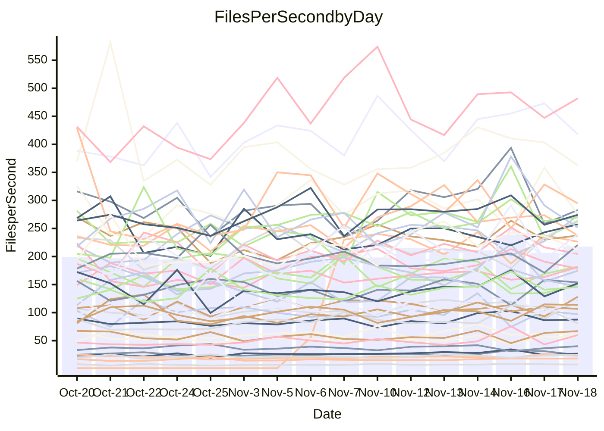

<!---
# This file is auto-generated. Do not edit.
# cspell:disable
--->
# Performance Report

Daily Performance

Time to Process Files

| Repository                                      | Elapsed | Min/Avg/Max          |    SD | SD Graph                |
| ----------------------------------------------- | ------: | :------------------: | ----: | ----------------------- |
| AdaDoom3/AdaDoom3                    |    2.43 | 1.7 /   2.8 /   3.5  |  0.52 | `    ┣━━┻●━╋━━┻━━┫    ` |
| alexiosc/megistos                    |    4.61 | 3.9 /   6.1 /   9.3  |  1.28 | `    ┣━●┻━━╋━━┻━━┫    ` |
| apollographql/apollo-server          |    2.86 | 1.5 /   2.4 /   3.3  |  0.39 | `    ┣━━┻━━╋━━●━━┫    ` |
| aspnetboilerplate/aspnetboilerplate  |    5.57 | 5.0 /   7.9 /  10.2  |  1.54 | `    ┣●━┻━━╋━━┻━━┫    ` |
| aws-amplify/docs                     |   14.75 | 7.4 /  12.1 /  15.4  |  2.41 | `    ┣━━┻━━╋━━┻●━┫    ` |
| Azure/azure-rest-api-specs           |    7.51 | 6.2 /   9.6 /  12.2  |  1.66 | `    ┣━●┻━━╋━━┻━━┫    ` |
| bitjson/typescript-starter           |    0.68 | 0.6 /   1.0 /   1.3  |  0.17 | `     ●━┻━━╋━━┻━┫     ` |
| caddyserver/caddy                    |    4.30 | 2.5 /   3.9 /   5.3  |  0.73 | `    ┣━━┻━━╋━●┻━━┫    ` |
| canada-ca/open-source-logiciel-libre |    0.89 | 0.7 /   1.0 /   1.4  |  0.17 | `     ┣━┻●━╋━━┻━┫     ` |
| chef/chef                            |    4.70 | 0.0 /   2.7 /   5.9  |  2.40 | `    ┣━━┻━━╋━━●━━┫    ` |
| dart-lang/sdk                        |   53.98 | 34.1 /  56.0 /  76.8 | 10.18 | `  ┣━━━┻━━●╋━━━┻━━━┫  ` |
| django/django                        |   10.08 | 7.6 /  12.6 /  15.6  |  2.25 | `    ┣━●┻━━╋━━┻━━┫    ` |
| eslint/eslint                        |    7.50 | 5.7 /   8.7 /  11.8  |  1.84 | `    ┣━━┻●━╋━━┻━━┫    ` |
| exonum/exonum                        |    3.42 | 2.0 /   3.0 /   3.9  |  0.55 | `    ┣━━┻━━╋━●┻━━┫    ` |
| flutter/samples                      |    9.95 | 6.6 /  10.4 /  14.0  |  2.21 | `    ┣━━┻━●╋━━┻━━┫    ` |
| gitbucket/gitbucket                  |    2.48 | 2.0 /   3.0 /   4.5  |  0.60 | `    ┣━━●━━╋━━┻━━┫    ` |
| googleapis/google-cloud-cpp          |   98.69 | 72.6 / 110.4 / 144.0 | 22.33 | `  ┣━━━┻━●━╋━━━┻━━━┫  ` |
| graphql/express-graphql              |    1.15 | 0.7 /   1.0 /   1.4  |  0.18 | `     ┣━┻━━╋━●┻━┫     ` |
| graphql/graphql-js                   |    2.69 | 2.1 /   3.3 /   4.4  |  0.63 | `    ┣━━●━━╋━━┻━━┫    ` |
| graphql/graphql-relay-js             |    0.93 | 0.7 /   1.1 /   1.4  |  0.17 | `     ┣━┻●━╋━━┻━┫     ` |
| graphql/graphql-spec                 |    0.93 | 0.8 /   1.2 /   1.6  |  0.22 | `     ┣●┻━━╋━━┻━┫     ` |
| iluwatar/java-design-patterns        |    9.88 | 7.4 /  11.1 /  14.6  |  2.13 | `    ┣━━┻●━╋━━┻━━┫    ` |
| ktaranov/sqlserver-kit               |    6.99 | 3.2 /   5.0 /   6.8  |  1.15 | `    ┣━━┻━━╋━━┻━●┫    ` |
| liriliri/licia                       |    4.16 | 2.2 /   3.6 /   4.7  |  0.70 | `    ┣━━┻━━╋━●┻━━┫    ` |
| MartinThoma/LaTeX-examples           |    6.39 | 3.8 /   5.6 /   7.5  |  1.05 | `    ┣━━┻━━╋━●┻━━┫    ` |
| mdx-js/mdx                           |    1.59 | 1.1 /   1.7 /   2.1  |  0.29 | `     ┣━┻━●╋━━┻━┫     ` |
| microsoft/TypeScript-Website         |    5.59 | 3.1 /   5.0 /   6.4  |  0.82 | `    ┣━━┻━━╋━●┻━━┫    ` |
| MicrosoftDocs/PowerShell-Docs        |   25.51 | 14.6 /  23.3 /  28.1 |  3.21 | `   ┣━━━┻━━╋━●┻━━━┫   ` |
| neovim/nvim-lspconfig                |    4.63 | 3.1 /   5.2 /  10.2  |  1.19 | `    ┣━━┻━●╋━━┻━━┫    ` |
| pagekit/pagekit                      |    2.90 | 2.0 /   3.2 /   4.1  |  0.59 | `    ┣━━┻━●╋━━┻━━┫    ` |
| php/php-src                          |   25.90 | 13.9 /  22.1 /  28.0 |  4.15 | `   ┣━━━┻━━╋━━●━━━┫   ` |
| plasticrake/tplink-smarthome-api     |    1.11 | 0.8 /   1.2 /   1.6  |  0.22 | `     ┣━┻━●╋━━┻━┫     ` |
| prettier/prettier                    |    8.88 | 4.4 /   7.5 /   9.3  |  1.23 | `    ┣━━┻━━╋━━●━━┫    ` |
| pycontribs/jira                      |    1.08 | 0.9 /   1.4 /   1.9  |  0.23 | `     ┣━●━━╋━━┻━┫     ` |
| RustPython/RustPython                |   13.32 | 7.1 /  10.9 /  13.4  |  2.04 | `    ┣━━┻━━╋━━┻●━┫    ` |
| shoelace-style/shoelace              |    2.91 | 1.7 /   2.6 /   3.5  |  0.43 | `    ┣━━┻━━╋━●┻━━┫    ` |
| slint-ui/slint                       |   17.30 | 12.5 /  19.8 /  24.1 |  3.67 | `   ┣━━━┻●━╋━━┻━━━┫   ` |
| SoftwareBrothers/admin-bro           |    1.88 | 1.5 /   2.3 /   3.2  |  0.40 | `    ┣━━●━━╋━━┻━━┫    ` |
| sveltejs/svelte                      |   18.71 | 13.4 /  22.1 / 100.8 | 10.47 | `   ┣━━┻━━●╋━━━┻━━┫   ` |
| TheAlgorithms/Python                 |    4.82 | 3.7 /   5.8 /   7.6  |  1.14 | `    ┣━━●━━╋━━┻━━┫    ` |
| twbs/bootstrap                       |    2.10 | 1.2 /   1.8 /   2.5  |  0.31 | `     ┣━┻━━╋━●┻━┫     ` |
| typescript-cheatsheets/react         |    0.87 | 0.8 /   1.1 /   1.4  |  0.18 | `     ┣●┻━━╋━━┻━┫     ` |
| typescript-eslint/typescript-eslint  |    4.23 | 2.6 /   4.0 /   4.8  |  0.66 | `    ┣━━┻━━╋●━┻━━┫    ` |
| vitest-dev/vitest                    |    9.23 | 6.4 /  10.4 /  13.0  |  2.05 | `    ┣━━┻●━╋━━┻━━┫    ` |
| w3c/aria-practices                   |    2.92 | 2.0 /   3.0 /   4.2  |  0.55 | `    ┣━━┻━━●━━┻━━┫    ` |
| w3c/specberus                        |    1.40 | 1.1 /   1.8 /   2.7  |  0.32 | `     ┣━●━━╋━━┻━┫     ` |
| webdeveric/webpack-assets-manifest   |    0.79 | 0.7 /   1.2 /   1.6  |  0.18 | `     ●━┻━━╋━━┻━┫     ` |
| webpack/webpack                      |    5.78 | 5.3 /   8.2 /  10.7  |  1.54 | `    ┣●━┻━━╋━━┻━━┫    ` |
| wireapp/wire-desktop                 |    1.65 | 0.9 /   1.4 /   1.9  |  0.25 | `     ┣━┻━━╋━━●━┫     ` |
| wireapp/wire-webapp                  |   12.08 | 8.5 /  14.8 /  20.4  |  3.22 | `   ┣━━━●━━╋━━┻━━━┫   ` |

Note:
- Elapsed time is in seconds.

Files per Second over Time

| Repository                                      | Files |   Sec |    Fps |     Rel | Trend Fps              |    N |
| ----------------------------------------------- | ----: | ----: | -----: | ------: | ---------------------- | ---: |
| AdaDoom3/AdaDoom3                    |   103 |  2.43 |  42.38 |  10.55% | `▂▂█▂▂▄▇▂▄▂▁▅▂▂▅▂▆▂▄▄` |   67 |
| alexiosc/megistos                    |   583 |  4.61 | 126.58 |  26.85% | `▆▇▅▅██▅▅▆▄█▅▂▄▅▃▅▅▆▇` |   67 |
| apollographql/apollo-server          |   256 |  2.86 |  89.45 | -17.90% | `▄▇▃▃▇▇▃▃█▃▄▃▃▃▅▃▅▆▅▂` |   67 |
| aspnetboilerplate/aspnetboilerplate  |  2308 |  5.57 | 414.41 |  35.23% | `▂▄█▄▂▂▂█▆▂▄▄▄▂▃▄▂▂▂▇` |   67 |
| aws-amplify/docs                     |  3039 | 14.75 | 206.07 | -21.47% | `▇▆▂▂▅▂▅▅█▅▆▂▆▂▃▇▅▂▂▂` |   67 |
| Azure/azure-rest-api-specs           |  2626 |  7.51 | 349.51 |  24.62% | `█▂▂▅▂▅▃▄▇▅▅▂▂▅▂▃▅▂▂▇` |   67 |
| bitjson/typescript-starter           |    20 |  0.68 |  29.33 |  41.05% | `▃▅▇▃▃▄▃▆▂▃▆█▆▄▇▆▃▅▂█` |   67 |
| caddyserver/caddy                    |   429 |  4.30 |  99.70 |  -8.80% | `▂▆▅▄▂▄▇▃▆▅▂▁▃▅▅█▆▄▃▃` |   67 |
| canada-ca/open-source-logiciel-libre |     7 |  0.89 |   7.89 |  10.88% | `▇▄▆▅▂▅▅▃█▇▄█▅▃▅▂▅█▅▆` |   67 |
| chef/chef                            |  1041 |  4.70 | 221.35 |  65.62% | `▆▅▆▅▆▅▇██▅▆▆▆▇▇▅▅▇▅▆` |   66 |
| dart-lang/sdk                        | 11882 | 53.98 | 220.11 |   0.25% | `▆▇▂▃▃▃▅▇▆▅▁▅█▃▂▃▄▄▆▄` |   67 |
| django/django                        |  2945 | 10.08 | 292.04 |  20.33% | `█▂▂▂▂▄▆▂▄▃▇▂▂▂▄▂▅▅▆▆` |   67 |
| eslint/eslint                        |  2090 |  7.50 | 278.60 |   9.96% | `▃▄▂▄▂█▄▂▇█▁▅▃▄▄▂▃▄█▅` |   67 |
| exonum/exonum                        |   421 |  3.42 | 123.13 | -15.35% | `▂▇▂▆▇▄▄▂▄▂▇▄▂▄▄▂▂█▇▂` |   67 |
| flutter/samples                      |  1681 |  9.95 | 168.98 |  -2.15% | `▂▄█▃▁▃█▅▂▇▁▆▂▆▄▆▅▂▁▄` |   67 |
| gitbucket/gitbucket                  |   427 |  2.48 | 172.51 |  17.69% | `▇▅▂▅█▅▄▃▃▆▄▅▇▆▆▅▃▂▃▆` |   67 |
| googleapis/google-cloud-cpp          | 22252 | 98.69 | 225.48 |   7.40% | `▂▄▅▅▂▇▂▂▂█▂▃▄▄▇▂▄█▅▅` |   67 |
| graphql/express-graphql              |    26 |  1.15 |  22.58 | -11.83% | `▃▃▃▂▃▇▃▄▇██▆▆▄▂▅▄▃▅▃` |   67 |
| graphql/graphql-js                   |   562 |  2.69 | 209.05 |  19.29% | `▂▄▂▄▂█▆▄▄▂▃▆▂▆▂▃▄▃▅▆` |   67 |
| graphql/graphql-relay-js             |    28 |  0.93 |  30.00 |  12.05% | `▄▃▃▂█▃▃▅▇▇▂▃▄█▃▃▂▅▃▅` |   67 |
| graphql/graphql-spec                 |    20 |  0.93 |  21.55 |  33.76% | `▄▂▄▅▄█▄▂▂▅▅▄▄▃▂▅▅█▃▆` |   67 |
| iluwatar/java-design-patterns        |  2239 |  9.88 | 226.70 |   8.25% | `██▄▅▅▄▂▂▆▆▂▅▆▃▁▄▂▆▆▅` |   67 |
| ktaranov/sqlserver-kit               |   490 |  6.99 |  70.12 | -31.69% | `▂▄███▄▆█▅▁█▂▁▄▄▄▄▄▂▁` |   67 |
| liriliri/licia                       |  1470 |  4.16 | 353.78 | -15.81% | `▂▂▃▅▄▅▅▇▂▅▄▂█▇▂▇▄▂▂▂` |   67 |
| MartinThoma/LaTeX-examples           |  1414 |  6.39 | 221.24 | -14.90% | `▅▄▆▄▅▅▄▂▂▆▅▂▅▄▂▆▆▂█▂` |   67 |
| mdx-js/mdx                           |   139 |  1.59 |  87.54 |   5.13% | `▅▄▂▂▅▄▆▂▂▇█▆▅▂▂▄▂▄▄▄` |   67 |
| microsoft/TypeScript-Website         |   809 |  5.59 | 144.68 | -10.05% | `▆▃▆▇▃▆▃▇█▂▃▂▂▃▃▂▆▅▃▃` |   67 |
| MicrosoftDocs/PowerShell-Docs        |  3127 | 25.51 | 122.56 | -10.77% | `▂▅▂▄▄█▂▂▂▅▄▄▂▂▂▄▇▅▂▂` |   67 |
| neovim/nvim-lspconfig                |   891 |  4.63 | 192.48 |   6.29% | `▅▄▅▃▄▃▅▆█▆▆▄▅▅▂▃▅▇▄▅` |   67 |
| pagekit/pagekit                      |   741 |  2.90 | 255.23 |   5.26% | `▂▄▃▂▂▂▅▄█▂▂▂▅▆▂▅▃█▆▄` |   67 |
| php/php-src                          |  2401 | 25.90 |  92.71 | -18.07% | `▄▄▂▅▅▅██▂▅▂▄▂▄▂▄▄▆▇▂` |   67 |
| plasticrake/tplink-smarthome-api     |    62 |  1.11 |  56.05 |   4.35% | `▂▆▄▃▅▂▇██▂▅▆▄▅▅▃▃█▄▅` |   67 |
| prettier/prettier                    |  2748 |  8.88 | 309.37 | -19.33% | `▄▂█▂▂▃▄▄▄▃▂▄▄▄▂▃▁▄▂▁` |   67 |
| pycontribs/jira                      |    78 |  1.08 |  72.47 |  22.77% | `▂▂▆▃▄▇▆█▆▂▄▄▆█▃█▂▆▅▆` |   67 |
| RustPython/RustPython                |  1090 | 13.32 |  81.80 | -20.12% | `▆▄▄▁▅▄▄▂▄▂▄█▂█▄▆▄▄▄▁` |   67 |
| shoelace-style/shoelace              |   440 |  2.91 | 151.29 | -12.29% | `▅▂█▂▂▆▂▂▃▃▂▂▅▅▅▄▄▆▃▃` |   67 |
| slint-ui/slint                       |  5168 | 17.30 | 298.73 |  12.90% | `▂▂▄▅▂▂▅▂▂██▄▂▅▂▄▁▂▂▅` |   67 |
| SoftwareBrothers/admin-bro           |   441 |  1.88 | 234.66 |  20.66% | `▃▃▂▃▂▂▃▃▅█▅▄▆█▃▃▃▇▆▇` |   67 |
| sveltejs/svelte                      |  9245 | 18.71 | 494.09 |   8.53% | `▅▇█▇▆▅▆▅▇▆▆▆▄▆▅▆▇▅█▆` |   67 |
| TheAlgorithms/Python                 |  1640 |  4.82 | 340.06 |  15.54% | `█▆▅█▅▂▄▄▅▇▂▂▄▂▂▄▃▂▆▅` |   67 |
| twbs/bootstrap                       |   152 |  2.10 |  72.40 | -15.42% | `▄▄▆▅█▅▆▆▂▆▂▇▃▅▇▂▂▆▃▂` |   67 |
| typescript-cheatsheets/react         |    24 |  0.87 |  27.61 |  24.96% | `▅▇▆▃▃▃▇▂▆▂▇▃▄▅▃▅▅▃█▆` |   67 |
| typescript-eslint/typescript-eslint  |   900 |  4.23 | 212.54 |  -7.72% | `▃▃█▆▃▂▃▃▃▇▃█▃▇▃▇▅▃▇▄` |   67 |
| vitest-dev/vitest                    |  2967 |  9.23 | 321.30 |   7.71% | `▂▁▅▆▅▆▂▂▆▂▆█▇▅▂▅▂▂▂▅` |   67 |
| w3c/aria-practices                   |   417 |  2.92 | 142.64 |  -0.38% | `▂▇▄▃▇▄▇▂▃▆▂▄▃█▅▂▅▃▄▄` |   67 |
| w3c/specberus                        |   190 |  1.40 | 135.36 |  21.35% | `▆▃▃▁▅▄█▆▃▅▃▄▃▇▆▆█▇▃▇` |   67 |
| webdeveric/webpack-assets-manifest   |    55 |  0.79 |  69.46 |  41.75% | `▂▂▄▂▃▄▆▃▃█▃▂▂▃█▆▄▄▅▇` |   67 |
| webpack/webpack                      |  1552 |  5.78 | 268.73 |  37.95% | `▂▄▇▂▂▄▅▂▅▄▄▂▂▅▂▄▄▅██` |   67 |
| wireapp/wire-desktop                 |    86 |  1.65 |  52.01 | -18.29% | `▆▄▇▄▄▇▇█▅▃▆▄▂▂▅▂▅▄▄▂` |   67 |
| wireapp/wire-webapp                  |  4006 | 12.08 | 331.57 |  51.42% | `▂▂▂▂▄▂▂█▃▂▃▇▃█▃█▃▃▅█` |   67 |

Data Throughput

| Repository                                      | Files |   Sec |     Kps |     Rel | Trend Kps              |    N |
| ----------------------------------------------- | ----: | ----: | ------: | ------: | ---------------------- | ---: |
| AdaDoom3/AdaDoom3                    |   103 |  2.43 |  900.64 |  10.55% | `▂▂█▂▂▄▇▂▄▂▁▅▂▂▅▂▆▂▄▄` |   67 |
| alexiosc/megistos                    |   583 |  4.61 |  994.65 |  26.85% | `▆▇▅▅██▅▅▆▄█▅▂▄▅▃▅▅▆▇` |   67 |
| apollographql/apollo-server          |   256 |  2.86 |  739.74 | -17.81% | `▄▇▃▃▇▇▃▃█▃▄▃▃▃▅▃▅▆▅▂` |   67 |
| aspnetboilerplate/aspnetboilerplate  |  2308 |  5.57 | 1022.39 |  35.23% | `▂▄█▄▂▂▂█▆▂▄▄▄▂▃▄▂▂▂▇` |   67 |
| aws-amplify/docs                     |  3039 | 14.75 |  810.51 | -21.44% | `▇▆▂▂▅▂▅▅█▅▆▂▆▂▃▇▅▂▂▂` |   67 |
| Azure/azure-rest-api-specs           |  2626 |  7.51 | 1126.24 |  26.60% | `█▂▃▅▂▆▃▄▇▅▅▂▂▅▂▃▅▂▃▇` |   67 |
| bitjson/typescript-starter           |    20 |  0.68 |  117.31 |  41.05% | `▃▅▇▃▃▄▃▆▂▃▆█▆▄▇▆▃▅▂█` |   67 |
| caddyserver/caddy                    |   429 |  4.30 |  973.08 |  -8.67% | `▂▆▅▄▃▄▇▃▆▅▂▁▃▅▅█▆▄▃▃` |   67 |
| canada-ca/open-source-logiciel-libre |     7 |  0.89 |   65.37 |  10.88% | `▇▄▆▅▂▅▅▃█▇▄█▅▃▅▂▅█▅▆` |   67 |
| chef/chef                            |  1041 |  4.70 | 1091.64 |  -4.29% | `▃▂▄▂▄▂▅██▂▅▄▄▆▆▂▂▆▂▄` |   38 |
| dart-lang/sdk                        | 11882 | 53.98 | 1546.43 |   0.26% | `▆▇▂▃▃▃▅▇▆▅▁▅█▃▂▃▄▄▆▄` |   67 |
| django/django                        |  2945 | 10.08 | 1899.90 |  20.47% | `█▂▂▂▂▄▆▂▄▃▇▂▂▂▄▂▅▅▆▆` |   67 |
| eslint/eslint                        |  2090 |  7.50 | 1976.75 |  10.12% | `▃▄▂▄▂█▄▂▇█▁▅▃▄▄▂▃▄█▅` |   67 |
| exonum/exonum                        |   421 |  3.42 | 1177.74 | -15.35% | `▂▇▂▆▇▄▄▂▄▂▇▄▂▄▄▂▂█▇▂` |   67 |
| flutter/samples                      |  1681 |  9.95 | 1025.51 |  -0.60% | `▂▄█▃▁▃█▅▂▇▁▆▂▆▄▆▆▂▁▄` |   67 |
| gitbucket/gitbucket                  |   427 |  2.48 |  852.87 |  17.99% | `▇▅▂▅█▅▄▃▃▆▄▅▇▆▆▅▃▂▃▆` |   67 |
| googleapis/google-cloud-cpp          | 22252 | 98.69 | 1997.49 |   8.24% | `▂▄▅▅▂▇▂▂▂▇▂▃▄▄▇▂▄█▅▅` |   67 |
| graphql/express-graphql              |    26 |  1.15 |  103.33 | -11.83% | `▃▃▃▂▃▇▃▄▇██▆▆▄▂▅▄▃▅▃` |   67 |
| graphql/graphql-js                   |   562 |  2.69 | 1590.21 |  19.11% | `▂▄▂▄▂█▆▄▄▂▃▆▂▆▂▃▄▃▅▅` |   67 |
| graphql/graphql-relay-js             |    28 |  0.93 |  117.87 |  12.05% | `▄▃▃▂█▃▃▅▇▇▂▃▄█▃▃▂▅▃▅` |   67 |
| graphql/graphql-spec                 |    20 |  0.93 |  700.54 |  29.90% | `▅▂▄▅▄█▄▂▃▅▄▄▄▃▂▅▅█▂▆` |   67 |
| iluwatar/java-design-patterns        |  2239 |  9.88 |  703.39 |   8.25% | `██▄▅▅▄▂▂▆▆▂▅▆▃▁▄▂▆▆▅` |   67 |
| ktaranov/sqlserver-kit               |   490 |  6.99 | 1062.70 | -31.69% | `▂▄███▄▆█▅▁█▂▁▄▄▄▄▄▂▁` |   67 |
| liriliri/licia                       |  1470 |  4.16 |  492.40 |  -4.45% | `▂▁▂▄▃▄▄▅▂▄▅▃█▇▃▇▄▃▃▃` |   67 |
| MartinThoma/LaTeX-examples           |  1414 |  6.39 |  459.69 | -14.90% | `▅▄▆▄▅▅▄▂▂▆▅▂▅▄▂▆▆▂█▂` |   67 |
| mdx-js/mdx                           |   139 |  1.59 |  412.50 |   5.13% | `▅▄▂▂▅▄▆▂▂▇█▆▅▂▂▄▂▄▄▄` |   67 |
| microsoft/TypeScript-Website         |   809 |  5.59 |  895.29 | -17.77% | `█▅▆▇▃▆▃▇█▂▃▂▂▃▃▂▆▅▃▃` |   67 |
| MicrosoftDocs/PowerShell-Docs        |  3127 | 25.51 | 1309.75 | -10.77% | `▂▅▂▄▄█▂▂▂▅▄▄▂▂▂▄▇▅▂▂` |   67 |
| neovim/nvim-lspconfig                |   891 |  4.63 |  611.14 |   6.53% | `▅▄▅▃▄▃▅▆█▆▆▄▅▅▂▃▅▇▄▅` |   67 |
| pagekit/pagekit                      |   741 |  2.90 |  532.16 |   5.26% | `▂▄▃▂▂▂▅▄█▂▂▂▅▆▂▅▃█▆▄` |   67 |
| php/php-src                          |  2401 | 25.90 | 1651.26 | -18.03% | `▄▄▂▅▅▅██▂▅▂▄▂▄▂▄▄▆▇▂` |   67 |
| plasticrake/tplink-smarthome-api     |    62 |  1.11 |  302.87 |   4.35% | `▂▆▄▃▅▂▇██▂▅▆▄▅▅▃▃█▄▅` |   67 |
| prettier/prettier                    |  2748 |  8.88 |  441.76 | -17.55% | `▄▂█▂▂▃▄▄▄▃▂▄▄▄▂▃▂▄▂▁` |   67 |
| pycontribs/jira                      |    78 |  1.08 |  651.28 |  36.96% | `▃▃▆▄▅▇▆█▆▃▅▅▆█▄█▃▆▅▇` |   67 |
| RustPython/RustPython                |  1090 | 13.32 | 2375.39 | -19.84% | `▆▄▄▁▅▄▄▂▄▂▄█▂█▄▆▄▄▄▁` |   67 |
| shoelace-style/shoelace              |   440 |  2.91 |  730.65 | -12.29% | `▅▂█▂▂▆▂▂▃▃▂▂▅▅▅▄▄▆▃▃` |   67 |
| slint-ui/slint                       |  5168 | 17.30 | 1790.48 |  13.22% | `▂▂▄▅▂▂▅▂▂██▄▂▅▂▄▂▂▂▅` |   67 |
| SoftwareBrothers/admin-bro           |   441 |  1.88 |  517.21 |  20.66% | `▃▃▂▃▂▂▃▃▅█▅▄▆█▃▃▃▇▆▇` |   67 |
| sveltejs/svelte                      |  9245 | 18.71 |  343.05 |   8.88% | `▅▇█▇▆▅▆▅▇▆▆▆▄▆▅▆▇▅█▆` |   67 |
| TheAlgorithms/Python                 |  1640 |  4.82 |  975.39 |  15.54% | `█▆▅█▅▂▄▄▅▇▂▂▄▂▂▄▃▂▆▅` |   67 |
| twbs/bootstrap                       |   152 |  2.10 |  618.22 | -14.79% | `▄▄▆▅█▅▆▆▂▆▂▇▃▅▇▂▂▆▃▂` |   67 |
| typescript-cheatsheets/react         |    24 |  0.87 |  249.60 |  24.96% | `▅▇▆▃▃▃▇▂▆▂▇▃▄▅▃▅▅▃█▆` |   67 |
| typescript-eslint/typescript-eslint  |   900 |  4.23 |  741.28 |  -6.15% | `▃▃█▅▃▂▃▃▃▇▃█▃▇▃▇▅▃▇▄` |   67 |
| vitest-dev/vitest                    |  2967 |  9.23 |  976.23 |   8.12% | `▂▁▅▆▅▆▂▂▆▂▆█▇▅▂▅▂▂▂▅` |   67 |
| w3c/aria-practices                   |   417 |  2.92 | 1342.94 |  -0.38% | `▂▇▄▃▇▄▇▂▃▆▂▄▃█▅▂▅▃▄▄` |   67 |
| w3c/specberus                        |   190 |  1.40 |  443.12 |  21.35% | `▆▃▃▁▅▄█▆▃▅▃▄▃▇▆▆█▇▃▇` |   67 |
| webdeveric/webpack-assets-manifest   |    55 |  0.79 |  160.39 |  41.75% | `▂▂▄▂▃▄▆▃▃█▃▂▂▃█▆▄▄▅▇` |   67 |
| webpack/webpack                      |  1552 |  5.78 | 2570.58 |  45.61% | `▂▄▆▂▂▄▅▂▄▄▄▃▂▅▃▅▄▅██` |   67 |
| wireapp/wire-desktop                 |    86 |  1.65 |  228.59 | -18.25% | `▆▄▇▄▄▇▇█▅▃▆▄▂▂▅▂▅▄▄▂` |   67 |
| wireapp/wire-webapp                  |  4006 | 12.08 | 1452.27 |  41.93% | `▂▂▃▂▄▂▂█▃▂▂▆▂█▂█▂▂▅▇` |   67 |

