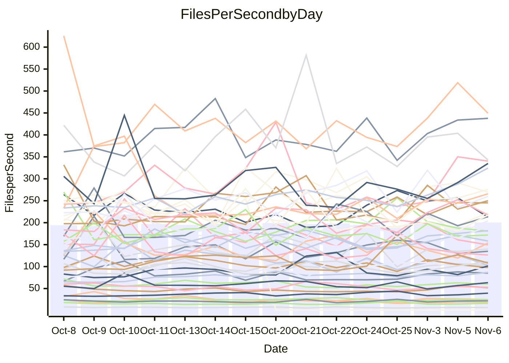

<!---
# This file is auto-generated. Do not edit.
# cspell:disable
--->
# Performance Report

Daily Performance

Time to Process Files

| Repository                                      | Elapsed | Min/Avg/Max          |    SD | SD Graph                |
| ----------------------------------------------- | ------: | :------------------: | ----: | ----------------------- |
| AdaDoom3/AdaDoom3                    |    3.00 | 1.8 /   2.8 /   3.5  |  0.46 | `    ┣━━┻━━╋●━┻━━┫    ` |
| alexiosc/megistos                    |    7.31 | 3.9 /   6.5 /   9.3  |  1.40 | `    ┣━━┻━━╋━●┻━━┫    ` |
| apollographql/apollo-server          |    2.61 | 1.4 /   2.5 /   3.3  |  0.41 | `    ┣━━┻━━╋●━┻━━┫    ` |
| aspnetboilerplate/aspnetboilerplate  |    6.99 | 5.1 /   8.0 /  10.2  |  1.62 | `    ┣━━┻●━╋━━┻━━┫    ` |
| aws-amplify/docs                     |   11.61 | 7.4 /  12.7 /  15.4  |  2.34 | `   ┣━━━┻●━╋━━┻━━━┫   ` |
| Azure/azure-rest-api-specs           |   11.08 | 6.2 /  10.0 /  12.2  |  1.72 | `    ┣━━┻━━╋━●┻━━┫    ` |
| bitjson/typescript-starter           |    1.21 | 0.7 /   1.0 /   1.3  |  0.17 | `     ┣━┻━━╋━━●━┫     ` |
| caddyserver/caddy                    |    4.65 | 2.3 /   3.9 /   4.8  |  0.68 | `    ┣━━┻━━╋━━●━━┫    ` |
| canada-ca/open-source-logiciel-libre |    1.21 | 0.7 /   1.0 /   1.4  |  0.18 | `     ┣━┻━━╋━●┻━┫     ` |
| chef/chef                            |    0.00 | 0.0 /   1.9 /   5.5  |  2.39 | `    ┣━━┻●━╋━━┻━━┫    ` |
| dart-lang/sdk                        |   61.56 | 35.8 /  57.3 /  76.1 |  9.05 | `  ┣━━━┻━━━╋━●━┻━━━┫  ` |
| django/django                        |   11.26 | 7.6 /  13.0 /  15.6  |  2.49 | `   ┣━━━┻●━╋━━┻━━━┫   ` |
| eslint/eslint                        |   10.49 | 5.8 /   9.4 /  11.5  |  1.66 | `    ┣━━┻━━╋━●┻━━┫    ` |
| exonum/exonum                        |    3.46 | 2.0 /   3.1 /   3.9  |  0.53 | `    ┣━━┻━━╋━●┻━━┫    ` |
| flutter/samples                      |   12.25 | 6.7 /  10.6 /  13.0  |  1.84 | `    ┣━━┻━━╋━━●━━┫    ` |
| gitbucket/gitbucket                  |    4.46 | 1.9 /   3.1 /   3.9  |  0.56 | `    ┣━━┻━━╋━━┻━━┫●   ` |
| googleapis/google-cloud-cpp          |  129.24 | 72.6 / 120.5 / 144.0 | 18.84 | `  ┣━━━┻━━━╋━●━┻━━━┫  ` |
| graphql/express-graphql              |    0.99 | 0.7 /   1.1 /   1.4  |  0.19 | `     ┣━┻━●╋━━┻━┫     ` |
| graphql/graphql-js                   |    3.79 | 2.1 /   3.3 /   4.4  |  0.69 | `    ┣━━┻━━╋━●┻━━┫    ` |
| graphql/graphql-relay-js             |    1.26 | 0.7 /   1.1 /   1.4  |  0.18 | `     ┣━┻━━╋━━●━┫     ` |
| graphql/graphql-spec                 |    1.41 | 0.8 /   1.3 /   1.6  |  0.20 | `     ┣━┻━━╋━●┻━┫     ` |
| iluwatar/java-design-patterns        |    8.51 | 7.4 /  11.8 /  14.6  |  2.14 | `    ┣●━┻━━╋━━┻━━┫    ` |
| ktaranov/sqlserver-kit               |    6.73 | 3.3 /   5.2 /   6.8  |  1.13 | `    ┣━━┻━━╋━━┻●━┫    ` |
| liriliri/licia                       |    2.32 | 2.3 /   3.6 /   4.7  |  0.66 | `    ●━━┻━━╋━━┻━━┫    ` |
| MartinThoma/LaTeX-examples           |    5.04 | 3.8 /   6.1 /   7.5  |  1.06 | `    ┣━━●━━╋━━┻━━┫    ` |
| mdx-js/mdx                           |    2.03 | 1.2 /   1.7 /   2.1  |  0.27 | `     ┣━┻━━╋━━●━┫     ` |
| microsoft/TypeScript-Website         |    5.37 | 3.1 /   4.9 /   6.3  |  0.82 | `    ┣━━┻━━╋━●┻━━┫    ` |
| MicrosoftDocs/PowerShell-Docs        |   27.78 | 14.4 /  23.2 /  28.1 |  3.42 | `   ┣━━━┻━━╋━━┻━●━┫   ` |
| neovim/nvim-lspconfig                |    3.77 | 3.1 /   5.3 /   6.8  |  1.01 | `    ┣━●┻━━╋━━┻━━┫    ` |
| pagekit/pagekit                      |    4.08 | 2.1 /   3.3 /   4.1  |  0.57 | `    ┣━━┻━━╋━━┻●━┫    ` |
| php/php-src                          |   16.38 | 13.6 /  22.3 /  28.0 |  4.18 | `   ┣━●━┻━━╋━━┻━━━┫   ` |
| plasticrake/tplink-smarthome-api     |    0.88 | 0.8 /   1.2 /   1.6  |  0.22 | `     ┣●┻━━╋━━┻━┫     ` |
| prettier/prettier                    |    8.58 | 4.5 /   7.6 /   9.3  |  1.33 | `    ┣━━┻━━╋━●┻━━┫    ` |
| pycontribs/jira                      |    1.23 | 0.9 /   1.4 /   1.9  |  0.23 | `     ┣━┻●━╋━━┻━┫     ` |
| RustPython/RustPython                |   13.22 | 6.5 /  10.5 /  13.3  |  2.09 | `    ┣━━┻━━╋━━┻●━┫    ` |
| shoelace-style/shoelace              |    2.94 | 1.7 /   2.6 /   3.2  |  0.46 | `    ┣━━┻━━╋━●┻━━┫    ` |
| slint-ui/slint                       |   22.76 | 11.7 /  18.8 /  23.4 |  3.53 | `   ┣━━━┻━━╋━━┻●━━┫   ` |
| SoftwareBrothers/admin-bro           |    2.33 | 1.5 /   2.4 /   3.2  |  0.37 | `    ┣━━┻━━●━━┻━━┫    ` |
| sveltejs/svelte                      |   24.82 | 13.2 /  21.6 /  27.1 |  4.05 | `   ┣━━━┻━━╋━━●━━━┫   ` |
| TheAlgorithms/Python                 |    4.85 | 3.9 /   6.2 /   7.6  |  1.01 | `    ┣━●┻━━╋━━┻━━┫    ` |
| twbs/bootstrap                       |    2.03 | 1.1 /   1.9 /   2.3  |  0.30 | `     ┣━┻━━╋━●┻━┫     ` |
| typescript-cheatsheets/react         |    0.86 | 0.8 /   1.2 /   1.4  |  0.17 | `     ●━┻━━╋━━┻━┫     ` |
| typescript-eslint/typescript-eslint  |    4.82 | 2.5 /   4.1 /   4.8  |  0.70 | `    ┣━━┻━━╋━━●━━┫    ` |
| vitest-dev/vitest                    |   12.23 | 6.4 /  10.5 /  13.1  |  2.00 | `    ┣━━┻━━╋━━●━━┫    ` |
| w3c/aria-practices                   |    3.61 | 2.0 /   3.0 /   4.2  |  0.58 | `    ┣━━┻━━╋━━●━━┫    ` |
| w3c/specberus                        |    1.92 | 1.2 /   1.7 /   2.3  |  0.34 | `     ┣━┻━━╋━●┻━┫     ` |
| webdeveric/webpack-assets-manifest   |    1.28 | 0.8 /   1.2 /   1.4  |  0.16 | `     ┣━┻━━╋━●┻━┫     ` |
| webpack/webpack                      |    9.47 | 5.3 /   8.3 /  10.4  |  1.54 | `    ┣━━┻━━╋━●┻━━┫    ` |
| wireapp/wire-desktop                 |    1.09 | 0.9 /   1.4 /   1.7  |  0.23 | `     ┣●┻━━╋━━┻━┫     ` |
| wireapp/wire-webapp                  |   11.80 | 8.8 /  13.5 /  18.3  |  2.81 | `   ┣━━━┻●━╋━━┻━━━┫   ` |

Note:
- Elapsed time is in seconds.

Files per Second over Time

| Repository                                      | Files |    Sec |    Fps |     Rel | Trend Fps              |    N |
| ----------------------------------------------- | ----: | -----: | -----: | ------: | ---------------------- | ---: |
| AdaDoom3/AdaDoom3                    |   103 |   3.00 |  34.31 |  -7.95% | `▄▅▁▂▅▂▂▂▂▆▂▄█▂▂█▂▄▂▃` |   45 |
| alexiosc/megistos                    |   583 |   7.31 |  79.72 | -15.78% | `▂▂▂▃▂█▂▃▂▂▅▇▂▅▇▅▆▂▁▃` |   45 |
| apollographql/apollo-server          |   256 |   2.61 |  98.22 |  -8.78% | `█▂▆█▃▃▄▅▂▅▃▃▆▅▃▁▃▂▂▃` |   45 |
| aspnetboilerplate/aspnetboilerplate  |  2308 |   6.99 | 330.37 |   9.96% | `▂▂▂▂▂▂▅▇▅▂██▆▇▃▅█▂▂▅` |   45 |
| aws-amplify/docs                     |  3039 |  11.61 | 261.83 |   4.53% | `▇▂▇▂▂▁▂▅▄▂▁▃▂▅▂▂▄█▂▃` |   45 |
| Azure/azure-rest-api-specs           |  2607 |  11.08 | 235.37 | -13.15% | `▅▂▄▂▄▂▄▅▁▄▄▂█▂▇▇▂█▆▂` |   45 |
| bitjson/typescript-starter           |    20 |   1.21 |  16.55 | -18.48% | `▃▂▃▃▃▃▂█▃▃▃▂▃▅▅▁▅▇▃▂` |   45 |
| caddyserver/caddy                    |   402 |   4.65 |  86.53 | -16.78% | `▅▂▂▂▂▆▂▂▅▂▇▂▂▅▄█▂▁▂▂` |   45 |
| canada-ca/open-source-logiciel-libre |     7 |   1.21 |   5.77 | -16.61% | `▃▂▁▃▃█▅▂▇▅▂▄▃▂▅▇▅▅▂▂` |   45 |
| chef/chef                            |     0 |   0.00 |   0.00 | -98.81% | `████████████████████` |   44 |
| dart-lang/sdk                        | 11839 |  61.56 | 192.32 |  -9.23% | `▃▃▅▃▃▂▃▂▂▃▁▂█▅▃▄▂▃▃▃` |   45 |
| django/django                        |  2941 |  11.26 | 261.23 |  10.14% | `▂▂▇▂▂█▁▆▁▃▁▃▂▃▂▂▁▆▇▄` |   45 |
| eslint/eslint                        |  2087 |  10.49 | 198.99 | -14.16% | `▄▄▁▅▂▂▂▇▄▂▅███▂▂▂▂▁▂` |   45 |
| exonum/exonum                        |   421 |   3.46 | 121.71 | -12.29% | `▆▆▂▅█▅▂▁▂▅▅▂▄▂▂▂█▂▆▃` |   45 |
| flutter/samples                      |  1703 |  12.25 | 139.00 | -16.38% | `▂▂▂▆▃▃▄▆▂▅▂▅▅▁▄▂▆▃█▂` |   45 |
| gitbucket/gitbucket                  |   427 |   4.46 |  95.73 | -32.24% | `▁▅▅▄▂▂▂▂▂▂▂█▂▄▂▅██▅ ` |   45 |
| googleapis/google-cloud-cpp          | 22116 | 129.24 | 171.12 |  -9.52% | `█▂▃▄▂▂▂▂▂▂▁▅▂▂▂▁▂▅█▂` |   45 |
| graphql/express-graphql              |    26 |   0.99 |  26.19 |   5.07% | `▅▃▂▂▂▆▁█▂▂▆▂▂▃▁▃▂█▂▄` |   45 |
| graphql/graphql-js                   |   556 |   3.79 | 146.62 | -16.47% | `▂▅▂▄▆█▇▂▁▂▂▂▂▅▂▂▂▂▂▂` |   45 |
| graphql/graphql-relay-js             |    28 |   1.26 |  22.14 | -16.98% | `▆▁█▆▃▃▂▄▇▄▅█▃▃▃▅▃▃▃▂` |   45 |
| graphql/graphql-spec                 |    19 |   1.41 |  13.43 | -14.02% | `▆▇▆▂▁▂▂▂▆▂▂█▃▃▅▄▃▆▂▂` |   45 |
| iluwatar/java-design-patterns        |  2239 |   8.51 | 263.25 |  33.03% | `█▂▅▂▇▃▄▂▂▅▃█▂▄▁▄▄▄▂▆` |   45 |
| ktaranov/sqlserver-kit               |   490 |   6.73 |  72.83 | -26.47% | `▂▄▂▆▂█▂▂▁▇▆▄▇▂▂▄▂▂▅▁` |   45 |
| liriliri/licia                       |  1442 |   2.32 | 621.21 |  50.65% | `█▂▄▅▂▂▇█▂▂▁▄▂▂▂▂▇▇▂█` |   45 |
| MartinThoma/LaTeX-examples           |  1414 |   5.04 | 280.28 |  16.53% | `▂▂▂▂▃▇▆▄▂▆▂▂▇▂▂█▂█▅▅` |   45 |
| mdx-js/mdx                           |   139 |   2.03 |  68.52 | -16.71% | `▂▂▅▂▅▄▆▅█▂▂▄▇▃▄▂▆▄▆▂` |   45 |
| microsoft/TypeScript-Website         |   765 |   5.37 | 142.55 | -11.47% | `▃▃▂▂█▂▅▄█▂▃█▅▃▃▅▃▂▂▃` |   45 |
| MicrosoftDocs/PowerShell-Docs        |  3127 |  27.78 | 112.54 | -18.69% | `▂▇▂█▂▃▄▃▂▁▄▂▅▃▂▂▃▃▃▁` |   45 |
| neovim/nvim-lspconfig                |   889 |   3.77 | 235.59 |  34.48% | `▃▂▂▁▂▂▂▂▄▂▅▇▄▁▂▇▂▂█▆` |   45 |
| pagekit/pagekit                      |   741 |   4.08 | 181.60 | -21.13% | `▇▆▃▂▆█▅▂▃▆█▂▂▂▂▅▂▂▅▁` |   45 |
| php/php-src                          |  2403 |  16.38 | 146.69 |  30.70% | `▂█▄▆▂▁▆▂▄▇▄▂▂▂▄▂▂▆▂▆` |   45 |
| plasticrake/tplink-smarthome-api     |    62 |   0.88 |  70.26 |  31.51% | `▄▃▄▅▂▂▃▁▆▁██▆▂▂▂▂▂▃▇` |   45 |
| prettier/prettier                    |  2791 |   8.58 | 325.15 | -14.30% | `▄▂▂█▂▁▂▃▄▆▂▂▄▂▂▂▄▁▁▂` |   45 |
| pycontribs/jira                      |    80 |   1.23 |  65.02 |  11.27% | `▃▅▁▃▃▃▅▂▅▄▂█▃▇▃▅▄▃█▅` |   45 |
| RustPython/RustPython                |  1069 |  13.22 |  80.86 | -20.80% | `▂▂▃▃▂▁▂▇▅▁▁▁▇▂█▇▁▄█▁` |   45 |
| shoelace-style/shoelace              |   440 |   2.94 | 149.80 | -15.40% | `▂▂▂▇█▂▂▁▅▂▇▂▃▅▄▂▂▅▆▂` |   45 |
| slint-ui/slint                       |  5027 |  22.76 | 220.85 | -16.41% | `▂▂▄▇▄█▂▂▂▂▄▂▂▄▇▃▂█▂▂` |   45 |
| SoftwareBrothers/admin-bro           |   441 |   2.33 | 189.01 |  -0.16% | `▃▃▃▇▆▃▃▂▃▂▅▄▃█▁▃▃▅▂▄` |   45 |
| sveltejs/svelte                      |  9223 |  24.82 | 371.65 | -16.36% | `▂▂▁▂▅▄▄█▂▂▇▂▂▄▂▆▂█▂▂` |   45 |
| TheAlgorithms/Python                 |  1640 |   4.85 | 338.37 |  23.80% | `▆▂▂█▂▂▂▇▇▃▂▂▄▅▄▂▃▁▂▆` |   45 |
| twbs/bootstrap                       |   152 |   2.03 |  74.97 |  -6.94% | `█▃▄▂▅▂▅▂▂▂▂▂▄▅▄▄▄█▂▂` |   45 |
| typescript-cheatsheets/react         |    24 |   0.86 |  27.86 |  32.76% | `▃▆▃▂▄▃▂█▃▂▆▃▇▂▅▃▅▃▅█` |   45 |
| typescript-eslint/typescript-eslint  |   887 |   4.82 | 183.92 | -18.82% | `▁▂▂▂▃▄▂▂▃▂▁▂█▄▃▃▃▂▃▁` |   45 |
| vitest-dev/vitest                    |  2948 |  12.23 | 241.11 | -16.26% | `▂▃▄▂▂▁▂▆▂▂▄█▄▂█▂█▂█▂` |   45 |
| w3c/aria-practices                   |   417 |   3.61 | 115.52 | -19.32% | `█▁▂▂█▃▂▂▇▅▃▃▃▂▄▆▃▇▅▂` |   45 |
| w3c/specberus                        |   190 |   1.92 |  99.16 | -14.28% | `█▂▂▂▇▂▃▂▇▆▇▂▂▄▄▄▂▂▂▃` |   45 |
| webdeveric/webpack-assets-manifest   |    55 |   1.28 |  43.00 | -11.44% | `▃▂▂▆▂▂▂█▃▇█▄▇▂█▂▂▃▇▂` |   45 |
| webpack/webpack                      |  1540 |   9.47 | 162.68 | -14.67% | `▇▆▂▄█▂▂▂▃▄▄▂▄▄▁▁█▂▂▂` |   45 |
| wireapp/wire-desktop                 |    86 |   1.09 |  78.72 |  30.93% | `▅▃▂▅▃▅▃▆█▃▃▃▃▃▃▇▃▃▅█` |   45 |
| wireapp/wire-webapp                  |  2803 |  11.80 | 237.45 |  10.41% | `▃▂▅▂▇▂██▂█▁▂▂▃▂██▂▂▅` |   45 |

Data Throughput

| Repository                                      | Files |    Sec |     Kps |     Rel | Trend Kps              |    N |
| ----------------------------------------------- | ----: | -----: | ------: | ------: | ---------------------- | ---: |
| AdaDoom3/AdaDoom3                    |   103 |   3.00 |  729.22 |  -7.95% | `▄▅▁▂▅▂▂▂▂▆▂▄█▂▂█▂▄▂▃` |   45 |
| alexiosc/megistos                    |   583 |   7.31 |  626.38 | -15.78% | `▂▂▂▃▂█▂▃▂▂▅▇▂▅▇▅▆▂▁▃` |   45 |
| apollographql/apollo-server          |   256 |   2.61 |  811.10 |  -8.78% | `█▂▆█▃▃▄▅▂▅▃▃▆▅▃▁▃▂▂▃` |   45 |
| aspnetboilerplate/aspnetboilerplate  |  2308 |   6.99 |  815.04 |  10.19% | `▂▂▂▂▂▂▅▇▅▂██▆▇▃▅█▂▂▅` |   45 |
| aws-amplify/docs                     |  3039 |  11.61 | 1029.07 |   4.55% | `▇▂▇▂▂▁▂▅▄▂▁▃▂▅▂▂▄█▂▃` |   45 |
| Azure/azure-rest-api-specs           |  2607 |  11.08 |  740.61 | -12.42% | `▅▂▄▂▄▂▄▅▁▄▄▂█▃▇▇▂█▆▂` |   45 |
| bitjson/typescript-starter           |    20 |   1.21 |   66.19 | -18.48% | `▃▂▃▃▃▃▂█▃▃▃▂▃▅▅▁▅▇▃▂` |   45 |
| caddyserver/caddy                    |   402 |   4.65 |  845.26 | -14.97% | `▅▂▂▂▃▆▂▂▅▂▇▃▂▅▅█▂▂▂▂` |   45 |
| canada-ca/open-source-logiciel-libre |     7 |   1.21 |   47.81 | -16.61% | `▃▂▁▃▃█▅▂▇▅▂▄▃▂▅▇▅▅▂▂` |   45 |
| chef/chef                            |  1037 |   4.07 | 1253.33 |  19.94% | `▄▃█▄▄▃▇▃▄▃█▆▃▃▂▃█`    |   16 |
| dart-lang/sdk                        | 11839 |  61.56 | 1351.59 |  -9.04% | `▃▃▅▃▃▂▃▂▂▃▁▂█▅▃▄▂▃▃▃` |   45 |
| django/django                        |  2941 |  11.26 | 1697.33 |  10.32% | `▂▂▇▂▂█▁▆▁▃▁▃▂▃▂▂▁▆▇▄` |   45 |
| eslint/eslint                        |  2087 |  10.49 | 1410.09 | -14.07% | `▄▄▁▅▂▂▂▇▄▂▅███▂▂▂▂▁▂` |   45 |
| exonum/exonum                        |   421 |   3.46 | 1164.23 | -12.29% | `▆▆▂▅█▅▂▁▂▅▅▂▄▂▂▂█▂▆▃` |   45 |
| flutter/samples                      |  1703 |  12.25 |  828.51 | -16.38% | `▂▂▂▆▃▃▄▆▂▅▂▅▅▁▄▂▆▃█▂` |   45 |
| gitbucket/gitbucket                  |   427 |   4.46 |  472.61 | -31.92% | `▁▅▅▄▂▂▂▂▂▂▂█▂▄▂▅██▅ ` |   45 |
| googleapis/google-cloud-cpp          | 22116 | 129.24 | 1500.89 |  -9.29% | `█▂▃▄▂▂▂▂▂▂▁▅▂▂▂▁▂▅█▂` |   45 |
| graphql/express-graphql              |    26 |   0.99 |  119.88 |   5.07% | `▅▃▂▂▂▆▁█▂▂▆▂▂▃▁▃▂█▂▄` |   45 |
| graphql/graphql-js                   |   556 |   3.79 | 1120.24 | -15.61% | `▂▅▂▄▆█▇▂▁▂▂▂▂▅▂▂▂▂▂▂` |   45 |
| graphql/graphql-relay-js             |    28 |   1.26 |   86.98 | -16.98% | `▆▁█▆▃▃▂▄▇▄▅█▃▃▃▅▃▃▃▂` |   45 |
| graphql/graphql-spec                 |    19 |   1.41 |  451.60 | -14.02% | `▆▇▆▂▁▂▂▂▆▂▂█▃▃▅▄▃▆▂▂` |   45 |
| iluwatar/java-design-patterns        |  2239 |   8.51 |  816.80 |  33.03% | `█▂▅▂▇▃▄▂▂▅▃█▂▄▁▄▄▄▂▆` |   45 |
| ktaranov/sqlserver-kit               |   490 |   6.73 | 1103.71 | -26.46% | `▂▄▂▆▂█▂▂▁▇▆▄▇▂▂▄▂▂▅▁` |   45 |
| liriliri/licia                       |  1442 |   2.32 |  744.85 |  50.65% | `█▂▄▅▂▂▇█▂▂▁▄▂▂▂▂▇▇▂█` |   45 |
| MartinThoma/LaTeX-examples           |  1414 |   5.04 |  582.37 |  16.53% | `▂▂▂▂▃▇▆▄▂▆▂▂▇▂▂█▂█▅▅` |   45 |
| mdx-js/mdx                           |   139 |   2.03 |  322.87 | -16.71% | `▂▂▅▂▅▄▆▅█▂▂▄▇▃▄▂▆▄▆▂` |   45 |
| microsoft/TypeScript-Website         |   765 |   5.37 |  983.72 | -11.44% | `▃▃▂▂█▂▅▄█▂▃█▅▃▃▅▃▂▂▃` |   45 |
| MicrosoftDocs/PowerShell-Docs        |  3127 |  27.78 | 1202.74 | -18.69% | `▂▇▂█▂▃▄▃▂▁▄▂▅▃▂▂▃▃▃▁` |   45 |
| neovim/nvim-lspconfig                |   889 |   3.77 |  744.94 |  34.91% | `▃▂▂▁▂▂▂▂▄▂▅▇▄▁▂▇▂▂█▆` |   45 |
| pagekit/pagekit                      |   741 |   4.08 |  378.65 | -21.13% | `▇▆▃▂▆█▅▂▃▆█▂▂▂▂▅▂▂▅▁` |   45 |
| php/php-src                          |  2403 |  16.38 | 2610.21 |  30.69% | `▂█▄▆▂▁▆▂▄▇▄▂▂▂▄▂▂▆▂▆` |   45 |
| plasticrake/tplink-smarthome-api     |    62 |   0.88 |  379.62 |  31.51% | `▄▃▄▅▂▂▃▁▆▁██▆▂▂▂▂▂▃▇` |   45 |
| prettier/prettier                    |  2791 |   8.58 |  453.30 | -14.59% | `▄▂▂█▂▁▂▃▄▆▂▂▄▂▂▂▄▁▁▂` |   45 |
| pycontribs/jira                      |    80 |   1.23 |  459.19 |  11.27% | `▃▅▁▃▃▃▅▂▅▄▂█▃▇▃▅▄▃█▅` |   45 |
| RustPython/RustPython                |  1069 |  13.22 | 2333.34 | -21.63% | `▂▂▃▃▂▁▂▇▅▁▁▁▇▂█▇▁▄█▁` |   45 |
| shoelace-style/shoelace              |   440 |   2.94 |  723.48 | -15.40% | `▂▂▂▇█▂▂▁▅▂▇▂▃▅▄▂▂▅▆▂` |   45 |
| slint-ui/slint                       |  5027 |  22.76 | 1326.97 | -15.03% | `▂▂▄▇▄█▂▂▂▂▅▂▂▄▇▃▂█▂▂` |   45 |
| SoftwareBrothers/admin-bro           |   441 |   2.33 |  416.58 |  -0.16% | `▃▃▃▇▆▃▃▂▃▂▅▄▃█▁▃▃▅▂▄` |   45 |
| sveltejs/svelte                      |  9223 |  24.82 |  257.25 | -16.27% | `▂▂▁▂▅▄▄█▂▂▇▂▂▄▂▆▂█▂▂` |   45 |
| TheAlgorithms/Python                 |  1640 |   4.85 |  970.56 |  23.92% | `▆▂▂█▂▂▂▇▇▃▂▂▄▅▄▂▃▁▂▆` |   45 |
| twbs/bootstrap                       |   152 |   2.03 |  633.78 |  -6.31% | `█▃▄▂▆▂▅▂▃▂▂▂▄▅▄▄▄█▃▃` |   45 |
| typescript-cheatsheets/react         |    24 |   0.86 |  251.90 |  32.76% | `▃▆▃▂▄▃▂█▃▂▆▃▇▂▅▃▅▃▅█` |   45 |
| typescript-eslint/typescript-eslint  |   887 |   4.82 |  628.88 | -18.65% | `▁▂▂▂▃▄▂▂▃▂▁▂█▄▃▃▃▂▃▁` |   45 |
| vitest-dev/vitest                    |  2948 |  12.23 |  728.88 | -15.60% | `▂▃▄▂▂▂▂▆▂▂▄█▄▂█▂█▂█▂` |   45 |
| w3c/aria-practices                   |   417 |   3.61 | 1087.61 | -19.32% | `█▁▂▂█▃▂▂▇▅▃▃▃▂▄▆▃▇▅▂` |   45 |
| w3c/specberus                        |   190 |   1.92 |  324.61 | -14.28% | `█▂▂▂▇▂▃▂▇▆▇▂▂▄▄▄▂▂▂▃` |   45 |
| webdeveric/webpack-assets-manifest   |    55 |   1.28 |   99.29 | -11.44% | `▃▂▂▆▂▂▂█▃▇█▄▇▂█▂▂▃▇▂` |   45 |
| webpack/webpack                      |  1540 |   9.47 | 1414.59 | -15.35% | `█▇▂▄█▂▂▂▃▄▄▂▄▄▁▁█▂▂▂` |   45 |
| wireapp/wire-desktop                 |    86 |   1.09 |  346.02 |  32.33% | `▅▃▃▅▃▅▃▆█▄▃▃▃▃▃▇▃▃▅█` |   45 |
| wireapp/wire-webapp                  |  2803 |  11.80 | 1132.45 |  12.78% | `▂▂▅▂▇▂██▂█▁▂▂▃▂██▂▂▅` |   45 |

