<!---
# This file is auto-generated. Do not edit.
# cspell:disable
--->
# Performance Report

```mermaid
xychart-beta
    title Files Per Second by Day
    y-axis Files per Second
    x-axis Date [Sep-14, Sep-16, Sep-17, Sep-20, Sep-22, Sep-24, Sep-27, Sep-28, Sep-29, Sep-30, Oct-1, Oct-2, Oct-8, Oct-9, Oct-10, Oct-11, Oct-13, Oct-14]
    bar [197.87, 189.83, 198.93, 223.14, 203.41, 191.85, 190.34, 190.33, 191.42, 191.65, 187.17, 187.29, 194.39, 192.05, 218.83, 197.10, 195.24, 199.63]
    line [97.36, 113.44, 95.42, 93.37, 113.84, 158.94, 91.50, 106.48, 102.03, 106.46, 94.98, 113.77, 93.63, 125.18, 87.00, 104.77, 109.42, 103.60]
    line [156.67, 149.67, 167.24, 171.44, 166.11, 165.94, 180.17, 169.69, 179.61, 173.13, 150.88, 153.50, 149.45, 170.98, 162.38, 193.61, 167.04, 173.26]
    line [159.91, 274.11, 160.48, 154.49, 133.29, 206.55, 172.23, 156.59, 180.95, 179.76, 145.22, 129.53, 157.39, 199.58, 152.82, 170.97, 185.75, 201.98]
    line [79.87, 74.03, 79.32, 76.57, 77.71, 78.68, 74.59, 96.62, 94.86, 81.46, 69.18, 73.06, 66.65, 96.25, 112.51, 78.91, 82.77, 107.75]
    line [151.50, 140.12, 185.15, 139.87, 144.59, 151.47, 163.76, 164.48, 145.07, 153.00, 154.07, 155.61, 136.07, 148.26, 141.19, 185.69, 154.55, 166.51]
    line [61.82, 49.92, 50.20, 50.36, 50.54, 47.43, 56.40, 49.96, 64.67, 50.46, 44.40, 48.96, 71.61, 56.00, 55.29, 59.99, 68.80, 52.93]
    line [47.78, 46.42, 45.99, 42.51, 50.42, 46.36, 61.34, 51.99, 46.51, 53.11, 48.59, 73.40, 59.94, 62.62, 55.56, 54.77, 45.21, 50.77]
    line [96.78, 160.57, 101.71, 98.32, 105.51, 103.82, 101.18, 119.72, 101.30, 101.24, 103.40, 125.70, 125.48, 99.76, 158.05, 114.31, 137.32, 140.33]
    line [118.61, 125.51, 156.41, 126.36, 117.29, 122.97, 147.55, 130.31, 120.84, 131.56, 115.38, 110.82, 116.53, 214.42, 116.00, 118.77, 144.83, 143.37]
    line [77.91, 142.49, 79.52, 110.64, 76.31, 85.79, 97.01, 82.92, 84.16, 84.72, 77.34, 87.34, 75.86, 81.29, 136.91, 94.03, 101.02, 106.57]
    line [23.74, 22.20, 23.03, 24.38, 22.79, 25.90, 22.55, 24.52, 26.32, 24.36, 24.04, 25.09, 23.35, 22.45, 21.51, 25.71, 29.42, 21.73]
    line [213.84, 211.89, 203.30, 203.26, 249.81, 370.77, 255.08, 280.21, 227.10, 239.56, 208.40, 216.14, 204.22, 251.15, 211.26, 222.05, 242.35, 199.86]
    line [226.41, 183.84, 178.08, 240.62, 182.34, 183.11, 178.48, 227.71, 175.37, 193.07, 180.70, 197.68, 174.97, 189.16, 226.87, 200.18, 179.39, 172.27]
    line [6.69, 7.98, 6.67, 6.83, 6.48, 7.18, 7.27, 6.94, 7.83, 6.98, 6.40, 6.43, 8.18, 6.76, 7.44, 7.30, 6.32, 5.70]
    line [197.07, 148.01, 150.26, 150.22, 155.16, 146.16, 150.57, 146.25, 172.87, 161.95, 149.25, 258.77, 151.43, 150.43, 254.02, 168.57, 231.71, 188.67]
    line [318.90, 363.44, 349.72, 406.48, 449.44, 342.12, 376.67, 347.31, 443.48, 368.45, 332.70, 302.48, 422.03, 338.21, 306.48, 376.46, 318.53, 433.90]
    line [214.17, 355.08, 286.90, 193.09, 220.97, 216.09, 223.67, 208.59, 258.02, 244.00, 208.42, 273.15, 264.14, 216.71, 266.75, 228.80, 223.08, 274.40]
    line [265.83, 272.53, 247.23, 246.03, 470.19, 256.56, 257.27, 291.74, 296.65, 268.66, 245.94, 244.92, 242.23, 245.65, 270.12, 330.98, 278.79, 286.61]
    line [18.79, 24.79, 24.63, 19.73, 20.13, 19.16, 18.74, 19.48, 22.38, 21.10, 27.10, 18.00, 23.58, 17.31, 20.37, 21.44, 22.38, 17.58]
    line [247.49, 246.97, 251.50, 236.84, 249.23, 243.91, 273.74, 252.33, 270.33, 282.14, 249.68, 432.83, 249.77, 263.65, 247.10, 235.41, 323.97, 243.48]
    line [17.04, 25.59, 14.10, 13.68, 15.06, 15.07, 17.30, 20.40, 18.84, 16.01, 18.80, 15.62, 18.14, 15.49, 15.23, 15.94, 13.89, 15.80]
    line [381.43, 392.33, 359.21, 375.60, 366.33, 321.23, 484.87, 422.08, 444.64, 410.96, 351.78, 368.84, 361.47, 370.09, 351.86, 414.54, 417.07, 452.69]
    line [20.76, 21.20, 21.42, 29.89, 21.10, 33.29, 22.21, 22.99, 25.81, 22.79, 21.40, 20.78, 24.57, 21.27, 19.07, 21.50, 21.24, 21.69]
    line [23.63, 25.87, 21.39, 25.97, 25.29, 24.28, 26.03, 27.14, 29.89, 26.22, 25.83, 25.33, 31.76, 42.94, 27.61, 25.97, 34.21, 25.38]
    line [82.90, 86.51, 81.41, 84.89, 78.73, 86.02, 82.17, 86.87, 92.07, 92.00, 84.24, 92.67, 106.68, 84.76, 82.82, 101.29, 118.90, 107.21]
    line [276.88, 185.15, 203.08, 216.06, 205.09, 247.61, 251.50, 220.80, 227.59, 212.73, 213.55, 197.04, 208.25, 194.51, 251.63, 210.60, 231.31, 199.27]
    line [44.11, 74.38, 48.80, 46.22, 56.03, 61.86, 55.07, 50.38, 50.26, 50.11, 43.90, 42.10, 56.81, 48.66, 45.19, 43.33, 48.66, 50.41]
    line [63.80, 67.85, 68.28, 64.95, 121.18, 70.33, 81.37, 68.55, 70.46, 78.07, 69.43, 66.84, 65.37, 64.09, 65.74, 75.83, 77.12, 73.46]
    line [130.94, 82.16, 79.40, 98.84, 72.96, 83.85, 90.86, 105.55, 94.80, 87.05, 82.35, 80.71, 82.95, 74.90, 76.80, 94.05, 96.82, 83.29]
    line [179.89, 238.35, 171.61, 172.61, 177.91, 241.32, 177.39, 178.05, 221.01, 182.74, 163.48, 169.32, 168.97, 278.92, 166.54, 166.53, 170.79, 189.37]
    line [127.77, 210.87, 148.03, 126.65, 140.55, 188.49, 125.20, 157.87, 127.91, 135.21, 124.24, 125.20, 125.79, 225.70, 154.24, 126.07, 127.29, 157.44]
    line [126.89, 119.89, 121.04, 127.46, 154.00, 162.49, 123.69, 144.71, 125.72, 134.25, 127.46, 121.17, 173.95, 124.58, 216.72, 133.97, 123.87, 170.79]
    line [119.42, 176.53, 123.45, 123.33, 163.66, 174.86, 123.76, 140.60, 149.87, 128.75, 160.37, 148.80, 127.97, 206.50, 122.84, 138.06, 149.67, 133.00]
    line [204.55, 207.72, 211.00, 215.66, 277.45, 216.60, 208.75, 228.82, 225.46, 221.92, 198.17, 351.24, 197.76, 198.13, 208.30, 202.68, 201.79, 324.52]
    line [277.45, 226.45, 225.10, 268.40, 226.40, 290.41, 225.84, 287.60, 216.33, 247.70, 277.53, 288.63, 233.16, 374.71, 397.16, 261.34, 217.24, 217.33]
    line [191.12, 144.91, 193.30, 142.56, 168.42, 145.10, 149.37, 134.63, 171.73, 154.69, 140.49, 131.94, 134.65, 137.28, 142.04, 172.94, 162.65, 137.97]
    line [262.40, 339.51, 263.75, 234.66, 253.01, 268.39, 293.97, 280.40, 292.26, 260.88, 404.51, 328.53, 305.64, 243.36, 444.70, 255.37, 254.42, 278.10]
    line [531.12, 384.37, 384.60, 745.85, 398.12, 385.90, 416.89, 405.74, 428.96, 399.50, 398.65, 384.43, 625.58, 373.38, 382.28, 469.75, 409.07, 501.41]
    line [281.57, 222.43, 291.44, 219.17, 221.75, 221.55, 237.73, 242.39, 246.40, 245.33, 214.25, 212.38, 215.08, 238.25, 274.47, 219.66, 252.51, 203.87]
    line [303.17, 236.15, 234.71, 233.17, 234.84, 298.34, 266.72, 232.18, 229.70, 240.06, 392.72, 229.48, 222.78, 224.66, 204.36, 254.42, 277.26, 285.61]
    line [177.63, 183.43, 188.58, 244.43, 196.97, 192.51, 179.82, 187.80, 186.23, 183.20, 182.62, 177.99, 183.70, 179.89, 233.14, 207.50, 218.41, 201.55]
    line [56.65, 66.08, 70.58, 54.86, 55.17, 51.26, 53.54, 77.09, 47.84, 59.17, 54.01, 70.63, 55.18, 49.90, 84.72, 57.64, 57.38, 60.79]
    line [101.98, 98.46, 103.01, 98.38, 99.03, 101.47, 103.27, 100.93, 105.22, 117.10, 120.39, 97.23, 97.90, 123.96, 100.36, 115.55, 122.73, 132.30]
    line [243.92, 325.88, 260.22, 243.99, 243.96, 239.11, 261.23, 266.19, 247.38, 252.69, 432.16, 234.56, 233.40, 238.56, 234.64, 256.33, 219.99, 224.95]
    line [93.89, 113.70, 92.25, 94.28, 98.57, 98.01, 93.82, 94.62, 89.71, 106.79, 118.50, 123.61, 91.76, 95.32, 93.61, 112.00, 123.43, 137.25]
    line [317.36, 187.32, 321.78, 198.42, 179.83, 171.82, 219.08, 181.95, 180.26, 215.27, 175.03, 168.70, 269.72, 161.18, 172.81, 172.65, 208.47, 204.40]
    line [33.93, 34.79, 33.36, 33.83, 35.26, 55.80, 33.99, 34.03, 41.23, 40.49, 30.44, 33.53, 33.57, 32.29, 33.27, 34.79, 37.33, 43.16]
    line [248.77, 196.63, 194.10, 246.18, 197.54, 195.96, 190.07, 228.82, 222.46, 205.73, 192.21, 184.58, 245.51, 246.82, 245.36, 219.50, 226.50, 200.10]
    line [211.67, 318.15, 234.86, 348.02, 254.54, 210.42, 205.10, 287.53, 207.85, 231.21, 200.22, 207.10, 331.74, 203.63, 192.81, 213.97, 213.28, 195.66]
    line [171.09, 160.76, 222.99, 297.37, 220.86, 165.88, 186.63, 165.05, 169.83, 183.91, 159.55, 166.58, 162.12, 169.35, 265.31, 194.05, 178.95, 180.14]
```

Daily Performance

Time to Process Files

| Repository                                      | Elapsed | Min/Avg/Max          |    SD | SD Graph                |
| ----------------------------------------------- | ------: | :------------------: | ----: | ----------------------- |
| AdaDoom3/AdaDoom3                    |    3.07 | 1.7 /   2.8 /   3.4  |  0.48 | `    ┣━━┻━━╋●━┻━━┫    ` |
| alexiosc/megistos                    |    6.82 | 3.9 /   6.7 /   8.1  |  1.09 | `    ┣━━┻━━●━━┻━━┫    ` |
| apollographql/apollo-server          |    2.97 | 1.4 /   2.4 /   3.1  |  0.40 | `    ┣━━┻━━╋━━┻●━┫    ` |
| aspnetboilerplate/aspnetboilerplate  |    7.15 | 4.9 /   8.4 /   9.8  |  1.32 | `    ┣━━●━━╋━━┻━━┫    ` |
| aws-amplify/docs                     |   14.14 | 7.4 /  12.4 /  14.6  |  2.12 | `    ┣━━┻━━╋━━●━━┫    ` |
| Azure/azure-rest-api-specs           |   11.01 | 6.0 /  10.4 /  12.2  |  1.33 | `    ┣━━┻━━╋●━┻━━┫    ` |
| bitjson/typescript-starter           |    1.12 | 0.7 /   1.0 /   1.2  |  0.14 | `     ┣━┻━━╋━━●━┫     ` |
| caddyserver/caddy                    |    3.19 | 2.2 /   3.5 /   4.5  |  0.59 | `    ┣━━┻●━╋━━┻━━┫    ` |
| canada-ca/open-source-logiciel-libre |    1.30 | 0.7 /   1.0 /   1.2  |  0.13 | `     ┣━┻━━╋━━┻━┫●    ` |
| chef/chef                            |    5.32 | 3.7 /   4.8 /   5.6  |  0.50 | `    ┣━━┻━━╋━━●━━┫    ` |
| dart-lang/sdk                        |   64.51 | 38.8 /  55.8 /  65.4 |  7.20 | `  ┣━━━┻━━━╋━━━┻●━━┫  ` |
| django/django                        |    9.05 | 8.4 /  13.6 /  15.3  |  1.69 | ` ●  ┣━━┻━━╋━━┻━━┫    ` |
| eslint/eslint                        |   10.57 | 5.5 /   9.3 /  11.5  |  1.53 | `    ┣━━┻━━╋━━●━━┫    ` |
| exonum/exonum                        |    3.45 | 2.0 /   3.3 /   3.8  |  0.46 | `    ┣━━┻━━╋●━┻━━┫    ` |
| flutter/samples                      |   11.92 | 7.2 /  11.2 /  14.9  |  1.75 | `    ┣━━┻━━╋●━┻━━┫    ` |
| gitbucket/gitbucket                  |    2.57 | 1.9 /   3.1 /   3.8  |  0.46 | `    ┣━━●━━╋━━┻━━┫    ` |
| googleapis/google-cloud-cpp          |  113.38 | 74.1 / 122.3 / 144.1 | 18.26 | `  ┣━━━┻━●━╋━━━┻━━━┫  ` |
| graphql/express-graphql              |    1.18 | 0.7 /   1.1 /   1.3  |  0.14 | `     ┣━┻━━╋━●┻━┫     ` |
| graphql/graphql-js                   |    2.31 | 2.1 /   3.4 /   4.0  |  0.52 | `    ●━━┻━━╋━━┻━━┫    ` |
| graphql/graphql-relay-js             |    0.95 | 0.7 /   1.1 /   1.3  |  0.16 | `     ┣━┻●━╋━━┻━┫     ` |
| graphql/graphql-spec                 |    1.07 | 0.7 /   1.2 /   1.4  |  0.19 | `     ┣━┻●━╋━━┻━┫     ` |
| iluwatar/java-design-patterns        |   10.61 | 8.0 /  12.4 /  14.4  |  1.61 | `    ┣━●┻━━╋━━┻━━┫    ` |
| ktaranov/sqlserver-kit               |    3.64 | 3.4 /   5.6 /   6.5  |  0.86 | `   ●┣━━┻━━╋━━┻━━┫    ` |
| liriliri/licia                       |    3.30 | 2.4 /   3.6 /   4.5  |  0.57 | `    ┣━━┻●━╋━━┻━━┫    ` |
| MartinThoma/LaTeX-examples           |    6.85 | 4.3 /   6.0 /   7.0  |  0.76 | `    ┣━━┻━━╋━━●━━┫    ` |
| mdx-js/mdx                           |    1.39 | 1.0 /   1.7 /   2.1  |  0.26 | `     ┣━●━━╋━━┻━┫     ` |
| microsoft/TypeScript-Website         |    5.28 | 3.1 /   4.9 /   6.3  |  0.68 | `    ┣━━┻━━╋━●┻━━┫    ` |
| MicrosoftDocs/PowerShell-Docs        |   21.09 | 14.4 /  23.5 /  29.6 |  3.38 | `   ┣━━━┻●━╋━━┻━━━┫   ` |
| neovim/nvim-lspconfig                |    6.03 | 3.1 /   5.2 /   6.6  |  0.78 | `    ┣━━┻━━╋━━●━━┫    ` |
| pagekit/pagekit                      |    2.13 | 1.9 /   3.2 /   4.0  |  0.54 | `    ●━━┻━━╋━━┻━━┫    ` |
| php/php-src                          |   24.30 | 13.6 /  23.3 /  29.3 |  3.64 | `   ┣━━━┻━━╋●━┻━━━┫   ` |
| plasticrake/tplink-smarthome-api     |    1.05 | 0.7 /   1.2 /   1.5  |  0.19 | `     ┣━┻●━╋━━┻━┫     ` |
| prettier/prettier                    |    7.94 | 4.4 /   7.6 /   9.0  |  1.17 | `    ┣━━┻━━╋●━┻━━┫    ` |
| pycontribs/jira                      |    1.56 | 0.8 /   1.4 /   1.8  |  0.24 | `     ┣━┻━━╋━●┻━┫     ` |
| RustPython/RustPython                |    9.33 | 6.5 /  10.7 /  12.4  |  1.48 | `    ┣━━●━━╋━━┻━━┫    ` |
| shoelace-style/shoelace              |    2.96 | 1.6 /   2.6 /   3.4  |  0.47 | `    ┣━━┻━━╋━●┻━━┫    ` |
| slint-ui/slint                       |   13.26 | 11.0 /  17.8 /  21.6 |  2.69 | `   ┣●━━┻━━╋━━┻━━━┫   ` |
| SoftwareBrothers/admin-bro           |    2.57 | 1.6 /   2.3 /   2.9  |  0.31 | `     ┣━┻━━╋━●┻━┫     ` |
| sveltejs/svelte                      |   14.22 | 12.2 /  22.0 /  25.4 |  3.18 | `  ●┣━━━┻━━╋━━┻━━━┫   ` |
| TheAlgorithms/Python                 |    6.83 | 3.8 /   6.1 /   7.3  |  0.86 | `    ┣━━┻━━╋━●┻━━┫    ` |
| twbs/bootstrap                       |    2.03 | 1.0 /   1.7 /   2.3  |  0.28 | `     ┣━┻━━╋━━●━┫     ` |
| typescript-cheatsheets/react         |    1.00 | 0.7 /   1.1 /   1.3  |  0.16 | `     ┣━┻━●╋━━┻━┫     ` |
| typescript-eslint/typescript-eslint  |    4.49 | 2.4 /   3.8 /   4.8  |  0.65 | `    ┣━━┻━━╋━━●━━┫    ` |
| vitest-dev/vitest                    |   11.53 | 6.4 /  10.4 /  13.1  |  1.49 | `    ┣━━┻━━╋━●┻━━┫    ` |
| w3c/aria-practices                   |    2.86 | 2.0 /   3.1 /   3.6  |  0.46 | `    ┣━━┻━●╋━━┻━━┫    ` |
| w3c/specberus                        |    1.50 | 1.2 /   1.8 /   2.2  |  0.28 | `     ┣━┻●━╋━━┻━┫     ` |
| webdeveric/webpack-assets-manifest   |    1.22 | 0.7 /   1.1 /   1.4  |  0.15 | `     ┣━┻━━╋━●┻━┫     ` |
| webpack/webpack                      |    5.96 | 4.4 /   7.7 /   9.7  |  1.43 | `    ┣━●┻━━╋━━┻━━┫    ` |
| wireapp/wire-desktop                 |    1.58 | 0.9 /   1.3 /   1.7  |  0.20 | `     ┣━┻━━╋━━●━┫     ` |
| wireapp/wire-webapp                  |   12.36 | 9.1 /  14.3 /  16.4  |  1.61 | `    ┣━●┻━━╋━━┻━━┫    ` |

Note:
- Elapsed time is in seconds.

Files per Second over Time

| Repository                                      | Files |    Sec |    Fps |     Rel | Trend Fps              |    N |
| ----------------------------------------------- | ----: | -----: | -----: | ------: | ---------------------- | ---: |
| AdaDoom3/AdaDoom3                    |   103 |   3.07 |  33.55 | -10.82% | `▂██▂▁▂▂▂▂▄▂▂▂▂▂▂▅▂▆▂` |   43 |
| alexiosc/megistos                    |   583 |   6.82 |  85.46 |  -5.46% | `▂▃▂▅▂▂▂▂▂▆▂▇▂▂▂▂▁█▂▃` |   43 |
| apollographql/apollo-server          |   256 |   2.97 |  86.22 | -23.28% | `▃▂▅▄▄▂▂▄▂▂▂▂▂▅█▂▆▄█▁` |   43 |
| aspnetboilerplate/aspnetboilerplate  |  2300 |   7.15 | 321.85 |  14.28% | `▂▂▂▂▂▂▂▂▂▅█▂▃▂▇▂▂▅▂▄` |   43 |
| aws-amplify/docs                     |  3039 |  14.14 | 214.93 | -15.53% | `▂▄▂▂▄▄▂▇█▂▂▆▂▆▁▁▂▁▂▁` |   42 |
| Azure/azure-rest-api-specs           |  2601 |  11.01 | 236.27 |  -7.23% | `▂▁▂▁█▂▂▂▂▂▂▄▂▂▄▁▁▁▁▂` |   43 |
| bitjson/typescript-starter           |    20 |   1.12 |  17.90 | -14.73% | `▅▃▃▃▇▂▅▂▄▂▆▂▅▂█▅▅▅▂▂` |   43 |
| caddyserver/caddy                    |   382 |   3.19 | 119.81 |  14.10% | `▄▄▂▅▂▄▂▅▂▂▃▂▂█▁▁▁█▂▄` |   43 |
| canada-ca/open-source-logiciel-libre |     7 |   1.30 |   5.37 | -23.78% | `▃▃▃▃▃▃▅▃▄▂▂█▆▂▄▂▁▄▂▁` |   43 |
| chef/chef                            |  1037 |   5.32 | 195.08 | -11.00% | `▄▃▄▄▅▃▄▃█▄▄▃▇▃▄▄█▆▄▃` |   43 |
| dart-lang/sdk                        | 11769 |  64.51 | 182.43 | -14.79% | `▅▂▂▄▂▂▅▅▅▂▅▂█▂▂▅▅▂▄▂` |   43 |
| django/django                        |  2935 |   9.05 | 324.32 |  46.69% | `▂▂▂▂▂█▂▂▂▂▂▂▂▂▂▂▁▂▇▇` |   43 |
| eslint/eslint                        |  2087 |  10.57 | 197.46 | -14.56% | `▁▂▂▂▂▂█▂▂▂▂▂▅▂▂▂▄▂▂▂` |   43 |
| exonum/exonum                        |   421 |   3.45 | 121.87 |  -7.39% | `▇▂▂▂▂▁▂█▂▂▂▂▂▁▂▂▄▅▅▂` |   43 |
| flutter/samples                      |  1703 |  11.92 | 142.85 |  -8.44% | `▅▅▃▃▃▂▂▂▃▅█▅▃▃▃▃▅▄▂▃` |   43 |
| gitbucket/gitbucket                  |   427 |   2.57 | 165.89 |  19.37% | `▂▁▂▂▂▂▂█▄▂▁▄▂▂▂▃▂▂▃▅` |   43 |
| googleapis/google-cloud-cpp          | 22068 | 113.38 | 194.64 |   4.83% | `▁▂█▂▂▂▂▂▇▇▄▂▂▂▂▂▄▂▂▃` |   43 |
| graphql/express-graphql              |    26 |   1.18 |  22.03 | -10.56% | `▂▃▁▃▃▃▃▂▂▂█▄▅▁▂▆█▂▂▂` |   43 |
| graphql/graphql-js                   |   551 |   2.31 | 238.87 |  41.28% | `▂▂▄▂▂█▂▂█▂▄▁▆▂▂█▄▇▁▇` |   43 |
| graphql/graphql-relay-js             |    28 |   0.95 |  29.48 |   8.37% | `▂▃▂▂▃▂▅█▃▁▂▂▆▂▃▇▆▃▁▄` |   43 |
| graphql/graphql-spec                 |    19 |   1.07 |  17.78 |   7.24% | `▃▆▂▂▅▃▅▃▃▂▂█▄▃▁▁▂▂▂▅` |   43 |
| iluwatar/java-design-patterns        |  2239 |  10.61 | 211.12 |  14.72% | `▅▂▂▂▂▂▂█▂▂▂▂▂▂▃▂▃▂▂▄` |   43 |
| ktaranov/sqlserver-kit               |   490 |   3.64 | 134.60 |  49.53% | `▂▂▂▂▂▃▁▂█▂▂▂▅▇▂█▂▂▂█` |   43 |
| liriliri/licia                       |  1442 |   3.30 | 436.71 |   6.67% | `▁█▆█▂▂▂▂▂▂▁▅▄▂▆▂▅▄▅▄` |   43 |
| MartinThoma/LaTeX-examples           |  1414 |   6.85 | 206.53 | -13.43% | `▆▅▆▆▂▂▂▃▅▂▅▂▂▂▂█▂▂▂▂` |   43 |
| mdx-js/mdx                           |   139 |   1.39 |  99.87 |  20.01% | `▆▃▂▂▂▂▁▅█▄▂▁▂▇▂▃▃▆█▆` |   43 |
| microsoft/TypeScript-Website         |   765 |   5.28 | 144.89 |  -8.68% | `▂▃▂▂▃▃▂▃▂█▇▁▄▆▂▂▅▂▅▂` |   43 |
| MicrosoftDocs/PowerShell-Docs        |  3127 |  21.09 | 148.25 |   8.56% | `▃▄▃▂▃▂▅▂█▄▂▂▂▃▄▃▂▂▇▄` |   43 |
| neovim/nvim-lspconfig                |   883 |   6.03 | 146.44 | -15.66% | `▂▂▃▂▂▂▂▃▃▆▄▂▂█▂▁▆▂▄▂` |   43 |
| pagekit/pagekit                      |   741 |   2.13 | 347.53 |  46.49% | `▅▂▂▂▂▅▅▃▅▇▂▂▁▂▅▂▅▁▂█` |   43 |
| php/php-src                          |  2392 |  24.30 |  98.45 |  -7.05% | `▂▂▂▂▄▄▂▂▂▂▇▂▂▄▄▂▆▄█▂` |   43 |
| plasticrake/tplink-smarthome-api     |    62 |   1.05 |  59.15 |  12.73% | `▇▂▂▆▃█▅▆▄▇▂▂▂▆▅▁▂▃▁▅` |   43 |
| prettier/prettier                    |  2744 |   7.94 | 345.65 |  -6.88% | `▄▂▅▂▂▁▄▂▁▂█▂▁▄▂▂▂▂▇▂` |   43 |
| pycontribs/jira                      |    80 |   1.56 |  51.29 | -13.91% | `▃▆▃▆▃▆▃▂█▂▂▂▂▅▇▂▂▆▆▂` |   43 |
| RustPython/RustPython                |   989 |   9.33 | 106.05 |  13.90% | `▂▁▂▂▂▃▄▂▂▄▄▂▆▃▂▂█▅▄▄` |   43 |
| shoelace-style/shoelace              |   440 |   2.96 | 148.40 | -15.79% | `▂▃▃▆▂▁▃▅▂▂▅▂▂█▂▅▄▄█▂` |   43 |
| slint-ui/slint                       |  4596 |  13.26 | 346.63 |  39.25% | `▂▂▆▂█▂▂▂▁▂▂▆▄▂▂▂▂█▂▆` |   43 |
| SoftwareBrothers/admin-bro           |   441 |   2.57 | 171.89 | -11.27% | `▅▃▃▃▃▄▃▃▆▃▄█▂▅▃▅▁▃▃▃` |   43 |
| sveltejs/svelte                      |  9137 |  14.22 | 642.43 |  50.55% | `▄▂▂▂▂▂▇▂▂▄▂▂▄▂█▁▄▂▁▇` |   43 |
| TheAlgorithms/Python                 |  1638 |   6.83 | 239.88 | -11.14% | `▁▂▂▂▂█▂▃▂▁▂▂▂▂▁▄█▂▂▂` |   43 |
| twbs/bootstrap                       |   152 |   2.03 |  74.95 |   0.02% | `▅▄█▁▃▂▂▂▂▃▄▇▂▂▂▂▃▅▃▃` |   43 |
| typescript-cheatsheets/react         |    24 |   1.00 |  24.00 |   5.72% | `▇▂▃▂▃▃▅▃▂▂▃▂▃█▄▂▆▂▂▅` |   43 |
| typescript-eslint/typescript-eslint  |   884 |   4.49 | 197.10 | -16.97% | `▅▄▂▂▂▃▂▄▂▂▂▃▅▂▃▁█▁▂▂` |   43 |
| vitest-dev/vitest                    |  2862 |  11.53 | 248.15 | -10.66% | `▂▂▂▂▇▅▄▂█▂▂▂▂▂▄▂▄▁▄▂` |   43 |
| w3c/aria-practices                   |   417 |   2.86 | 145.75 |   5.12% | `▂▂▂▂▅▄▂█▂▂▂▇▁▂▄▄▆▂▂▄` |   43 |
| w3c/specberus                        |   190 |   1.50 | 126.58 |  13.07% | `▁▅▂▂▃▅▅▃█▂▇▃▇▂▂▃█▇█▅` |   43 |
| webdeveric/webpack-assets-manifest   |    55 |   1.22 |  44.97 |  -9.99% | `▄▃▄▄▃▂█▅▄▄▃▃▂▂▄▂█▄▇▃` |   42 |
| webpack/webpack                      |  1501 |   5.96 | 251.78 |  24.67% | `▆▃▃▃▃▂█▂▂▂▄▁▂▂▂▄▂█▂▇` |   43 |
| wireapp/wire-desktop                 |    84 |   1.58 |  53.15 |  -3.76% | `▂▂▂▅▁▂▆▃▃▇▂▂▇▃▂█▆▂▃▃` |   43 |
| wireapp/wire-webapp                  |  2737 |  12.36 | 221.47 |  15.21% | `▂▃▂▂▂▂▂▂▅█▁▂▂▆▂▂█▂▂▄` |   43 |

Data Throughput

| Repository                                      | Files |    Sec |     Kps |     Rel | Trend Kps              |    N |
| ----------------------------------------------- | ----: | -----: | ------: | ------: | ---------------------- | ---: |
| AdaDoom3/AdaDoom3                    |   103 |   3.07 |  713.03 | -10.82% | `▂██▂▁▂▂▂▂▄▂▂▂▂▂▂▅▂▆▂` |   43 |
| alexiosc/megistos                    |   583 |   6.82 |  671.52 |  -5.46% | `▂▃▂▅▂▂▂▂▂▆▂▇▂▂▂▂▁█▂▃` |   43 |
| apollographql/apollo-server          |   256 |   2.97 |  712.01 | -23.26% | `▃▂▅▄▄▂▂▄▂▂▂▂▂▅█▂▆▄█▁` |   43 |
| aspnetboilerplate/aspnetboilerplate  |  2300 |   7.15 |  790.49 |  14.54% | `▂▂▂▂▂▂▂▂▂▅█▂▃▂▇▂▂▅▂▄` |   43 |
| aws-amplify/docs                     |  3039 |  14.14 |  844.24 | -15.52% | `▂▄▂▂▄▄▂▇█▂▂▆▂▆▁▁▂▁▂▁` |   42 |
| Azure/azure-rest-api-specs           |  2601 |  11.01 |  733.61 |  -6.34% | `▂▁▂▁█▂▂▂▂▂▂▄▂▂▃▂▁▁▁▂` |   43 |
| bitjson/typescript-starter           |    20 |   1.12 |   71.60 | -14.73% | `▅▃▃▃▇▂▅▂▄▂▆▂▅▂█▅▅▅▂▂` |   43 |
| caddyserver/caddy                    |   382 |   3.19 | 1130.02 |  18.28% | `▄▄▁▄▂▄▂▅▂▂▃▂▂█▁▂▁█▂▅` |   43 |
| canada-ca/open-source-logiciel-libre |     7 |   1.30 |   44.46 | -23.78% | `▃▃▃▃▃▃▅▃▄▂▂█▆▂▄▂▁▄▂▁` |   43 |
| chef/chef                            |  1037 |   5.32 |  959.23 | -10.98% | `▄▃▄▄▅▃▄▃█▄▄▃▇▃▄▄█▆▄▃` |   43 |
| dart-lang/sdk                        | 11769 |  64.51 | 1277.61 | -14.73% | `▅▂▂▄▂▂▅▅▅▂▅▂█▂▂▅▅▂▄▂` |   43 |
| django/django                        |  2935 |   9.05 | 2101.61 |  47.09% | `▂▂▂▂▂█▂▂▂▂▂▂▂▂▂▂▁▂▇▇` |   43 |
| eslint/eslint                        |  2087 |  10.57 | 1397.00 | -14.41% | `▁▂▂▂▂▂█▂▂▂▂▂▅▂▂▂▄▂▂▂` |   43 |
| exonum/exonum                        |   421 |   3.45 | 1165.76 |  -7.39% | `▇▂▂▂▂▁▂█▂▂▂▂▂▁▂▂▄▅▅▂` |   43 |
| flutter/samples                      |  1703 |  11.92 |  851.51 |  -8.44% | `▅▅▃▃▃▂▂▂▃▅█▅▃▃▃▃▅▄▂▃` |   43 |
| gitbucket/gitbucket                  |   427 |   2.57 |  812.34 |  18.91% | `▂▁▂▂▂▂▂█▄▂▁▄▂▂▂▃▂▂▃▄` |   43 |
| googleapis/google-cloud-cpp          | 22068 | 113.38 | 1700.28 |   4.92% | `▁▂█▂▂▂▂▂▇▇▄▂▂▂▂▂▄▂▂▃` |   43 |
| graphql/express-graphql              |    26 |   1.18 |  100.84 | -10.56% | `▂▃▁▃▃▃▃▂▂▂█▄▅▁▂▆█▂▂▂` |   43 |
| graphql/graphql-js                   |   551 |   2.31 | 1781.34 |  41.27% | `▂▂▄▂▂█▂▂█▂▄▁▆▂▂█▄▇▁▇` |   43 |
| graphql/graphql-relay-js             |    28 |   0.95 |  115.81 |   8.37% | `▂▃▂▂▃▂▅█▃▁▂▂▆▂▃▇▆▃▁▄` |   43 |
| graphql/graphql-spec                 |    19 |   1.07 |  597.82 |   7.29% | `▃▆▂▂▅▃▅▃▃▂▂█▄▃▁▁▂▂▂▅` |   43 |
| iluwatar/java-design-patterns        |  2239 |  10.61 |  655.04 |  14.78% | `▅▂▂▂▂▂▂█▂▂▂▂▂▂▃▂▃▂▂▄` |   43 |
| ktaranov/sqlserver-kit               |   490 |   3.64 | 2039.06 |  49.53% | `▂▂▂▂▂▃▁▂█▂▂▂▅▇▂█▂▂▂█` |   43 |
| liriliri/licia                       |  1442 |   3.30 |  523.63 |   6.67% | `▁█▆█▂▂▂▂▂▂▁▅▄▂▆▂▅▄▅▄` |   43 |
| MartinThoma/LaTeX-examples           |  1414 |   6.85 |  429.12 | -13.33% | `▆▅▆▆▂▂▂▃▅▂▅▂▂▂▂█▂▂▂▂` |   43 |
| mdx-js/mdx                           |   139 |   1.39 |  470.63 |  20.01% | `▆▃▂▂▂▂▁▅█▄▂▁▂▇▂▃▃▆█▆` |   43 |
| microsoft/TypeScript-Website         |   765 |   5.28 |  999.27 |  -8.67% | `▂▃▂▂▃▃▂▃▂█▇▁▄▆▂▂▅▂▅▂` |   43 |
| MicrosoftDocs/PowerShell-Docs        |  3127 |  21.09 | 1584.32 |   8.56% | `▃▄▃▂▃▂▅▂█▄▂▂▂▃▄▃▂▂▇▄` |   43 |
| neovim/nvim-lspconfig                |   883 |   6.03 |  463.03 | -11.29% | `▂▂▂▂▂▂▂▃▃▆▄▂▂█▂▁▆▂▅▂` |   43 |
| pagekit/pagekit                      |   741 |   2.13 |  724.61 |  46.49% | `▅▂▂▂▂▅▅▃▅▇▂▂▁▂▅▂▅▁▂█` |   43 |
| php/php-src                          |  2392 |  24.30 | 1751.48 |  -6.83% | `▂▂▂▂▄▄▂▂▂▂▇▂▂▄▄▂▆▄█▂` |   43 |
| plasticrake/tplink-smarthome-api     |    62 |   1.05 |  319.60 |  12.73% | `▇▂▂▆▃█▅▆▄▇▂▂▂▆▅▁▂▃▁▅` |   43 |
| prettier/prettier                    |  2744 |   7.94 |  484.97 |  -7.19% | `▄▂▅▂▂▁▄▂▁▂█▂▁▄▂▂▂▂▇▂` |   43 |
| pycontribs/jira                      |    80 |   1.56 |  362.24 | -13.91% | `▃▆▃▆▃▆▃▂█▂▂▂▂▅▇▂▂▆▆▂` |   43 |
| RustPython/RustPython                |   989 |   9.33 | 3142.00 |  19.32% | `▃▂▂▂▂▃▄▃▂▄▄▂▇▃▃▂█▅▄▄` |   43 |
| shoelace-style/shoelace              |   440 |   2.96 |  716.71 | -15.79% | `▂▃▃▆▂▁▃▅▂▂▅▂▂█▂▅▄▄█▂` |   43 |
| slint-ui/slint                       |  4596 |  13.26 | 2014.75 |  39.99% | `▂▂▆▂█▂▂▂▁▂▂▆▄▂▂▂▂█▂▆` |   43 |
| SoftwareBrothers/admin-bro           |   441 |   2.57 |  378.86 | -11.27% | `▅▃▃▃▃▄▃▃▆▃▄█▂▅▃▅▁▃▃▃` |   43 |
| sveltejs/svelte                      |  9137 |  14.22 |  443.73 |  50.47% | `▄▂▂▂▂▂▇▂▂▄▂▂▄▂█▁▄▂▁▇` |   43 |
| TheAlgorithms/Python                 |  1638 |   6.83 |  686.68 | -10.09% | `▁▂▂▂▂█▂▃▂▁▂▂▂▂▁▄█▂▂▂` |   43 |
| twbs/bootstrap                       |   152 |   2.03 |  630.68 |   2.25% | `▅▄█▁▃▂▂▂▂▃▄▇▂▂▂▂▄▅▃▃` |   43 |
| typescript-cheatsheets/react         |    24 |   1.00 |  217.00 |   5.72% | `▇▂▃▂▃▃▅▃▂▂▃▂▃█▄▂▆▂▂▅` |   43 |
| typescript-eslint/typescript-eslint  |   884 |   4.49 |  670.89 | -16.46% | `▅▄▂▂▂▂▂▄▂▂▂▃▅▂▃▁█▁▂▂` |   43 |
| vitest-dev/vitest                    |  2862 |  11.53 |  738.81 |  -9.28% | `▂▂▂▂▇▄▄▂█▂▂▂▂▂▄▂▄▁▄▂` |   43 |
| w3c/aria-practices                   |   417 |   2.86 | 1372.19 |   5.19% | `▂▂▂▂▅▄▂█▂▂▂▇▁▂▄▄▆▂▂▄` |   43 |
| w3c/specberus                        |   190 |   1.50 |  414.40 |  13.07% | `▁▅▂▂▃▅▅▃█▂▇▃▇▂▂▃█▇█▅` |   43 |
| webdeveric/webpack-assets-manifest   |    55 |   1.22 |  103.83 |  -9.99% | `▄▃▄▄▃▂█▅▄▄▃▃▂▂▄▂█▄▇▃` |   42 |
| webpack/webpack                      |  1501 |   5.96 | 2202.48 |  40.10% | `▄▂▂▂▂▁█▂▂▂▄▁▂▂▂▄▂█▂▇` |   43 |
| wireapp/wire-desktop                 |    84 |   1.58 |  232.85 |   1.18% | `▂▂▂▄▁▂▅▃▃▇▂▂▇▃▂█▆▃▃▃` |   43 |
| wireapp/wire-webapp                  |  2737 |  12.36 | 1019.13 |  17.54% | `▂▃▂▂▂▂▂▂▅█▂▂▂▆▂▂█▂▂▄` |   43 |

