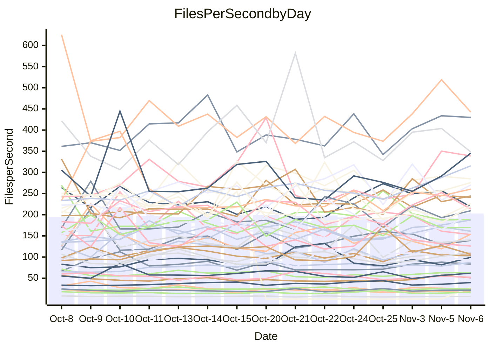

<!---
# This file is auto-generated. Do not edit.
# cspell:disable
--->
# Performance Report

Daily Performance

Time to Process Files

| Repository                                      | Elapsed | Min/Avg/Max          |    SD | SD Graph                |
| ----------------------------------------------- | ------: | :------------------: | ----: | ----------------------- |
| AdaDoom3/AdaDoom3                    |    2.39 | 1.8 /   2.9 /   3.5  |  0.45 | `    ┣━━●━━╋━━┻━━┫    ` |
| alexiosc/megistos                    |    7.26 | 3.9 /   6.5 /   9.3  |  1.39 | `    ┣━━┻━━╋━●┻━━┫    ` |
| apollographql/apollo-server          |    1.58 | 1.4 /   2.5 /   3.3  |  0.41 | `    ●━━┻━━╋━━┻━━┫    ` |
| aspnetboilerplate/aspnetboilerplate  |    7.09 | 5.1 /   8.0 /  10.2  |  1.61 | `    ┣━━┻●━╋━━┻━━┫    ` |
| aws-amplify/docs                     |   14.38 | 7.4 /  12.7 /  15.4  |  2.32 | `   ┣━━━┻━━╋━●┻━━━┫   ` |
| Azure/azure-rest-api-specs           |   11.08 | 6.2 /  10.0 /  12.2  |  1.71 | `    ┣━━┻━━╋━●┻━━┫    ` |
| bitjson/typescript-starter           |    0.72 | 0.7 /   1.0 /   1.3  |  0.17 | `     ●━┻━━╋━━┻━┫     ` |
| caddyserver/caddy                    |    4.70 | 2.3 /   3.9 /   4.8  |  0.69 | `    ┣━━┻━━╋━━●━━┫    ` |
| canada-ca/open-source-logiciel-libre |    0.95 | 0.7 /   1.0 /   1.4  |  0.18 | `     ┣━┻━●╋━━┻━┫     ` |
| chef/chef                            |    3.82 | 0.0 /   1.8 /   5.5  |  2.38 | `    ┣━━┻━━╋━●┻━━┫    ` |
| dart-lang/sdk                        |   48.58 | 35.8 /  57.4 /  76.1 |  8.98 | `  ┣━━━●━━━╋━━━┻━━━┫  ` |
| django/django                        |   15.31 | 7.6 /  12.9 /  15.6  |  2.48 | `   ┣━━━┻━━╋━━●━━━┫   ` |
| eslint/eslint                        |   10.16 | 5.8 /   9.4 /  11.5  |  1.65 | `    ┣━━┻━━╋●━┻━━┫    ` |
| exonum/exonum                        |    2.33 | 2.0 /   3.1 /   3.9  |  0.53 | `    ┣━●┻━━╋━━┻━━┫    ` |
| flutter/samples                      |    7.16 | 6.7 /  10.6 /  13.0  |  1.84 | `    ●━━┻━━╋━━┻━━┫    ` |
| gitbucket/gitbucket                  |    2.75 | 1.9 /   3.2 /   4.5  |  0.58 | `    ┣━━┻●━╋━━┻━━┫    ` |
| googleapis/google-cloud-cpp          |   73.62 | 72.6 / 120.7 / 144.0 | 18.67 | `● ┣━━━┻━━━╋━━━┻━━━┫  ` |
| graphql/express-graphql              |    1.01 | 0.7 /   1.1 /   1.4  |  0.19 | `     ┣━┻━●╋━━┻━┫     ` |
| graphql/graphql-js                   |    2.99 | 2.1 /   3.3 /   4.4  |  0.69 | `    ┣━━┻━●╋━━┻━━┫    ` |
| graphql/graphql-relay-js             |    1.13 | 0.7 /   1.1 /   1.4  |  0.18 | `     ┣━┻━━╋●━┻━┫     ` |
| graphql/graphql-spec                 |    0.86 | 0.8 /   1.3 /   1.6  |  0.20 | `     ●━┻━━╋━━┻━┫     ` |
| iluwatar/java-design-patterns        |   13.21 | 7.4 /  11.7 /  14.6  |  2.17 | `    ┣━━┻━━╋━●┻━━┫    ` |
| ktaranov/sqlserver-kit               |    6.22 | 3.3 /   5.2 /   6.8  |  1.14 | `    ┣━━┻━━╋━━●━━┫    ` |
| liriliri/licia                       |    4.01 | 2.3 /   3.6 /   4.7  |  0.68 | `    ┣━━┻━━╋━●┻━━┫    ` |
| MartinThoma/LaTeX-examples           |    5.12 | 3.8 /   6.1 /   7.5  |  1.06 | `    ┣━━●━━╋━━┻━━┫    ` |
| mdx-js/mdx                           |    2.03 | 1.2 /   1.7 /   2.1  |  0.27 | `     ┣━┻━━╋━━●━┫     ` |
| microsoft/TypeScript-Website         |    4.13 | 3.1 /   4.9 /   6.3  |  0.81 | `    ┣━━●━━╋━━┻━━┫    ` |
| MicrosoftDocs/PowerShell-Docs        |   25.52 | 14.4 /  23.3 /  28.1 |  3.45 | `   ┣━━━┻━━╋━●┻━━━┫   ` |
| neovim/nvim-lspconfig                |    4.43 | 3.1 /   5.3 /   6.8  |  1.02 | `    ┣━━┻●━╋━━┻━━┫    ` |
| pagekit/pagekit                      |    2.69 | 2.1 /   3.3 /   4.1  |  0.57 | `    ┣━━●━━╋━━┻━━┫    ` |
| php/php-src                          |   26.06 | 13.6 /  22.1 /  28.0 |  4.22 | `   ┣━━━┻━━╋━━●━━━┫   ` |
| plasticrake/tplink-smarthome-api     |    1.34 | 0.8 /   1.2 /   1.6  |  0.23 | `     ┣━┻━━╋━●┻━┫     ` |
| prettier/prettier                    |    7.04 | 4.5 /   7.6 /   9.3  |  1.32 | `    ┣━━┻━●╋━━┻━━┫    ` |
| pycontribs/jira                      |    1.70 | 0.9 /   1.4 /   1.9  |  0.23 | `     ┣━┻━━╋━━●━┫     ` |
| RustPython/RustPython                |   10.02 | 6.5 /  10.6 /  13.3  |  2.10 | `    ┣━━┻━●╋━━┻━━┫    ` |
| shoelace-style/shoelace              |    2.88 | 1.7 /   2.6 /   3.2  |  0.46 | `    ┣━━┻━━╋━●┻━━┫    ` |
| slint-ui/slint                       |   13.81 | 11.7 /  18.8 /  23.4 |  3.54 | `   ┣━●━┻━━╋━━┻━━━┫   ` |
| SoftwareBrothers/admin-bro           |    1.57 | 1.5 /   2.4 /   3.2  |  0.37 | `    ●━━┻━━╋━━┻━━┫    ` |
| sveltejs/svelte                      |   24.24 | 13.2 /  21.7 /  27.1 |  4.04 | `   ┣━━━┻━━╋━●┻━━━┫   ` |
| TheAlgorithms/Python                 |    3.90 | 3.9 /   6.2 /   7.6  |  1.02 | `   ●┣━━┻━━╋━━┻━━┫    ` |
| twbs/bootstrap                       |    1.70 | 1.1 /   1.9 /   2.3  |  0.30 | `     ┣━┻━●╋━━┻━┫     ` |
| typescript-cheatsheets/react         |    1.23 | 0.8 /   1.2 /   1.4  |  0.17 | `     ┣━┻━━╋●━┻━┫     ` |
| typescript-eslint/typescript-eslint  |    3.44 | 2.5 /   4.1 /   4.8  |  0.70 | `    ┣━━●━━╋━━┻━━┫    ` |
| vitest-dev/vitest                    |    6.71 | 6.4 /  10.6 /  13.1  |  2.00 | `    ●━━┻━━╋━━┻━━┫    ` |
| w3c/aria-practices                   |    2.80 | 2.0 /   3.0 /   4.2  |  0.58 | `    ┣━━┻━●╋━━┻━━┫    ` |
| w3c/specberus                        |    1.33 | 1.2 /   1.7 /   2.3  |  0.33 | `     ┣━●━━╋━━┻━┫     ` |
| webdeveric/webpack-assets-manifest   |    1.27 | 0.8 /   1.2 /   1.4  |  0.16 | `     ┣━┻━━╋━●┻━┫     ` |
| webpack/webpack                      |    5.93 | 5.3 /   8.3 /  10.4  |  1.53 | `    ┣●━┻━━╋━━┻━━┫    ` |
| wireapp/wire-desktop                 |    0.95 | 0.9 /   1.4 /   1.7  |  0.23 | `     ●━┻━━╋━━┻━┫     ` |
| wireapp/wire-webapp                  |   15.65 | 8.8 /  13.5 /  18.3  |  2.79 | `   ┣━━━┻━━╋━━●━━━┫   ` |

Note:
- Elapsed time is in seconds.

Files per Second over Time

| Repository                                      | Files |   Sec |    Fps |     Rel | Trend Fps              |    N |
| ----------------------------------------------- | ----: | ----: | -----: | ------: | ---------------------- | ---: |
| AdaDoom3/AdaDoom3                    |   103 |  2.39 |  43.17 |  16.02% | `▅▁▂▅▂▂▂▂▆▂▄█▂▂█▂▄▂▃▅` |   46 |
| alexiosc/megistos                    |   583 |  7.26 |  80.36 | -14.81% | `▂▂▃▂█▂▃▂▂▅▇▂▅▇▅▆▂▁▃▃` |   46 |
| apollographql/apollo-server          |   256 |  1.58 | 161.85 |  50.60% | `▂▅▆▃▃▃▅▂▄▃▃▅▄▃▁▃▂▂▃█` |   46 |
| aspnetboilerplate/aspnetboilerplate  |  2308 |  7.09 | 325.70 |   8.17% | `▂▂▂▂▂▅▇▅▂██▆▇▃▅█▂▂▅▅` |   46 |
| aws-amplify/docs                     |  3039 | 14.38 | 211.34 | -15.71% | `▂▇▂▂▁▂▅▄▂▁▃▂▅▂▂▄█▂▃▂` |   46 |
| Azure/azure-rest-api-specs           |  2607 | 11.08 | 235.31 | -12.92% | `▂▄▂▄▂▄▅▁▄▄▂█▂▇▇▂█▆▂▂` |   46 |
| bitjson/typescript-starter           |    20 |  0.72 |  27.74 |  37.23% | `▂▂▃▃▃▂█▃▃▃▂▃▅▅▁▄▇▃▂█` |   46 |
| caddyserver/caddy                    |   402 |  4.70 |  85.61 | -17.36% | `▂▂▂▂▆▂▂▅▂▇▂▂▅▄█▂▁▂▂▁` |   46 |
| canada-ca/open-source-logiciel-libre |     7 |  0.95 |   7.39 |   7.14% | `▂▁▃▃█▅▂▇▅▂▄▃▂▅▇▅▅▂▂▅` |   46 |
| chef/chef                            |  1040 |  3.82 | 272.46 | 232.88% | `▁▁▁▁▁▁▁▁▁▁▁▁▁▁▁▁▁▁▁█` |   45 |
| dart-lang/sdk                        | 11839 | 48.58 | 243.70 |  15.25% | `▃▅▃▃▂▃▂▂▃▁▂█▅▃▄▂▃▃▃▅` |   46 |
| django/django                        |  2941 | 15.31 | 192.13 | -19.18% | `▂▇▂▂█▁▆▁▃▁▃▂▃▂▂▁▆▇▄▁` |   46 |
| eslint/eslint                        |  2087 | 10.16 | 205.34 | -11.15% | `▄▁▅▂▂▂▇▄▂▅███▂▂▂▂▁▂▂` |   46 |
| exonum/exonum                        |   421 |  2.33 | 180.60 |  30.49% | `▆▂▅█▅▂▁▂▅▅▂▄▂▂▂█▂▆▃▇` |   46 |
| flutter/samples                      |  1703 |  7.16 | 237.99 |  43.69% | `▂▂▆▃▃▄▆▂▅▂▅▅▁▄▂▆▃█▂▇` |   46 |
| gitbucket/gitbucket                  |   427 |  2.75 | 155.26 |  10.66% | `▅▅▄▃▃▂▃▃▃▃█▂▅▂▅██▅▁▅` |   46 |
| googleapis/google-cloud-cpp          | 22116 | 73.62 | 300.42 |  59.18% | `▂▃▄▂▂▂▂▂▂▁▄▂▂▂▁▁▅▇▂█` |   46 |
| graphql/express-graphql              |    26 |  1.01 |  25.79 |   3.33% | `▃▂▂▂▆▁█▂▂▆▂▂▃▁▃▂█▂▄▄` |   46 |
| graphql/graphql-js                   |   556 |  2.99 | 185.82 |   6.24% | `▅▂▄▆█▇▂▁▂▂▂▂▅▂▂▂▂▂▂▄` |   46 |
| graphql/graphql-relay-js             |    28 |  1.13 |  24.71 |  -7.01% | `▁█▆▃▃▂▄▇▄▅█▃▃▃▅▃▃▃▂▄` |   46 |
| graphql/graphql-spec                 |    19 |  0.86 |  22.01 |  41.39% | `▇▆▂▁▂▂▂▆▂▂█▃▃▅▄▃▆▂▂█` |   46 |
| iluwatar/java-design-patterns        |  2239 | 13.21 | 169.45 | -14.98% | `▂▅▂█▃▄▂▂▅▃█▂▄▁▅▄▄▂▆▂` |   46 |
| ktaranov/sqlserver-kit               |   490 |  6.22 |  78.77 | -20.02% | `▄▂▆▂█▂▂▁▇▆▄▇▂▂▄▂▂▅▁▂` |   46 |
| liriliri/licia                       |  1442 |  4.01 | 359.46 | -13.78% | `▂▄▅▂▂▇█▂▂▁▄▂▂▂▂▇▇▂█▂` |   46 |
| MartinThoma/LaTeX-examples           |  1414 |  5.12 | 276.10 |  14.38% | `▂▂▂▃▇▆▄▂▆▂▂▇▂▂█▂█▅▅▅` |   46 |
| mdx-js/mdx                           |   139 |  2.03 |  68.42 | -16.53% | `▂▅▂▅▄▆▅█▂▂▄▇▃▄▂▆▄▆▂▂` |   46 |
| microsoft/TypeScript-Website         |   765 |  4.13 | 185.08 |  15.22% | `▃▂▂█▂▅▄█▂▃█▅▃▃▅▃▂▂▃▅` |   46 |
| MicrosoftDocs/PowerShell-Docs        |  3127 | 25.52 | 122.52 | -11.13% | `▇▂█▂▃▄▃▂▁▄▂▅▃▂▂▃▃▃▁▂` |   46 |
| neovim/nvim-lspconfig                |   889 |  4.43 | 200.70 |  13.71% | `▂▂▁▂▂▂▂▄▂▅▇▄▁▂▇▂▂█▆▄` |   46 |
| pagekit/pagekit                      |   741 |  2.69 | 274.98 |  19.97% | `▆▃▂▆█▅▂▃▆█▂▂▂▂▅▂▂▅▁▆` |   46 |
| php/php-src                          |  2403 | 26.06 |  92.20 | -18.39% | `█▄▆▂▁▆▂▄▇▄▂▂▂▄▂▂▆▂▆▂` |   46 |
| plasticrake/tplink-smarthome-api     |    62 |  1.34 |  46.17 | -14.16% | `▃▄▅▂▂▃▁▆▁██▆▂▂▂▂▂▃▇▂` |   46 |
| prettier/prettier                    |  2791 |  7.04 | 396.21 |   4.75% | `▂▂█▂▁▂▃▄▆▂▂▄▂▂▂▄▁▁▂▃` |   46 |
| pycontribs/jira                      |    80 |  1.70 |  47.04 | -19.69% | `▅▁▃▃▃▅▂▅▄▂█▃▇▃▅▄▃█▅▂` |   46 |
| RustPython/RustPython                |  1069 | 10.02 | 106.68 |   4.96% | `▂▃▃▂▁▂▇▅▁▁▁▇▂█▇▁▄█▁▄` |   46 |
| shoelace-style/shoelace              |   440 |  2.88 | 152.84 | -13.40% | `▂▂▇█▂▂▁▅▂▇▂▃▅▄▂▂▅▆▂▂` |   46 |
| slint-ui/slint                       |  5027 | 13.81 | 364.09 |  38.30% | `▂▄▇▄█▂▂▂▂▄▂▂▄▇▃▂█▂▂█` |   46 |
| SoftwareBrothers/admin-bro           |   441 |  1.57 | 280.15 |  47.99% | `▃▃▇▆▃▃▂▃▂▅▄▃█▁▃▃▅▂▄█` |   46 |
| sveltejs/svelte                      |  9223 | 24.24 | 380.56 | -14.05% | `▂▁▂▅▄▄█▂▂▇▂▂▄▂▆▂█▂▂▂` |   46 |
| TheAlgorithms/Python                 |  1640 |  3.90 | 420.86 |  53.19% | `▂▂█▂▂▂▆▆▃▂▂▄▄▄▂▃▁▂▅█` |   46 |
| twbs/bootstrap                       |   152 |  1.70 |  89.54 |  11.32% | `▃▄▂▆▂▅▂▃▂▂▂▄▅▄▄▄█▃▃▄` |   46 |
| typescript-cheatsheets/react         |    24 |  1.23 |  19.57 |  -7.41% | `▆▃▂▄▃▂█▃▂▆▃▇▂▅▃▅▃▅█▃` |   46 |
| typescript-eslint/typescript-eslint  |   887 |  3.44 | 257.60 |  14.17% | `▂▂▂▃▄▂▂▃▂▁▂█▄▃▃▃▂▃▁▅` |   46 |
| vitest-dev/vitest                    |  2948 |  6.71 | 439.64 |  53.24% | `▃▄▂▂▁▂▆▂▂▄█▄▂█▂█▂█▂█` |   46 |
| w3c/aria-practices                   |   417 |  2.80 | 148.84 |   4.39% | `▁▂▃█▃▂▂▇▅▃▄▃▂▄▆▃▇▅▂▅` |   46 |
| w3c/specberus                        |   190 |  1.33 | 142.70 |  23.75% | `▂▂▂█▃▃▂▇▇▇▃▂▅▄▄▃▂▂▃▇` |   46 |
| webdeveric/webpack-assets-manifest   |    55 |  1.27 |  43.26 | -10.69% | `▂▂▆▂▂▂█▃▇█▄▇▂█▂▂▃▇▂▂` |   46 |
| webpack/webpack                      |  1540 |  5.93 | 259.80 |  36.70% | `▆▂▄█▂▂▂▃▄▄▂▄▄▁▁█▂▂▂▇` |   46 |
| wireapp/wire-desktop                 |    86 |  0.95 |  90.24 |  49.08% | `▂▂▄▂▄▂▅▇▃▃▂▂▂▂▆▃▂▄▆█` |   46 |
| wireapp/wire-webapp                  |  2803 | 15.65 | 179.08 | -16.92% | `▂▅▂▇▂██▂█▁▂▂▃▂██▂▂▅▂` |   46 |

Data Throughput

| Repository                                      | Files |   Sec |     Kps |     Rel | Trend Kps              |    N |
| ----------------------------------------------- | ----: | ----: | ------: | ------: | ---------------------- | ---: |
| AdaDoom3/AdaDoom3                    |   103 |  2.39 |  917.51 |  16.02% | `▅▁▂▅▂▂▂▂▆▂▄█▂▂█▂▄▂▃▅` |   46 |
| alexiosc/megistos                    |   583 |  7.26 |  631.42 | -14.81% | `▂▂▃▂█▂▃▂▂▅▇▂▅▇▅▆▂▁▃▃` |   46 |
| apollographql/apollo-server          |   256 |  1.58 | 1336.50 |  50.60% | `▂▅▆▃▃▃▅▂▄▃▃▅▄▃▁▃▂▂▃█` |   46 |
| aspnetboilerplate/aspnetboilerplate  |  2308 |  7.09 |  803.52 |   8.39% | `▂▂▂▂▂▅▇▅▂██▆▇▃▅█▂▂▅▅` |   46 |
| aws-amplify/docs                     |  3039 | 14.38 |  830.61 | -15.70% | `▂▇▂▂▁▂▅▄▂▁▃▂▅▂▂▄█▂▃▂` |   46 |
| Azure/azure-rest-api-specs           |  2607 | 11.08 |  740.40 | -12.21% | `▂▄▂▄▂▄▅▁▄▄▂█▃▇▇▂█▆▂▂` |   46 |
| bitjson/typescript-starter           |    20 |  0.72 |  110.97 |  37.23% | `▂▂▃▃▃▂█▃▃▃▂▃▅▅▁▄▇▃▂█` |   46 |
| caddyserver/caddy                    |   402 |  4.70 |  836.28 | -15.60% | `▂▂▂▃▆▂▂▅▂▇▃▂▅▅█▂▂▂▂▂` |   46 |
| canada-ca/open-source-logiciel-libre |     7 |  0.95 |   61.20 |   7.14% | `▂▁▃▃█▅▂▇▅▂▄▃▂▅▇▅▅▂▂▅` |   46 |
| chef/chef                            |  1040 |  3.82 | 1343.16 |  27.05% | `▃▂▇▃▄▂▆▂▃▃▇▅▃▂▂▃▇█`   |   17 |
| dart-lang/sdk                        | 11839 | 48.58 | 1712.66 |  15.48% | `▃▅▃▃▂▃▂▂▃▁▂█▅▃▄▂▃▃▃▅` |   46 |
| django/django                        |  2941 | 15.31 | 1248.34 | -19.04% | `▂▇▂▂█▁▆▁▃▁▃▂▃▂▂▁▆▇▄▁` |   46 |
| eslint/eslint                        |  2087 | 10.16 | 1455.06 | -11.05% | `▄▁▅▂▂▂▇▄▂▅███▂▂▂▂▁▂▂` |   46 |
| exonum/exonum                        |   421 |  2.33 | 1727.51 |  30.49% | `▆▂▅█▅▂▁▂▅▅▂▄▂▂▂█▂▆▃▇` |   46 |
| flutter/samples                      |  1703 |  7.16 | 1418.56 |  43.69% | `▂▂▆▃▃▄▆▂▅▂▅▅▁▄▂▆▃█▂▇` |   46 |
| gitbucket/gitbucket                  |   427 |  2.75 |  766.50 |  11.19% | `▅▅▄▃▃▂▃▃▃▃█▂▅▂▅██▅▁▅` |   46 |
| googleapis/google-cloud-cpp          | 22116 | 73.62 | 2635.05 |  59.58% | `▂▃▄▂▂▂▂▂▂▁▄▂▂▂▁▁▅▇▂█` |   46 |
| graphql/express-graphql              |    26 |  1.01 |  118.02 |   3.33% | `▃▂▂▂▆▁█▂▂▆▂▂▃▁▃▂█▂▄▄` |   46 |
| graphql/graphql-js                   |   556 |  2.99 | 1419.69 |   7.31% | `▅▂▄▆█▇▂▁▂▂▂▂▅▂▂▂▂▂▂▄` |   46 |
| graphql/graphql-relay-js             |    28 |  1.13 |   97.07 |  -7.01% | `▁█▆▃▃▂▄▇▄▅█▃▃▃▅▃▃▃▂▄` |   46 |
| graphql/graphql-spec                 |    19 |  0.86 |  740.35 |  41.39% | `▇▆▂▁▂▂▂▆▂▂█▃▃▅▄▃▆▂▂█` |   46 |
| iluwatar/java-design-patterns        |  2239 | 13.21 |  525.77 | -14.98% | `▂▅▂█▃▄▂▂▅▃█▂▄▁▅▄▄▂▆▂` |   46 |
| ktaranov/sqlserver-kit               |   490 |  6.22 | 1193.73 | -20.00% | `▄▂▆▂█▂▂▁▇▆▄▇▂▂▄▂▂▅▁▂` |   46 |
| liriliri/licia                       |  1442 |  4.01 |  431.01 | -13.78% | `▂▄▅▂▂▇█▂▂▁▄▂▂▂▂▇▇▂█▂` |   46 |
| MartinThoma/LaTeX-examples           |  1414 |  5.12 |  573.68 |  14.38% | `▂▂▂▃▇▆▄▂▆▂▂▇▂▂█▂█▅▅▅` |   46 |
| mdx-js/mdx                           |   139 |  2.03 |  322.39 | -16.53% | `▂▅▂▅▄▆▅█▂▂▄▇▃▄▂▆▄▆▂▂` |   46 |
| microsoft/TypeScript-Website         |   765 |  4.13 | 1277.20 |  15.26% | `▃▂▂█▂▅▄█▂▃█▅▃▃▅▃▂▂▃▅` |   46 |
| MicrosoftDocs/PowerShell-Docs        |  3127 | 25.52 | 1309.33 | -11.13% | `▇▂█▂▃▄▃▂▁▄▂▅▃▂▂▃▃▃▁▂` |   46 |
| neovim/nvim-lspconfig                |   889 |  4.43 |  634.62 |  14.06% | `▂▂▁▂▂▂▂▄▂▅▇▄▁▂▇▂▂█▆▄` |   46 |
| pagekit/pagekit                      |   741 |  2.69 |  573.34 |  19.97% | `▆▃▂▆█▅▂▃▆█▂▂▂▂▅▂▂▅▁▆` |   46 |
| php/php-src                          |  2403 | 26.06 | 1640.73 | -18.39% | `█▄▆▂▁▆▂▄▇▄▂▂▂▄▂▂▆▂▆▂` |   46 |
| plasticrake/tplink-smarthome-api     |    62 |  1.34 |  249.49 | -14.16% | `▃▄▅▂▂▃▁▆▁██▆▂▂▂▂▂▃▇▂` |   46 |
| prettier/prettier                    |  2791 |  7.04 |  552.36 |   4.40% | `▂▂█▂▁▂▃▄▆▂▂▄▂▂▂▄▁▁▂▃` |   46 |
| pycontribs/jira                      |    80 |  1.70 |  332.23 | -19.69% | `▅▁▃▃▃▅▂▅▄▂█▃▇▃▅▄▃█▅▂` |   46 |
| RustPython/RustPython                |  1069 | 10.02 | 3078.29 |   3.88% | `▂▃▃▂▁▂▇▅▁▁▁▇▂█▇▁▄█▁▄` |   46 |
| shoelace-style/shoelace              |   440 |  2.88 |  738.15 | -13.40% | `▂▂▇█▂▂▁▅▂▇▂▃▅▄▂▂▅▆▂▂` |   46 |
| slint-ui/slint                       |  5027 | 13.81 | 2187.66 |  40.55% | `▂▄▇▄█▂▂▂▂▅▂▂▄▇▃▂█▂▂█` |   46 |
| SoftwareBrothers/admin-bro           |   441 |  1.57 |  617.47 |  47.99% | `▃▃▇▆▃▃▂▃▂▅▄▃█▁▃▃▅▂▄█` |   46 |
| sveltejs/svelte                      |  9223 | 24.24 |  263.42 | -13.96% | `▂▁▂▅▄▄█▂▂▇▂▂▄▂▆▂█▂▂▂` |   46 |
| TheAlgorithms/Python                 |  1640 |  3.90 | 1207.16 |  53.34% | `▂▂█▂▂▂▆▆▃▂▂▄▄▄▂▃▁▂▅█` |   46 |
| twbs/bootstrap                       |   152 |  1.70 |  756.96 |  12.06% | `▃▄▂▆▂▅▂▃▂▃▂▄▅▄▄▄█▃▃▄` |   46 |
| typescript-cheatsheets/react         |    24 |  1.23 |  176.94 |  -7.41% | `▆▃▂▄▃▂█▃▂▆▃▇▂▅▃▅▃▅█▃` |   46 |
| typescript-eslint/typescript-eslint  |   887 |  3.44 |  880.84 |  14.41% | `▂▂▂▃▄▂▂▃▂▁▂█▄▃▃▃▂▃▁▅` |   46 |
| vitest-dev/vitest                    |  2948 |  6.71 | 1329.05 |  54.42% | `▃▄▂▂▂▂▆▂▂▄█▄▂█▂█▂█▂█` |   46 |
| w3c/aria-practices                   |   417 |  2.80 | 1401.32 |   4.39% | `▁▂▃█▃▂▂▇▅▃▄▃▂▄▆▃▇▅▂▅` |   46 |
| w3c/specberus                        |   190 |  1.33 |  467.16 |  23.75% | `▂▂▂█▃▃▂▇▇▇▃▂▅▄▄▃▂▂▃▇` |   46 |
| webdeveric/webpack-assets-manifest   |    55 |  1.27 |   99.90 | -10.69% | `▂▂▆▂▂▂█▃▇█▄▇▂█▂▂▃▇▂▂` |   46 |
| webpack/webpack                      |  1540 |  5.93 | 2259.07 |  35.64% | `▇▂▄█▂▂▂▃▄▄▂▄▄▁▁█▂▂▂▇` |   46 |
| wireapp/wire-desktop                 |    86 |  0.95 |  396.63 |  50.63% | `▃▂▄▃▄▃▅▇▃▃▃▂▂▃▆▃▂▄▆█` |   46 |
| wireapp/wire-webapp                  |  2803 | 15.65 |  854.05 | -15.18% | `▂▅▂▇▂██▂█▁▂▂▃▂██▂▂▅▂` |   46 |

