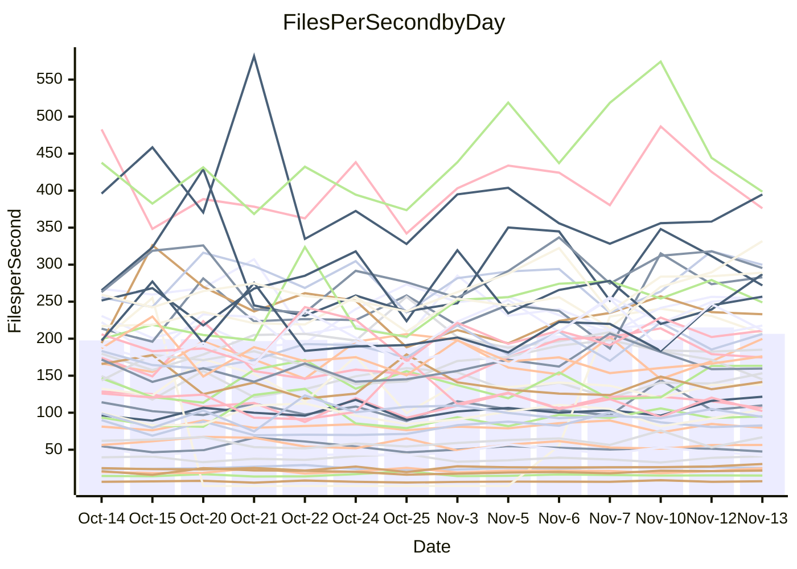

<!---
# This file is auto-generated. Do not edit.
# cspell:disable
--->
# Performance Report

Daily Performance

Time to Process Files

| Repository                                      | Elapsed | Min/Avg/Max          |    SD | SD Graph                |
| ----------------------------------------------- | ------: | :------------------: | ----: | ----------------------- |
| AdaDoom3/AdaDoom3                    |    3.29 | 1.8 /   2.8 /   3.5  |  0.51 | `    ┣━━┻━━╋━━●━━┫    ` |
| alexiosc/megistos                    |    4.80 | 3.9 /   6.4 /   9.3  |  1.23 | `    ┣━●┻━━╋━━┻━━┫    ` |
| apollographql/apollo-server          |    2.44 | 1.4 /   2.5 /   3.3  |  0.41 | `    ┣━━┻━━●━━┻━━┫    ` |
| aspnetboilerplate/aspnetboilerplate  |    9.31 | 5.3 /   7.9 /  10.2  |  1.55 | `    ┣━━┻━━╋━━●━━┫    ` |
| aws-amplify/docs                     |    9.47 | 7.4 /  12.4 /  15.4  |  2.46 | `    ┣━●┻━━╋━━┻━━┫    ` |
| Azure/azure-rest-api-specs           |    6.86 | 6.2 /   9.7 /  12.2  |  1.73 | `    ┣●━┻━━╋━━┻━━┫    ` |
| bitjson/typescript-starter           |    1.07 | 0.6 /   1.0 /   1.3  |  0.18 | `     ┣━┻━━╋●━┻━┫     ` |
| caddyserver/caddy                    |    4.81 | 2.5 /   3.9 /   4.9  |  0.71 | `    ┣━━┻━━╋━━┻●━┫    ` |
| canada-ca/open-source-logiciel-libre |    0.81 | 0.7 /   1.0 /   1.4  |  0.18 | `     ┣━●━━╋━━┻━┫     ` |
| chef/chef                            |    4.83 | 0.0 /   2.2 /   5.9  |  2.44 | `    ┣━━┻━━╋━━●━━┫    ` |
| dart-lang/sdk                        |   44.57 | 34.1 /  56.6 /  76.1 |  9.64 | `  ┣━━●┻━━━╋━━━┻━━━┫  ` |
| django/django                        |    8.51 | 7.6 /  12.6 /  15.6  |  2.37 | `    ●━━┻━━╋━━┻━━┫    ` |
| eslint/eslint                        |    9.01 | 5.7 /   8.9 /  11.8  |  1.87 | `    ┣━━┻━━●━━┻━━┫    ` |
| exonum/exonum                        |    3.56 | 2.1 /   3.1 /   3.9  |  0.54 | `    ┣━━┻━━╋━━●━━┫    ` |
| flutter/samples                      |   12.24 | 6.6 /  10.5 /  13.9  |  2.10 | `    ┣━━┻━━╋━━●━━┫    ` |
| gitbucket/gitbucket                  |    2.35 | 2.0 /   3.1 /   4.5  |  0.61 | `    ┣━━●━━╋━━┻━━┫    ` |
| googleapis/google-cloud-cpp          |  128.71 | 72.6 / 113.0 / 144.0 | 22.35 | `  ┣━━━┻━━━╋━━●┻━━━┫  ` |
| graphql/express-graphql              |    1.16 | 0.7 /   1.1 /   1.4  |  0.18 | `     ┣━┻━━╋●━┻━┫     ` |
| graphql/graphql-js                   |    4.00 | 2.1 /   3.4 /   4.4  |  0.66 | `    ┣━━┻━━╋━━●━━┫    ` |
| graphql/graphql-relay-js             |    1.01 | 0.7 /   1.1 /   1.4  |  0.17 | `     ┣━┻━●╋━━┻━┫     ` |
| graphql/graphql-spec                 |    1.08 | 0.8 /   1.3 /   1.6  |  0.21 | `     ┣━┻●━╋━━┻━┫     ` |
| iluwatar/java-design-patterns        |    7.83 | 7.4 /  11.3 /  14.6  |  2.10 | `    ┣●━┻━━╋━━┻━━┫    ` |
| ktaranov/sqlserver-kit               |    6.34 | 3.2 /   5.2 /   6.8  |  1.11 | `    ┣━━┻━━╋━━●━━┫    ` |
| liriliri/licia                       |    3.97 | 2.2 /   3.6 /   4.7  |  0.71 | `    ┣━━┻━━╋●━┻━━┫    ` |
| MartinThoma/LaTeX-examples           |    5.01 | 3.8 /   5.9 /   7.5  |  1.10 | `    ┣━━┻●━╋━━┻━━┫    ` |
| mdx-js/mdx                           |    1.40 | 1.2 /   1.8 /   2.1  |  0.29 | `     ┣━●━━╋━━┻━┫     ` |
| microsoft/TypeScript-Website         |    4.57 | 3.1 /   4.9 /   6.0  |  0.82 | `    ┣━━┻━●╋━━┻━━┫    ` |
| MicrosoftDocs/PowerShell-Docs        |   24.35 | 14.9 /  23.5 /  28.1 |  3.26 | `   ┣━━━┻━━╋●━┻━━━┫   ` |
| neovim/nvim-lspconfig                |    4.67 | 3.1 /   5.2 /  10.2  |  1.24 | `    ┣━━┻━●╋━━┻━━┫    ` |
| pagekit/pagekit                      |    3.64 | 2.0 /   3.2 /   4.1  |  0.62 | `    ┣━━┻━━╋━●┻━━┫    ` |
| php/php-src                          |   20.23 | 13.6 /  22.4 /  28.0 |  4.23 | `   ┣━━━┻●━╋━━┻━━━┫   ` |
| plasticrake/tplink-smarthome-api     |    1.39 | 0.8 /   1.2 /   1.6  |  0.22 | `     ┣━┻━━╋━●┻━┫     ` |
| prettier/prettier                    |    6.77 | 4.5 /   7.6 /   9.3  |  1.23 | `    ┣━━┻●━╋━━┻━━┫    ` |
| pycontribs/jira                      |    1.61 | 1.0 /   1.4 /   1.9  |  0.21 | `     ┣━┻━━╋━●┻━┫     ` |
| RustPython/RustPython                |    8.42 | 7.2 /  11.1 /  13.4  |  2.03 | `    ┣━●┻━━╋━━┻━━┫    ` |
| shoelace-style/shoelace              |    2.25 | 1.7 /   2.6 /   3.5  |  0.45 | `    ┣━━┻●━╋━━┻━━┫    ` |
| slint-ui/slint                       |   22.93 | 12.5 /  19.4 /  24.1 |  3.67 | `   ┣━━━┻━━╋━━●━━━┫   ` |
| SoftwareBrothers/admin-bro           |    2.59 | 1.5 /   2.3 /   3.2  |  0.41 | `    ┣━━┻━━╋━●┻━━┫    ` |
| sveltejs/svelte                      |   24.75 | 13.4 /  22.9 / 100.8 | 11.57 | `   ┣━━┻━━━╋●━━┻━━┫   ` |
| TheAlgorithms/Python                 |    3.93 | 3.7 /   6.0 /   7.6  |  1.14 | `    ┣●━┻━━╋━━┻━━┫    ` |
| twbs/bootstrap                       |    1.82 | 1.2 /   1.9 /   2.5  |  0.29 | `     ┣━┻━●╋━━┻━┫     ` |
| typescript-cheatsheets/react         |    1.00 | 0.8 /   1.2 /   1.4  |  0.17 | `     ┣━┻●━╋━━┻━┫     ` |
| typescript-eslint/typescript-eslint  |    4.25 | 2.6 /   4.0 /   4.8  |  0.71 | `    ┣━━┻━━╋●━┻━━┫    ` |
| vitest-dev/vitest                    |   12.20 | 6.4 /  10.3 /  12.9  |  2.10 | `    ┣━━┻━━╋━━●━━┫    ` |
| w3c/aria-practices                   |    3.45 | 2.1 /   3.1 /   4.2  |  0.53 | `    ┣━━┻━━╋━●┻━━┫    ` |
| w3c/specberus                        |    1.54 | 1.1 /   1.7 /   2.3  |  0.32 | `     ┣━┻●━╋━━┻━┫     ` |
| webdeveric/webpack-assets-manifest   |    1.39 | 0.8 /   1.2 /   1.6  |  0.16 | `     ┣━┻━━╋━━●━┫     ` |
| webpack/webpack                      |    9.71 | 5.3 /   8.3 /  10.7  |  1.62 | `    ┣━━┻━━╋━━●━━┫    ` |
| wireapp/wire-desktop                 |    1.05 | 0.9 /   1.4 /   1.9  |  0.24 | `     ┣●┻━━╋━━┻━┫     ` |
| wireapp/wire-webapp                  |   16.90 | 8.5 /  14.0 /  18.4  |  2.96 | `   ┣━━━┻━━╋━━●━━━┫   ` |

Note:
- Elapsed time is in seconds.

Files per Second over Time

| Repository                                      | Files |    Sec |    Fps |     Rel | Trend Fps              |    N |
| ----------------------------------------------- | ----: | -----: | -----: | ------: | ---------------------- | ---: |
| AdaDoom3/AdaDoom3                    |   103 |   3.29 |  31.26 | -18.38% | `▅▃▂▄▃▂▂▅▁▂▅█▂▅█▆█▁▂▂` |   53 |
| alexiosc/megistos                    |   583 |   4.80 | 121.55 |  28.64% | `▃▃▄▆▆▇▆▄▆▅▃▃▆▆▃▃▆▃▆█` |   53 |
| apollographql/apollo-server          |   256 |   2.44 | 105.10 |  -2.67% | `▇▂▃▂▄█▅▃▁▂▂▅▅▂▄▅▂▄▃▃` |   53 |
| aspnetboilerplate/aspnetboilerplate  |  2308 |   9.31 | 247.87 | -18.47% | `▅█▂▂▅▅█▃█▄▂▅▂▇▄▃▂▅▂▂` |   53 |
| aws-amplify/docs                     |  3039 |   9.47 | 320.94 |  24.44% | `▂▂▂▂▂▇▁▄▃▂█▇▄▂█▆▆▂▆▅` |   53 |
| Azure/azure-rest-api-specs           |  2625 |   6.86 | 382.60 |  36.84% | `▂▇▂▂▅▂▄▂▄▃▂▂█▄▂▂▅▄▄▇` |   53 |
| bitjson/typescript-starter           |    20 |   1.07 |  18.69 |  -8.28% | `▆▂▃▂▄▆▂▅▂▂█▂▂▄▇▂▄▄▃▃` |   53 |
| caddyserver/caddy                    |   414 |   4.81 |  86.08 | -18.96% | `▁▂▄▁▂▂▃▆▁▁▆▁▆▅█▄▂▆▄▁` |   53 |
| canada-ca/open-source-logiciel-libre |     7 |   0.81 |   8.63 |  24.37% | `▄▃▄▂█▅▅▃▄▃▂▃▃▆▄▂▅▆▂▆` |   53 |
| chef/chef                            |  1041 |   4.83 | 215.41 | 103.95% | `▇█▇▅█▅▆█▅█▅▅▅▆▅▅▇▅▅▆` |   52 |
| dart-lang/sdk                        | 11864 |  44.57 | 266.17 |  23.04% | `▄▄▂▄▂▂▃█▃▅▃▇▂▂▃▄▇▃▅▅` |   53 |
| django/django                        |  2945 |   8.51 | 346.09 |  41.92% | `▁▂▂▂▂▂▄▅▃▅▂▂▄▇▄▂▂▄▄█` |   53 |
| eslint/eslint                        |  2090 |   9.01 | 231.86 |  -6.09% | `▂▂▁▂▇█▄▇▂▅█▂▅▄█▄▇▄▄▃` |   53 |
| exonum/exonum                        |   421 |   3.56 | 118.38 | -16.83% | `▇▅▂▃▅▃▅▂▂█▂▇▁▅▅▇▂█▅▂` |   53 |
| flutter/samples                      |  1703 |  12.24 | 139.12 | -18.21% | `▇▆█▂▄▂▆█▂▃█▂▁▂▄▂▂▂▂▂` |   53 |
| gitbucket/gitbucket                  |   427 |   2.35 | 182.07 |  25.91% | `▅▅▂▃▃▂▃▅▅▃▃▇█▆▃▆█▂▆▆` |   53 |
| googleapis/google-cloud-cpp          | 22119 | 128.71 | 171.85 | -16.12% | `█▇█▄▂▄▂█▇▇▂▆▂▆▇▄▄▄▂▂` |   53 |
| graphql/express-graphql              |    26 |   1.16 |  22.37 | -11.19% | `▄▅▅▅▃█▃▂▃▄▄█▃█▅▆▃▆▂▃` |   53 |
| graphql/graphql-js                   |   562 |   4.00 | 140.56 | -18.96% | `▄▂█▂▂▂▂▃▅▃▆▂▄▂▇▄▅▄▇▂` |   53 |
| graphql/graphql-relay-js             |    28 |   1.01 |  27.73 |   4.66% | `▃▇▄▂▅▃▂▃▃▅▅▄▅▂█▄▃▂█▄` |   53 |
| graphql/graphql-spec                 |    19 |   1.08 |  17.54 |  13.14% | `█▂▆▂▅▃▃▂▅█▃▃▂▁▂▂▅▂▅▅` |   53 |
| iluwatar/java-design-patterns        |  2239 |   7.83 | 285.81 |  39.00% | `▂▅▂▅▂█▆▂▅▂▂▂█▅▄▄▅▂▂█` |   53 |
| ktaranov/sqlserver-kit               |   490 |   6.34 |  77.25 | -21.81% | `▂▃▄▂▂▁▆▁▂▂▄▇█▄▃▄▃▂▄▂` |   53 |
| liriliri/licia                       |  1442 |   3.97 | 363.32 | -13.17% | `▂▂▂▄▄█▂▂▅▁▆▇▂▂▂▂▂▄▂▂` |   53 |
| MartinThoma/LaTeX-examples           |  1414 |   5.01 | 282.31 |  12.35% | `▅▄▅▅▂▇▂▅▄▄█▂▂█▂▇▂▃▂▅` |   53 |
| mdx-js/mdx                           |   139 |   1.40 |  99.04 |  21.05% | `▂▂▇▅█▂▃▂▇▂▂▂▁▇▃▂▆▄▂▆` |   53 |
| microsoft/TypeScript-Website         |   810 |   4.57 | 177.41 |   9.34% | `▄▄▃▇▂█▂▂▅▂▂▂▆▂▄▂▂▂▄▄` |   53 |
| MicrosoftDocs/PowerShell-Docs        |  3127 |  24.35 | 128.42 |  -5.91% | `▂▂▂▂▄▃▅▂▂▂▂▅▂▄█▂▂▂▃▂` |   53 |
| neovim/nvim-lspconfig                |   891 |   4.67 | 190.85 |   6.65% | `▅▃▆▅▅█▅▁▄▅▅▂█▇▄▃▃█▄▅` |   53 |
| pagekit/pagekit                      |   741 |   3.64 | 203.39 | -14.77% | `▄█▂▂▂▆▂▂▂█▂▂▇▃▂▂█▄▅▂` |   53 |
| php/php-src                          |  2401 |  20.23 | 118.71 |   6.45% | `▂▁▅▄▂▂▂▅█▇▂▁▅▂▂▂▅▂▂▄` |   53 |
| plasticrake/tplink-smarthome-api     |    62 |   1.39 |  44.64 | -15.28% | `▃▅▃▅▂▂█▇▂▅▂▄▂▅▃▃▂▆▃▂` |   53 |
| prettier/prettier                    |  2818 |   6.77 | 416.34 |   9.60% | `▅▆▃▂▆▂▂▃▃▃▃▂█▃▆▃▃▆▆▆` |   53 |
| pycontribs/jira                      |    78 |   1.61 |  48.43 | -15.51% | `▂▅▄▄▄▃▃▆▃▃▇▃▅▄█▃▇▂▃▃` |   53 |
| RustPython/RustPython                |  1077 |   8.42 | 127.84 |  29.05% | `▄▅▄▅▁▂▂▂▅▂▂▂▂▆█▂▂▂▄▇` |   53 |
| shoelace-style/shoelace              |   440 |   2.25 | 195.83 |  12.63% | `▃▇▁▅▃▃▄▆▂▃▅▂▃▅▅▃▂█▃▆` |   53 |
| slint-ui/slint                       |  5152 |  22.93 | 224.71 | -15.39% | `█▂▄▄▂▂▂▄▄▂▂▁▂▄▅█▂█▂▂` |   53 |
| SoftwareBrothers/admin-bro           |   441 |   2.59 | 170.12 | -12.63% | `██▃▂▅▃▇▅▃▄▂▂▄▂▃▅▆▇▂▃` |   53 |
| sveltejs/svelte                      |  9241 |  24.75 | 373.36 | -16.13% | `▄▄█▄▄██▆▄▄▆▄▆▆▇▁▄▄▇▄` |   53 |
| TheAlgorithms/Python                 |  1640 |   3.93 | 417.61 |  45.87% | `█▇▂▂▂▄▂▄▇▂▅▄▂▆▂▂▁█▂▇` |   53 |
| twbs/bootstrap                       |   152 |   1.82 |  83.46 |   1.28% | `▅▃▂█▅▃▁▅▅▃▄▃▅▇▅▃▅▃▂▄` |   53 |
| typescript-cheatsheets/react         |    24 |   1.00 |  24.10 |  13.73% | `▃▂▅▃▂▂▂▅▃▄▂▄▃▃█▅▃▇▅▅` |   53 |
| typescript-eslint/typescript-eslint  |   887 |   4.25 | 208.90 |  -9.20% | `▅▂▄▄▅▁██▃▂▄▂▂▅▅▂▂▄▆▂` |   53 |
| vitest-dev/vitest                    |  2963 |  12.20 | 242.82 | -18.75% | `▇▂▃▂▄▃▄█▂▄▁█▂▁▄▂▂█▂▂` |   53 |
| w3c/aria-practices                   |   417 |   3.45 | 120.74 | -13.73% | `▆▅▆▃▄▃▃▃▄▄▆█▃▆▆▄▃▆▆▃` |   53 |
| w3c/specberus                        |   190 |   1.54 | 123.72 |   9.38% | `▆▂▄▅█▃▂▇▇▂▂▆▂▃▂▅▃▂▃▅` |   53 |
| webdeveric/webpack-assets-manifest   |    55 |   1.39 |  39.58 | -17.80% | `▄▄▄▄▃▆█▄▄▇▆▃▄▃▃▅▁▅▃▃` |   53 |
| webpack/webpack                      |  1545 |   9.71 | 159.11 | -17.43% | `▇█▁█▅▁▄▂▄▅▄▅▂▂▇▂▂▂▅▂` |   53 |
| wireapp/wire-desktop                 |    86 |   1.05 |  81.99 |  33.84% | `██▂▄█▇▂▃▃▃▂▃▂▁▃▅▃▄▄▇` |   53 |
| wireapp/wire-webapp                  |  3138 |  16.90 | 185.73 | -14.40% | `▂▂▂█▂▂▇▄▅▂▂▃▄▂▅▂▂█▂▂` |   53 |

Data Throughput

| Repository                                      | Files |    Sec |     Kps |     Rel | Trend Kps              |    N |
| ----------------------------------------------- | ----: | -----: | ------: | ------: | ---------------------- | ---: |
| AdaDoom3/AdaDoom3                    |   103 |   3.29 |  664.38 | -18.38% | `▅▃▂▄▃▂▂▅▁▂▅█▂▅█▆█▁▂▂` |   53 |
| alexiosc/megistos                    |   583 |   4.80 |  955.11 |  28.64% | `▃▃▄▆▆▇▆▄▆▅▃▃▆▆▃▃▆▃▆█` |   53 |
| apollographql/apollo-server          |   256 |   2.44 |  868.33 |  -2.64% | `▇▂▃▂▄█▅▃▁▂▂▅▅▂▄▅▂▄▃▃` |   53 |
| aspnetboilerplate/aspnetboilerplate  |  2308 |   9.31 |  611.52 | -18.44% | `▅█▂▂▅▅█▃█▄▂▅▂▇▄▃▂▅▂▂` |   53 |
| aws-amplify/docs                     |  3039 |   9.47 | 1262.33 |  24.52% | `▂▂▂▂▂▇▁▄▃▂█▇▄▂█▆▆▂▆▅` |   53 |
| Azure/azure-rest-api-specs           |  2625 |   6.86 | 1222.42 |  38.63% | `▂▇▂▂▅▂▄▂▄▃▃▂█▄▂▂▅▄▄▇` |   53 |
| bitjson/typescript-starter           |    20 |   1.07 |   74.75 |  -8.28% | `▆▂▃▂▄▆▂▅▂▂█▂▂▄▇▂▄▄▃▃` |   53 |
| caddyserver/caddy                    |   414 |   4.81 |  841.92 | -18.38% | `▁▂▄▂▂▂▃▆▁▁▆▁▆▅█▄▂▆▄▁` |   53 |
| canada-ca/open-source-logiciel-libre |     7 |   0.81 |   71.51 |  24.37% | `▄▃▄▂█▅▅▃▄▃▂▃▃▆▄▂▅▆▂▆` |   53 |
| chef/chef                            |  1041 |   4.83 | 1061.53 |  -5.35% | `▆█▅▂▇▂▄▇▂█▂▁▂▄▃▂▆▂▁▃` |   24 |
| dart-lang/sdk                        | 11864 |  44.57 | 1870.65 |  23.13% | `▄▄▂▄▂▂▃█▃▅▃▇▂▂▃▄▇▃▅▅` |   53 |
| django/django                        |  2945 |   8.51 | 2249.20 |  42.02% | `▁▂▂▂▂▂▄▅▃▅▂▂▄▇▄▂▂▄▄█` |   53 |
| eslint/eslint                        |  2090 |   9.01 | 1642.67 |  -6.07% | `▂▂▁▂▇█▄▇▂▅█▂▅▄█▄▇▄▄▃` |   53 |
| exonum/exonum                        |   421 |   3.56 | 1132.39 | -16.83% | `▇▅▂▃▅▃▅▂▂█▂▇▁▅▅▇▂█▅▂` |   53 |
| flutter/samples                      |  1703 |  12.24 |  829.26 | -18.21% | `▇▆█▂▄▂▆█▂▃█▂▁▂▄▂▂▂▂▂` |   53 |
| gitbucket/gitbucket                  |   427 |   2.35 |  898.83 |  26.21% | `▅▅▂▃▃▂▃▅▅▃▃▇█▆▃▆█▂▆▆` |   53 |
| googleapis/google-cloud-cpp          | 22119 | 128.71 | 1512.27 | -15.83% | `█▇█▄▂▄▂█▇▇▂▆▂▆▇▄▄▄▂▂` |   53 |
| graphql/express-graphql              |    26 |   1.16 |  102.40 | -11.19% | `▄▅▅▅▃█▃▂▃▄▄█▃█▅▆▃▆▂▃` |   53 |
| graphql/graphql-js                   |   562 |   4.00 | 1068.96 | -18.99% | `▄▂█▂▂▂▂▃▅▃▅▂▄▂▇▄▅▄▇▂` |   53 |
| graphql/graphql-relay-js             |    28 |   1.01 |  108.94 |   4.66% | `▃▇▄▂▅▃▂▃▃▅▅▄▅▂█▄▃▂█▄` |   53 |
| graphql/graphql-spec                 |    19 |   1.08 |  590.02 |  13.14% | `█▂▆▂▅▃▃▂▅█▃▃▂▁▂▂▅▂▅▅` |   53 |
| iluwatar/java-design-patterns        |  2239 |   7.83 |  886.78 |  39.00% | `▂▅▂▅▂█▆▂▅▂▂▂█▅▄▄▅▂▂█` |   53 |
| ktaranov/sqlserver-kit               |   490 |   6.34 | 1170.72 | -21.80% | `▂▃▄▂▂▁▆▁▂▂▄▇█▄▃▄▃▂▄▂` |   53 |
| liriliri/licia                       |  1442 |   3.97 |  435.63 | -13.17% | `▂▂▂▄▄█▂▂▅▁▆▇▂▂▂▂▂▄▂▂` |   53 |
| MartinThoma/LaTeX-examples           |  1414 |   5.01 |  586.57 |  12.35% | `▅▄▅▅▂▇▂▅▄▄█▂▂█▂▇▂▃▂▅` |   53 |
| mdx-js/mdx                           |   139 |   1.40 |  466.72 |  21.05% | `▂▂▇▅█▂▃▂▇▂▂▂▁▇▃▂▆▄▂▆` |   53 |
| microsoft/TypeScript-Website         |   810 |   4.57 | 1257.01 |  11.44% | `▄▄▃▇▂█▂▂▅▂▂▂▆▂▄▂▂▂▄▄` |   53 |
| MicrosoftDocs/PowerShell-Docs        |  3127 |  24.35 | 1372.43 |  -5.91% | `▂▂▂▂▄▃▅▂▂▂▂▅▂▄█▂▂▂▃▂` |   53 |
| neovim/nvim-lspconfig                |   891 |   4.67 |  605.53 |   6.91% | `▅▃▆▅▅█▅▁▄▅▅▂█▇▄▃▃█▄▅` |   53 |
| pagekit/pagekit                      |   741 |   3.64 |  424.06 | -14.77% | `▄█▂▂▂▆▂▂▂█▂▂▇▃▂▂█▄▅▂` |   53 |
| php/php-src                          |  2401 |  20.23 | 2113.61 |   6.49% | `▂▁▅▄▂▂▂▅█▇▂▁▅▂▂▂▅▂▂▄` |   53 |
| plasticrake/tplink-smarthome-api     |    62 |   1.39 |  241.20 | -15.28% | `▃▅▃▅▂▂█▇▂▅▂▄▂▅▃▃▂▆▃▂` |   53 |
| prettier/prettier                    |  2818 |   6.77 |  577.97 |   9.13% | `▅▆▃▂▆▂▂▃▃▃▃▂█▃▆▃▃▆▆▆` |   53 |
| pycontribs/jira                      |    78 |   1.61 |  435.24 |  -0.00% | `▂▄▂▃▅▄▄▇▄▄▇▄▅▄█▄█▃▄▄` |   53 |
| RustPython/RustPython                |  1077 |   8.42 | 3712.45 |  29.40% | `▄▅▄▅▂▂▂▂▅▂▂▂▂▆█▂▂▂▄▇` |   53 |
| shoelace-style/shoelace              |   440 |   2.25 |  945.76 |  12.63% | `▃▇▁▅▃▃▄▆▂▃▅▂▃▅▅▃▂█▃▆` |   53 |
| slint-ui/slint                       |  5152 |  22.93 | 1344.60 | -15.02% | `█▂▄▄▂▂▂▄▄▂▂▂▂▄▅█▂█▂▂` |   53 |
| SoftwareBrothers/admin-bro           |   441 |   2.59 |  374.97 | -12.63% | `██▃▂▅▃▇▅▃▄▂▂▄▂▃▅▆▇▂▃` |   53 |
| sveltejs/svelte                      |  9241 |  24.75 |  258.25 | -16.13% | `▄▄█▄▄██▆▄▄▆▄▆▆▇▁▄▄▇▄` |   53 |
| TheAlgorithms/Python                 |  1640 |   3.93 | 1197.82 |  45.90% | `█▇▂▂▂▄▂▄▇▂▅▄▂▆▂▂▁█▂▇` |   53 |
| twbs/bootstrap                       |   152 |   1.82 |  708.88 |   1.73% | `▅▃▂█▅▃▁▅▅▃▄▃▅▇▅▃▅▃▂▄` |   53 |
| typescript-cheatsheets/react         |    24 |   1.00 |  217.90 |  13.73% | `▃▂▅▃▂▂▂▅▃▄▂▄▃▃█▅▃▇▅▅` |   53 |
| typescript-eslint/typescript-eslint  |   887 |   4.25 |  714.79 |  -9.11% | `▅▂▄▄▅▁██▃▂▄▂▂▅▅▂▂▄▆▂` |   53 |
| vitest-dev/vitest                    |  2963 |  12.20 |  736.73 | -18.35% | `▇▂▃▂▄▃▄█▂▄▁█▂▁▄▂▂█▂▂` |   53 |
| w3c/aria-practices                   |   417 |   3.45 | 1136.76 | -13.73% | `▆▅▆▃▄▃▃▃▄▄▆█▃▆▆▄▃▆▆▃` |   53 |
| w3c/specberus                        |   190 |   1.54 |  405.02 |   9.38% | `▆▂▄▅█▃▂▇▇▂▂▆▂▃▂▅▃▂▃▅` |   53 |
| webdeveric/webpack-assets-manifest   |    55 |   1.39 |   91.39 | -17.80% | `▄▄▄▄▃▆█▄▄▇▆▃▄▃▃▅▁▅▃▃` |   53 |
| webpack/webpack                      |  1545 |   9.71 | 1455.66 | -15.41% | `▇█▁█▅▂▅▂▄▅▅▅▃▂█▂▃▂▅▂` |   53 |
| wireapp/wire-desktop                 |    86 |   1.05 |  360.37 |  33.97% | `██▂▄█▇▂▃▃▃▂▃▂▁▃▅▃▄▄▇` |   53 |
| wireapp/wire-webapp                  |  3138 |  16.90 |  879.13 | -14.02% | `▂▂▂█▂▂▇▄▅▂▂▃▄▂▅▂▂█▂▂` |   53 |

