<!---
# This file is auto-generated. Do not edit.
# cspell:disable
--->
# Performance Report

```mermaid
xychart-beta
    title Files Per Second by Day
    y-axis Files per Second
    x-axis Date [Sep-14, Sep-16, Sep-17, Sep-20, Sep-22, Sep-24, Sep-27, Sep-28, Sep-29, Sep-30, Oct-1, Oct-2, Oct-8, Oct-9, Oct-10, Oct-11, Oct-13, Oct-14]
    bar [197.87, 189.83, 198.93, 223.14, 203.41, 191.85, 190.34, 190.33, 191.42, 191.65, 187.17, 187.29, 194.39, 192.05, 218.83, 197.10, 195.24, 196.98]
    line [97.36, 113.44, 95.42, 93.37, 113.84, 158.94, 91.50, 106.48, 102.03, 106.46, 94.98, 113.77, 93.63, 125.18, 87.00, 104.77, 109.42, 97.82]
    line [156.67, 149.67, 167.24, 171.44, 166.11, 165.94, 180.17, 169.69, 179.61, 173.13, 150.88, 153.50, 149.45, 170.98, 162.38, 193.61, 167.04, 182.48]
    line [159.91, 274.11, 160.48, 154.49, 133.29, 206.55, 172.23, 156.59, 180.95, 179.76, 145.22, 129.53, 157.39, 199.58, 152.82, 170.97, 185.75, 187.43]
    line [79.87, 74.03, 79.32, 76.57, 77.71, 78.68, 74.59, 96.62, 94.86, 81.46, 69.18, 73.06, 66.65, 96.25, 112.51, 78.91, 82.77, 95.93]
    line [151.50, 140.12, 185.15, 139.87, 144.59, 151.47, 163.76, 164.48, 145.07, 153.00, 154.07, 155.61, 136.07, 148.26, 141.19, 185.69, 154.55, 167.46]
    line [61.82, 49.92, 50.20, 50.36, 50.54, 47.43, 56.40, 49.96, 64.67, 50.46, 44.40, 48.96, 71.61, 56.00, 55.29, 59.99, 68.80, 63.78]
    line [47.78, 46.42, 45.99, 42.51, 50.42, 46.36, 61.34, 51.99, 46.51, 53.11, 48.59, 73.40, 59.94, 62.62, 55.56, 54.77, 45.21, 57.26]
    line [96.78, 160.57, 101.71, 98.32, 105.51, 103.82, 101.18, 119.72, 101.30, 101.24, 103.40, 125.70, 125.48, 99.76, 158.05, 114.31, 137.32, 143.13]
    line [118.61, 125.51, 156.41, 126.36, 117.29, 122.97, 147.55, 130.31, 120.84, 131.56, 115.38, 110.82, 116.53, 214.42, 116.00, 118.77, 144.83, 135.56]
    line [77.91, 142.49, 79.52, 110.64, 76.31, 85.79, 97.01, 82.92, 84.16, 84.72, 77.34, 87.34, 75.86, 81.29, 136.91, 94.03, 101.02, 106.18]
    line [23.74, 22.20, 23.03, 24.38, 22.79, 25.90, 22.55, 24.52, 26.32, 24.36, 24.04, 25.09, 23.35, 22.45, 21.51, 25.71, 29.42, 24.60]
    line [213.84, 211.89, 203.30, 203.26, 249.81, 370.77, 255.08, 280.21, 227.10, 239.56, 208.40, 216.14, 204.22, 251.15, 211.26, 222.05, 242.35, 195.61]
    line [226.41, 183.84, 178.08, 240.62, 182.34, 183.11, 178.48, 227.71, 175.37, 193.07, 180.70, 197.68, 174.97, 189.16, 226.87, 200.18, 179.39, 170.89]
    line [6.69, 7.98, 6.67, 6.83, 6.48, 7.18, 7.27, 6.94, 7.83, 6.98, 6.40, 6.43, 8.18, 6.76, 7.44, 7.30, 6.32, 5.81]
    line [197.07, 148.01, 150.26, 150.22, 155.16, 146.16, 150.57, 146.25, 172.87, 161.95, 149.25, 258.77, 151.43, 150.43, 254.02, 168.57, 231.71, 173.54]
    line [318.90, 363.44, 349.72, 406.48, 449.44, 342.12, 376.67, 347.31, 443.48, 368.45, 332.70, 302.48, 422.03, 338.21, 306.48, 376.46, 318.53, 415.95]
    line [214.17, 355.08, 286.90, 193.09, 220.97, 216.09, 223.67, 208.59, 258.02, 244.00, 208.42, 273.15, 264.14, 216.71, 266.75, 228.80, 223.08, 242.80]
    line [265.83, 272.53, 247.23, 246.03, 470.19, 256.56, 257.27, 291.74, 296.65, 268.66, 245.94, 244.92, 242.23, 245.65, 270.12, 330.98, 278.79, 272.38]
    line [18.79, 24.79, 24.63, 19.73, 20.13, 19.16, 18.74, 19.48, 22.38, 21.10, 27.10, 18.00, 23.58, 17.31, 20.37, 21.44, 22.38, 20.67]
    line [247.49, 246.97, 251.50, 236.84, 249.23, 243.91, 273.74, 252.33, 270.33, 282.14, 249.68, 432.83, 249.77, 263.65, 247.10, 235.41, 323.97, 237.06]
    line [17.04, 25.59, 14.10, 13.68, 15.06, 15.07, 17.30, 20.40, 18.84, 16.01, 18.80, 15.62, 18.14, 15.49, 15.23, 15.94, 13.89, 14.95]
    line [381.43, 392.33, 359.21, 375.60, 366.33, 321.23, 484.87, 422.08, 444.64, 410.96, 351.78, 368.84, 361.47, 370.09, 351.86, 414.54, 417.07, 450.45]
    line [20.76, 21.20, 21.42, 29.89, 21.10, 33.29, 22.21, 22.99, 25.81, 22.79, 21.40, 20.78, 24.57, 21.27, 19.07, 21.50, 21.24, 21.05]
    line [23.63, 25.87, 21.39, 25.97, 25.29, 24.28, 26.03, 27.14, 29.89, 26.22, 25.83, 25.33, 31.76, 42.94, 27.61, 25.97, 34.21, 26.38]
    line [82.90, 86.51, 81.41, 84.89, 78.73, 86.02, 82.17, 86.87, 92.07, 92.00, 84.24, 92.67, 106.68, 84.76, 82.82, 101.29, 118.90, 106.77]
    line [276.88, 185.15, 203.08, 216.06, 205.09, 247.61, 251.50, 220.80, 227.59, 212.73, 213.55, 197.04, 208.25, 194.51, 251.63, 210.60, 231.31, 195.70]
    line [44.11, 74.38, 48.80, 46.22, 56.03, 61.86, 55.07, 50.38, 50.26, 50.11, 43.90, 42.10, 56.81, 48.66, 45.19, 43.33, 48.66, 49.29]
    line [63.80, 67.85, 68.28, 64.95, 121.18, 70.33, 81.37, 68.55, 70.46, 78.07, 69.43, 66.84, 65.37, 64.09, 65.74, 75.83, 77.12, 85.06]
    line [130.94, 82.16, 79.40, 98.84, 72.96, 83.85, 90.86, 105.55, 94.80, 87.05, 82.35, 80.71, 82.95, 74.90, 76.80, 94.05, 96.82, 90.40]
    line [179.89, 238.35, 171.61, 172.61, 177.91, 241.32, 177.39, 178.05, 221.01, 182.74, 163.48, 169.32, 168.97, 278.92, 166.54, 166.53, 170.79, 182.99]
    line [127.77, 210.87, 148.03, 126.65, 140.55, 188.49, 125.20, 157.87, 127.91, 135.21, 124.24, 125.20, 125.79, 225.70, 154.24, 126.07, 127.29, 154.67]
    line [126.89, 119.89, 121.04, 127.46, 154.00, 162.49, 123.69, 144.71, 125.72, 134.25, 127.46, 121.17, 173.95, 124.58, 216.72, 133.97, 123.87, 179.60]
    line [119.42, 176.53, 123.45, 123.33, 163.66, 174.86, 123.76, 140.60, 149.87, 128.75, 160.37, 148.80, 127.97, 206.50, 122.84, 138.06, 149.67, 127.82]
    line [204.55, 207.72, 211.00, 215.66, 277.45, 216.60, 208.75, 228.82, 225.46, 221.92, 198.17, 351.24, 197.76, 198.13, 208.30, 202.68, 201.79, 286.37]
    line [277.45, 226.45, 225.10, 268.40, 226.40, 290.41, 225.84, 287.60, 216.33, 247.70, 277.53, 288.63, 233.16, 374.71, 397.16, 261.34, 217.24, 216.25]
    line [191.12, 144.91, 193.30, 142.56, 168.42, 145.10, 149.37, 134.63, 171.73, 154.69, 140.49, 131.94, 134.65, 137.28, 142.04, 172.94, 162.65, 138.06]
    line [262.40, 339.51, 263.75, 234.66, 253.01, 268.39, 293.97, 280.40, 292.26, 260.88, 404.51, 328.53, 305.64, 243.36, 444.70, 255.37, 254.42, 269.53]
    line [531.12, 384.37, 384.60, 745.85, 398.12, 385.90, 416.89, 405.74, 428.96, 399.50, 398.65, 384.43, 625.58, 373.38, 382.28, 469.75, 409.07, 459.09]
    line [281.57, 222.43, 291.44, 219.17, 221.75, 221.55, 237.73, 242.39, 246.40, 245.33, 214.25, 212.38, 215.08, 238.25, 274.47, 219.66, 252.51, 201.93]
    line [303.17, 236.15, 234.71, 233.17, 234.84, 298.34, 266.72, 232.18, 229.70, 240.06, 392.72, 229.48, 222.78, 224.66, 204.36, 254.42, 277.26, 263.36]
    line [177.63, 183.43, 188.58, 244.43, 196.97, 192.51, 179.82, 187.80, 186.23, 183.20, 182.62, 177.99, 183.70, 179.89, 233.14, 207.50, 218.41, 233.63]
    line [56.65, 66.08, 70.58, 54.86, 55.17, 51.26, 53.54, 77.09, 47.84, 59.17, 54.01, 70.63, 55.18, 49.90, 84.72, 57.64, 57.38, 58.19]
    line [101.98, 98.46, 103.01, 98.38, 99.03, 101.47, 103.27, 100.93, 105.22, 117.10, 120.39, 97.23, 97.90, 123.96, 100.36, 115.55, 122.73, 121.00]
    line [243.92, 325.88, 260.22, 243.99, 243.96, 239.11, 261.23, 266.19, 247.38, 252.69, 432.16, 234.56, 233.40, 238.56, 234.64, 256.33, 219.99, 268.01]
    line [93.89, 113.70, 92.25, 94.28, 98.57, 98.01, 93.82, 94.62, 89.71, 106.79, 118.50, 123.61, 91.76, 95.32, 93.61, 112.00, 123.43, 126.07]
    line [317.36, 187.32, 321.78, 198.42, 179.83, 171.82, 219.08, 181.95, 180.26, 215.27, 175.03, 168.70, 269.72, 161.18, 172.81, 172.65, 208.47, 189.05]
    line [33.93, 34.79, 33.36, 33.83, 35.26, 55.80, 33.99, 34.03, 41.23, 40.49, 30.44, 33.53, 33.57, 32.29, 33.27, 34.79, 37.33, 39.48]
    line [248.77, 196.63, 194.10, 246.18, 197.54, 195.96, 190.07, 228.82, 222.46, 205.73, 192.21, 184.58, 245.51, 246.82, 245.36, 219.50, 226.50, 196.89]
    line [211.67, 318.15, 234.86, 348.02, 254.54, 210.42, 205.10, 287.53, 207.85, 231.21, 200.22, 207.10, 331.74, 203.63, 192.81, 213.97, 213.28, 214.30]
    line [171.09, 160.76, 222.99, 297.37, 220.86, 165.88, 186.63, 165.05, 169.83, 183.91, 159.55, 166.58, 162.12, 169.35, 265.31, 194.05, 178.95, 177.70]
```

Daily Performance

Time to Process Files

| Repository                                      | Elapsed | Min/Avg/Max          |    SD | SD Graph                |
| ----------------------------------------------- | ------: | :------------------: | ----: | ----------------------- |
| AdaDoom3/AdaDoom3                    |    3.21 | 1.7 /   2.8 /   3.4  |  0.47 | `    ┣━━┻━━╋━●┻━━┫    ` |
| alexiosc/megistos                    |    5.57 | 3.9 /   6.7 /   8.1  |  1.08 | `    ┣━━●━━╋━━┻━━┫    ` |
| apollographql/apollo-server          |    2.60 | 1.4 /   2.4 /   3.1  |  0.40 | `    ┣━━┻━━╋━●┻━━┫    ` |
| aspnetboilerplate/aspnetboilerplate  |    9.43 | 4.9 /   8.4 /   9.8  |  1.32 | `    ┣━━┻━━╋━●┻━━┫    ` |
| aws-amplify/docs                     |   14.20 | 7.4 /  12.5 /  14.6  |  2.11 | `    ┣━━┻━━╋━━●━━┫    ` |
| Azure/azure-rest-api-specs           |    7.35 | 6.0 /  10.4 /  12.2  |  1.31 | `   ●┣━━┻━━╋━━┻━━┫    ` |
| bitjson/typescript-starter           |    0.74 | 0.7 /   1.0 /   1.2  |  0.14 | `     ┣●┻━━╋━━┻━┫     ` |
| caddyserver/caddy                    |    4.43 | 2.2 /   3.5 /   4.5  |  0.58 | `    ┣━━┻━━╋━━┻●━┫    ` |
| canada-ca/open-source-logiciel-libre |    1.16 | 0.7 /   1.0 /   1.3  |  0.13 | `     ┣━┻━━╋━━●━┫     ` |
| chef/chef                            |    5.50 | 3.7 /   4.8 /   5.6  |  0.50 | `    ┣━━┻━━╋━━┻●━┫    ` |
| dart-lang/sdk                        |   61.79 | 38.8 /  56.0 /  65.4 |  7.24 | `  ┣━━━┻━━━╋━━●┻━━━┫  ` |
| django/django                        |   13.97 | 8.4 /  13.5 /  15.3  |  1.80 | `    ┣━━┻━━╋●━┻━━┫    ` |
| eslint/eslint                        |    8.30 | 5.5 /   9.4 /  11.5  |  1.52 | `    ┣━━┻●━╋━━┻━━┫    ` |
| exonum/exonum                        |    3.51 | 2.0 /   3.3 /   3.8  |  0.45 | `    ┣━━┻━━╋●━┻━━┫    ` |
| flutter/samples                      |   12.32 | 7.2 /  11.2 /  14.9  |  1.73 | `    ┣━━┻━━╋━●┻━━┫    ` |
| gitbucket/gitbucket                  |    2.86 | 1.9 /   3.1 /   3.8  |  0.47 | `    ┣━━┻●━╋━━┻━━┫    ` |
| googleapis/google-cloud-cpp          |  127.70 | 74.1 / 122.1 / 144.1 | 18.10 | `  ┣━━━┻━━━╋●━━┻━━━┫  ` |
| graphql/express-graphql              |    0.86 | 0.7 /   1.1 /   1.3  |  0.14 | `     ┣●┻━━╋━━┻━┫     ` |
| graphql/graphql-js                   |    3.85 | 2.1 /   3.3 /   4.0  |  0.54 | `    ┣━━┻━━╋━━●━━┫    ` |
| graphql/graphql-relay-js             |    0.99 | 0.7 /   1.1 /   1.3  |  0.16 | `     ┣━┻━●╋━━┻━┫     ` |
| graphql/graphql-spec                 |    1.43 | 0.7 /   1.2 /   1.4  |  0.19 | `     ┣━┻━━╋━━┻●┫     ` |
| iluwatar/java-design-patterns        |   13.15 | 8.0 /  12.4 /  14.4  |  1.62 | `    ┣━━┻━━╋━●┻━━┫    ` |
| ktaranov/sqlserver-kit               |    4.65 | 3.4 /   5.6 /   6.5  |  0.90 | `    ┣━━●━━╋━━┻━━┫    ` |
| liriliri/licia                       |    3.23 | 2.4 /   3.6 /   4.5  |  0.56 | `    ┣━━┻●━╋━━┻━━┫    ` |
| MartinThoma/LaTeX-examples           |    7.14 | 4.3 /   6.1 /   7.0  |  0.76 | `    ┣━━┻━━╋━━┻●━┫    ` |
| mdx-js/mdx                           |    1.92 | 1.0 /   1.7 /   2.1  |  0.26 | `     ┣━┻━━╋━●┻━┫     ` |
| microsoft/TypeScript-Website         |    4.52 | 3.1 /   4.9 /   6.3  |  0.67 | `    ┣━━┻●━╋━━┻━━┫    ` |
| MicrosoftDocs/PowerShell-Docs        |   15.85 | 14.4 /  23.5 /  29.6 |  3.36 | `  ●┣━━━┻━━╋━━┻━━━┫   ` |
| neovim/nvim-lspconfig                |    4.40 | 3.1 /   5.2 /   6.6  |  0.78 | `    ┣━━●━━╋━━┻━━┫    ` |
| pagekit/pagekit                      |    4.13 | 1.9 /   3.2 /   4.0  |  0.56 | `    ┣━━┻━━╋━━┻━●┫    ` |
| php/php-src                          |   23.06 | 13.6 /  23.3 /  29.3 |  3.60 | `   ┣━━━┻━━●━━┻━━━┫   ` |
| plasticrake/tplink-smarthome-api     |    0.88 | 0.7 /   1.2 /   1.5  |  0.19 | `     ●━┻━━╋━━┻━┫     ` |
| prettier/prettier                    |    7.22 | 4.4 /   7.6 /   9.0  |  1.16 | `    ┣━━┻━●╋━━┻━━┫    ` |
| pycontribs/jira                      |    1.51 | 0.8 /   1.4 /   1.8  |  0.23 | `     ┣━┻━━╋●━┻━┫     ` |
| RustPython/RustPython                |    9.34 | 6.5 /  10.6 /  12.4  |  1.47 | `    ┣━━●━━╋━━┻━━┫    ` |
| shoelace-style/shoelace              |    2.78 | 1.6 /   2.6 /   3.4  |  0.47 | `    ┣━━┻━━╋●━┻━━┫    ` |
| slint-ui/slint                       |   21.00 | 11.0 /  17.7 /  21.6 |  2.75 | `   ┣━━━┻━━╋━━┻●━━┫   ` |
| SoftwareBrothers/admin-bro           |    2.62 | 1.6 /   2.3 /   2.9  |  0.31 | `     ┣━┻━━╋━━●━┫     ` |
| sveltejs/svelte                      |   24.40 | 12.2 /  21.8 /  25.4 |  3.35 | `   ┣━━━┻━━╋━━●━━━┫   ` |
| TheAlgorithms/Python                 |    7.30 | 3.8 /   6.1 /   7.3  |  0.86 | `    ┣━━┻━━╋━━┻●━┫    ` |
| twbs/bootstrap                       |    1.40 | 1.0 /   1.7 /   2.3  |  0.28 | `     ┣━●━━╋━━┻━┫     ` |
| typescript-cheatsheets/react         |    1.22 | 0.7 /   1.1 /   1.3  |  0.16 | `     ┣━┻━━╋━●┻━┫     ` |
| typescript-eslint/typescript-eslint  |    4.72 | 2.4 /   3.9 /   4.8  |  0.65 | `    ┣━━┻━━╋━━┻●━┫    ` |
| vitest-dev/vitest                    |   11.34 | 6.4 /  10.4 /  13.1  |  1.49 | `    ┣━━┻━━╋━●┻━━┫    ` |
| w3c/aria-practices                   |    3.55 | 2.0 /   3.1 /   3.6  |  0.45 | `    ┣━━┻━━╋━━●━━┫    ` |
| w3c/specberus                        |    1.28 | 1.2 /   1.7 /   2.2  |  0.28 | `     ┣●┻━━╋━━┻━┫     ` |
| webdeveric/webpack-assets-manifest   |    1.17 | 0.7 /   1.1 /   1.4  |  0.15 | `     ┣━┻━━╋●━┻━┫     ` |
| webpack/webpack                      |    9.48 | 4.4 /   7.6 /   9.7  |  1.43 | `    ┣━━┻━━╋━━┻●━┫    ` |
| wireapp/wire-desktop                 |    0.98 | 0.9 /   1.4 /   1.7  |  0.20 | `     ●━┻━━╋━━┻━┫     ` |
| wireapp/wire-webapp                  |    9.19 | 9.1 /  14.2 /  16.4  |  1.62 | `●   ┣━━┻━━╋━━┻━━┫    ` |

Note:
- Elapsed time is in seconds.

Files per Second over Time

| Repository                                      | Files |    Sec |    Fps |     Rel | Trend Fps              |    N |
| ----------------------------------------------- | ----: | -----: | -----: | ------: | ---------------------- | ---: |
| AdaDoom3/AdaDoom3                    |   103 |   3.21 |  32.12 | -14.40% | `██▂▁▂▂▂▂▄▂▂▂▂▂▂▅▂▆▂▂` |   44 |
| alexiosc/megistos                    |   583 |   5.57 | 104.63 |  15.88% | `▃▂▅▂▂▂▂▂▆▂▇▂▂▂▂▁█▂▃▅` |   44 |
| apollographql/apollo-server          |   256 |   2.60 |  98.39 | -11.99% | `▂▅▄▄▂▂▄▂▂▂▂▂▅█▂▆▄█▁▂` |   44 |
| aspnetboilerplate/aspnetboilerplate  |  2300 |   9.43 | 243.91 | -13.67% | `▂▂▂▂▂▂▂▂▅█▂▃▂▇▂▂▅▂▄▂` |   44 |
| aws-amplify/docs                     |  3039 |  14.20 | 214.08 | -15.56% | `▄▂▂▄▄▂▇█▂▂▆▂▆▁▁▂▁▂▁▁` |   43 |
| Azure/azure-rest-api-specs           |  2601 |   7.35 | 354.11 |  39.27% | `▁▂▁█▂▂▂▂▂▂▄▂▂▄▁▁▁▁▂▆` |   44 |
| bitjson/typescript-starter           |    20 |   0.74 |  26.86 |  28.36% | `▃▃▃▇▂▅▂▄▂▆▂▅▂█▅▅▅▂▂▇` |   44 |
| caddyserver/caddy                    |   382 |   4.43 |  86.26 | -18.11% | `▄▂▅▂▄▂▅▂▂▃▂▂█▁▁▁█▂▄▁` |   44 |
| canada-ca/open-source-logiciel-libre |     7 |   1.16 |   6.04 | -13.74% | `▃▄▃▃▃▅▃▄▂▂█▆▃▄▃▂▄▂▁▂` |   44 |
| chef/chef                            |  1037 |   5.50 | 188.55 | -13.76% | `▃▄▄▅▃▄▃█▄▄▃▇▃▄▄█▆▄▃▂` |   44 |
| dart-lang/sdk                        | 11769 |  61.79 | 190.47 | -10.74% | `▂▂▄▂▂▅▅▅▂▅▂█▂▂▅▅▂▄▂▂` |   44 |
| django/django                        |  2935 |  13.97 | 210.07 |  -5.98% | `▂▂▂▂█▂▂▂▂▂▂▂▂▂▂▁▂▇▇▂` |   44 |
| eslint/eslint                        |  2087 |   8.30 | 251.58 |   9.22% | `▂▂▂▂▂█▂▂▂▂▂▅▂▂▂▄▂▂▂▄` |   44 |
| exonum/exonum                        |   421 |   3.51 | 119.95 |  -8.70% | `▂▂▂▂▁▂█▂▂▂▂▂▁▂▂▄▅▅▂▂` |   44 |
| flutter/samples                      |  1703 |  12.32 | 138.25 | -11.22% | `▅▃▃▃▂▂▂▃▅█▅▃▃▃▃▅▄▂▃▃` |   44 |
| gitbucket/gitbucket                  |   427 |   2.86 | 149.12 |   6.84% | `▁▂▂▂▂▂█▄▂▁▄▂▂▂▃▂▂▃▅▃` |   44 |
| googleapis/google-cloud-cpp          | 22068 | 127.70 | 172.81 |  -7.03% | `▂█▂▂▂▂▂▇▇▄▂▂▂▂▂▄▂▂▃▂` |   44 |
| graphql/express-graphql              |    26 |   0.86 |  30.33 |  23.41% | `▃▁▃▃▃▃▂▂▂█▄▅▁▂▆█▂▂▂▆` |   44 |
| graphql/graphql-js                   |   551 |   3.85 | 143.28 | -16.04% | `▂▄▂▂█▂▂█▂▄▁▆▂▂█▄▇▁▇▂` |   44 |
| graphql/graphql-relay-js             |    28 |   0.99 |  28.36 |   4.06% | `▃▂▂▃▂▅█▃▁▂▂▆▂▃▇▆▃▁▄▃` |   44 |
| graphql/graphql-spec                 |    19 |   1.43 |  13.25 | -20.20% | `▆▂▂▅▃▅▃▃▂▂█▄▃▁▁▂▂▂▅▁` |   44 |
| iluwatar/java-design-patterns        |  2239 |  13.15 | 170.24 |  -7.80% | `▂▂▂▂▂▂█▂▂▂▂▂▂▃▂▃▂▂▄▂` |   44 |
| ktaranov/sqlserver-kit               |   490 |   4.65 | 105.40 |  15.79% | `▂▂▂▂▃▁▂█▂▂▂▅▇▂█▂▂▂█▅` |   44 |
| liriliri/licia                       |  1442 |   3.23 | 445.96 |   8.76% | `█▆█▂▂▂▂▂▂▁▅▄▂▆▂▅▄▅▄▄` |   44 |
| MartinThoma/LaTeX-examples           |  1414 |   7.14 | 198.06 | -16.72% | `▅▆▆▂▂▂▃▅▂▅▂▂▂▂█▂▂▂▂▁` |   44 |
| mdx-js/mdx                           |   139 |   1.92 |  72.30 | -13.52% | `▃▂▂▂▂▁▅█▄▂▁▂▇▂▃▃▆█▆▂` |   44 |
| microsoft/TypeScript-Website         |   765 |   4.52 | 169.36 |   6.95% | `▃▂▂▃▃▂▃▂█▇▁▄▆▂▂▅▂▅▂▄` |   44 |
| MicrosoftDocs/PowerShell-Docs        |  3127 |  15.85 | 197.24 |  44.15% | `▄▃▂▃▂▅▂█▄▂▂▂▃▄▃▂▂▇▄▇` |   44 |
| neovim/nvim-lspconfig                |   883 |   4.40 | 200.91 |  16.12% | `▂▃▂▂▂▂▃▃▆▄▂▂█▂▁▆▂▄▂▅` |   44 |
| pagekit/pagekit                      |   741 |   4.13 | 179.62 | -25.08% | `▂▂▂▂▅▅▃▅▇▂▂▁▂▅▂▅▁▂█▁` |   44 |
| php/php-src                          |  2392 |  23.06 | 103.71 |  -1.93% | `▂▂▂▄▄▂▂▂▂▇▂▂▄▄▂▆▄█▂▃` |   44 |
| plasticrake/tplink-smarthome-api     |    62 |   0.88 |  70.23 |  33.46% | `▂▂▆▃█▅▆▄▇▂▂▂▆▅▁▂▃▁▅▇` |   44 |
| prettier/prettier                    |  2744 |   7.22 | 380.05 |   2.55% | `▂▅▂▂▁▄▂▁▂█▂▁▄▂▂▂▂▇▂▃` |   44 |
| pycontribs/jira                      |    80 |   1.51 |  52.99 | -10.78% | `▆▃▆▃▆▃▂█▂▂▂▂▅▇▂▂▆▆▂▃` |   44 |
| RustPython/RustPython                |   989 |   9.34 | 105.90 |  13.38% | `▁▂▂▂▃▄▂▂▄▄▂▆▃▂▂█▅▄▄▄` |   44 |
| shoelace-style/shoelace              |   440 |   2.78 | 158.34 |  -9.83% | `▃▃▆▂▁▃▅▂▂▅▂▂█▂▅▄▄█▂▃` |   44 |
| slint-ui/slint                       |  4596 |  21.00 | 218.87 | -12.85% | `▂▆▂█▂▂▂▁▂▂▆▄▂▂▂▂█▂▆▂` |   44 |
| SoftwareBrothers/admin-bro           |   441 |   2.62 | 168.14 | -12.98% | `▃▃▃▃▄▃▃▆▃▄█▂▅▃▅▁▃▃▃▂` |   44 |
| sveltejs/svelte                      |  9137 |  24.40 | 374.47 | -13.24% | `▂▂▂▂▂▇▂▂▄▂▂▄▂█▁▄▂▁▇▂` |   44 |
| TheAlgorithms/Python                 |  1638 |   7.30 | 224.24 | -16.72% | `▂▂▂▂█▂▃▂▁▂▂▂▂▁▄█▂▂▂▁` |   44 |
| twbs/bootstrap                       |   152 |   1.40 | 108.24 |  44.45% | `▄█▁▃▂▂▂▂▃▄▇▂▂▂▂▃▅▃▃▇` |   44 |
| typescript-cheatsheets/react         |    24 |   1.22 |  19.75 | -13.11% | `▂▃▂▃▃▅▃▂▂▃▂▃█▄▂▆▂▂▅▂` |   44 |
| typescript-eslint/typescript-eslint  |   884 |   4.72 | 187.12 | -20.87% | `▄▂▂▂▃▂▄▂▂▂▃▅▂▃▁█▁▂▂▁` |   44 |
| vitest-dev/vitest                    |  2862 |  11.34 | 252.39 |  -8.91% | `▂▂▂▇▅▄▂█▂▂▂▂▂▄▂▄▁▄▂▂` |   44 |
| w3c/aria-practices                   |   417 |   3.55 | 117.45 | -15.39% | `▂▂▂▅▄▂█▂▂▂▇▁▂▄▄▆▂▂▄▁` |   44 |
| w3c/specberus                        |   190 |   1.28 | 148.73 |  32.46% | `▅▂▂▃▅▅▃█▂▇▃▇▂▂▃█▇█▅▇` |   44 |
| webdeveric/webpack-assets-manifest   |    55 |   1.17 |  47.05 |  -5.60% | `▃▄▄▃▂█▅▄▄▃▃▂▂▄▂█▄▇▃▄` |   43 |
| webpack/webpack                      |  1501 |   9.48 | 158.36 | -22.03% | `▃▃▃▃▂█▂▂▂▄▁▂▂▂▄▂█▂▇▂` |   44 |
| wireapp/wire-desktop                 |    84 |   0.98 |  85.47 |  54.91% | `▂▂▅▁▂▆▃▃▇▂▂▇▃▂█▆▂▃▃█` |   44 |
| wireapp/wire-webapp                  |  2737 |   9.19 | 297.79 |  54.38% | `▃▂▂▂▂▂▂▅█▁▂▂▆▂▂█▂▂▄█` |   44 |

Data Throughput

| Repository                                      | Files |    Sec |     Kps |     Rel | Trend Kps              |    N |
| ----------------------------------------------- | ----: | -----: | ------: | ------: | ---------------------- | ---: |
| AdaDoom3/AdaDoom3                    |   103 |   3.21 |  682.70 | -14.40% | `██▂▁▂▂▂▂▄▂▂▂▂▂▂▅▂▆▂▂` |   44 |
| alexiosc/megistos                    |   583 |   5.57 |  822.11 |  15.88% | `▃▂▅▂▂▂▂▂▆▂▇▂▂▂▂▁█▂▃▅` |   44 |
| apollographql/apollo-server          |   256 |   2.60 |  812.45 | -11.97% | `▂▅▄▄▂▂▄▂▂▂▂▂▅█▂▆▄█▁▂` |   44 |
| aspnetboilerplate/aspnetboilerplate  |  2300 |   9.43 |  599.07 | -13.48% | `▂▂▂▂▂▂▂▂▅█▂▃▂▇▂▂▅▂▄▂` |   44 |
| aws-amplify/docs                     |  3039 |  14.20 |  840.89 | -15.55% | `▄▂▂▄▄▂▇█▂▂▆▂▆▁▁▂▁▂▁▁` |   43 |
| Azure/azure-rest-api-specs           |  2601 |   7.35 | 1099.51 |  40.57% | `▁▂▁█▂▂▂▂▂▂▄▂▂▃▂▁▁▁▂▆` |   44 |
| bitjson/typescript-starter           |    20 |   0.74 |  107.43 |  28.36% | `▃▃▃▇▂▅▂▄▂▆▂▅▂█▅▅▅▂▂▇` |   44 |
| caddyserver/caddy                    |   382 |   4.43 |  813.61 | -15.19% | `▄▁▄▂▄▂▅▂▂▃▂▂█▁▂▁█▂▅▂` |   44 |
| canada-ca/open-source-logiciel-libre |     7 |   1.16 |   50.05 | -13.74% | `▃▄▃▃▃▅▃▄▂▂█▆▃▄▃▂▄▂▁▂` |   44 |
| chef/chef                            |  1037 |   5.50 |  927.10 | -13.75% | `▃▄▄▅▃▄▃█▄▄▃▇▃▄▄█▆▄▃▂` |   44 |
| dart-lang/sdk                        | 11769 |  61.79 | 1333.94 | -10.68% | `▂▂▄▂▂▅▅▅▂▅▂█▂▂▅▅▂▄▂▂` |   44 |
| django/django                        |  2935 |  13.97 | 1361.30 |  -5.73% | `▂▂▂▂█▂▂▂▂▂▂▂▂▂▂▁▂▇▇▂` |   44 |
| eslint/eslint                        |  2087 |   8.30 | 1779.85 |   9.40% | `▂▂▂▂▂█▂▂▂▂▂▅▂▂▂▄▂▂▂▅` |   44 |
| exonum/exonum                        |   421 |   3.51 | 1147.31 |  -8.70% | `▂▂▂▂▁▂█▂▂▂▂▂▁▂▂▄▅▅▂▂` |   44 |
| flutter/samples                      |  1703 |  12.32 |  824.05 | -11.22% | `▅▃▃▃▂▂▂▃▅█▅▃▃▃▃▅▄▂▃▃` |   44 |
| gitbucket/gitbucket                  |   427 |   2.86 |  730.24 |   6.44% | `▁▂▂▂▂▂█▄▂▁▄▂▂▂▃▂▂▃▄▃` |   44 |
| googleapis/google-cloud-cpp          | 22068 | 127.70 | 1509.53 |  -6.96% | `▂█▂▂▂▂▂▇▇▄▂▂▂▂▂▄▂▂▃▂` |   44 |
| graphql/express-graphql              |    26 |   0.86 |  138.81 |  23.41% | `▃▁▃▃▃▃▂▂▂█▄▅▁▂▆█▂▂▂▆` |   44 |
| graphql/graphql-js                   |   551 |   3.85 | 1068.50 | -16.05% | `▂▄▂▂█▂▂█▂▄▁▆▂▂█▄▇▁▇▂` |   44 |
| graphql/graphql-relay-js             |    28 |   0.99 |  111.42 |   4.06% | `▃▂▂▃▂▅█▃▁▂▂▆▂▃▇▆▃▁▄▃` |   44 |
| graphql/graphql-spec                 |    19 |   1.43 |  445.55 | -20.17% | `▆▂▂▅▃▅▃▃▂▂█▄▃▁▁▂▂▂▅▁` |   44 |
| iluwatar/java-design-patterns        |  2239 |  13.15 |  528.20 |  -7.76% | `▂▂▂▂▂▂█▂▂▂▂▂▂▃▂▃▂▂▄▂` |   44 |
| ktaranov/sqlserver-kit               |   490 |   4.65 | 1596.75 |  15.79% | `▂▂▂▂▃▁▂█▂▂▂▅▇▂█▂▂▂█▅` |   44 |
| liriliri/licia                       |  1442 |   3.23 |  534.72 |   8.76% | `█▆█▂▂▂▂▂▂▁▅▄▂▆▂▅▄▅▄▄` |   44 |
| MartinThoma/LaTeX-examples           |  1414 |   7.14 |  411.53 | -16.63% | `▅▆▆▂▂▂▃▅▂▅▂▂▂▂█▂▂▂▂▁` |   44 |
| mdx-js/mdx                           |   139 |   1.92 |  340.69 | -13.52% | `▃▂▂▂▂▁▅█▄▂▁▂▇▂▃▃▆█▆▂` |   44 |
| microsoft/TypeScript-Website         |   765 |   4.52 | 1168.03 |   6.96% | `▃▂▂▃▃▂▃▂█▇▁▄▆▂▂▅▂▅▂▄` |   44 |
| MicrosoftDocs/PowerShell-Docs        |  3127 |  15.85 | 2107.88 |  44.16% | `▄▃▂▃▂▅▂█▄▂▂▂▃▄▃▂▂▇▄▇` |   44 |
| neovim/nvim-lspconfig                |   883 |   4.40 |  635.26 |  22.02% | `▂▂▂▂▂▂▃▃▆▄▂▂█▂▁▆▂▅▂▅` |   44 |
| pagekit/pagekit                      |   741 |   4.13 |  374.51 | -25.08% | `▂▂▂▂▅▅▃▅▇▂▂▁▂▅▂▅▁▂█▁` |   44 |
| php/php-src                          |  2392 |  23.06 | 1845.02 |  -1.70% | `▂▂▂▄▄▂▂▂▂▇▂▂▄▄▂▆▄█▂▃` |   44 |
| plasticrake/tplink-smarthome-api     |    62 |   0.88 |  379.46 |  33.46% | `▂▂▆▃█▅▆▄▇▂▂▂▆▅▁▂▃▁▅▇` |   44 |
| prettier/prettier                    |  2744 |   7.22 |  533.24 |   2.22% | `▂▅▂▂▁▄▂▁▂█▂▁▄▂▂▂▂▇▂▃` |   44 |
| pycontribs/jira                      |    80 |   1.51 |  374.24 | -10.78% | `▆▃▆▃▆▃▂█▂▂▂▂▅▇▂▂▆▆▂▃` |   44 |
| RustPython/RustPython                |   989 |   9.34 | 3137.70 |  18.64% | `▂▂▂▂▃▄▃▂▄▄▂▇▃▃▂█▅▄▄▄` |   44 |
| shoelace-style/shoelace              |   440 |   2.78 |  764.70 |  -9.83% | `▃▃▆▂▁▃▅▂▂▅▂▂█▂▅▄▄█▂▃` |   44 |
| slint-ui/slint                       |  4596 |  21.00 | 1272.17 | -12.40% | `▂▆▂█▂▂▂▁▂▂▆▄▂▂▂▂█▂▆▂` |   44 |
| SoftwareBrothers/admin-bro           |   441 |   2.62 |  370.60 | -12.98% | `▃▃▃▃▄▃▃▆▃▄█▂▅▃▅▁▃▃▃▂` |   44 |
| sveltejs/svelte                      |  9137 |  24.40 |  258.65 | -13.29% | `▂▂▂▂▂▇▂▂▄▂▂▄▂█▁▄▂▁▇▂` |   44 |
| TheAlgorithms/Python                 |  1638 |   7.30 |  641.91 | -15.76% | `▂▂▂▂█▂▃▂▁▂▂▂▂▁▄█▂▂▂▁` |   44 |
| twbs/bootstrap                       |   152 |   1.40 |  910.80 |  47.60% | `▄█▁▃▂▂▂▂▃▄▇▂▂▂▂▄▅▃▃█` |   44 |
| typescript-cheatsheets/react         |    24 |   1.22 |  178.58 | -13.11% | `▂▃▂▃▃▅▃▂▂▃▂▃█▄▂▆▂▂▅▂` |   44 |
| typescript-eslint/typescript-eslint  |   884 |   4.72 |  636.93 | -20.39% | `▄▂▂▂▂▂▄▂▂▂▃▅▂▃▁█▁▂▂▁` |   44 |
| vitest-dev/vitest                    |  2862 |  11.34 |  751.43 |  -7.54% | `▂▂▂▇▄▄▂█▂▂▂▂▂▄▂▄▁▄▂▂` |   44 |
| w3c/aria-practices                   |   417 |   3.55 | 1105.79 | -15.33% | `▂▂▂▅▄▂█▂▂▂▇▁▂▄▄▆▂▂▄▁` |   44 |
| w3c/specberus                        |   190 |   1.28 |  486.88 |  32.46% | `▅▂▂▃▅▅▃█▂▇▃▇▂▂▃█▇█▅▇` |   44 |
| webdeveric/webpack-assets-manifest   |    55 |   1.17 |  108.64 |  -5.60% | `▃▄▄▃▂█▅▄▄▃▃▂▂▄▂█▄▇▃▄` |   43 |
| webpack/webpack                      |  1501 |   9.48 | 1385.29 | -12.68% | `▂▂▂▂▁█▂▂▂▄▁▂▂▂▄▂█▂▇▂` |   44 |
| wireapp/wire-desktop                 |    84 |   0.98 |  374.46 |  62.67% | `▂▂▄▁▂▅▃▃▇▂▂▇▃▂█▆▂▃▃█` |   44 |
| wireapp/wire-webapp                  |  2737 |   9.19 | 1370.37 |  57.43% | `▃▂▂▂▂▂▂▅█▂▂▂▆▂▂█▂▂▄█` |   44 |

