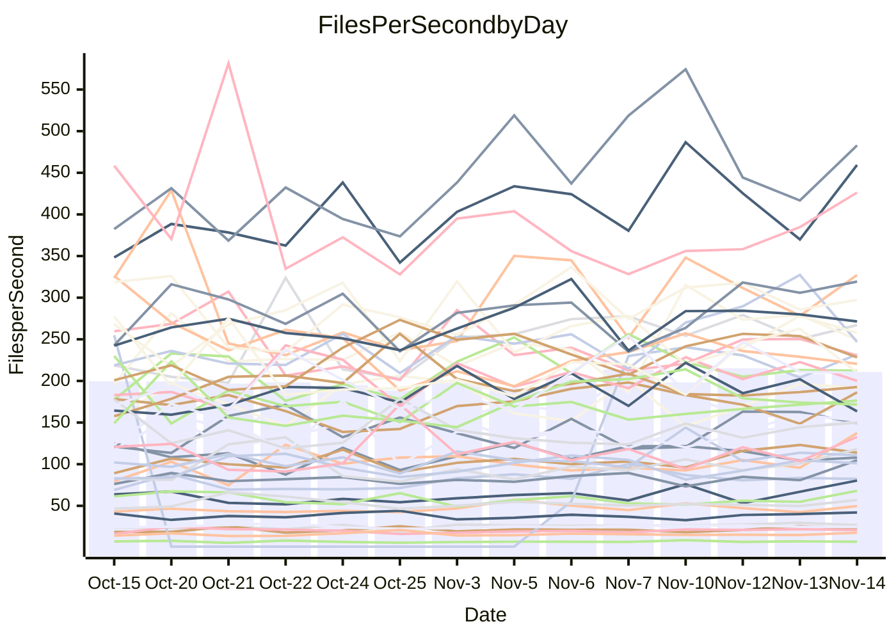

<!---
# This file is auto-generated. Do not edit.
# cspell:disable
--->
# Performance Report

Daily Performance

Time to Process Files

| Repository                                      | Elapsed | Min/Avg/Max          |    SD | SD Graph                |
| ----------------------------------------------- | ------: | :------------------: | ----: | ----------------------- |
| AdaDoom3/AdaDoom3                    |    3.16 | 1.7 /   2.8 /   3.5  |  0.52 | `    ┣━━┻━━╋━●┻━━┫    ` |
| alexiosc/megistos                    |    5.49 | 3.9 /   6.2 /   9.3  |  1.32 | `    ┣━━┻●━╋━━┻━━┫    ` |
| apollographql/apollo-server          |    2.63 | 1.5 /   2.4 /   3.3  |  0.40 | `    ┣━━┻━━╋●━┻━━┫    ` |
| aspnetboilerplate/aspnetboilerplate  |    5.03 | 5.2 /   7.9 /  10.2  |  1.55 | `    ●━━┻━━╋━━┻━━┫    ` |
| aws-amplify/docs                     |   10.88 | 7.4 /  12.2 /  15.4  |  2.44 | `    ┣━━┻●━╋━━┻━━┫    ` |
| Azure/azure-rest-api-specs           |    9.55 | 6.2 /   9.6 /  12.2  |  1.70 | `    ┣━━┻━━●━━┻━━┫    ` |
| bitjson/typescript-starter           |    0.78 | 0.6 /   1.0 /   1.3  |  0.17 | `     ┣●┻━━╋━━┻━┫     ` |
| caddyserver/caddy                    |    4.33 | 2.5 /   3.9 /   4.9  |  0.72 | `    ┣━━┻━━╋━●┻━━┫    ` |
| canada-ca/open-source-logiciel-libre |    1.17 | 0.7 /   1.0 /   1.4  |  0.17 | `     ┣━┻━━╋━●┻━┫     ` |
| chef/chef                            |    3.30 | 0.0 /   2.3 /   5.9  |  2.44 | `    ┣━━┻━━╋●━┻━━┫    ` |
| dart-lang/sdk                        |   42.53 | 34.1 /  56.3 /  76.1 | 10.02 | `  ┣━━●┻━━━╋━━━┻━━━┫  ` |
| django/django                        |   14.03 | 7.6 /  12.6 /  15.6  |  2.32 | `    ┣━━┻━━╋━●┻━━┫    ` |
| eslint/eslint                        |   10.20 | 5.7 /   8.8 /  11.8  |  1.86 | `    ┣━━┻━━╋━●┻━━┫    ` |
| exonum/exonum                        |    3.52 | 2.1 /   3.0 /   3.9  |  0.55 | `    ┣━━┻━━╋━━●━━┫    ` |
| flutter/samples                      |    8.89 | 6.6 /  10.4 /  14.0  |  2.17 | `    ┣━━┻●━╋━━┻━━┫    ` |
| gitbucket/gitbucket                  |    3.50 | 2.0 /   3.1 /   4.5  |  0.62 | `    ┣━━┻━━╋━●┻━━┫    ` |
| googleapis/google-cloud-cpp          |  129.14 | 72.6 / 112.1 / 144.0 | 22.47 | `  ┣━━━┻━━━╋━━●┻━━━┫  ` |
| graphql/express-graphql              |    0.99 | 0.7 /   1.1 /   1.4  |  0.17 | `     ┣━┻━●╋━━┻━┫     ` |
| graphql/graphql-js                   |    3.02 | 2.1 /   3.3 /   4.4  |  0.66 | `    ┣━━┻━●╋━━┻━━┫    ` |
| graphql/graphql-relay-js             |    0.98 | 0.7 /   1.1 /   1.4  |  0.17 | `     ┣━┻●━╋━━┻━┫     ` |
| graphql/graphql-spec                 |    1.50 | 0.8 /   1.2 /   1.6  |  0.22 | `     ┣━┻━━╋━━●━┫     ` |
| iluwatar/java-design-patterns        |   13.74 | 7.4 /  11.2 /  14.6  |  2.11 | `    ┣━━┻━━╋━━┻●━┫    ` |
| ktaranov/sqlserver-kit               |    3.19 | 3.2 /   5.1 /   6.8  |  1.15 | `    ┣●━┻━━╋━━┻━━┫    ` |
| liriliri/licia                       |    2.64 | 2.2 /   3.6 /   4.7  |  0.69 | `    ┣━●┻━━╋━━┻━━┫    ` |
| MartinThoma/LaTeX-examples           |    7.01 | 3.8 /   5.7 /   7.5  |  1.04 | `    ┣━━┻━━╋━━┻●━┫    ` |
| mdx-js/mdx                           |    2.06 | 1.2 /   1.7 /   2.1  |  0.28 | `     ┣━┻━━╋━━●━┫     ` |
| microsoft/TypeScript-Website         |    4.32 | 3.1 /   5.0 /   6.0  |  0.81 | `    ┣━━┻●━╋━━┻━━┫    ` |
| MicrosoftDocs/PowerShell-Docs        |   25.01 | 14.6 /  23.5 /  28.1 |  3.18 | `   ┣━━━┻━━╋━●┻━━━┫   ` |
| neovim/nvim-lspconfig                |    4.47 | 3.1 /   5.3 /  10.2  |  1.20 | `    ┣━━┻●━╋━━┻━━┫    ` |
| pagekit/pagekit                      |    2.89 | 2.0 /   3.2 /   4.1  |  0.58 | `    ┣━━┻●━╋━━┻━━┫    ` |
| php/php-src                          |   14.72 | 13.9 /  22.3 /  28.0 |  4.13 | `   ┣●━━┻━━╋━━┻━━━┫   ` |
| plasticrake/tplink-smarthome-api     |    0.85 | 0.8 /   1.2 /   1.6  |  0.22 | `     ┣●┻━━╋━━┻━┫     ` |
| prettier/prettier                    |    6.30 | 4.4 /   7.6 /   9.3  |  1.27 | `    ┣━━●━━╋━━┻━━┫    ` |
| pycontribs/jira                      |    0.98 | 1.0 /   1.4 /   1.9  |  0.22 | `     ●━┻━━╋━━┻━┫     ` |
| RustPython/RustPython                |   12.74 | 7.2 /  11.1 /  13.4  |  2.02 | `    ┣━━┻━━╋━━●━━┫    ` |
| shoelace-style/shoelace              |    3.12 | 1.7 /   2.6 /   3.5  |  0.46 | `    ┣━━┻━━╋━━●━━┫    ` |
| slint-ui/slint                       |   23.27 | 12.5 /  19.6 /  24.1 |  3.60 | `   ┣━━━┻━━╋━━●━━━┫   ` |
| SoftwareBrothers/admin-bro           |    2.54 | 1.5 /   2.4 /   3.2  |  0.41 | `    ┣━━┻━━╋●━┻━━┫    ` |
| sveltejs/svelte                      |   23.72 | 13.4 /  22.5 / 100.8 | 11.31 | `   ┣━━┻━━━●━━━┻━━┫   ` |
| TheAlgorithms/Python                 |    5.30 | 3.7 /   5.8 /   7.6  |  1.16 | `    ┣━━┻━●╋━━┻━━┫    ` |
| twbs/bootstrap                       |    1.47 | 1.2 /   1.8 /   2.5  |  0.30 | `     ┣━●━━╋━━┻━┫     ` |
| typescript-cheatsheets/react         |    1.22 | 0.8 /   1.1 /   1.4  |  0.18 | `     ┣━┻━━╋●━┻━┫     ` |
| typescript-eslint/typescript-eslint  |    4.46 | 2.6 /   4.0 /   4.8  |  0.69 | `    ┣━━┻━━╋━●┻━━┫    ` |
| vitest-dev/vitest                    |   12.13 | 6.4 /  10.3 /  13.0  |  2.10 | `    ┣━━┻━━╋━━●━━┫    ` |
| w3c/aria-practices                   |    3.53 | 2.1 /   3.0 /   4.2  |  0.55 | `    ┣━━┻━━╋━━●━━┫    ` |
| w3c/specberus                        |    1.53 | 1.1 /   1.8 /   2.7  |  0.33 | `     ┣━┻●━╋━━┻━┫     ` |
| webdeveric/webpack-assets-manifest   |    1.24 | 0.8 /   1.2 /   1.6  |  0.17 | `     ┣━┻━━╋●━┻━┫     ` |
| webpack/webpack                      |    9.52 | 5.3 /   8.3 /  10.7  |  1.59 | `    ┣━━┻━━╋━●┻━━┫    ` |
| wireapp/wire-desktop                 |    0.91 | 0.9 /   1.4 /   1.9  |  0.25 | `     ●━┻━━╋━━┻━┫     ` |
| wireapp/wire-webapp                  |    9.73 | 8.5 /  14.4 /  18.4  |  2.95 | `   ┣━●━┻━━╋━━┻━━━┫   ` |

Note:
- Elapsed time is in seconds.

Files per Second over Time

| Repository                                      | Files |    Sec |    Fps |     Rel | Trend Fps              |    N |
| ----------------------------------------------- | ----: | -----: | -----: | ------: | ---------------------- | ---: |
| AdaDoom3/AdaDoom3                    |   103 |   3.16 |  32.63 | -15.25% | `▅▁▂▄▇▂▄▇▅▇▁▂▂▂█▂▂▄▇▂` |   56 |
| alexiosc/megistos                    |   583 |   5.49 | 106.21 |   8.27% | `▃▅▄▂▂▅▄▃▃▅▂▅▆▇▅▅██▅▅` |   56 |
| apollographql/apollo-server          |   256 |   2.63 |  97.47 | -10.17% | `▄▂▃▃▆▇▃▆▆▃▅▃▄▇▃▃▇█▃▃` |   56 |
| aspnetboilerplate/aspnetboilerplate  |  2308 |   5.03 | 459.05 |  50.15% | `▃▆▄▂▄▂▅▄▂▂▄▂▂▄█▄▂▂▂█` |   56 |
| aws-amplify/docs                     |  3039 |  10.88 | 279.26 |   6.94% | `▄▃▂█▇▄▂█▆▆▂▆▅▅▂▂▄▂▄▄` |   56 |
| Azure/azure-rest-api-specs           |  2625 |   9.55 | 274.91 |  -2.20% | `▂▄▃▂▂█▄▂▂▅▄▄▇▂▂▄▂▅▃▃` |   56 |
| bitjson/typescript-starter           |    20 |   0.78 |  25.72 |  26.73% | `▅▂▂█▂▂▄▇▂▄▄▃▃▄▆▂▂▃▂▆` |   56 |
| caddyserver/caddy                    |   414 |   4.33 |  95.62 | -11.50% | `▆▁▁▆▁▆▅█▄▂▆▄▁▅▄▃▂▄▆▂` |   56 |
| canada-ca/open-source-logiciel-libre |     7 |   1.17 |   6.01 | -14.30% | `▃▅▃▃▄▃█▅▃▇█▃█▅▇▅▃▅▆▃` |   56 |
| chef/chef                            |  1041 |   3.30 | 315.78 | 180.98% | `█▅█▅▅▅▆▆▅▇▅▅▆▅▆▅▆▅▇█` |   55 |
| dart-lang/sdk                        | 11864 |  42.53 | 278.96 |  27.82% | `█▃▅▃▇▂▂▃▄▇▃▅▅▆▁▂▂▂▄▆` |   56 |
| django/django                        |  2945 |  14.03 | 209.84 | -13.54% | `▅▃▅▂▂▄▇▄▂▂▄▄█▂▂▂▂▄▆▂` |   56 |
| eslint/eslint                        |  2090 |  10.20 | 204.90 | -18.11% | `▇▂▅▇▂▅▄█▄▇▄▄▃▄▂▄▂█▄▂` |   56 |
| exonum/exonum                        |   421 |   3.52 | 119.67 | -16.80% | `▂▂▇▂▇▁▅▅▇▂█▅▂█▂▇█▄▄▂` |   56 |
| flutter/samples                      |  1703 |   8.89 | 191.46 |  10.80% | `█▂▃█▂▁▂▄▂▂▂▂▂▄█▃▁▃█▅` |   56 |
| gitbucket/gitbucket                  |   427 |   3.50 | 122.10 | -16.54% | `▅▅▃▃▇█▆▃▆█▂▆▆▅▂▅█▅▄▃` |   56 |
| googleapis/google-cloud-cpp          | 22119 | 129.14 | 171.28 | -17.06% | `█▇▇▂▆▂▆▇▄▄▄▂▂▄▅▅▂▇▂▂` |   56 |
| graphql/express-graphql              |    26 |   0.99 |  26.26 |   4.55% | `▂▃▄▄█▃█▅▆▃▆▂▃▃▄▂▃▇▃▅` |   56 |
| graphql/graphql-js                   |   562 |   3.02 | 186.28 |   6.37% | `▃▅▃▆▂▄▂▇▄▆▄▇▂▄▂▄▂█▆▄` |   56 |
| graphql/graphql-relay-js             |    28 |   0.98 |  28.55 |   7.52% | `▃▃▅▅▄▅▂█▄▃▂█▄▂▃▂▇▃▂▄` |   56 |
| graphql/graphql-spec                 |    19 |   1.50 |  12.67 | -20.15% | `▂▄▇▃▃▂▁▂▂▄▂▄▅▂▄▅▄█▄▂` |   56 |
| iluwatar/java-design-patterns        |  2239 |  13.74 | 162.92 | -21.97% | `▂▅▂▂▂█▄▄▄▅▂▂██▄▅▅▄▂▂` |   56 |
| ktaranov/sqlserver-kit               |   490 |   3.19 | 153.85 |  51.35% | `▁▂▂▄▇█▄▃▄▃▂▄▂▄▇██▄▅█` |   56 |
| liriliri/licia                       |  1442 |   2.64 | 545.43 |  31.93% | `▃▅▁▇█▂▂▂▂▃▅▂▃▂▃▆▄▅▅▇` |   56 |
| MartinThoma/LaTeX-examples           |  1414 |   7.01 | 201.75 | -21.87% | `▅▄▄█▂▂█▂▇▂▃▂▅▄▆▅▅▅▄▂` |   56 |
| mdx-js/mdx                           |   139 |   2.06 |  67.63 | -17.50% | `▃▇▂▂▂▁█▃▂▇▄▂▆▅▃▂▆▄▇▂` |   56 |
| microsoft/TypeScript-Website         |   809 |   4.32 | 187.15 |  15.44% | `▃▇▃▂▂█▂▆▃▂▂▆▅▃▆▇▃▆▂▆` |   56 |
| MicrosoftDocs/PowerShell-Docs        |  3127 |  25.01 | 125.05 |  -8.31% | `▂▂▂▂▅▂▄█▂▂▂▂▂▅▂▄▄█▂▂` |   56 |
| neovim/nvim-lspconfig                |   891 |   4.47 | 199.24 |  11.80% | `▁▄▅▅▂█▇▄▃▃█▄▅▄▅▃▄▃▅▅` |   56 |
| pagekit/pagekit                      |   741 |   2.89 | 256.13 |   7.90% | `▂▂█▂▂▇▃▂▂█▄▅▂▄▂▂▂▂▄▄` |   56 |
| php/php-src                          |  2401 |  14.72 | 163.08 |  45.65% | `▅█▇▂▁▅▂▂▂▅▂▂▄▄▂▅▅▅██` |   56 |
| plasticrake/tplink-smarthome-api     |    62 |   0.85 |  72.99 |  38.53% | `▇▂▅▂▄▂▄▂▃▂▆▂▂▆▄▃▅▂▇█` |   56 |
| prettier/prettier                    |  2818 |   6.30 | 447.25 |  17.04% | `▂▂▂▂▂▅▂▄▂▂▄▄▄▂█▂▂▃▄▄` |   56 |
| pycontribs/jira                      |    78 |   0.98 |  79.89 |  38.31% | `▆▃▂▆▂▄▃▇▂▆▂▃▂▂▆▄▅▇▆█` |   56 |
| RustPython/RustPython                |  1077 |  12.74 |  84.56 | -15.55% | `▂▅▂▂▂▂▆█▂▂▂▄▇▅▄▂▆▅▄▂` |   56 |
| shoelace-style/shoelace              |   440 |   3.12 | 141.17 | -18.70% | `▅▂▂▅▂▃▄▄▂▂▇▂▅▂█▂▂▆▂▂` |   56 |
| slint-ui/slint                       |  5152 |  23.27 | 221.39 | -16.48% | `▄▄▂▂▁▂▄▅█▂█▂▂▂▄▅▂▂▅▂` |   56 |
| SoftwareBrothers/admin-bro           |   441 |   2.54 | 173.37 |  -9.59% | `▆▃▅▂▂▄▂▃▅▆█▃▃▃▂▃▂▂▃▃` |   56 |
| sveltejs/svelte                      |  9241 |  23.72 | 389.59 | -13.59% | `▆▅▄▆▅▆▆▇▁▅▅█▅▇█▇▆▅▆▅` |   56 |
| TheAlgorithms/Python                 |  1640 |   5.30 | 309.34 |   4.88% | `▄▇▂▅▄▂▆▂▂▁█▂▇▅▄▇▅▂▄▄` |   56 |
| twbs/bootstrap                       |   152 |   1.47 | 103.60 |  22.42% | `▄▄▃▃▃▄▆▄▂▄▂▂▄▄▆▅█▅▆▆` |   56 |
| typescript-cheatsheets/react         |    24 |   1.22 |  19.67 |  -9.27% | `▅▃▄▂▄▃▃█▅▃▇▅▅▇▆▃▃▃█▃` |   56 |
| typescript-eslint/typescript-eslint  |   887 |   4.46 | 199.09 | -13.94% | `█▃▂▄▂▂▅▅▂▂▄▆▂▂▆▄▂▂▂▂` |   56 |
| vitest-dev/vitest                    |  2963 |  12.13 | 244.19 | -18.59% | `█▂▄▁█▂▁▄▂▂█▂▂▁▄▄▄▄▂▂` |   56 |
| w3c/aria-practices                   |   417 |   3.53 | 117.96 | -17.34% | `▃▃▃▅▇▂▅▅▃▃▅▅▃█▄▃█▄█▃` |   56 |
| w3c/specberus                        |   190 |   1.53 | 123.93 |  11.55% | `██▃▃▇▃▄▃▆▄▃▄▆▃▃▁▅▄▇▆` |   56 |
| webdeveric/webpack-assets-manifest   |    55 |   1.24 |  44.49 |  -7.10% | `▄▄▆▅▃▄▃▃▄▁▅▃▂▃▅▃▄▅█▄` |   56 |
| webpack/webpack                      |  1545 |   9.52 | 162.36 | -16.14% | `▂▄▅▅▅▃▂█▂▃▂▅▂▄█▂▂▅▆▂` |   56 |
| wireapp/wire-desktop                 |    86 |   0.91 |  94.67 |  49.96% | `▃▂▃▂▃▂▁▃▅▃▄▄▆▄▇▄▄▇▇█` |   56 |
| wireapp/wire-webapp                  |  3138 |   9.73 | 322.58 |  51.38% | `▄▅▃▂▃▄▂▅▂▃█▂▂▂▂▂▄▂▂█` |   56 |

Data Throughput

| Repository                                      | Files |    Sec |     Kps |     Rel | Trend Kps              |    N |
| ----------------------------------------------- | ----: | -----: | ------: | ------: | ---------------------- | ---: |
| AdaDoom3/AdaDoom3                    |   103 |   3.16 |  693.48 | -15.25% | `▅▁▂▄▇▂▄▇▅▇▁▂▂▂█▂▂▄▇▂` |   56 |
| alexiosc/megistos                    |   583 |   5.49 |  834.59 |   8.27% | `▃▅▄▂▂▅▄▃▃▅▂▅▆▇▅▅██▅▅` |   56 |
| apollographql/apollo-server          |   256 |   2.63 |  805.25 | -10.15% | `▄▂▃▃▆▇▃▆▆▃▅▄▄▇▃▃▇█▃▃` |   56 |
| aspnetboilerplate/aspnetboilerplate  |  2308 |   5.03 | 1132.52 |  50.16% | `▃▆▄▂▄▂▅▄▂▂▄▂▂▄█▄▂▂▂█` |   56 |
| aws-amplify/docs                     |  3039 |  10.88 | 1098.38 |   7.00% | `▄▃▂█▇▄▂█▆▆▂▆▅▅▂▂▄▂▄▄` |   56 |
| Azure/azure-rest-api-specs           |  2625 |   9.55 |  878.34 |  -1.19% | `▂▄▃▂▂█▄▂▂▅▄▄▇▂▂▄▂▅▃▃` |   56 |
| bitjson/typescript-starter           |    20 |   0.78 |  102.88 |  26.73% | `▅▂▂█▂▂▄▇▂▄▄▃▃▄▆▂▂▃▂▆` |   56 |
| caddyserver/caddy                    |   414 |   4.33 |  935.17 | -11.12% | `▆▁▁▆▁▆▅█▄▂▆▄▁▅▄▃▂▄▆▂` |   56 |
| canada-ca/open-source-logiciel-libre |     7 |   1.17 |   49.76 | -14.30% | `▃▅▃▃▄▃█▅▃▇█▃█▅▇▅▃▅▆▃` |   56 |
| chef/chef                            |  1041 |   3.30 | 1556.14 |  38.57% | `█▂█▂▁▂▄▃▂▆▂▁▃▂▄▂▄▂▅█` |   27 |
| dart-lang/sdk                        | 11864 |  42.53 | 1960.53 |  27.88% | `█▃▅▃▇▂▂▃▄▇▃▅▅▆▂▂▂▂▄▆` |   56 |
| django/django                        |  2945 |  14.03 | 1363.74 | -13.50% | `▅▃▅▂▂▄▇▄▂▂▄▄█▂▂▂▂▄▆▂` |   56 |
| eslint/eslint                        |  2090 |  10.20 | 1451.69 | -18.10% | `▇▂▅▇▂▅▄█▄▇▄▄▃▄▂▄▂█▄▂` |   56 |
| exonum/exonum                        |   421 |   3.52 | 1144.73 | -16.80% | `▂▂▇▂▇▁▅▅▇▂█▅▂█▂▇█▄▄▂` |   56 |
| flutter/samples                      |  1703 |   8.89 | 1141.22 |  10.80% | `█▂▃█▂▁▂▄▂▂▂▂▂▄█▃▁▃█▅` |   56 |
| gitbucket/gitbucket                  |   427 |   3.50 |  602.77 | -16.40% | `▅▅▃▃▇█▆▃▆█▂▆▆▅▂▅█▅▄▃` |   56 |
| googleapis/google-cloud-cpp          | 22119 | 129.14 | 1507.28 | -16.84% | `█▇▇▂▆▂▆▇▄▄▄▂▂▄▅▅▂▇▂▂` |   56 |
| graphql/express-graphql              |    26 |   0.99 |  120.17 |   4.55% | `▂▃▄▄█▃█▅▆▃▆▂▃▃▄▂▃▇▃▅` |   56 |
| graphql/graphql-js                   |   562 |   3.02 | 1416.62 |   6.19% | `▃▅▃▆▂▄▂▇▄▆▄▇▂▄▂▄▂█▆▄` |   56 |
| graphql/graphql-relay-js             |    28 |   0.98 |  112.18 |   7.52% | `▃▃▅▅▄▅▂█▄▃▂█▄▂▃▂▇▃▂▄` |   56 |
| graphql/graphql-spec                 |    19 |   1.50 |  426.24 | -20.15% | `▂▄▇▃▃▂▁▂▂▄▂▄▅▂▄▅▄█▄▂` |   56 |
| iluwatar/java-design-patterns        |  2239 |  13.74 |  505.51 | -21.97% | `▂▅▂▂▂█▄▄▄▅▂▂██▄▅▅▄▂▂` |   56 |
| ktaranov/sqlserver-kit               |   490 |   3.19 | 2331.55 |  51.36% | `▁▂▂▄▇█▄▃▄▃▂▄▂▄▇██▄▅█` |   56 |
| liriliri/licia                       |  1442 |   2.64 |  653.99 |  31.93% | `▃▅▁▇█▂▂▂▂▃▅▂▃▂▃▆▄▅▅▇` |   56 |
| MartinThoma/LaTeX-examples           |  1414 |   7.01 |  419.19 | -21.87% | `▅▄▄█▂▂█▂▇▂▃▂▅▄▆▅▅▅▄▂` |   56 |
| mdx-js/mdx                           |   139 |   2.06 |  318.71 | -17.50% | `▃▇▂▂▂▁█▃▂▇▄▂▆▅▃▂▆▄▇▂` |   56 |
| microsoft/TypeScript-Website         |   809 |   4.32 | 1157.34 |   3.63% | `▃▇▄▂▂█▃▆▃▃▃▆▆▃▄▅▂▄▁▅` |   56 |
| MicrosoftDocs/PowerShell-Docs        |  3127 |  25.01 | 1336.37 |  -8.31% | `▂▂▂▂▅▂▄█▂▂▂▂▂▅▂▄▄█▂▂` |   56 |
| neovim/nvim-lspconfig                |   891 |   4.47 |  632.15 |  12.03% | `▁▄▅▅▂█▇▄▃▃█▄▅▄▅▃▄▃▅▅` |   56 |
| pagekit/pagekit                      |   741 |   2.89 |  534.03 |   7.90% | `▂▂█▂▂▇▃▂▂█▄▅▂▄▂▂▂▂▄▄` |   56 |
| php/php-src                          |  2401 |  14.72 | 2903.56 |  45.69% | `▅█▇▂▁▅▂▂▂▅▂▂▄▄▂▅▅▅██` |   56 |
| plasticrake/tplink-smarthome-api     |    62 |   0.85 |  394.38 |  38.53% | `▇▂▅▂▄▂▄▂▃▂▆▂▂▆▄▃▅▂▇█` |   56 |
| prettier/prettier                    |  2818 |   6.30 |  620.88 |  16.65% | `▂▂▂▂▂▅▂▄▂▂▄▄▄▂█▂▂▃▄▄` |   56 |
| pycontribs/jira                      |    78 |   0.98 |  717.95 |  59.12% | `▆▄▃▆▃▅▄▇▃▇▃▄▃▃▆▄▅▇▆█` |   56 |
| RustPython/RustPython                |  1077 |  12.74 | 2455.75 | -15.21% | `▂▅▂▂▂▂▆█▂▂▂▄▇▅▄▂▆▅▄▂` |   56 |
| shoelace-style/shoelace              |   440 |   3.12 |  681.80 | -18.70% | `▅▂▂▅▂▃▄▄▂▂▇▂▅▂█▂▂▆▂▂` |   56 |
| slint-ui/slint                       |  5152 |  23.27 | 1324.75 | -16.29% | `▄▄▂▂▂▂▄▅█▂█▂▂▂▄▅▂▂▅▂` |   56 |
| SoftwareBrothers/admin-bro           |   441 |   2.54 |  382.12 |  -9.59% | `▆▃▅▂▂▄▂▃▅▆█▃▃▃▂▃▂▂▃▃` |   56 |
| sveltejs/svelte                      |  9241 |  23.72 |  269.48 | -13.60% | `▆▅▄▆▅▆▆▇▁▅▅█▅▇█▇▆▅▆▅` |   56 |
| TheAlgorithms/Python                 |  1640 |   5.30 |  887.27 |   4.89% | `▄▇▂▅▄▂▆▂▂▁█▂▇▅▄▇▅▂▄▄` |   56 |
| twbs/bootstrap                       |   152 |   1.47 |  879.91 |  22.85% | `▄▄▃▃▃▄▆▄▂▄▂▂▄▄▆▅█▅▆▆` |   56 |
| typescript-cheatsheets/react         |    24 |   1.22 |  177.85 |  -9.27% | `▅▃▄▂▄▃▃█▅▃▇▅▅▇▆▃▃▃█▃` |   56 |
| typescript-eslint/typescript-eslint  |   887 |   4.46 |  681.22 | -13.89% | `█▃▂▄▂▂▅▅▂▂▄▆▂▂▆▄▂▂▂▂` |   56 |
| vitest-dev/vitest                    |  2963 |  12.13 |  740.89 | -18.31% | `█▂▄▁█▂▁▄▂▂█▂▂▁▄▄▄▄▂▂` |   56 |
| w3c/aria-practices                   |   417 |   3.53 | 1110.61 | -17.34% | `▃▃▃▅▇▂▅▅▃▃▅▅▃█▄▃█▄█▃` |   56 |
| w3c/specberus                        |   190 |   1.53 |  405.70 |  11.55% | `██▃▃▇▃▄▃▆▄▃▄▆▃▃▁▅▄▇▆` |   56 |
| webdeveric/webpack-assets-manifest   |    55 |   1.24 |  102.74 |  -7.10% | `▄▄▆▅▃▄▃▃▄▁▅▃▂▃▅▃▄▅█▄` |   56 |
| webpack/webpack                      |  1545 |   9.52 | 1485.41 | -14.46% | `▂▄▅▅▅▃▂█▂▃▃▅▂▄█▂▂▅▆▃` |   56 |
| wireapp/wire-desktop                 |    86 |   0.91 |  416.13 |  50.06% | `▃▂▃▂▃▂▁▃▅▃▄▄▆▄▇▄▄▇▇█` |   56 |
| wireapp/wire-webapp                  |  3138 |   9.73 | 1526.83 |  51.73% | `▄▅▂▂▃▄▂▅▂▂█▂▂▂▂▂▄▂▂█` |   56 |

