<!---
# This file is auto-generated. Do not edit.
# cspell:disable
--->
# Performance Report

```mermaid
xychart-beta
    title Files Per Second by Day
    y-axis Files per Second
    x-axis Date [Sep-20, Sep-22, Sep-24, Sep-27, Sep-28, Sep-29, Sep-30, Oct-1, Oct-2, Oct-8, Oct-9, Oct-10, Oct-11, Oct-13, Oct-14, Oct-15, Oct-20]
    bar [223.14, 203.41, 191.85, 190.34, 190.33, 191.42, 191.65, 187.17, 187.29, 194.39, 192.05, 218.83, 197.10, 195.24, 197.65, 199.65, 196.61]
    line [268.40, 226.40, 290.41, 225.84, 287.60, 216.33, 247.70, 277.53, 288.63, 233.16, 374.71, 397.16, 261.34, 217.24, 217.08, 218.73, 211.69]
    line [6.83, 6.48, 7.18, 7.27, 6.94, 7.83, 6.98, 6.40, 6.43, 8.18, 6.76, 7.44, 7.30, 6.32, 6.65, 7.26, 6.21]
    line [42.51, 50.42, 46.36, 61.34, 51.99, 46.51, 53.11, 48.59, 73.40, 59.94, 62.62, 55.56, 54.77, 45.21, 54.60, 46.67, 54.34]
    line [93.37, 113.84, 158.94, 91.50, 106.48, 102.03, 106.46, 94.98, 113.77, 93.63, 125.18, 87.00, 104.77, 109.42, 96.45, 89.22, 124.33]
    line [142.56, 168.42, 145.10, 149.37, 134.63, 171.73, 154.69, 140.49, 131.94, 134.65, 137.28, 142.04, 172.94, 162.65, 143.57, 178.30, 204.82]
    line [46.22, 56.03, 61.86, 55.07, 50.38, 50.26, 50.11, 43.90, 42.10, 56.81, 48.66, 45.19, 43.33, 48.66, 51.39, 43.09, 46.27]
    line [216.06, 205.09, 247.61, 251.50, 220.80, 227.59, 212.73, 213.55, 197.04, 208.25, 194.51, 251.63, 210.60, 231.31, 197.08, 254.89, 1.00]
    line [172.61, 177.91, 241.32, 177.39, 178.05, 221.01, 182.74, 163.48, 169.32, 168.97, 278.92, 166.54, 166.53, 170.79, 205.75, 183.07, 163.93]
    line [348.02, 254.54, 210.42, 205.10, 287.53, 207.85, 231.21, 200.22, 207.10, 331.74, 203.63, 192.81, 213.97, 213.28, 213.47, 195.94, 359.05]
    line [64.95, 121.18, 70.33, 81.37, 68.55, 70.46, 78.07, 69.43, 66.84, 65.37, 64.09, 65.74, 75.83, 77.12, 81.28, 76.22, 105.99]
    line [98.84, 72.96, 83.85, 90.86, 105.55, 94.80, 87.05, 82.35, 80.71, 82.95, 74.90, 76.80, 94.05, 96.82, 93.39, 82.69, 76.36]
    line [246.03, 470.19, 256.56, 257.27, 291.74, 296.65, 268.66, 245.94, 244.92, 242.23, 245.65, 270.12, 330.98, 278.79, 265.30, 323.42, 437.26]
    line [54.86, 55.17, 51.26, 53.54, 77.09, 47.84, 59.17, 54.01, 70.63, 55.18, 49.90, 84.72, 57.64, 57.38, 56.41, 61.33, 82.74]
    line [33.83, 35.26, 55.80, 33.99, 34.03, 41.23, 40.49, 30.44, 33.53, 33.57, 32.29, 33.27, 34.79, 37.33, 39.68, 40.77, 34.90]
    line [246.18, 197.54, 195.96, 190.07, 228.82, 222.46, 205.73, 192.21, 184.58, 245.51, 246.82, 245.36, 219.50, 226.50, 197.43, 277.21, 193.75]
    line [24.38, 22.79, 25.90, 22.55, 24.52, 26.32, 24.36, 24.04, 25.09, 23.35, 22.45, 21.51, 25.71, 29.42, 23.92, 24.25, 22.11]
    line [126.65, 140.55, 188.49, 125.20, 157.87, 127.91, 135.21, 124.24, 125.20, 125.79, 225.70, 154.24, 126.07, 127.29, 146.49, 121.12, 112.39]
    line [127.46, 154.00, 162.49, 123.69, 144.71, 125.72, 134.25, 127.46, 121.17, 173.95, 124.58, 216.72, 133.97, 123.87, 165.74, 177.89, 126.21]
    line [243.99, 243.96, 239.11, 261.23, 266.19, 247.38, 252.69, 432.16, 234.56, 233.40, 238.56, 234.64, 256.33, 219.99, 259.48, 242.38, 248.64]
    line [25.97, 25.29, 24.28, 26.03, 27.14, 29.89, 26.22, 25.83, 25.33, 31.76, 42.94, 27.61, 25.97, 34.21, 25.09, 23.71, 24.32]
    line [19.73, 20.13, 19.16, 18.74, 19.48, 22.38, 21.10, 27.10, 18.00, 23.58, 17.31, 20.37, 21.44, 22.38, 20.97, 16.04, 27.49]
    line [150.22, 155.16, 146.16, 150.57, 146.25, 172.87, 161.95, 149.25, 258.77, 151.43, 150.43, 254.02, 168.57, 231.71, 166.56, 155.07, 141.64]
    line [29.89, 21.10, 33.29, 22.21, 22.99, 25.81, 22.79, 21.40, 20.78, 24.57, 21.27, 19.07, 21.50, 21.24, 19.97, 18.63, 19.47]
    line [139.87, 144.59, 151.47, 163.76, 164.48, 145.07, 153.00, 154.07, 155.61, 136.07, 148.26, 141.19, 185.69, 154.55, 171.82, 141.67, 142.46]
    line [98.32, 105.51, 103.82, 101.18, 119.72, 101.30, 101.24, 103.40, 125.70, 125.48, 99.76, 158.05, 114.31, 137.32, 128.51, 125.12, 96.95]
    line [240.62, 182.34, 183.11, 178.48, 227.71, 175.37, 193.07, 180.70, 197.68, 174.97, 189.16, 226.87, 200.18, 179.39, 183.41, 164.40, 156.31]
    line [193.09, 220.97, 216.09, 223.67, 208.59, 258.02, 244.00, 208.42, 273.15, 264.14, 216.71, 266.75, 228.80, 223.08, 230.72, 200.81, 208.61]
    line [219.17, 221.75, 221.55, 237.73, 242.39, 246.40, 245.33, 214.25, 212.38, 215.08, 238.25, 274.47, 219.66, 252.51, 199.34, 218.85, 202.54]
    line [375.60, 366.33, 321.23, 484.87, 422.08, 444.64, 410.96, 351.78, 368.84, 361.47, 370.09, 351.86, 414.54, 417.07, 482.80, 348.28, 433.56]
    line [154.49, 133.29, 206.55, 172.23, 156.59, 180.95, 179.76, 145.22, 129.53, 157.39, 199.58, 152.82, 170.97, 185.75, 186.96, 229.89, 154.63]
    line [110.64, 76.31, 85.79, 97.01, 82.92, 84.16, 84.72, 77.34, 87.34, 75.86, 81.29, 136.91, 94.03, 101.02, 99.02, 79.59, 133.46]
    line [244.43, 196.97, 192.51, 179.82, 187.80, 186.23, 183.20, 182.62, 177.99, 183.70, 179.89, 233.14, 207.50, 218.41, 222.25, 177.43, 287.18]
    line [98.38, 99.03, 101.47, 103.27, 100.93, 105.22, 117.10, 120.39, 97.23, 97.90, 123.96, 100.36, 115.55, 122.73, 114.09, 102.09, 99.27]
    line [297.37, 220.86, 165.88, 186.63, 165.05, 169.83, 183.91, 159.55, 166.58, 162.12, 169.35, 265.31, 194.05, 178.95, 189.91, 170.29, 171.45]
    line [233.17, 234.84, 298.34, 266.72, 232.18, 229.70, 240.06, 392.72, 229.48, 222.78, 224.66, 204.36, 254.42, 277.26, 251.58, 268.24, 223.36]
    line [203.26, 249.81, 370.77, 255.08, 280.21, 227.10, 239.56, 208.40, 216.14, 204.22, 251.15, 211.26, 222.05, 242.35, 194.13, 326.19, 343.51]
    line [406.48, 449.44, 342.12, 376.67, 347.31, 443.48, 368.45, 332.70, 302.48, 422.03, 338.21, 306.48, 376.46, 318.53, 395.99, 458.46, 330.81]
    line [123.33, 163.66, 174.86, 123.76, 140.60, 149.87, 128.75, 160.37, 148.80, 127.97, 206.50, 122.84, 138.06, 149.67, 132.46, 123.48, 190.98]
    line [84.89, 78.73, 86.02, 82.17, 86.87, 92.07, 92.00, 84.24, 92.67, 106.68, 84.76, 82.82, 101.29, 118.90, 100.19, 82.72, 84.82]
    line [198.42, 179.83, 171.82, 219.08, 181.95, 180.26, 215.27, 175.03, 168.70, 269.72, 161.18, 172.81, 172.65, 208.47, 179.72, 157.56, 196.27]
    line [76.57, 77.71, 78.68, 74.59, 96.62, 94.86, 81.46, 69.18, 73.06, 66.65, 96.25, 112.51, 78.91, 82.77, 89.92, 69.05, 89.02]
    line [126.36, 117.29, 122.97, 147.55, 130.31, 120.84, 131.56, 115.38, 110.82, 116.53, 214.42, 116.00, 118.77, 144.83, 149.59, 117.74, 196.92]
    line [745.85, 398.12, 385.90, 416.89, 405.74, 428.96, 399.50, 398.65, 384.43, 625.58, 373.38, 382.28, 469.75, 409.07, 437.77, 382.49, 370.38]
    line [215.66, 277.45, 216.60, 208.75, 228.82, 225.46, 221.92, 198.17, 351.24, 197.76, 198.13, 208.30, 202.68, 201.79, 267.21, 259.65, 197.31]
    line [94.28, 98.57, 98.01, 93.82, 94.62, 89.71, 106.79, 118.50, 123.61, 91.76, 95.32, 93.61, 112.00, 123.43, 125.94, 120.60, 148.28]
    line [50.36, 50.54, 47.43, 56.40, 49.96, 64.67, 50.46, 44.40, 48.96, 71.61, 56.00, 55.29, 59.99, 68.80, 62.02, 63.75, 75.46]
    line [236.84, 249.23, 243.91, 273.74, 252.33, 270.33, 282.14, 249.68, 432.83, 249.77, 263.65, 247.10, 235.41, 323.97, 255.64, 242.67, 408.00]
    line [171.44, 166.11, 165.94, 180.17, 169.69, 179.61, 173.13, 150.88, 153.50, 149.45, 170.98, 162.38, 193.61, 167.04, 174.22, 149.10, 192.69]
    line [234.66, 253.01, 268.39, 293.97, 280.40, 292.26, 260.88, 404.51, 328.53, 305.64, 243.36, 444.70, 255.37, 254.42, 262.77, 318.79, 321.56]
    line [13.68, 15.06, 15.07, 17.30, 20.40, 18.84, 16.01, 18.80, 15.62, 18.14, 15.49, 15.23, 15.94, 13.89, 14.53, 14.11, 20.25]
```

Daily Performance

Time to Process Files

| Repository                                      | Elapsed | Min/Avg/Max          |    SD | SD Graph                |
| ----------------------------------------------- | ------: | :------------------: | ----: | ----------------------- |
| AdaDoom3/AdaDoom3                    |    2.95 | 1.7 /   2.8 /   3.4  |  0.48 | `    ┣━━┻━━╋●━┻━━┫    ` |
| alexiosc/megistos                    |    7.63 | 3.9 /   6.7 /   8.1  |  1.05 | `    ┣━━┻━━╋━━●━━┫    ` |
| apollographql/apollo-server          |    2.58 | 1.4 /   2.4 /   3.1  |  0.41 | `    ┣━━┻━━╋●━┻━━┫    ` |
| aspnetboilerplate/aspnetboilerplate  |    5.28 | 4.9 /   8.4 /   9.8  |  1.35 | `   ●┣━━┻━━╋━━┻━━┫    ` |
| aws-amplify/docs                     |   14.36 | 7.4 /  12.6 /  14.6  |  2.13 | `    ┣━━┻━━╋━━●━━┫    ` |
| Azure/azure-rest-api-specs           |   10.45 | 6.0 /  10.4 /  12.2  |  1.34 | `    ┣━━┻━━●━━┻━━┫    ` |
| bitjson/typescript-starter           |    0.73 | 0.7 /   1.0 /   1.2  |  0.14 | `     ●━┻━━╋━━┻━┫     ` |
| caddyserver/caddy                    |    3.19 | 2.2 /   3.6 /   4.5  |  0.61 | `    ┣━━┻●━╋━━┻━━┫    ` |
| canada-ca/open-source-logiciel-libre |    1.13 | 0.7 /   1.0 /   1.3  |  0.14 | `     ┣━┻━━╋━●┻━┫     ` |
| chef/chef                            |    0.00 | 3.7 /   4.8 /   5.5  |  0.49 | `●       ┣┻╋┻┫        ` |
| dart-lang/sdk                        |   60.83 | 38.8 /  55.9 /  65.4 |  7.42 | `  ┣━━━┻━━━╋━━●┻━━━┫  ` |
| django/django                        |   14.87 | 8.4 /  13.4 /  15.3  |  1.83 | `    ┣━━┻━━╋━━●━━┫    ` |
| eslint/eslint                        |    5.81 | 5.5 /   9.5 /  11.5  |  1.48 | `  ● ┣━━┻━━╋━━┻━━┫    ` |
| exonum/exonum                        |    2.14 | 2.0 /   3.3 /   3.8  |  0.47 | `   ●┣━━┻━━╋━━┻━━┫    ` |
| flutter/samples                      |    8.31 | 7.2 /  11.3 /  14.9  |  1.68 | `    ●━━┻━━╋━━┻━━┫    ` |
| gitbucket/gitbucket                  |    3.80 | 1.9 /   3.2 /   3.8  |  0.44 | `    ┣━━┻━━╋━━┻●━┫    ` |
| googleapis/google-cloud-cpp          |  128.72 | 74.1 / 121.9 / 144.1 | 18.02 | `  ┣━━━┻━━━╋━●━┻━━━┫  ` |
| graphql/express-graphql              |    1.18 | 0.7 /   1.1 /   1.3  |  0.14 | `     ┣━┻━━╋━●┻━┫     ` |
| graphql/graphql-js                   |    3.89 | 2.1 /   3.4 /   4.0  |  0.54 | `    ┣━━┻━━╋━━●━━┫    ` |
| graphql/graphql-relay-js             |    1.15 | 0.7 /   1.1 /   1.3  |  0.16 | `     ┣━┻━━╋━●┻━┫     ` |
| graphql/graphql-spec                 |    0.94 | 0.8 /   1.2 /   1.4  |  0.18 | `     ┣●┻━━╋━━┻━┫     ` |
| iluwatar/java-design-patterns        |   13.66 | 8.0 /  12.3 /  14.4  |  1.68 | `    ┣━━┻━━╋━━●━━┫    ` |
| ktaranov/sqlserver-kit               |    3.67 | 3.5 /   5.6 /   6.5  |  0.85 | `   ●┣━━┻━━╋━━┻━━┫    ` |
| liriliri/licia                       |    3.33 | 2.4 /   3.6 /   4.5  |  0.59 | `    ┣━━┻━●╋━━┻━━┫    ` |
| MartinThoma/LaTeX-examples           |    6.98 | 4.3 /   6.2 /   7.4  |  0.76 | `    ┣━━┻━━╋━━●━━┫    ` |
| mdx-js/mdx                           |    1.56 | 1.0 /   1.7 /   2.1  |  0.27 | `     ┣━┻●━╋━━┻━┫     ` |
| microsoft/TypeScript-Website         |    5.37 | 3.1 /   4.9 /   6.3  |  0.67 | `    ┣━━┻━━╋━●┻━━┫    ` |
| MicrosoftDocs/PowerShell-Docs        |   24.78 | 14.4 /  23.0 /  29.6 |  3.60 | `   ┣━━━┻━━╋━●┻━━━┫   ` |
| neovim/nvim-lspconfig                |    4.59 | 3.1 /   5.2 /   6.6  |  0.80 | `    ┣━━┻●━╋━━┻━━┫    ` |
| pagekit/pagekit                      |    3.55 | 1.9 /   3.3 /   4.1  |  0.55 | `    ┣━━┻━━╋●━┻━━┫    ` |
| php/php-src                          |   16.13 | 13.6 /  23.1 /  29.3 |  3.64 | `   ●━━━┻━━╋━━┻━━━┫   ` |
| plasticrake/tplink-smarthome-api     |    1.14 | 0.7 /   1.2 /   1.5  |  0.19 | `     ┣━┻━●╋━━┻━┫     ` |
| prettier/prettier                    |    8.37 | 4.4 /   7.5 /   9.0  |  1.18 | `    ┣━━┻━━╋━●┻━━┫    ` |
| pycontribs/jira                      |    0.97 | 0.8 /   1.4 /   1.8  |  0.23 | `     ●━┻━━╋━━┻━┫     ` |
| RustPython/RustPython                |   12.36 | 6.5 /  10.6 /  12.4  |  1.51 | `    ┣━━┻━━╋━━┻●━┫    ` |
| shoelace-style/shoelace              |    2.85 | 1.6 /   2.6 /   3.4  |  0.45 | `    ┣━━┻━━╋━●┻━━┫    ` |
| slint-ui/slint                       |   21.28 | 11.0 /  18.0 /  21.6 |  2.76 | `   ┣━━━┻━━╋━━┻●━━┫   ` |
| SoftwareBrothers/admin-bro           |    2.82 | 1.6 /   2.3 /   2.9  |  0.31 | `     ┣━┻━━╋━━┻●┫     ` |
| sveltejs/svelte                      |   24.87 | 12.2 /  22.0 /  25.4 |  3.31 | `   ┣━━━┻━━╋━━●━━━┫   ` |
| TheAlgorithms/Python                 |    4.02 | 3.8 /   6.2 /   7.3  |  0.88 | `   ●┣━━┻━━╋━━┻━━┫    ` |
| twbs/bootstrap                       |    1.43 | 1.0 /   1.7 /   2.3  |  0.30 | `     ┣━┻●━╋━━┻━┫     ` |
| typescript-cheatsheets/react         |    1.23 | 0.7 /   1.1 /   1.4  |  0.17 | `     ┣━┻━━╋━●┻━┫     ` |
| typescript-eslint/typescript-eslint  |    2.58 | 2.4 /   3.8 /   4.8  |  0.69 | `    ┣●━┻━━╋━━┻━━┫    ` |
| vitest-dev/vitest                    |    9.02 | 6.4 /  10.5 /  13.1  |  1.49 | `    ┣━━●━━╋━━┻━━┫    ` |
| w3c/aria-practices                   |    2.18 | 2.0 /   3.1 /   3.6  |  0.44 | `    ●━━┻━━╋━━┻━━┫    ` |
| w3c/specberus                        |    1.96 | 1.2 /   1.7 /   2.2  |  0.29 | `     ┣━┻━━╋━●┻━┫     ` |
| webdeveric/webpack-assets-manifest   |    1.19 | 0.7 /   1.1 /   1.4  |  0.14 | `     ┣━┻━━╋●━┻━┫     ` |
| webpack/webpack                      |    7.69 | 5.0 /   7.9 /   9.9  |  1.35 | `    ┣━━┻━━●━━┻━━┫    ` |
| wireapp/wire-desktop                 |    1.11 | 0.9 /   1.3 /   1.7  |  0.20 | `     ┣━●━━╋━━┻━┫     ` |
| wireapp/wire-webapp                  |    9.61 | 9.1 /  14.1 /  16.4  |  1.79 | `  ● ┣━━┻━━╋━━┻━━┫    ` |

Note:
- Elapsed time is in seconds.

Files per Second over Time

| Repository                                      | Files |    Sec |    Fps |     Rel | Trend Fps              |    N |
| ----------------------------------------------- | ----: | -----: | -----: | ------: | ---------------------- | ---: |
| AdaDoom3/AdaDoom3                    |   103 |   2.95 |  34.90 |  -7.62% | `▁▂▂▂▂▅▂▂▂▂▂▂▆▂█▂▂▄▅▃` |   44 |
| alexiosc/megistos                    |   583 |   7.63 |  76.36 | -15.36% | `▂▂▂▂▂▆▂▇▂▂▂▂▁█▂▃▅▄▂▂` |   44 |
| apollographql/apollo-server          |   256 |   2.58 |  99.27 | -11.02% | `▄▂▂▄▂▂▂▂▂▅█▂▆▄█▁▂▂▃▂` |   44 |
| aspnetboilerplate/aspnetboilerplate  |  2308 |   5.28 | 437.26 |  54.43% | `▂▂▂▂▂▅█▂▃▂▇▂▂▅▂▄▂▂▄█` |   44 |
| aws-amplify/docs                     |  3039 |  14.36 | 211.69 | -15.91% | `▄▄▂▇█▂▂▆▂▆▁▁▂▁▂▁▁▂▂▁` |   43 |
| Azure/azure-rest-api-specs           |  2598 |  10.45 | 248.64 |  -2.21% | `█▂▂▂▂▂▂▄▂▂▄▁▁▁▁▂▆▂▂▂` |   44 |
| bitjson/typescript-starter           |    20 |   0.73 |  27.49 |  31.87% | `▇▂▆▂▄▂▆▂▅▂█▅▅▅▂▂▇▅▁█` |   44 |
| caddyserver/caddy                    |   396 |   3.19 | 124.33 |  19.01% | `▂▄▂▅▂▂▃▂▂█▁▁▁█▂▄▁▂▂▅` |   44 |
| canada-ca/open-source-logiciel-libre |     7 |   1.13 |   6.21 | -11.62% | `▃▃▅▃▄▂▂█▆▃▄▃▂▄▂▁▂▇▄▃` |   44 |
| chef/chef                            |     0 |   0.00 |   0.00 | -99.54% | `▄▃▄▃█▄▄▃▇▃▄▃█▆▃▃▂▃█ ` |   44 |
| dart-lang/sdk                        | 11786 |  60.83 | 193.75 |  -9.46% | `▂▂▅▅▅▂▅▂█▂▂▅▅▂▄▂▂▃▇▂` |   44 |
| django/django                        |  2935 |  14.87 | 197.31 | -12.19% | `▂█▂▂▂▂▂▂▂▂▂▂▁▂▇▇▂▂▄▂` |   44 |
| eslint/eslint                        |  2087 |   5.81 | 359.05 |  57.52% | `▂▂▇▂▂▂▂▂▄▂▂▂▄▂▂▂▄▂▂█` |   44 |
| exonum/exonum                        |   421 |   2.14 | 196.92 |  49.15% | `▂▁▂█▂▂▂▂▂▁▂▂▄▅▅▂▂▇▂▇` |   44 |
| flutter/samples                      |  1703 |   8.31 | 204.82 |  32.56% | `▃▂▂▂▃▅█▅▃▃▃▃▅▄▂▃▃▄▅▆` |   44 |
| gitbucket/gitbucket                  |   427 |   3.80 | 112.39 | -18.22% | `▂▂▂█▄▂▁▄▂▂▂▃▂▂▃▅▃▂▂▁` |   44 |
| googleapis/google-cloud-cpp          | 22069 | 128.72 | 171.45 |  -7.93% | `▂▂▂▂██▅▂▂▃▂▂▄▂▂▄▂▅▂▂` |   44 |
| graphql/express-graphql              |    26 |   1.18 |  22.11 | -10.64% | `▃▃▃▂▂▂█▄▅▁▂▆█▂▂▂▆▂▃▂` |   44 |
| graphql/graphql-js                   |   551 |   3.89 | 141.64 | -16.43% | `▂█▂▂█▂▄▁▆▂▂█▄▇▁▇▂▂▂▁` |   44 |
| graphql/graphql-relay-js             |    28 |   1.15 |  24.32 | -10.96% | `▃▂▅█▃▁▂▂▆▂▃▇▆▃▁▄▃▁▂▂` |   44 |
| graphql/graphql-spec                 |    19 |   0.94 |  20.25 |  24.73% | `▅▃▅▃▃▂▂█▄▃▁▁▂▂▂▅▁▁▂▇` |   44 |
| iluwatar/java-design-patterns        |  2239 |  13.66 | 163.93 | -11.63% | `▂▂▂█▂▂▂▂▂▂▃▂▃▂▂▄▂█▃▂` |   44 |
| ktaranov/sqlserver-kit               |   490 |   3.67 | 133.46 |  47.99% | `▂▃▁▂█▂▂▂▅▇▂█▂▂▂█▅▂▂▇` |   44 |
| liriliri/licia                       |  1442 |   3.33 | 433.56 |   4.34% | `▂▃▂▃▂▂▁▅▄▃▇▂▅▄▅▄▅█▂▄` |   44 |
| MartinThoma/LaTeX-examples           |  1414 |   6.98 | 202.54 | -13.29% | `▃▂▃▄▅▂▅▂▃▂▃█▂▂▂▂▂▁▃▂` |   44 |
| mdx-js/mdx                           |   139 |   1.56 |  89.02 |   7.06% | `▂▂▁▅█▄▂▁▂▇▂▃▃▆█▆▂▂▂▄` |   44 |
| microsoft/TypeScript-Website         |   765 |   5.37 | 142.46 | -10.28% | `▃▃▂▃▂█▇▁▄▆▂▂▅▂▅▂▄▅▂▂` |   44 |
| MicrosoftDocs/PowerShell-Docs        |  3127 |  24.78 | 126.21 |  -9.73% | `▃▂▅▂█▄▂▂▂▃▄▃▂▂▇▄▇▂▆▂` |   44 |
| neovim/nvim-lspconfig                |   884 |   4.59 | 192.69 |  10.99% | `▂▂▂▃▃▆▄▂▂█▂▁▆▂▄▂▅▂▂▄` |   44 |
| pagekit/pagekit                      |   741 |   3.55 | 208.61 | -10.60% | `▂▅▅▃▅▇▂▂▁▃▅▂▅▂▂█▁▂▂▂` |   44 |
| php/php-src                          |  2392 |  16.13 | 148.28 |  38.73% | `▄▄▂▂▂▂▇▂▂▄▄▂▆▄█▂▃▄▄▆` |   44 |
| plasticrake/tplink-smarthome-api     |    62 |   1.14 |  54.34 |   2.24% | `▃█▅▆▄▇▂▂▂▆▅▁▂▃▁▅▇▂▂▄` |   44 |
| prettier/prettier                    |  2768 |   8.37 | 330.81 | -11.51% | `▂▁▄▂▁▂█▂▁▄▂▂▂▂▇▂▃▂▅▂` |   44 |
| pycontribs/jira                      |    80 |   0.97 |  82.74 |  40.82% | `▃▆▃▂█▂▂▂▂▅▇▂▂▆▆▂▃▂▄█` |   44 |
| RustPython/RustPython                |  1048 |  12.36 |  84.82 |  -9.59% | `▂▃▄▂▂▄▄▂▆▃▂▂█▅▄▄▄▁▂▂` |   44 |
| shoelace-style/shoelace              |   440 |   2.85 | 154.63 | -11.71% | `▂▁▃▅▂▂▅▂▂█▂▅▄▄█▂▃▄▇▃` |   44 |
| slint-ui/slint                       |  4753 |  21.28 | 223.36 | -10.49% | `█▂▂▂▁▂▂▆▄▂▂▂▂█▂▆▂▂▄▂` |   44 |
| SoftwareBrothers/admin-bro           |   441 |   2.82 | 156.31 | -18.77% | `▃▄▃▃▆▃▄█▂▅▃▅▁▃▃▃▂▅▂▂` |   44 |
| sveltejs/svelte                      |  9212 |  24.87 | 370.38 | -13.42% | `▂▂▇▂▂▄▂▂▄▂█▁▄▂▁▇▂▂▂▁` |   44 |
| TheAlgorithms/Python                 |  1640 |   4.02 | 408.00 |  51.12% | `▂█▂▃▂▁▂▂▂▂▁▄█▂▂▂▁▄▂▇` |   44 |
| twbs/bootstrap                       |   152 |   1.43 | 105.99 |  39.14% | `▃▂▂▂▂▃▄█▃▂▂▂▄▅▃▄█▃▄█` |   44 |
| typescript-cheatsheets/react         |    24 |   1.23 |  19.47 | -13.63% | `▄▃▅▄▃▂▃▃▃█▄▃▆▂▃▅▃▁▂▃` |   44 |
| typescript-eslint/typescript-eslint  |   886 |   2.58 | 343.51 |  44.24% | `▂▃▂▄▂▂▂▃▅▂▃▁█▁▂▂▁▁▇█` |   44 |
| vitest-dev/vitest                    |  2900 |   9.02 | 321.56 |  16.55% | `▇▅▄▂█▂▂▂▂▂▄▂▄▁▄▂▂▂▄▄` |   44 |
| w3c/aria-practices                   |   417 |   2.18 | 190.98 |  38.31% | `▅▄▂█▂▂▂▇▁▂▄▄▆▂▂▄▁▄▂▇` |   44 |
| w3c/specberus                        |   190 |   1.96 |  96.95 | -13.64% | `▃▅▅▃█▂▇▃▇▂▂▃█▇█▅▇▁▅▂` |   44 |
| webdeveric/webpack-assets-manifest   |    55 |   1.19 |  46.27 |  -6.30% | `▃▂█▅▄▄▃▃▂▂▄▂█▄▇▃▄█▃▄` |   43 |
| webpack/webpack                      |  1510 |   7.69 | 196.27 |   0.68% | `▃▂█▂▃▂▅▂▂▂▂▄▂█▂▇▂▁▂▄` |   44 |
| wireapp/wire-desktop                 |    84 |   1.11 |  75.46 |  34.32% | `▁▂▆▃▃▇▂▂▇▃▂█▆▂▃▃█▃▄▆` |   44 |
| wireapp/wire-webapp                  |  2760 |   9.61 | 287.18 |  46.91% | `▂▂▂▂▅█▁▂▂▆▂▂█▂▂▄█▂▂▇` |   44 |

Data Throughput

| Repository                                      | Files |    Sec |     Kps |     Rel | Trend Kps              |    N |
| ----------------------------------------------- | ----: | -----: | ------: | ------: | ---------------------- | ---: |
| AdaDoom3/AdaDoom3                    |   103 |   2.95 |  741.78 |  -7.62% | `▁▂▂▂▂▅▂▂▂▂▂▂▆▂█▂▂▄▅▃` |   44 |
| alexiosc/megistos                    |   583 |   7.63 |  600.03 | -15.36% | `▂▂▂▂▂▆▂▇▂▂▂▂▁█▂▃▅▄▂▂` |   44 |
| apollographql/apollo-server          |   256 |   2.58 |  819.79 | -11.02% | `▄▂▂▄▂▂▂▂▂▅█▂▆▄█▁▂▂▃▂` |   44 |
| aspnetboilerplate/aspnetboilerplate  |  2308 |   5.28 | 1078.75 |  55.43% | `▂▂▂▂▂▅█▂▃▂▇▂▂▅▂▄▂▂▄█` |   44 |
| aws-amplify/docs                     |  3039 |  14.36 |  831.52 | -15.93% | `▄▄▂▇█▂▂▆▂▆▁▁▂▁▂▁▁▂▂▁` |   43 |
| Azure/azure-rest-api-specs           |  2598 |  10.45 |  778.66 |  -0.48% | `█▂▂▂▂▂▂▄▂▂▃▂▁▁▁▂▆▂▂▂` |   44 |
| bitjson/typescript-starter           |    20 |   0.73 |  109.96 |  31.87% | `▇▂▆▂▄▂▆▂▅▂█▅▅▅▂▂▇▅▁█` |   44 |
| caddyserver/caddy                    |   396 |   3.19 | 1194.93 |  25.29% | `▂▄▂▅▂▂▃▂▂█▁▂▁█▂▅▂▂▂▅` |   44 |
| canada-ca/open-source-logiciel-libre |     7 |   1.13 |   51.46 | -11.62% | `▃▃▅▃▄▂▂█▆▃▄▃▂▄▂▁▂▇▄▃` |   44 |
| chef/chef                            |  1037 |   4.07 | 1253.33 |  17.31% | `▄▄▃▄▃█▄▄▃▇▃▄▃█▆▃▃▂▃█` |   43 |
| dart-lang/sdk                        | 11786 |  60.83 | 1358.93 |  -9.29% | `▂▂▅▅▅▂▅▂█▂▂▅▅▂▄▂▂▃▇▂` |   44 |
| django/django                        |  2935 |  14.87 | 1280.21 | -11.88% | `▂█▂▂▂▂▂▂▂▂▂▂▁▂▇▇▂▂▄▂` |   44 |
| eslint/eslint                        |  2087 |   5.81 | 2540.19 |  57.75% | `▂▂▇▂▂▂▂▂▄▂▂▂▄▂▂▂▄▂▂█` |   44 |
| exonum/exonum                        |   421 |   2.14 | 1883.62 |  49.15% | `▂▁▂█▂▂▂▂▂▁▂▂▄▅▅▂▂▇▂▇` |   44 |
| flutter/samples                      |  1703 |   8.31 | 1220.88 |  32.56% | `▃▂▂▂▃▅█▅▃▃▃▃▅▄▂▃▃▄▅▆` |   44 |
| gitbucket/gitbucket                  |   427 |   3.80 |  550.38 | -18.46% | `▂▂▂█▄▂▁▄▂▂▂▃▂▂▃▄▃▂▂▁` |   44 |
| googleapis/google-cloud-cpp          | 22069 | 128.72 | 1498.02 |  -7.86% | `▂▂▂▂██▅▂▂▃▂▂▄▂▂▄▂▅▂▂` |   44 |
| graphql/express-graphql              |    26 |   1.18 |  101.21 | -10.64% | `▃▃▃▂▂▂█▄▅▁▂▆█▂▂▂▆▂▃▂` |   44 |
| graphql/graphql-js                   |   551 |   3.89 | 1078.64 | -14.66% | `▂█▂▂█▂▄▁▆▂▂█▄▇▁▇▂▂▂▂` |   44 |
| graphql/graphql-relay-js             |    28 |   1.15 |   95.53 | -10.96% | `▃▂▅█▃▁▂▂▆▂▃▇▆▃▁▄▃▁▂▂` |   44 |
| graphql/graphql-spec                 |    19 |   0.94 |  681.13 |  24.74% | `▅▃▅▃▃▂▂█▄▃▁▁▂▂▂▅▁▁▂▇` |   44 |
| iluwatar/java-design-patterns        |  2239 |  13.66 |  508.62 | -11.62% | `▂▂▂█▂▂▂▂▂▂▃▂▃▂▂▄▂█▃▂` |   44 |
| ktaranov/sqlserver-kit               |   490 |   3.67 | 2022.03 |  48.01% | `▂▃▁▂█▂▂▂▅▇▂█▂▂▂█▅▂▂▇` |   44 |
| liriliri/licia                       |  1442 |   3.33 |  519.85 |   4.34% | `▂▃▂▃▂▂▁▅▄▃▇▂▅▄▅▄▅█▂▄` |   44 |
| MartinThoma/LaTeX-examples           |  1414 |   6.98 |  420.83 | -13.22% | `▃▂▃▄▅▂▅▂▃▂▃█▂▂▂▂▂▁▃▂` |   44 |
| mdx-js/mdx                           |   139 |   1.56 |  419.47 |   7.06% | `▂▂▁▅█▄▂▁▂▇▂▃▃▆█▆▂▂▂▄` |   44 |
| microsoft/TypeScript-Website         |   765 |   5.37 |  982.54 | -10.27% | `▃▃▂▃▂█▇▁▄▆▂▂▅▂▅▂▄▅▂▂` |   44 |
| MicrosoftDocs/PowerShell-Docs        |  3127 |  24.78 | 1348.81 |  -9.73% | `▃▂▅▂█▄▂▂▂▃▄▃▂▂▇▄▇▂▆▂` |   44 |
| neovim/nvim-lspconfig                |   884 |   4.59 |  609.23 |  16.08% | `▂▂▂▃▃▆▄▂▂█▂▁▆▂▅▂▅▂▂▄` |   44 |
| pagekit/pagekit                      |   741 |   3.55 |  434.97 | -10.60% | `▂▅▅▃▅▇▂▂▁▃▅▂▅▂▂█▁▂▂▂` |   44 |
| php/php-src                          |  2392 |  16.13 | 2639.74 |  39.11% | `▄▄▂▂▂▂▇▂▂▄▄▂▆▄█▂▃▄▄▆` |   44 |
| plasticrake/tplink-smarthome-api     |    62 |   1.14 |  293.63 |   2.24% | `▃█▅▆▄▇▂▂▂▆▅▁▂▃▁▅▇▂▂▄` |   44 |
| prettier/prettier                    |  2768 |   8.37 |  462.51 | -12.08% | `▂▁▄▂▁▂█▂▁▄▂▂▂▂▇▂▃▂▅▂` |   44 |
| pycontribs/jira                      |    80 |   0.97 |  584.38 |  40.82% | `▃▆▃▂█▂▂▂▂▅▇▂▂▆▆▂▃▂▄█` |   44 |
| RustPython/RustPython                |  1048 |  12.36 | 2441.15 |  -9.01% | `▂▃▄▃▂▄▄▂▇▃▃▂█▅▄▄▄▂▂▂` |   44 |
| shoelace-style/shoelace              |   440 |   2.85 |  746.79 | -11.71% | `▂▁▃▅▂▂▅▂▂█▂▅▄▄█▂▃▄▇▃` |   44 |
| slint-ui/slint                       |  4753 |  21.28 | 1314.79 |  -9.11% | `█▂▂▂▁▂▂▆▄▂▂▂▂█▂▆▂▂▄▂` |   44 |
| SoftwareBrothers/admin-bro           |   441 |   2.82 |  344.53 | -18.77% | `▃▄▃▃▆▃▄█▂▅▃▅▁▃▃▃▂▅▂▂` |   44 |
| sveltejs/svelte                      |  9212 |  24.87 |  255.95 | -13.41% | `▂▂▇▂▂▄▂▂▄▂█▁▄▂▁▇▂▂▂▁` |   44 |
| TheAlgorithms/Python                 |  1640 |   4.02 | 1170.02 |  52.45% | `▂█▂▃▂▁▂▂▂▂▁▄█▂▂▂▁▄▂▇` |   44 |
| twbs/bootstrap                       |   152 |   1.43 |  893.22 |  42.14% | `▃▂▂▂▂▃▄█▃▂▂▂▄▆▃▄█▃▄█` |   44 |
| typescript-cheatsheets/react         |    24 |   1.23 |  176.06 | -13.63% | `▄▃▅▄▃▂▃▃▃█▄▃▆▂▃▅▃▁▂▃` |   44 |
| typescript-eslint/typescript-eslint  |   886 |   2.58 | 1174.00 |  45.55% | `▂▂▂▄▂▂▂▃▅▂▃▁█▁▂▂▁▁▇█` |   44 |
| vitest-dev/vitest                    |  2900 |   9.02 |  967.13 |  19.32% | `▇▄▄▂█▂▂▂▂▂▄▂▄▁▄▂▂▂▄▄` |   44 |
| w3c/aria-practices                   |   417 |   2.18 | 1798.05 |  38.40% | `▅▄▂█▂▂▂▇▁▂▄▄▆▂▂▄▁▄▂▇` |   44 |
| w3c/specberus                        |   190 |   1.96 |  317.40 | -13.64% | `▃▅▅▃█▂▇▃▇▂▂▃█▇█▅▇▁▅▂` |   44 |
| webdeveric/webpack-assets-manifest   |    55 |   1.19 |  106.85 |  -6.30% | `▃▂█▅▄▄▃▃▂▂▄▂█▄▇▃▄█▃▄` |   43 |
| webpack/webpack                      |  1510 |   7.69 | 1802.86 |  16.61% | `▂▁█▂▂▂▄▁▂▂▂▄▂█▂▇▂▂▂▅` |   44 |
| wireapp/wire-desktop                 |    84 |   1.11 |  330.58 |  40.37% | `▁▂▅▃▃▇▂▂▇▃▂█▆▂▃▃█▄▅▇` |   44 |
| wireapp/wire-webapp                  |  2760 |   9.61 | 1323.12 |  49.33% | `▂▂▂▂▅█▂▂▂▆▂▂█▂▂▄█▃▂▇` |   44 |

