<!---
# This file is auto-generated. Do not edit.
# cspell:disable
--->
# Performance Report

```mermaid
xychart-beta
    title Files Per Second by Day
    y-axis Files per Second
    x-axis Date [Sep-24, Sep-27, Sep-28, Sep-29, Sep-30, Oct-1, Oct-2, Oct-8, Oct-9, Oct-10, Oct-11, Oct-13, Oct-14, Oct-15, Oct-20, Oct-21, Oct-22, Oct-24]
    bar [191.85, 190.34, 190.33, 191.42, 191.65, 187.17, 187.29, 194.39, 192.05, 218.83, 197.10, 195.24, 197.65, 199.65, 199.37, 196.79, 198.31, 187.13]
    line [33.29, 22.21, 22.99, 25.81, 22.79, 21.40, 20.78, 24.57, 21.27, 19.07, 21.50, 21.24, 19.97, 18.63, 18.81, 25.32, 17.74, 21.56]
    line [188.49, 125.20, 157.87, 127.91, 135.21, 124.24, 125.20, 125.79, 225.70, 154.24, 126.07, 127.29, 146.49, 121.12, 113.50, 158.05, 171.36, 135.32]
    line [47.43, 56.40, 49.96, 64.67, 50.46, 44.40, 48.96, 71.61, 56.00, 55.29, 59.99, 68.80, 62.02, 63.75, 67.15, 53.54, 51.87, 50.67]
    line [183.11, 178.48, 227.71, 175.37, 193.07, 180.70, 197.68, 174.97, 189.16, 226.87, 200.18, 179.39, 183.41, 164.40, 159.49, 171.10, 192.78, 164.97]
    line [101.47, 103.27, 100.93, 105.22, 117.10, 120.39, 97.23, 97.90, 123.96, 100.36, 115.55, 122.73, 114.09, 102.09, 96.85, 112.31, 97.68, 99.28]
    line [158.94, 91.50, 106.48, 102.03, 106.46, 94.98, 113.77, 93.63, 125.18, 87.00, 104.77, 109.42, 96.45, 89.22, 106.77, 99.95, 95.97, 101.09]
    line [241.32, 177.39, 178.05, 221.01, 182.74, 163.48, 169.32, 168.97, 278.92, 166.54, 166.53, 170.79, 205.75, 183.07, 186.73, 165.39, 242.72, 218.64]
    line [247.61, 251.50, 220.80, 227.59, 212.73, 213.55, 197.04, 208.25, 194.51, 251.63, 210.60, 231.31, 197.08, 254.89, 1.00, 1.00, 1.00, 1.00]
    line [216.09, 223.67, 208.59, 258.02, 244.00, 208.42, 273.15, 264.14, 216.71, 266.75, 228.80, 223.08, 230.72, 200.81, 218.77, 189.13, 193.68, 231.33]
    line [122.97, 147.55, 130.31, 120.84, 131.56, 115.38, 110.82, 116.53, 214.42, 116.00, 118.77, 144.83, 149.59, 117.74, 156.35, 121.08, 131.79, 150.11]
    line [61.86, 55.07, 50.38, 50.26, 50.11, 43.90, 42.10, 56.81, 48.66, 45.19, 43.33, 48.66, 51.39, 43.09, 46.53, 43.54, 42.59, 42.42]
    line [210.42, 205.10, 287.53, 207.85, 231.21, 200.22, 207.10, 331.74, 203.63, 192.81, 213.97, 213.28, 213.47, 195.94, 281.48, 223.48, 226.53, 200.71]
    line [151.47, 163.76, 164.48, 145.07, 153.00, 154.07, 155.61, 136.07, 148.26, 141.19, 185.69, 154.55, 171.82, 141.67, 160.22, 141.81, 166.38, 146.81]
    line [103.82, 101.18, 119.72, 101.30, 101.24, 103.40, 125.70, 125.48, 99.76, 158.05, 114.31, 137.32, 128.51, 125.12, 108.27, 113.06, 87.44, 110.34]
    line [192.51, 179.82, 187.80, 186.23, 183.20, 182.62, 177.99, 183.70, 179.89, 233.14, 207.50, 218.41, 222.25, 177.43, 233.06, 229.37, 176.10, 178.60]
    line [83.85, 90.86, 105.55, 94.80, 87.05, 82.35, 80.71, 82.95, 74.90, 76.80, 94.05, 96.82, 93.39, 82.69, 80.94, 123.93, 132.34, 90.68]
    line [206.55, 172.23, 156.59, 180.95, 179.76, 145.22, 129.53, 157.39, 199.58, 152.82, 170.97, 185.75, 186.96, 229.89, 148.98, 188.53, 169.56, 156.35]
    line [321.23, 484.87, 422.08, 444.64, 410.96, 351.78, 368.84, 361.47, 370.09, 351.86, 414.54, 417.07, 482.80, 348.28, 388.55, 378.31, 362.57, 388.91]
    line [290.41, 225.84, 287.60, 216.33, 247.70, 277.53, 288.63, 233.16, 374.71, 397.16, 261.34, 217.24, 217.08, 218.73, 236.08, 220.88, 219.16, 213.36]
    line [221.55, 237.73, 242.39, 246.40, 245.33, 214.25, 212.38, 215.08, 238.25, 274.47, 219.66, 252.51, 199.34, 218.85, 204.99, 197.92, 323.88, 220.43]
    line [174.86, 123.76, 140.60, 149.87, 128.75, 160.37, 148.80, 127.97, 206.50, 122.84, 138.06, 149.67, 132.46, 123.48, 172.40, 152.34, 114.90, 157.83]
    line [78.68, 74.59, 96.62, 94.86, 81.46, 69.18, 73.06, 66.65, 96.25, 112.51, 78.91, 82.77, 89.92, 69.05, 88.06, 69.61, 70.25, 69.83]
    line [256.56, 257.27, 291.74, 296.65, 268.66, 245.94, 244.92, 242.23, 245.65, 270.12, 330.98, 278.79, 265.30, 323.42, 429.01, 245.01, 230.93, 274.66]
    line [85.79, 97.01, 82.92, 84.16, 84.72, 77.34, 87.34, 75.86, 81.29, 136.91, 94.03, 101.02, 99.02, 79.59, 103.01, 74.73, 123.30, 111.55]
    line [268.39, 293.97, 280.40, 292.26, 260.88, 404.51, 328.53, 305.64, 243.36, 444.70, 255.37, 254.42, 262.77, 318.79, 326.00, 239.93, 235.04, 344.65]
    line [243.91, 273.74, 252.33, 270.33, 282.14, 249.68, 432.83, 249.77, 263.65, 247.10, 235.41, 323.97, 255.64, 242.67, 316.16, 297.94, 268.60, 273.84]
    line [145.10, 149.37, 134.63, 171.73, 154.69, 140.49, 131.94, 134.65, 137.28, 142.04, 172.94, 162.65, 143.57, 178.30, 170.91, 182.97, 163.77, 135.54]
    line [298.34, 266.72, 232.18, 229.70, 240.06, 392.72, 229.48, 222.78, 224.66, 204.36, 254.42, 277.26, 251.58, 268.24, 217.93, 267.67, 285.04, 340.54]
    line [385.90, 416.89, 405.74, 428.96, 399.50, 398.65, 384.43, 625.58, 373.38, 382.28, 469.75, 409.07, 437.77, 382.49, 431.43, 368.45, 432.30, 409.14]
    line [162.49, 123.69, 144.71, 125.72, 134.25, 127.46, 121.17, 173.95, 124.58, 216.72, 133.97, 123.87, 165.74, 177.89, 125.02, 140.68, 119.01, 126.33]
    line [171.82, 219.08, 181.95, 180.26, 215.27, 175.03, 168.70, 269.72, 161.18, 172.81, 172.65, 208.47, 179.72, 157.56, 178.54, 204.92, 206.57, 184.25]
    line [216.60, 208.75, 228.82, 225.46, 221.92, 198.17, 351.24, 197.76, 198.13, 208.30, 202.68, 201.79, 267.21, 259.65, 268.53, 307.28, 206.33, 236.55]
    line [98.01, 93.82, 94.62, 89.71, 106.79, 118.50, 123.61, 91.76, 95.32, 93.61, 112.00, 123.43, 125.94, 120.60, 124.47, 93.34, 91.16, 93.44]
    line [146.16, 150.57, 146.25, 172.87, 161.95, 149.25, 258.77, 151.43, 150.43, 254.02, 168.57, 231.71, 166.56, 155.07, 196.36, 171.90, 145.85, 197.24]
    line [19.16, 18.74, 19.48, 22.38, 21.10, 27.10, 18.00, 23.58, 17.31, 20.37, 21.44, 22.38, 20.97, 16.04, 25.16, 22.03, 21.51, 19.02]
    line [370.77, 255.08, 280.21, 227.10, 239.56, 208.40, 216.14, 204.22, 251.15, 211.26, 222.05, 242.35, 194.13, 326.19, 270.15, 236.87, 261.40, 313.35]
    line [51.26, 53.54, 77.09, 47.84, 59.17, 54.01, 70.63, 55.18, 49.90, 84.72, 57.64, 57.38, 56.41, 61.33, 67.41, 66.13, 54.31, 52.48]
    line [165.94, 180.17, 169.69, 179.61, 173.13, 150.88, 153.50, 149.45, 170.98, 162.38, 193.61, 167.04, 174.22, 149.10, 223.58, 156.27, 146.04, 155.35]
    line [7.18, 7.27, 6.94, 7.83, 6.98, 6.40, 6.43, 8.18, 6.76, 7.44, 7.30, 6.32, 6.65, 7.26, 7.96, 5.55, 8.36, 6.26]
    line [55.80, 33.99, 34.03, 41.23, 40.49, 30.44, 33.53, 33.57, 32.29, 33.27, 34.79, 37.33, 39.68, 40.77, 33.11, 37.81, 36.24, 46.32]
    line [70.33, 81.37, 68.55, 70.46, 78.07, 69.43, 66.84, 65.37, 64.09, 65.74, 75.83, 77.12, 81.28, 76.22, 89.41, 79.60, 82.04, 68.96]
    line [15.07, 17.30, 20.40, 18.84, 16.01, 18.80, 15.62, 18.14, 15.49, 15.23, 15.94, 13.89, 14.53, 14.11, 17.05, 13.85, 14.03, 13.72]
    line [24.28, 26.03, 27.14, 29.89, 26.22, 25.83, 25.33, 31.76, 42.94, 27.61, 25.97, 34.21, 25.09, 23.71, 23.43, 25.33, 21.92, 25.08]
    line [46.36, 61.34, 51.99, 46.51, 53.11, 48.59, 73.40, 59.94, 62.62, 55.56, 54.77, 45.21, 54.60, 46.67, 49.27, 66.25, 61.14, 51.58]
    line [195.96, 190.07, 228.82, 222.46, 205.73, 192.21, 184.58, 245.51, 246.82, 245.36, 219.50, 226.50, 197.43, 277.21, 193.99, 275.35, 183.43, 185.16]
    line [25.90, 22.55, 24.52, 26.32, 24.36, 24.04, 25.09, 23.35, 22.45, 21.51, 25.71, 29.42, 23.92, 24.25, 24.95, 26.96, 29.32, 22.40]
    line [342.12, 376.67, 347.31, 443.48, 368.45, 332.70, 302.48, 422.03, 338.21, 306.48, 376.46, 318.53, 395.99, 458.46, 370.45, 581.53, 334.74, 331.73]
    line [86.02, 82.17, 86.87, 92.07, 92.00, 84.24, 92.67, 106.68, 84.76, 82.82, 101.29, 118.90, 100.19, 82.72, 84.05, 109.59, 112.56, 94.84]
    line [165.88, 186.63, 165.05, 169.83, 183.91, 159.55, 166.58, 162.12, 169.35, 265.31, 194.05, 178.95, 189.91, 170.29, 194.31, 165.66, 237.49, 169.84]
    line [239.11, 261.23, 266.19, 247.38, 252.69, 432.16, 234.56, 233.40, 238.56, 234.64, 256.33, 219.99, 259.48, 242.38, 264.24, 274.64, 257.62, 230.85]
```

Daily Performance

Time to Process Files

| Repository                                      | Elapsed | Min/Avg/Max          |    SD | SD Graph                |
| ----------------------------------------------- | ------: | :------------------: | ----: | ----------------------- |
| AdaDoom3/AdaDoom3                    |    2.00 | 1.7 /   2.8 /   3.4  |  0.47 | `    ┣●━┻━━╋━━┻━━┫    ` |
| alexiosc/megistos                    |    5.68 | 3.9 /   6.5 /   8.1  |  1.15 | `    ┣━━┻●━╋━━┻━━┫    ` |
| apollographql/apollo-server          |    2.58 | 1.4 /   2.4 /   3.1  |  0.40 | `    ┣━━┻━━╋●━┻━━┫    ` |
| aspnetboilerplate/aspnetboilerplate  |    9.35 | 5.1 /   8.4 /  10.2  |  1.38 | `    ┣━━┻━━╋━●┻━━┫    ` |
| aws-amplify/docs                     |   14.29 | 7.4 /  12.7 /  14.6  |  2.06 | `    ┣━━┻━━╋━●┻━━┫    ` |
| Azure/azure-rest-api-specs           |   11.01 | 6.0 /  10.4 /  12.2  |  1.36 | `    ┣━━┻━━╋●━┻━━┫    ` |
| bitjson/typescript-starter           |    1.01 | 0.7 /   1.0 /   1.2  |  0.15 | `     ┣━┻━━╋●━┻━┫     ` |
| caddyserver/caddy                    |    4.55 | 2.2 /   3.6 /   4.6  |  0.62 | `    ┣━━┻━━╋━━┻●━┫    ` |
| canada-ca/open-source-logiciel-libre |    1.23 | 0.7 /   1.0 /   1.3  |  0.15 | `     ┣━┻━━╋━━┻●┫     ` |
| chef/chef                            |    0.00 | 0.0 /   4.1 /   5.5  |  1.74 | `   ●┣━━┻━━╋━━┻━━┫    ` |
| dart-lang/sdk                        |   76.12 | 38.8 /  56.0 /  65.4 |  7.65 | `  ┣━━━┻━━━╋━━━┻━━━┫ ●` |
| django/django                        |   14.82 | 8.4 /  13.2 /  15.3  |  2.02 | `   ┣━━━┻━━╋━━●━━━┫   ` |
| eslint/eslint                        |   10.29 | 5.5 /   9.5 /  11.5  |  1.46 | `    ┣━━┻━━╋━●┻━━┫    ` |
| exonum/exonum                        |    2.73 | 2.0 /   3.3 /   3.8  |  0.49 | `    ┣━━●━━╋━━┻━━┫    ` |
| flutter/samples                      |   12.19 | 7.2 /  11.2 /  14.9  |  1.79 | `    ┣━━┻━━╋━●┻━━┫    ` |
| gitbucket/gitbucket                  |    3.48 | 1.9 /   3.1 /   3.8  |  0.50 | `    ┣━━┻━━╋━●┻━━┫    ` |
| googleapis/google-cloud-cpp          |  127.06 | 72.6 / 122.9 / 144.1 | 17.39 | `  ┣━━━┻━━━╋●━━┻━━━┫  ` |
| graphql/express-graphql              |    1.19 | 0.7 /   1.1 /   1.3  |  0.15 | `     ┣━┻━━╋━●┻━┫     ` |
| graphql/graphql-js                   |    2.33 | 2.1 /   3.4 /   4.1  |  0.56 | `    ┣●━┻━━╋━━┻━━┫    ` |
| graphql/graphql-relay-js             |    1.20 | 0.7 /   1.1 /   1.4  |  0.17 | `     ┣━┻━━╋━●┻━┫     ` |
| graphql/graphql-spec                 |    1.38 | 0.8 /   1.2 /   1.4  |  0.19 | `     ┣━┻━━╋━●┻━┫     ` |
| iluwatar/java-design-patterns        |   13.50 | 7.8 /  12.2 /  14.6  |  1.86 | `    ┣━━┻━━╋━●┻━━┫    ` |
| ktaranov/sqlserver-kit               |    4.75 | 3.4 /   5.5 /   6.8  |  0.95 | `    ┣━━┻●━╋━━┻━━┫    ` |
| liriliri/licia                       |    4.01 | 2.4 /   3.6 /   4.5  |  0.59 | `    ┣━━┻━━╋━●┻━━┫    ` |
| MartinThoma/LaTeX-examples           |    6.50 | 4.1 /   6.2 /   7.5  |  0.85 | `    ┣━━┻━━╋●━┻━━┫    ` |
| mdx-js/mdx                           |    1.92 | 1.0 /   1.7 /   2.1  |  0.27 | `     ┣━┻━━╋━●┻━┫     ` |
| microsoft/TypeScript-Website         |    4.97 | 3.1 /   4.9 /   6.3  |  0.67 | `    ┣━━┻━━●━━┻━━┫    ` |
| MicrosoftDocs/PowerShell-Docs        |   24.59 | 14.4 /  23.3 /  29.6 |  3.50 | `   ┣━━━┻━━╋●━┻━━━┫   ` |
| neovim/nvim-lspconfig                |    5.24 | 3.1 /   5.2 /   6.6  |  0.83 | `    ┣━━┻━━●━━┻━━┫    ` |
| pagekit/pagekit                      |    3.78 | 1.9 /   3.3 /   4.1  |  0.55 | `    ┣━━┻━━╋━●┻━━┫    ` |
| php/php-src                          |   25.48 | 13.6 /  23.2 /  29.3 |  3.69 | `   ┣━━━┻━━╋━●┻━━━┫   ` |
| plasticrake/tplink-smarthome-api     |    1.05 | 0.7 /   1.2 /   1.5  |  0.20 | `     ┣━┻●━╋━━┻━┫     ` |
| prettier/prettier                    |    8.55 | 4.4 /   7.5 /   9.0  |  1.25 | `    ┣━━┻━━╋━━●━━┫    ` |
| pycontribs/jira                      |    1.58 | 0.8 /   1.4 /   1.8  |  0.23 | `     ┣━┻━━╋━●┻━┫     ` |
| RustPython/RustPython                |    9.52 | 6.5 /  10.7 /  13.2  |  1.62 | `    ┣━━┻●━╋━━┻━━┫    ` |
| shoelace-style/shoelace              |    2.76 | 1.6 /   2.6 /   3.4  |  0.44 | `    ┣━━┻━━╋●━┻━━┫    ` |
| slint-ui/slint                       |   13.95 | 11.0 /  18.0 /  22.4 |  2.90 | `   ┣━●━┻━━╋━━┻━━━┫   ` |
| SoftwareBrothers/admin-bro           |    2.50 | 1.6 /   2.4 /   2.9  |  0.31 | `     ┣━┻━━╋●━┻━┫     ` |
| sveltejs/svelte                      |   21.14 | 13.2 /  22.3 /  26.2 |  3.01 | `   ┣━━━┻━●╋━━┻━━━┫   ` |
| TheAlgorithms/Python                 |    5.30 | 3.8 /   6.1 /   7.3  |  0.93 | `    ┣━━●━━╋━━┻━━┫    ` |
| twbs/bootstrap                       |    2.32 | 1.0 /   1.7 /   2.3  |  0.29 | `     ┣━┻━━╋━━┻━●     ` |
| typescript-cheatsheets/react         |    0.98 | 0.7 /   1.1 /   1.4  |  0.18 | `     ┣━┻●━╋━━┻━┫     ` |
| typescript-eslint/typescript-eslint  |    2.62 | 2.4 /   3.8 /   4.8  |  0.72 | `    ┣●━┻━━╋━━┻━━┫    ` |
| vitest-dev/vitest                    |   11.65 | 6.4 /  10.4 /  13.1  |  1.61 | `    ┣━━┻━━╋━●┻━━┫    ` |
| w3c/aria-practices                   |    3.62 | 2.0 /   3.1 /   3.7  |  0.48 | `    ┣━━┻━━╋━━●━━┫    ` |
| w3c/specberus                        |    2.01 | 1.2 /   1.8 /   2.3  |  0.29 | `     ┣━┻━━╋━●┻━┫     ` |
| webdeveric/webpack-assets-manifest   |    1.27 | 0.7 /   1.2 /   1.4  |  0.14 | `     ┣━┻━━╋━●┻━┫     ` |
| webpack/webpack                      |    9.56 | 5.0 /   7.9 /   9.9  |  1.38 | `    ┣━━┻━━╋━━┻●━┫    ` |
| wireapp/wire-desktop                 |    1.69 | 0.9 /   1.4 /   1.7  |  0.21 | `     ┣━┻━━╋━━┻●┫     ` |
| wireapp/wire-webapp                  |   15.82 | 9.1 /  14.2 /  16.4  |  1.85 | `    ┣━━┻━━╋━━●━━┫    ` |

Note:
- Elapsed time is in seconds.

Files per Second over Time

| Repository                                      | Files |    Sec |    Fps |     Rel | Trend Fps              |    N |
| ----------------------------------------------- | ----: | -----: | -----: | ------: | ---------------------- | ---: |
| AdaDoom3/AdaDoom3                    |   103 |   2.00 |  51.62 |  36.84% | `▂▂▂▂▂▆▂█▂▂▄▅▃▂▂▅▂▅▅█` |   49 |
| alexiosc/megistos                    |   583 |   5.68 | 102.68 |  10.55% | `▆▂▂▂▂▁▇▂▂▄▄▂▂▂▇▄█▅▂▄` |   49 |
| apollographql/apollo-server          |   256 |   2.58 |  99.26 | -10.34% | `▂▂▅█▂▆▄█▁▂▂▃▂▂▂▅▂▂▂▂` |   49 |
| aspnetboilerplate/aspnetboilerplate  |  2308 |   9.35 | 246.78 | -12.72% | `▂▄▂▇▂▂▅▂▄▂▂▄██▂▂▁▂▄▂` |   49 |
| aws-amplify/docs                     |  3039 |  14.29 | 212.59 | -14.22% | `█▂█▂▂▂▂▂▂▂▂▂▂▄▂▂▂▂▂▂` |   48 |
| Azure/azure-rest-api-specs           |  2598 |  11.01 | 235.99 |  -7.63% | `▅▃▃▅▂▂▂▂▃█▂▃▃▅▇▂▅▂▂▃` |   49 |
| bitjson/typescript-starter           |    20 |   1.01 |  19.86 |  -5.79% | `▂▅▂█▅▅▅▂▂▇▅▁█▅▂▇▂▇▃▃` |   49 |
| caddyserver/caddy                    |   396 |   4.55 |  87.13 | -16.45% | `▂▂█▁▁▁█▂▄▁▂▂▅▂▁▄▃▂▄▂` |   49 |
| canada-ca/open-source-logiciel-libre |     7 |   1.23 |   5.69 | -19.52% | `█▆▃▄▃▂▄▂▁▂▇▄▃█▁▂▅▇▃▂` |   49 |
| chef/chef                            |     0 |   0.00 |   0.00 | -99.47% | `▆█▆▇▇█▇▇▆▆▆█▁▁▁▁▁▁▁▁` |   49 |
| dart-lang/sdk                        | 11786 |  76.12 | 154.84 | -27.70% | `▂█▂▂▅▅▂▄▂▂▃▇▂▂▇▇▂▂▃ ` |   49 |
| django/django                        |  2935 |  14.82 | 198.08 | -13.60% | `▂▂▂▂▂▁▂▇▇▂▂▄▂█▅█▂▂▅▂` |   49 |
| eslint/eslint                        |  2087 |  10.29 | 202.78 | -10.39% | `▂▄▂▂▂▄▂▂▂▄▂▂█▂▄▁▂▄▂▂` |   49 |
| exonum/exonum                        |   421 |   2.73 | 154.20 |  15.70% | `▂▃▁▂▂▅▅▆▂▂█▂█▂▃▁▄▂▄▅` |   49 |
| flutter/samples                      |  1703 |  12.19 | 139.72 | -10.56% | `▅▃▃▃▃▆▄▂▃▃▄▅▇▃█▃▃▆▂▃` |   49 |
| gitbucket/gitbucket                  |   427 |   3.48 | 122.77 | -11.71% | `▄▂▂▂▃▂▂▄▅▄▂▂▁▁▇▁▂█▄▂` |   49 |
| googleapis/google-cloud-cpp          | 22069 | 127.06 | 173.68 |  -5.82% | `▂▂▂▂▁▄▂▂▃▂▅▂▂▄▂▂▂█▂▂` |   49 |
| graphql/express-graphql              |    26 |   1.19 |  21.87 | -12.66% | `▄▅▂▂▇█▂▂▂▆▂▃▂▅▇▁▅▆▃▂` |   49 |
| graphql/graphql-js                   |   551 |   2.33 | 236.32 |  38.87% | `▂▆▂▂█▄▇▁▇▂▂▂▂▇▅▁▂▂▂▇` |   49 |
| graphql/graphql-relay-js             |    28 |   1.20 |  23.31 | -13.39% | `▃▇▃▃█▇▄▂▅▄▂▃▃▂▁▅▁▂▄▂` |   49 |
| graphql/graphql-spec                 |    19 |   1.38 |  13.82 | -14.20% | `█▄▃▁▁▂▂▂▅▁▁▂▇▂▂▁▂▂▂▂` |   49 |
| iluwatar/java-design-patterns        |  2239 |  13.50 | 165.88 | -12.34% | `▂▂▂▃▂▃▂▂▄▂▇▃▂▄▁▃▄█▇▂` |   49 |
| ktaranov/sqlserver-kit               |   490 |   4.75 | 103.11 |  12.20% | `▂▅▆▂█▂▂▂▇▄▂▂▇▁▁▁█▄▆▄` |   49 |
| liriliri/licia                       |  1442 |   4.01 | 359.59 | -12.85% | `▅▅▃▇▂▅▄▅▄▅█▂▄▂▄▁▃▂▄▂` |   49 |
| MartinThoma/LaTeX-examples           |  1414 |   6.50 | 217.50 |  -7.43% | `▂▃▂▂▇▂▂▂▂▂▁▃▂▂▂▁█▆▃▃` |   49 |
| mdx-js/mdx                           |   139 |   1.92 |  72.45 | -11.84% | `▁▂▇▂▃▃▆█▆▂▂▂▄▄▂▂▂▂▂▂` |   49 |
| microsoft/TypeScript-Website         |   765 |   4.97 | 153.99 |  -3.00% | `▁▆█▃▂▆▃▆▃▅▆▃▃▆▃▃▆▃▃▄` |   49 |
| MicrosoftDocs/PowerShell-Docs        |  3127 |  24.59 | 127.18 |  -7.88% | `▃▂▃▅▃▂▃█▄█▃▇▃▃▅▃▃▂▃▃` |   49 |
| neovim/nvim-lspconfig                |   884 |   5.24 | 168.74 |  -2.66% | `▂▂█▂▁▆▂▄▂▅▂▂▄▇▂▂▂▂▂▃` |   49 |
| pagekit/pagekit                      |   741 |   3.78 | 196.16 | -15.12% | `▂▁▃▅▂▅▂▂█▁▂▂▂▃▁▂▂▂▅▂` |   49 |
| php/php-src                          |  2392 |  25.48 |  93.87 | -11.90% | `▂▂▄▄▂▆▄█▂▃▄▄▆▃▂▂▂▂▂▂` |   49 |
| plasticrake/tplink-smarthome-api     |    62 |   1.05 |  59.23 |   9.81% | `▂▂▆▅▁▂▃▁▅▇▂▂▄▂▆▆█▂▂▅` |   49 |
| prettier/prettier                    |  2768 |   8.55 | 323.60 | -14.32% | `▂▁▃▂▂▂▂▆▂▃▂▅▂▄██▂▂▂▂` |   49 |
| pycontribs/jira                      |    80 |   1.58 |  50.71 | -14.46% | `▂▂▅▇▂▂▆▆▃▃▂▄█▃▅▅▂▄▃▂` |   49 |
| RustPython/RustPython                |  1048 |   9.52 | 110.04 |  15.80% | `▂▆▃▂▂█▅▄▄▄▁▂▂▂▄▄▇▂▁▄` |   49 |
| shoelace-style/shoelace              |   440 |   2.76 | 159.61 |  -8.91% | `▂▂█▂▅▄▄█▂▃▄▇▃▂▅▄▅▂▃▃` |   49 |
| slint-ui/slint                       |  4753 |  13.95 | 340.62 |  34.67% | `▆▄▂▂▂▂█▂▆▂▂▄▂▂▄▃▆▂▆▆` |   49 |
| SoftwareBrothers/admin-bro           |   441 |   2.50 | 176.31 |  -6.55% | `█▂▅▃▅▁▃▃▃▂▅▂▂▂▂▃▂▅▁▃` |   49 |
| sveltejs/svelte                      |  9212 |  21.14 | 435.71 |   4.02% | `▂▄▂█▂▄▂▁▇▂▂▂▂▄▂▁▂▄▂▃` |   49 |
| TheAlgorithms/Python                 |  1640 |   5.30 | 309.20 |  13.09% | `▂▂▂▁▅█▂▂▂▁▄▂█▁▄▄▄▂▂▄` |   49 |
| twbs/bootstrap                       |   152 |   2.32 |  65.56 | -14.10% | `█▃▂▂▂▄▅▃▄█▃▄█▃▃▆▆▃▃▂` |   49 |
| typescript-cheatsheets/react         |    24 |   0.98 |  24.54 |  11.02% | `▂▃▇▄▃▆▂▃▅▃▁▂▃▂█▃▂▂▂▅` |   49 |
| typescript-eslint/typescript-eslint  |   886 |   2.62 | 338.53 |  39.98% | `▃▅▂▃▁█▁▂▂▁▁▇█▂▅▂▂▇▅▇` |   49 |
| vitest-dev/vitest                    |  2900 |  11.65 | 248.91 | -10.93% | `▂▂▂▄▂▄▁▄▂▂▂▄▄▅▂▂▂▂█▂` |   49 |
| w3c/aria-practices                   |   417 |   3.62 | 115.32 | -17.73% | `▇▂▂▅▅▆▂▂▄▂▄▂▇▅▄▅▂▁█▂` |   49 |
| w3c/specberus                        |   190 |   2.01 |  94.46 | -15.53% | `▃█▂▃▃█▇█▅▇▁▅▃▅▅▃▁▂▅▂` |   49 |
| webdeveric/webpack-assets-manifest   |    55 |   1.27 |  43.36 | -10.61% | `▃▂▂▄▂█▄▇▃▄█▃▄▄▄▂▃▂▂▃` |   48 |
| webpack/webpack                      |  1510 |   9.56 | 157.94 | -19.30% | `▂▃▃▂▄▂█▂▇▂▁▂▄▂▇▂▂▇▅▂` |   49 |
| wireapp/wire-desktop                 |    84 |   1.69 |  49.59 | -12.21% | `▂▇▃▂█▆▂▃▃█▃▄▆▄▃▂▂▃▂▂` |   49 |
| wireapp/wire-webapp                  |  2760 |  15.82 | 174.51 | -11.11% | `▂▂▆▂▂█▂▂▄█▂▂▇▂▄▅▂▂▂▂` |   49 |

Data Throughput

| Repository                                      | Files |    Sec |     Kps |     Rel | Trend Kps              |    N |
| ----------------------------------------------- | ----: | -----: | ------: | ------: | ---------------------- | ---: |
| AdaDoom3/AdaDoom3                    |   103 |   2.00 | 1097.12 |  36.84% | `▂▂▂▂▂▆▂█▂▂▄▅▃▂▂▅▂▅▅█` |   49 |
| alexiosc/megistos                    |   583 |   5.68 |  806.79 |  10.55% | `▆▂▂▂▂▁▇▂▂▄▄▂▂▂▇▄█▅▂▄` |   49 |
| apollographql/apollo-server          |   256 |   2.58 |  819.71 | -10.34% | `▂▂▅█▂▆▄█▁▂▂▃▂▂▂▅▂▂▂▂` |   49 |
| aspnetboilerplate/aspnetboilerplate  |  2308 |   9.35 |  608.82 | -12.25% | `▂▃▂▇▂▂▅▂▄▂▂▄██▂▂▁▂▄▂` |   49 |
| aws-amplify/docs                     |  3039 |  14.29 |  835.06 | -14.25% | `█▂█▂▂▂▂▂▂▂▂▂▂▄▂▂▂▂▂▂` |   48 |
| Azure/azure-rest-api-specs           |  2598 |  11.01 |  739.02 |  -6.23% | `▅▃▃▅▂▂▂▂▃█▂▃▃▅▇▂▅▂▂▃` |   49 |
| bitjson/typescript-starter           |    20 |   1.01 |   79.44 |  -5.79% | `▂▅▂█▅▅▅▂▂▇▅▁█▅▂▇▂▇▃▃` |   49 |
| caddyserver/caddy                    |   396 |   4.55 |  837.40 | -12.72% | `▂▂█▁▂▁█▂▅▂▂▂▅▂▂▄▃▂▄▂` |   49 |
| canada-ca/open-source-logiciel-libre |     7 |   1.23 |   47.14 | -19.52% | `█▆▃▄▃▂▄▂▁▂▇▄▃█▁▂▅▇▃▂` |   49 |
| chef/chef                            |  1037 |   4.07 | 1253.33 |  17.13% | `▄▄▃▄▃█▄▄▃▇▃▄▃█▆▃▃▂▃█` |   41 |
| dart-lang/sdk                        | 11786 |  76.12 | 1085.98 | -27.59% | `▂█▂▂▅▅▂▄▂▂▃▇▂▂▇▇▂▂▃ ` |   49 |
| django/django                        |  2935 |  14.82 | 1285.22 | -13.34% | `▂▂▂▂▂▁▂▇▇▂▂▄▂█▅█▂▂▅▂` |   49 |
| eslint/eslint                        |  2087 |  10.29 | 1434.63 | -10.29% | `▂▄▂▂▂▄▂▂▂▄▂▂█▂▄▁▂▄▂▂` |   49 |
| exonum/exonum                        |   421 |   2.73 | 1474.93 |  15.70% | `▂▃▁▂▂▅▅▆▂▂█▂█▂▃▁▄▂▄▅` |   49 |
| flutter/samples                      |  1703 |  12.19 |  832.82 | -10.56% | `▅▃▃▃▃▆▄▂▃▃▄▅▇▃█▃▃▆▂▃` |   49 |
| gitbucket/gitbucket                  |   427 |   3.48 |  601.19 | -11.92% | `▄▂▂▂▃▂▂▄▅▄▂▂▁▁▇▁▂█▄▂` |   49 |
| googleapis/google-cloud-cpp          | 22069 | 127.06 | 1517.52 |  -5.77% | `▂▂▂▂▁▄▂▂▃▂▅▂▂▄▂▂▂█▂▂` |   49 |
| graphql/express-graphql              |    26 |   1.19 |  100.10 | -12.66% | `▄▅▂▂▇█▂▂▂▆▂▃▂▅▇▁▅▆▃▂` |   49 |
| graphql/graphql-js                   |   551 |   2.33 | 1799.64 |  41.38% | `▂▆▂▂█▄▇▁▇▂▂▂▂█▅▁▂▂▃▇` |   49 |
| graphql/graphql-relay-js             |    28 |   1.20 |   91.56 | -13.39% | `▃▇▃▃█▇▄▂▅▄▂▃▃▂▁▅▁▂▄▂` |   49 |
| graphql/graphql-spec                 |    19 |   1.38 |  464.71 | -14.20% | `█▄▃▁▁▂▂▂▅▁▁▂▇▂▂▁▂▂▂▂` |   49 |
| iluwatar/java-design-patterns        |  2239 |  13.50 |  514.69 | -12.34% | `▂▂▂▃▂▃▂▂▄▂▇▃▂▄▁▃▄█▇▂` |   49 |
| ktaranov/sqlserver-kit               |   490 |   4.75 | 1562.25 |  12.21% | `▂▅▆▂█▂▂▂▇▄▂▂▇▁▁▁█▄▆▄` |   49 |
| liriliri/licia                       |  1442 |   4.01 |  431.16 | -12.85% | `▅▅▃▇▂▅▄▅▄▅█▂▄▂▄▁▃▂▄▂` |   49 |
| MartinThoma/LaTeX-examples           |  1414 |   6.50 |  451.92 |  -7.38% | `▂▃▂▂▇▂▂▂▂▂▁▃▂▂▂▁█▆▃▃` |   49 |
| mdx-js/mdx                           |   139 |   1.92 |  341.42 | -11.84% | `▁▂▇▂▃▃▆█▆▂▂▂▄▄▂▂▂▂▂▂` |   49 |
| microsoft/TypeScript-Website         |   765 |   4.97 | 1062.03 |  -2.99% | `▁▆█▃▂▆▃▆▃▅▆▃▃▆▃▃▆▃▃▄` |   49 |
| MicrosoftDocs/PowerShell-Docs        |  3127 |  24.59 | 1359.18 |  -7.88% | `▃▂▃▅▃▂▃█▄█▃▇▃▃▅▃▃▂▃▃` |   49 |
| neovim/nvim-lspconfig                |   884 |   5.24 |  533.53 |   1.04% | `▂▂█▂▁▆▂▅▂▅▂▂▄▇▂▂▂▂▂▃` |   49 |
| pagekit/pagekit                      |   741 |   3.78 |  409.00 | -15.12% | `▂▁▃▅▂▅▂▂█▁▂▂▂▃▁▂▂▂▅▂` |   49 |
| php/php-src                          |  2392 |  25.48 | 1671.15 | -11.70% | `▂▂▄▄▂▆▄█▂▃▄▄▆▃▂▂▂▂▂▂` |   49 |
| plasticrake/tplink-smarthome-api     |    62 |   1.05 |  320.04 |   9.81% | `▂▂▆▅▁▂▃▁▅▇▂▂▄▂▆▆█▂▂▅` |   49 |
| prettier/prettier                    |  2768 |   8.55 |  452.44 | -14.77% | `▂▁▃▂▂▂▂▆▂▃▂▅▂▄██▂▂▂▂` |   49 |
| pycontribs/jira                      |    80 |   1.58 |  358.17 | -14.46% | `▂▂▅▇▂▂▆▆▃▃▂▄█▃▅▅▂▄▃▂` |   49 |
| RustPython/RustPython                |  1048 |   9.52 | 3167.19 |  15.95% | `▂▇▃▃▂█▅▄▄▄▂▂▂▂▄▄▇▂▂▄` |   49 |
| shoelace-style/shoelace              |   440 |   2.76 |  770.83 |  -8.91% | `▂▂█▂▅▄▄█▂▃▄▇▃▂▅▄▅▂▃▃` |   49 |
| slint-ui/slint                       |  4753 |  13.95 | 2005.00 |  36.30% | `▆▄▂▂▂▂█▂▆▂▂▄▂▂▄▃▇▂▆▆` |   49 |
| SoftwareBrothers/admin-bro           |   441 |   2.50 |  388.60 |  -6.55% | `█▂▅▃▅▁▃▃▃▂▅▂▂▂▂▃▂▅▁▃` |   49 |
| sveltejs/svelte                      |  9212 |  21.14 |  301.10 |   4.02% | `▂▄▂█▂▄▂▁▇▂▂▂▂▄▂▁▂▄▂▃` |   49 |
| TheAlgorithms/Python                 |  1640 |   5.30 |  886.68 |  13.78% | `▂▂▂▁▅█▂▂▂▁▄▂█▁▄▄▄▂▂▄` |   49 |
| twbs/bootstrap                       |   152 |   2.32 |  552.55 | -12.56% | `█▃▂▂▂▄▆▃▄█▃▄█▃▃▆▆▃▃▂` |   49 |
| typescript-cheatsheets/react         |    24 |   0.98 |  221.91 |  11.02% | `▂▃▇▄▃▆▂▃▅▃▁▂▃▂█▃▂▂▂▅` |   49 |
| typescript-eslint/typescript-eslint  |   886 |   2.62 | 1156.97 |  41.01% | `▃▅▂▃▁█▁▂▂▁▁▇█▂▅▂▂▇▅█` |   49 |
| vitest-dev/vitest                    |  2900 |  11.65 |  748.63 |  -9.17% | `▂▂▂▄▂▄▁▄▂▂▂▄▄▅▂▂▂▂█▂` |   49 |
| w3c/aria-practices                   |   417 |   3.62 | 1085.73 | -17.68% | `▇▂▂▅▅▆▂▂▄▂▄▂▇▅▄▅▂▁█▂` |   49 |
| w3c/specberus                        |   190 |   2.01 |  309.25 | -15.53% | `▃█▂▃▃█▇█▅▇▁▅▃▅▅▃▁▂▅▂` |   49 |
| webdeveric/webpack-assets-manifest   |    55 |   1.27 |  100.12 | -10.61% | `▃▂▂▄▂█▄▇▃▄█▃▄▄▄▂▃▂▂▃` |   48 |
| webpack/webpack                      |  1510 |   9.56 | 1450.76 |  -8.92% | `▁▂▂▂▄▂█▂▇▂▂▂▅▃█▂▃█▆▂` |   49 |
| wireapp/wire-desktop                 |    84 |   1.69 |  217.23 |  -8.91% | `▂▇▃▂█▆▂▃▃█▄▅▇▄▃▃▃▃▃▂` |   49 |
| wireapp/wire-webapp                  |  2760 |  15.82 |  804.00 | -10.01% | `▂▂▆▂▂█▂▂▄█▃▂▇▂▄▅▂▂▂▂` |   49 |

