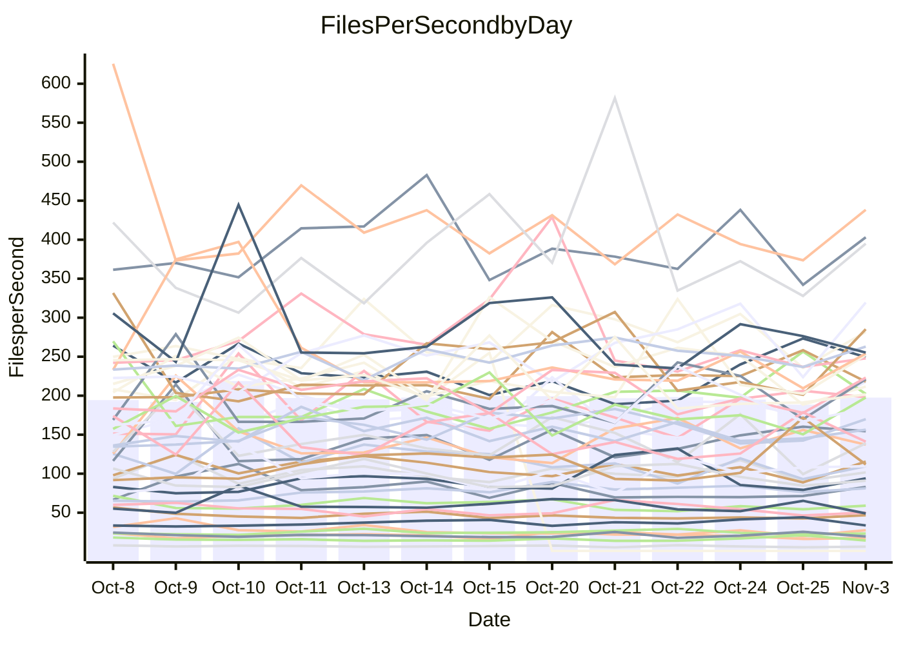

<!---
# This file is auto-generated. Do not edit.
# cspell:disable
--->
# Performance Report

Daily Performance

Time to Process Files

| Repository                                      | Elapsed | Min/Avg/Max          |    SD | SD Graph                |
| ----------------------------------------------- | ------: | :------------------: | ----: | ----------------------- |
| AdaDoom3/AdaDoom3                    |    3.22 | 2.0 /   2.9 /   3.5  |  0.43 | `    ┣━━┻━━╋━●┻━━┫    ` |
| alexiosc/megistos                    |    4.04 | 3.9 /   6.6 /   8.1  |  1.25 | `    ●━━┻━━╋━━┻━━┫    ` |
| apollographql/apollo-server          |    2.61 | 1.4 /   2.4 /   3.0  |  0.43 | `    ┣━━┻━━╋●━┻━━┫    ` |
| aspnetboilerplate/aspnetboilerplate  |    9.25 | 5.1 /   8.4 /  10.2  |  1.48 | `    ┣━━┻━━╋━●┻━━┫    ` |
| aws-amplify/docs                     |   15.13 | 7.7 /  12.8 /  14.6  |  2.34 | `   ┣━━━┻━━╋━━●━━━┫   ` |
| Azure/azure-rest-api-specs           |   11.24 | 7.3 /  10.5 /  12.2  |  1.27 | `    ┣━━┻━━╋━●┻━━┫    ` |
| bitjson/typescript-starter           |    1.15 | 0.7 /   1.0 /   1.2  |  0.17 | `     ┣━┻━━╋━●┻━┫     ` |
| caddyserver/caddy                    |    3.01 | 2.3 /   3.9 /   4.6  |  0.66 | `    ┣━●┻━━╋━━┻━━┫    ` |
| canada-ca/open-source-logiciel-libre |    0.76 | 0.7 /   1.1 /   1.4  |  0.18 | `     ┣●┻━━╋━━┻━┫     ` |
| chef/chef                            |    0.00 | 0.0 /   2.7 /   5.5  |  2.45 | `    ┣━━●━━╋━━┻━━┫    ` |
| dart-lang/sdk                        |   66.03 | 38.8 /  56.1 /  76.1 |  8.68 | `  ┣━━━┻━━━╋━━━●━━━┫  ` |
| django/django                        |    7.64 | 8.3 /  13.2 /  15.3  |  2.27 | `  ●┣━━━┻━━╋━━┻━━━┫   ` |
| eslint/eslint                        |   10.11 | 5.8 /   9.5 /  11.5  |  1.44 | `    ┣━━┻━━╋●━┻━━┫    ` |
| exonum/exonum                        |    2.68 | 2.0 /   3.1 /   3.8  |  0.55 | `    ┣━━┻●━╋━━┻━━┫    ` |
| flutter/samples                      |   10.58 | 7.2 /  11.0 /  13.0  |  1.70 | `    ┣━━┻━●╋━━┻━━┫    ` |
| gitbucket/gitbucket                  |    3.46 | 1.9 /   3.1 /   3.9  |  0.53 | `    ┣━━┻━━╋━●┻━━┫    ` |
| googleapis/google-cloud-cpp          |  131.25 | 72.6 / 118.5 / 138.7 | 18.73 | `  ┣━━━┻━━━╋━━●┻━━━┫  ` |
| graphql/express-graphql              |    0.80 | 0.7 /   1.1 /   1.3  |  0.18 | `     ┣●┻━━╋━━┻━┫     ` |
| graphql/graphql-js                   |    2.17 | 2.1 /   3.2 /   4.1  |  0.67 | `    ┣━●┻━━╋━━┻━━┫    ` |
| graphql/graphql-relay-js             |    1.16 | 0.7 /   1.1 /   1.4  |  0.20 | `     ┣━┻━━╋●━┻━┫     ` |
| graphql/graphql-spec                 |    1.47 | 0.8 /   1.3 /   1.6  |  0.20 | `     ┣━┻━━╋━━●━┫     ` |
| iluwatar/java-design-patterns        |   11.47 | 7.4 /  11.9 /  14.6  |  2.26 | `    ┣━━┻━●╋━━┻━━┫    ` |
| ktaranov/sqlserver-kit               |    3.26 | 3.4 /   5.3 /   6.8  |  1.11 | `    ┣●━┻━━╋━━┻━━┫    ` |
| liriliri/licia                       |    4.07 | 2.3 /   3.6 /   4.5  |  0.58 | `    ┣━━┻━━╋━●┻━━┫    ` |
| MartinThoma/LaTeX-examples           |    4.04 | 4.1 /   6.4 /   7.5  |  0.83 | ` ●  ┣━━┻━━╋━━┻━━┫    ` |
| mdx-js/mdx                           |    1.71 | 1.2 /   1.8 /   2.1  |  0.27 | `     ┣━┻━●╋━━┻━┫     ` |
| microsoft/TypeScript-Website         |    5.57 | 3.1 /   4.9 /   6.3  |  0.82 | `    ┣━━┻━━╋━●┻━━┫    ` |
| MicrosoftDocs/PowerShell-Docs        |   24.75 | 14.4 /  22.7 /  27.4 |  3.77 | `   ┣━━━┻━━╋━●┻━━━┫   ` |
| neovim/nvim-lspconfig                |    6.09 | 3.2 /   5.4 /   6.8  |  0.91 | `    ┣━━┻━━╋━●┻━━┫    ` |
| pagekit/pagekit                      |    2.33 | 2.1 /   3.4 /   4.1  |  0.56 | `    ┣●━┻━━╋━━┻━━┫    ` |
| php/php-src                          |   28.01 | 13.6 /  22.1 /  26.7 |  4.14 | `   ┣━━━┻━━╋━━┻━●━┫   ` |
| plasticrake/tplink-smarthome-api     |    1.48 | 0.8 /   1.2 /   1.5  |  0.21 | `     ┣━┻━━╋━━┻●┫     ` |
| prettier/prettier                    |    8.93 | 4.5 /   7.4 /   8.9  |  1.37 | `    ┣━━┻━━╋━━●━━┫    ` |
| pycontribs/jira                      |    1.57 | 0.9 /   1.4 /   1.9  |  0.23 | `     ┣━┻━━╋━●┻━┫     ` |
| RustPython/RustPython                |   13.11 | 6.5 /  10.5 /  13.2  |  1.82 | `    ┣━━┻━━╋━━┻━●┫    ` |
| shoelace-style/shoelace              |    2.97 | 1.7 /   2.5 /   3.1  |  0.47 | `    ┣━━┻━━╋━━●━━┫    ` |
| slint-ui/slint                       |   13.26 | 11.7 /  18.2 /  22.5 |  3.30 | `   ┣━●━┻━━╋━━┻━━━┫   ` |
| SoftwareBrothers/admin-bro           |    2.44 | 1.6 /   2.4 /   2.9  |  0.36 | `    ┣━━┻━━●━━┻━━┫    ` |
| sveltejs/svelte                      |   18.52 | 13.2 /  22.3 /  27.1 |  3.72 | `   ┣━━━●━━╋━━┻━━━┫   ` |
| TheAlgorithms/Python                 |    6.82 | 3.9 /   6.2 /   7.3  |  1.03 | `    ┣━━┻━━╋━●┻━━┫    ` |
| twbs/bootstrap                       |    2.21 | 1.1 /   1.8 /   2.3  |  0.31 | `     ┣━┻━━╋━━●━┫     ` |
| typescript-cheatsheets/react         |    1.24 | 0.8 /   1.2 /   1.4  |  0.16 | `     ┣━┻━━╋●━┻━┫     ` |
| typescript-eslint/typescript-eslint  |    3.90 | 2.5 /   4.0 /   4.8  |  0.75 | `    ┣━━┻━━●━━┻━━┫    ` |
| vitest-dev/vitest                    |   12.93 | 6.4 /  10.8 /  13.1  |  1.73 | `    ┣━━┻━━╋━━┻●━┫    ` |
| w3c/aria-practices                   |    3.26 | 2.0 /   3.0 /   4.2  |  0.61 | `    ┣━━┻━━╋●━┻━━┫    ` |
| w3c/specberus                        |    1.95 | 1.2 /   1.7 /   2.3  |  0.36 | `     ┣━┻━━╋━●┻━┫     ` |
| webdeveric/webpack-assets-manifest   |    1.31 | 0.9 /   1.2 /   1.4  |  0.12 | `     ┣━┻━━╋━●┻━┫     ` |
| webpack/webpack                      |    9.41 | 5.4 /   8.1 /   9.9  |  1.56 | `    ┣━━┻━━╋━━●━━┫    ` |
| wireapp/wire-desktop                 |    1.31 | 0.9 /   1.4 /   1.7  |  0.24 | `     ┣━┻━●╋━━┻━┫     ` |
| wireapp/wire-webapp                  |   15.82 | 9.1 /  13.6 /  16.4  |  2.44 | `   ┣━━━┻━━╋━━●━━━┫   ` |

Note:
- Elapsed time is in seconds.

Files per Second over Time

| Repository                                      | Files |    Sec |    Fps |     Rel | Trend Fps              |    N |
| ----------------------------------------------- | ----: | -----: | -----: | ------: | ---------------------- | ---: |
| AdaDoom3/AdaDoom3                    |   103 |   3.22 |  31.97 | -13.53% | `█▃▂▅▅▃▂▃▅▂▅▅█▂▅▆▁▂▅▂` |   31 |
| alexiosc/megistos                    |   583 |   4.04 | 144.43 |  55.87% | `▂▂▄▄▂▂▂▇▄█▅▂▄▂▂▂▁▂▂█` |   31 |
| apollographql/apollo-server          |   256 |   2.61 |  97.94 | -11.79% | `█▁▂▂▂▂▂▂▅▂▂▂▂▁▆▁▄▅▂▂` |   31 |
| aspnetboilerplate/aspnetboilerplate  |  2308 |   9.25 | 249.53 | -11.96% | `▂▄▂▂▄██▂▂▁▂▄▂▂▂▂▂▂▂▂` |   31 |
| aws-amplify/docs                     |  3039 |  15.13 | 200.81 | -19.32% | `▂▂▂▂▂▁▃▂▂▂▂▂▁▁█▁█▂▁▁` |   31 |
| Azure/azure-rest-api-specs           |  2607 |  11.24 | 231.91 |  -8.29% | `▂▃█▂▃▃▅▇▂▅▂▂▃▂▆▃▆▂▅▂` |   31 |
| bitjson/typescript-starter           |    20 |   1.15 |  17.44 | -16.03% | `▂▃█▅▁█▅▂█▂▇▃▄▇▂▂▂▂▃▂` |   31 |
| caddyserver/caddy                    |   402 |   3.01 | 133.52 |  30.31% | `▂▅▂▂▂▆▂▂▅▄▂▅▂█▅▂▂▂▃▇` |   31 |
| canada-ca/open-source-logiciel-libre |     7 |   0.76 |   9.27 |  35.60% | `▃▂▃▇▄▃█▂▂▅▇▄▂▆▃▂▁▃▂▇` |   31 |
| chef/chef                            |     0 |   0.00 |   0.00 | -99.16% | `▇▆▆▇█▁▁▁▁▁▁▁▁▁▁▁▁▁▁▁` |   31 |
| dart-lang/sdk                        | 11839 |  66.03 | 179.29 | -16.84% | `▅▃▃▄█▄▄██▃▃▅▁▄▃▃▆▃▃▃` |   31 |
| django/django                        |  2941 |   7.64 | 385.13 |  67.10% | `▆▆▂▂▄▁▆▄▆▁▂▄▁▁▁▂▇▂▁█` |   31 |
| eslint/eslint                        |  2087 |  10.11 | 206.43 |  -8.43% | `▂▂▄▂▂█▂▄▁▂▄▂▂▄▄▄▁▅▂▂` |   31 |
| exonum/exonum                        |   421 |   2.68 | 157.12 |  12.06% | `▆▂▂█▂█▂▃▁▄▂▄▅▃▅▅▂▅█▅` |   31 |
| flutter/samples                      |  1703 |  10.58 | 160.90 |   0.90% | `▂▂▂▃▅▆▂█▂▂▅▁▂▂▂▂▂▇▄▃` |   31 |
| gitbucket/gitbucket                  |   427 |   3.46 | 123.34 | -12.07% | `▄▅▄▂▂▁▂▇▁▂█▄▂▄▁▄▄▄▂▂` |   31 |
| googleapis/google-cloud-cpp          | 22116 | 131.25 | 168.50 | -12.36% | `▂▃▂▄▂▂▄▂▁▂█▂▂▂▇▂▂▄▂▂` |   31 |
| graphql/express-graphql              |    26 |   0.80 |  32.34 |  29.84% | `▂▃▇▃▄▃▅█▂▅▇▃▃▃▆▃▁▂▂█` |   31 |
| graphql/graphql-js                   |   556 |   2.17 | 255.66 |  40.55% | `▁▇▂▂▂▂█▅▁▂▂▃▇▇▂▅▂▄▅█` |   31 |
| graphql/graphql-relay-js             |    28 |   1.16 |  24.16 | -11.00% | `▂▆▅▂▃▃▃▂▆▂▃▅▃▆▆▁█▆▃▃` |   31 |
| graphql/graphql-spec                 |    19 |   1.47 |  12.91 | -16.95% | `▃▆▂▂▃▇▃▃▂▃▃▃▃█▇█▇▂▁▂` |   31 |
| iluwatar/java-design-patterns        |  2239 |  11.47 | 195.13 |  -0.57% | `▂▄▂▇▃▂▄▁▂▃▇▇▂▂█▂▅▂▇▃` |   31 |
| ktaranov/sqlserver-kit               |   490 |   3.26 | 150.13 |  53.20% | `▂▇▄▂▂▇▁▁▁█▄▅▄▄▂▄▂▆▂█` |   31 |
| liriliri/licia                       |  1442 |   4.07 | 354.68 | -13.52% | `▅▄▄▇▂▄▂▄▁▂▂▃▂▂█▂▄▅▂▂` |   31 |
| MartinThoma/LaTeX-examples           |  1414 |   4.04 | 350.16 |  55.29% | `▂▂▂▁▃▂▂▂▁█▆▃▂▃▂▂▂▃▃█` |   31 |
| mdx-js/mdx                           |   139 |   1.71 |  81.37 |   1.56% | `█▆▂▂▂▄▄▂▂▂▂▂▂▂▂▂▅▂▅▃` |   31 |
| microsoft/TypeScript-Website         |   765 |   5.57 | 137.32 | -14.35% | `▆▃▄▆▃▃▅▃▃▆▃▃▃▂▃▃▂▂█▂` |   31 |
| MicrosoftDocs/PowerShell-Docs        |  3127 |  24.75 | 126.33 | -11.42% | `█▄█▂▇▂▂▅▂▂▁▂▂▂▂▇▂█▂▂` |   31 |
| neovim/nvim-lspconfig                |   889 |   6.09 | 145.97 | -13.99% | `▅▂▅▂▂▅█▃▃▂▂▂▃▂▄▂▂▁▂▂` |   31 |
| pagekit/pagekit                      |   741 |   2.33 | 317.60 |  40.05% | `▂█▁▂▂▂▃▁▂▂▂▅▂▂▆▅▂▂▅▇` |   31 |
| php/php-src                          |  2403 |  28.01 |  85.80 | -24.07% | `█▂▂▄▄▆▂▂▁▁▁▁▂▄▂█▄▆▂▁` |   31 |
| plasticrake/tplink-smarthome-api     |    62 |   1.48 |  41.88 | -22.88% | `▁▅▇▂▂▄▂▆▆█▂▂▅▄▄▂▄▅▁▁` |   31 |
| prettier/prettier                    |  2791 |   8.93 | 312.45 | -19.16% | `▆▂▃▂▅▂▄█▇▂▂▂▂▄▄▂▂█▂▁` |   31 |
| pycontribs/jira                      |    80 |   1.57 |  51.06 | -11.52% | `▆▃▃▃▄█▃▅▅▂▄▃▃▃▃▅▁▃▃▃` |   31 |
| RustPython/RustPython                |  1069 |  13.11 |  81.51 | -18.10% | `▄▄▄▁▂▂▂▅▄█▂▁▅▅▂▂▄▃▂▂` |   31 |
| shoelace-style/shoelace              |   440 |   2.97 | 147.94 | -17.78% | `█▂▂▄▇▂▂▄▄▅▂▂▂█▁▂▂▇█▂` |   31 |
| slint-ui/slint                       |  5027 |  13.26 | 379.18 |  43.00% | `▂▇▂▂▄▂▂▅▃▇▂▇▇█▂▂▄▇▄█` |   31 |
| SoftwareBrothers/admin-bro           |   441 |   2.44 | 180.92 |  -5.03% | `▃▃▂▅▂▂▂▂▃▂▅▁▃█▃▃▃█▇▃` |   31 |
| sveltejs/svelte                      |  9223 |  18.52 | 497.98 |  16.67% | `▂█▂▂▂▂▅▂▂▂▅▂▃▂▃▂▁▂▆▅` |   31 |
| TheAlgorithms/Python                 |  1640 |   6.82 | 240.52 | -12.45% | `▂▂▁▅▂█▁▄▄▄▂▂▄▄▆▂▂█▂▂` |   31 |
| twbs/bootstrap                       |   152 |   2.21 |  68.71 | -13.25% | `▂▂▆▂▃▆▂▂▄▄▂▂▁▂█▃▄▂▅▂` |   31 |
| typescript-cheatsheets/react         |    24 |   1.24 |  19.29 |  -7.46% | `▃▅▃▁▂▃▂█▃▂▂▂▅▃▃▅▃▂▃▃` |   31 |
| typescript-eslint/typescript-eslint  |   887 |   3.90 | 227.49 |  -1.76% | `▂▂▁▂▇█▂▅▂▂▇▆█▂▁▂▂▂▃▃` |   31 |
| vitest-dev/vitest                    |  2948 |  12.93 | 227.95 | -16.84% | `▄▂▂▂▄▄▅▂▂▂▂█▂▂▂▃▄▂▂▁` |   31 |
| w3c/aria-practices                   |   417 |   3.26 | 127.73 | -12.01% | `▃▄▂▄▃▇▅▅▅▂▂█▂▇█▁▂▂█▃` |   31 |
| w3c/specberus                        |   190 |   1.95 |  97.60 | -17.12% | `▇▅▇▁▅▂▄▅▃▁▂▅▂▂█▂▂▂▇▂` |   31 |
| webdeveric/webpack-assets-manifest   |    55 |   1.31 |  42.14 |  -8.94% | `▇▃▄█▃▄▄▃▂▃▂▂▃▃▄▃▃█▃▂` |   31 |
| webpack/webpack                      |  1540 |   9.41 | 163.59 | -15.66% | `▂▆▂▁▂▄▂▆▂▂▆▄▂▁▇▇▂▄█▂` |   31 |
| wireapp/wire-desktop                 |    86 |   1.31 |  65.74 |   9.31% | `▂▂█▃▄▆▃▃▂▂▂▂▂▅▄▃▂▄▃▅` |   31 |
| wireapp/wire-webapp                  |  2803 |  15.82 | 177.19 | -15.74% | `▂▄█▂▂█▂▄▅▂▂▂▂▅▃▂▅▂█▂` |   31 |

Data Throughput

| Repository                                      | Files |    Sec |     Kps |     Rel | Trend Kps              |    N |
| ----------------------------------------------- | ----: | -----: | ------: | ------: | ---------------------- | ---: |
| AdaDoom3/AdaDoom3                    |   103 |   3.22 |  679.53 | -13.53% | `█▃▂▅▅▃▂▃▅▂▅▅█▂▅▆▁▂▅▂` |   31 |
| alexiosc/megistos                    |   583 |   4.04 | 1134.87 |  55.87% | `▂▂▄▄▂▂▂▇▄█▅▂▄▂▂▂▁▂▂█` |   31 |
| apollographql/apollo-server          |   256 |   2.61 |  808.77 | -11.79% | `█▁▂▂▂▂▂▂▅▂▂▂▂▁▆▁▄▅▂▂` |   31 |
| aspnetboilerplate/aspnetboilerplate  |  2308 |   9.25 |  615.60 | -11.69% | `▂▄▂▂▄██▂▂▁▂▄▂▂▂▂▂▂▂▂` |   31 |
| aws-amplify/docs                     |  3039 |  15.13 |  789.25 | -19.30% | `▂▂▂▂▂▁▃▂▂▂▂▂▁▁█▁█▂▁▁` |   31 |
| Azure/azure-rest-api-specs           |  2607 |  11.24 |  729.72 |  -7.09% | `▂▃█▂▃▃▅▇▂▅▂▂▃▂▆▃▆▂▅▃` |   31 |
| bitjson/typescript-starter           |    20 |   1.15 |   69.75 | -16.03% | `▂▃█▅▁█▅▂█▂▇▃▄▇▂▂▂▂▃▂` |   31 |
| caddyserver/caddy                    |   402 |   3.01 | 1304.29 |  34.53% | `▂▅▂▂▂▆▂▂▅▄▂▅▂█▆▂▂▃▃▇` |   31 |
| canada-ca/open-source-logiciel-libre |     7 |   0.76 |   76.80 |  35.60% | `▃▂▃▇▄▃█▂▂▅▇▄▂▆▃▂▁▃▂▇` |   31 |
| chef/chef                            |  1037 |   4.07 | 1253.33 |  19.94% | `▄▃█▄▄▃▇▃▄▃█▆▃▃▂▃█`    |   16 |
| dart-lang/sdk                        | 11839 |  66.03 | 1259.97 | -16.60% | `▅▃▃▄█▄▄██▃▃▅▁▄▃▃▆▃▃▃` |   31 |
| django/django                        |  2941 |   7.64 | 2502.38 |  67.52% | `▆▆▂▂▄▁▆▄▆▁▂▄▁▁▁▂▇▂▁█` |   31 |
| eslint/eslint                        |  2087 |  10.11 | 1462.84 |  -8.28% | `▂▂▄▂▂█▂▄▁▂▄▂▂▄▄▄▁▅▂▂` |   31 |
| exonum/exonum                        |   421 |   2.68 | 1502.91 |  12.06% | `▆▂▂█▂█▂▃▁▄▂▄▅▃▅▅▂▅█▅` |   31 |
| flutter/samples                      |  1703 |  10.58 |  959.05 |   0.90% | `▂▂▂▃▅▆▂█▂▂▅▁▂▂▂▂▂▇▄▃` |   31 |
| gitbucket/gitbucket                  |   427 |   3.46 |  608.91 | -11.45% | `▄▅▄▂▂▁▂▇▁▂█▄▂▄▁▄▄▄▂▂` |   31 |
| googleapis/google-cloud-cpp          | 22116 | 131.25 | 1477.96 | -12.04% | `▂▃▂▄▂▂▄▂▁▂█▂▂▂▇▂▃▄▂▂` |   31 |
| graphql/express-graphql              |    26 |   0.80 |  148.00 |  29.84% | `▂▃▇▃▄▃▅█▂▅▇▃▃▃▆▃▁▂▂█` |   31 |
| graphql/graphql-js                   |   556 |   2.17 | 1953.35 |  42.58% | `▁▇▂▂▂▂█▅▁▂▂▃▇▇▂▅▂▄▅█` |   31 |
| graphql/graphql-relay-js             |    28 |   1.16 |   94.92 | -11.00% | `▂▆▅▂▃▃▃▂▆▂▃▅▃▆▆▁█▆▃▃` |   31 |
| graphql/graphql-spec                 |    19 |   1.47 |  434.26 | -16.95% | `▃▆▂▂▃▇▃▃▂▃▃▃▃█▇█▇▂▁▂` |   31 |
| iluwatar/java-design-patterns        |  2239 |  11.47 |  605.43 |  -0.57% | `▂▄▂▇▃▂▄▁▂▃▇▇▂▂█▂▅▂▇▃` |   31 |
| ktaranov/sqlserver-kit               |   490 |   3.26 | 2275.23 |  53.25% | `▂▇▄▂▂▇▁▁▁█▄▅▄▄▂▄▂▆▂█` |   31 |
| liriliri/licia                       |  1442 |   4.07 |  425.27 | -13.52% | `▅▄▄▇▂▄▂▄▁▂▂▃▂▂█▂▄▅▂▂` |   31 |
| MartinThoma/LaTeX-examples           |  1414 |   4.04 |  727.56 |  55.29% | `▂▂▂▁▃▂▂▂▁█▆▃▂▃▂▂▂▃▃█` |   31 |
| mdx-js/mdx                           |   139 |   1.71 |  383.42 |   1.56% | `█▆▂▂▂▄▄▂▂▂▂▂▂▂▂▂▅▂▅▃` |   31 |
| microsoft/TypeScript-Website         |   765 |   5.57 |  947.63 | -14.31% | `▆▃▄▆▃▃▅▃▃▆▃▃▃▂▃▃▂▂█▂` |   31 |
| MicrosoftDocs/PowerShell-Docs        |  3127 |  24.75 | 1350.04 | -11.42% | `█▄█▂▇▂▂▅▂▂▁▂▂▂▂▇▂█▂▂` |   31 |
| neovim/nvim-lspconfig                |   889 |   6.09 |  461.54 | -13.57% | `▅▂▅▂▂▅█▃▃▂▂▂▃▂▄▂▂▁▂▂` |   31 |
| pagekit/pagekit                      |   741 |   2.33 |  662.21 |  40.05% | `▂█▁▂▂▂▃▁▂▂▂▅▂▂▆▅▂▂▅▇` |   31 |
| php/php-src                          |  2403 |  28.01 | 1526.80 | -24.08% | `█▂▂▄▄▆▂▂▁▁▁▁▂▄▂█▄▆▂▁` |   31 |
| plasticrake/tplink-smarthome-api     |    62 |   1.48 |  226.29 | -22.88% | `▁▅▇▂▂▄▂▆▆█▂▂▅▄▄▂▄▅▁▁` |   31 |
| prettier/prettier                    |  2791 |   8.93 |  435.60 | -19.55% | `▆▂▃▂▅▂▄█▇▂▂▂▂▄▄▂▂█▂▁` |   31 |
| pycontribs/jira                      |    80 |   1.57 |  360.59 | -11.52% | `▆▃▃▃▄█▃▅▅▂▄▃▃▃▃▅▁▃▃▃` |   31 |
| RustPython/RustPython                |  1069 |  13.11 | 2352.14 | -19.37% | `▅▅▅▂▂▂▂▅▄█▂▁▅▅▂▂▄▃▂▂` |   31 |
| shoelace-style/shoelace              |   440 |   2.97 |  714.50 | -17.78% | `█▂▂▄▇▂▂▄▄▅▂▂▂█▁▂▂▇█▂` |   31 |
| slint-ui/slint                       |  5027 |  13.26 | 2278.32 |  46.46% | `▂▆▂▂▄▂▂▄▃▇▂▆▆█▂▂▄▇▄█` |   31 |
| SoftwareBrothers/admin-bro           |   441 |   2.44 |  398.75 |  -5.03% | `▃▃▂▅▂▂▂▂▃▂▅▁▃█▃▃▃█▇▃` |   31 |
| sveltejs/svelte                      |  9223 |  18.52 |  344.69 |  16.86% | `▂█▂▂▂▂▅▂▂▂▅▂▃▂▃▂▁▂▆▅` |   31 |
| TheAlgorithms/Python                 |  1640 |   6.82 |  689.89 | -12.33% | `▂▂▁▄▂█▁▄▄▄▂▂▄▄▆▂▂█▂▂` |   31 |
| twbs/bootstrap                       |   152 |   2.21 |  580.91 | -12.38% | `▂▃▆▂▃▆▂▂▄▄▂▂▂▂█▃▄▂▆▂` |   31 |
| typescript-cheatsheets/react         |    24 |   1.24 |  174.43 |  -7.46% | `▃▅▃▁▂▃▂█▃▂▂▂▅▃▃▅▃▂▃▃` |   31 |
| typescript-eslint/typescript-eslint  |   887 |   3.90 |  777.89 |  -1.47% | `▂▂▁▂▇█▂▅▂▂▇▆█▂▁▂▂▂▃▃` |   31 |
| vitest-dev/vitest                    |  2948 |  12.93 |  689.10 | -15.85% | `▄▂▂▂▄▄▅▂▂▂▂█▂▂▂▃▄▂▂▂` |   31 |
| w3c/aria-practices                   |   417 |   3.26 | 1202.56 | -12.01% | `▃▄▂▄▃▇▅▅▅▂▂█▂▇█▁▂▂█▃` |   31 |
| w3c/specberus                        |   190 |   1.95 |  319.50 | -17.12% | `▇▅▇▁▅▂▄▅▃▁▂▅▂▂█▂▂▂▇▂` |   31 |
| webdeveric/webpack-assets-manifest   |    55 |   1.31 |   97.30 |  -8.94% | `▇▃▄█▃▄▄▃▂▃▂▂▃▃▄▃▃█▃▂` |   31 |
| webpack/webpack                      |  1540 |   9.41 | 1422.51 | -16.61% | `▂▆▂▁▂▄▂▇▂▂▇▅▂▂█▇▂▄█▂` |   31 |
| wireapp/wire-desktop                 |    86 |   1.31 |  288.94 |  11.01% | `▃▃█▃▄▆▄▃▂▂▂▂▂▅▅▃▂▅▃▅` |   31 |
| wireapp/wire-webapp                  |  2803 |  15.82 |  845.05 | -13.03% | `▂▄█▂▂▇▂▄▅▂▂▂▂▅▃▂▆▂█▂` |   31 |

