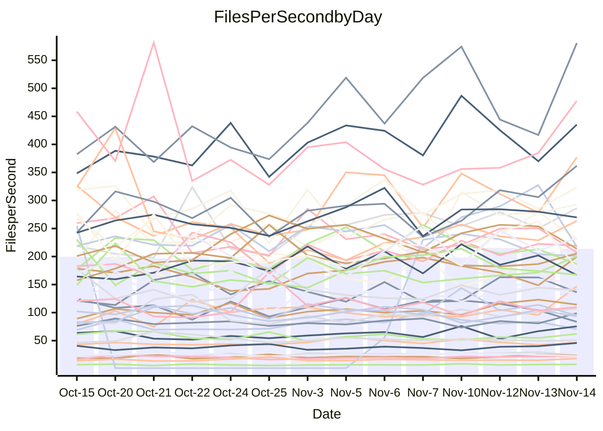

<!---
# This file is auto-generated. Do not edit.
# cspell:disable
--->
# Performance Report

Daily Performance

Time to Process Files

| Repository                                      | Elapsed | Min/Avg/Max          |    SD | SD Graph                |
| ----------------------------------------------- | ------: | :------------------: | ----: | ----------------------- |
| AdaDoom3/AdaDoom3                    |    3.17 | 1.7 /   2.8 /   3.5  |  0.52 | `    ┣━━┻━━╋━●┻━━┫    ` |
| alexiosc/megistos                    |    5.34 | 3.9 /   6.4 /   9.3  |  1.29 | `    ┣━━┻●━╋━━┻━━┫    ` |
| apollographql/apollo-server          |    2.66 | 1.5 /   2.4 /   3.3  |  0.39 | `    ┣━━┻━━╋●━┻━━┫    ` |
| aspnetboilerplate/aspnetboilerplate  |    7.40 | 5.2 /   7.8 /  10.2  |  1.57 | `    ┣━━┻━●╋━━┻━━┫    ` |
| aws-amplify/docs                     |   13.89 | 7.4 /  12.2 /  15.4  |  2.50 | `    ┣━━┻━━╋━●┻━━┫    ` |
| Azure/azure-rest-api-specs           |    8.77 | 6.2 /   9.6 /  12.2  |  1.74 | `    ┣━━┻●━╋━━┻━━┫    ` |
| bitjson/typescript-starter           |    1.10 | 0.6 /   1.0 /   1.3  |  0.18 | `     ┣━┻━━╋●━┻━┫     ` |
| caddyserver/caddy                    |    3.76 | 2.5 /   3.9 /   4.9  |  0.73 | `    ┣━━┻━●╋━━┻━━┫    ` |
| canada-ca/open-source-logiciel-libre |    0.96 | 0.7 /   1.0 /   1.4  |  0.17 | `     ┣━┻━●╋━━┻━┫     ` |
| chef/chef                            |    5.77 | 0.0 /   2.1 /   5.9  |  2.41 | `    ┣━━┻━━╋━━┻━●┫    ` |
| dart-lang/sdk                        |   61.53 | 34.1 /  56.1 /  76.1 | 10.24 | `  ┣━━━┻━━━╋━●━┻━━━┫  ` |
| django/django                        |   13.81 | 7.6 /  12.6 /  15.6  |  2.36 | `    ┣━━┻━━╋━●┻━━┫    ` |
| eslint/eslint                        |    8.12 | 5.7 /   8.8 /  11.8  |  1.86 | `    ┣━━┻━●╋━━┻━━┫    ` |
| exonum/exonum                        |    2.28 | 2.1 /   3.1 /   3.9  |  0.54 | `    ┣━●┻━━╋━━┻━━┫    ` |
| flutter/samples                      |   11.23 | 6.6 /  10.3 /  13.9  |  2.14 | `    ┣━━┻━━╋●━┻━━┫    ` |
| gitbucket/gitbucket                  |    2.69 | 2.0 /   3.1 /   4.5  |  0.63 | `    ┣━━┻●━╋━━┻━━┫    ` |
| googleapis/google-cloud-cpp          |   97.27 | 72.6 / 112.4 / 144.0 | 22.47 | `  ┣━━━┻●━━╋━━━┻━━━┫  ` |
| graphql/express-graphql              |    1.23 | 0.7 /   1.1 /   1.4  |  0.17 | `     ┣━┻━━╋━●┻━┫     ` |
| graphql/graphql-js                   |    2.97 | 2.1 /   3.4 /   4.4  |  0.65 | `    ┣━━┻●━╋━━┻━━┫    ` |
| graphql/graphql-relay-js             |    1.28 | 0.7 /   1.1 /   1.4  |  0.17 | `     ┣━┻━━╋━━●━┫     ` |
| graphql/graphql-spec                 |    0.99 | 0.8 /   1.3 /   1.6  |  0.21 | `     ┣━●━━╋━━┻━┫     ` |
| iluwatar/java-design-patterns        |   10.08 | 7.4 /  11.2 /  14.6  |  2.15 | `    ┣━━┻●━╋━━┻━━┫    ` |
| ktaranov/sqlserver-kit               |    3.33 | 3.2 /   5.2 /   6.8  |  1.12 | `    ┣●━┻━━╋━━┻━━┫    ` |
| liriliri/licia                       |    2.93 | 2.2 /   3.7 /   4.7  |  0.70 | `    ┣━━●━━╋━━┻━━┫    ` |
| MartinThoma/LaTeX-examples           |    5.24 | 3.8 /   5.7 /   7.5  |  1.07 | `    ┣━━┻━●╋━━┻━━┫    ` |
| mdx-js/mdx                           |    2.06 | 1.2 /   1.8 /   2.1  |  0.28 | `     ┣━┻━━╋━━●━┫     ` |
| microsoft/TypeScript-Website         |    4.15 | 3.1 /   5.0 /   6.0  |  0.82 | `    ┣━━●━━╋━━┻━━┫    ` |
| MicrosoftDocs/PowerShell-Docs        |   19.94 | 14.9 /  23.7 /  28.1 |  2.98 | `   ┣━━●┻━━╋━━┻━━━┫   ` |
| neovim/nvim-lspconfig                |    5.94 | 3.1 /   5.2 /  10.2  |  1.23 | `    ┣━━┻━━╋━●┻━━┫    ` |
| pagekit/pagekit                      |    3.52 | 2.0 /   3.2 /   4.1  |  0.59 | `    ┣━━┻━━╋●━┻━━┫    ` |
| php/php-src                          |   19.40 | 13.9 /  22.6 /  28.0 |  4.09 | `   ┣━━━●━━╋━━┻━━━┫   ` |
| plasticrake/tplink-smarthome-api     |    1.35 | 0.8 /   1.2 /   1.6  |  0.22 | `     ┣━┻━━╋●━┻━┫     ` |
| prettier/prettier                    |    8.82 | 4.4 /   7.6 /   9.3  |  1.28 | `    ┣━━┻━━╋━━●━━┫    ` |
| pycontribs/jira                      |    1.41 | 1.0 /   1.4 /   1.9  |  0.22 | `     ┣━┻━━●━━┻━┫     ` |
| RustPython/RustPython                |   13.32 | 7.2 /  11.1 /  13.4  |  2.04 | `    ┣━━┻━━╋━━●━━┫    ` |
| shoelace-style/shoelace              |    2.97 | 1.7 /   2.6 /   3.5  |  0.46 | `    ┣━━┻━━╋━●┻━━┫    ` |
| slint-ui/slint                       |   17.04 | 12.5 /  19.6 /  24.1 |  3.66 | `   ┣━━━┻●━╋━━┻━━━┫   ` |
| SoftwareBrothers/admin-bro           |    2.52 | 1.5 /   2.4 /   3.2  |  0.41 | `    ┣━━┻━━╋●━┻━━┫    ` |
| sveltejs/svelte                      |   17.36 | 13.4 /  22.7 / 100.8 | 11.69 | `   ┣━━┻━●━╋━━━┻━━┫   ` |
| TheAlgorithms/Python                 |    4.02 | 3.7 /   5.9 /   7.6  |  1.16 | `    ┣●━┻━━╋━━┻━━┫    ` |
| twbs/bootstrap                       |    1.62 | 1.2 /   1.9 /   2.5  |  0.29 | `     ┣━┻●━╋━━┻━┫     ` |
| typescript-cheatsheets/react         |    1.19 | 0.8 /   1.1 /   1.4  |  0.18 | `     ┣━┻━━╋●━┻━┫     ` |
| typescript-eslint/typescript-eslint  |    3.61 | 2.6 /   4.0 /   4.8  |  0.71 | `    ┣━━┻━●╋━━┻━━┫    ` |
| vitest-dev/vitest                    |    8.85 | 6.4 /  10.4 /  13.0  |  2.15 | `    ┣━━┻●━╋━━┻━━┫    ` |
| w3c/aria-practices                   |    3.40 | 2.1 /   3.1 /   4.2  |  0.55 | `    ┣━━┻━━╋━●┻━━┫    ` |
| w3c/specberus                        |    2.73 | 1.1 /   1.8 /   2.3  |  0.31 | `     ┣━┻━━╋━━┻━┫  ●  ` |
| webdeveric/webpack-assets-manifest   |    1.31 | 0.8 /   1.2 /   1.6  |  0.17 | `     ┣━┻━━╋━●┻━┫     ` |
| webpack/webpack                      |    9.72 | 5.3 /   8.2 /  10.7  |  1.61 | `    ┣━━┻━━╋━━●━━┫    ` |
| wireapp/wire-desktop                 |    1.33 | 0.9 /   1.4 /   1.9  |  0.24 | `     ┣━┻━●╋━━┻━┫     ` |
| wireapp/wire-webapp                  |   16.88 | 8.5 /  14.2 /  18.4  |  2.97 | `   ┣━━━┻━━╋━━●━━━┫   ` |

Note:
- Elapsed time is in seconds.

Files per Second over Time

| Repository                                      | Files |   Sec |    Fps |     Rel | Trend Fps              |    N |
| ----------------------------------------------- | ----: | ----: | -----: | ------: | ---------------------- | ---: |
| AdaDoom3/AdaDoom3                    |   103 |  3.17 |  32.54 | -15.24% | `▄▃▂▂▅▁▂▄▇▂▄▇▅▇▁▂▂▂█▂` |   52 |
| alexiosc/megistos                    |   583 |  5.34 | 109.09 |  13.54% | `▅▅▆▅▃▅▄▃▃▅▅▃▃▅▃▅▇█▅▆` |   52 |
| apollographql/apollo-server          |   256 |  2.66 |  96.29 | -10.64% | `▂▄█▅▃▁▂▂▅▅▂▄▅▂▄▃▃▅▂▂` |   52 |
| aspnetboilerplate/aspnetboilerplate  |  2308 |  7.40 | 311.77 |   0.96% | `▂▄▄▇▃▇▄▂▄▂▆▄▂▂▄▂▂▄█▄` |   52 |
| aws-amplify/docs                     |  3039 | 13.89 | 218.84 | -16.56% | `▂▂▇▁▄▃▂█▇▄▂█▆▆▂▆▅▅▂▂` |   52 |
| Azure/azure-rest-api-specs           |  2625 |  8.77 | 299.33 |   6.40% | `▂▅▂▄▂▄▃▂▂█▄▂▂▅▄▄▇▂▂▄` |   52 |
| bitjson/typescript-starter           |    20 |  1.10 |  18.14 | -11.25% | `▂▄▆▂▅▂▂█▂▂▄▇▂▄▄▃▃▄▆▂` |   52 |
| caddyserver/caddy                    |   414 |  3.76 | 110.11 |   2.59% | `▁▂▂▃▆▁▁▆▁▆▅█▄▂▆▄▁▅▄▃` |   52 |
| canada-ca/open-source-logiciel-libre |     7 |  0.96 |   7.33 |   4.42% | `▂█▅▅▃▄▃▂▃▃▆▄▂▅▆▂▆▄▅▄` |   52 |
| chef/chef                            |  1041 |  5.77 | 180.45 |  72.73% | `▅█▅▆█▅█▅▅▅▆▆▅▇▅▅▆▅▆▅` |   51 |
| dart-lang/sdk                        | 11864 | 61.53 | 192.82 | -12.09% | `▄▂▂▃█▃▅▃▇▂▂▃▄▇▃▅▅▆▁▂` |   52 |
| django/django                        |  2945 | 13.81 | 213.23 | -12.14% | `▂▂▂▄▅▃▅▂▂▄▇▄▂▂▄▄█▂▂▂` |   52 |
| eslint/eslint                        |  2090 |  8.12 | 257.35 |   3.53% | `▂▇█▄▇▂▅█▂▅▄█▄▇▄▄▃▄▂▄` |   52 |
| exonum/exonum                        |   421 |  2.28 | 184.59 |  30.03% | `▃▅▃▄▂▂▇▂▇▁▅▅▇▂█▅▂█▂▇` |   52 |
| flutter/samples                      |  1703 | 11.23 | 151.71 | -12.33% | `▂▄▂▇█▂▃█▂▁▂▄▂▂▂▂▂▄█▃` |   52 |
| gitbucket/gitbucket                  |   427 |  2.69 | 158.65 |   9.52% | `▃▃▂▃▅▅▃▃▇█▆▃▆█▂▆▆▅▂▅` |   52 |
| googleapis/google-cloud-cpp          | 22119 | 97.27 | 227.41 |  10.37% | `▄▂▄▂█▇▇▂▆▂▆▇▄▄▄▂▂▄▅▅` |   52 |
| graphql/express-graphql              |    26 |  1.23 |  21.14 | -15.97% | `▅▃█▃▂▃▄▄█▃█▅▆▃▆▂▃▃▄▂` |   52 |
| graphql/graphql-js                   |   562 |  2.97 | 189.33 |   9.49% | `▂▂▃▃▃▅▃▆▂▄▂█▅▆▅█▂▄▃▅` |   52 |
| graphql/graphql-relay-js             |    28 |  1.28 |  21.91 | -17.44% | `▂▅▃▂▃▃▅▅▄▅▂█▄▃▂█▄▂▃▂` |   52 |
| graphql/graphql-spec                 |    19 |  0.99 |  19.13 |  22.42% | `▂▅▃▃▂▅█▃▃▂▁▂▂▅▂▅▅▃▅▆` |   52 |
| iluwatar/java-design-patterns        |  2239 | 10.08 | 222.21 |   6.30% | `▄▂▇▅▂▅▂▂▂█▄▄▄▅▂▂██▄▅` |   52 |
| ktaranov/sqlserver-kit               |   490 |  3.33 | 147.35 |  48.28% | `▂▂▁▆▁▂▂▄▇█▄▃▄▃▂▄▂▄▇█` |   52 |
| liriliri/licia                       |  1442 |  2.93 | 492.46 |  20.12% | `▄▄█▂▂▅▁▆▇▂▂▂▂▂▄▂▂▂▃▅` |   52 |
| MartinThoma/LaTeX-examples           |  1414 |  5.24 | 269.99 |   5.07% | `▅▂▇▂▅▄▄█▂▂█▂▇▂▃▂▅▄▆▅` |   52 |
| mdx-js/mdx                           |   139 |  2.06 |  67.32 | -17.40% | `▅█▂▃▂▇▂▂▂▁▇▃▂▆▄▂▆▄▂▂` |   52 |
| microsoft/TypeScript-Website         |   809 |  4.15 | 194.87 |  20.44% | `▇▂█▂▂▅▂▂▂▆▂▄▂▂▂▄▄▂▄▅` |   52 |
| MicrosoftDocs/PowerShell-Docs        |  3127 | 19.94 | 156.84 |  16.75% | `▂▄▃▅▂▂▂▂▅▂▄█▂▂▂▃▂▅▂▄` |   52 |
| neovim/nvim-lspconfig                |   891 |  5.94 | 149.88 | -16.50% | `▅▅█▅▁▄▅▅▂█▇▄▃▃█▄▅▄▅▃` |   52 |
| pagekit/pagekit                      |   741 |  3.52 | 210.28 | -11.80% | `▂▂▆▂▂▂█▂▂▇▃▂▂█▄▅▂▄▂▂` |   52 |
| php/php-src                          |  2401 | 19.40 | 123.79 |  12.29% | `▄▂▂▂▅█▇▂▁▅▂▂▂▅▂▂▄▄▂▅` |   52 |
| plasticrake/tplink-smarthome-api     |    62 |  1.35 |  46.10 | -12.40% | `▅▂▂█▇▂▅▂▄▂▅▃▃▂▆▃▂▆▅▃` |   52 |
| prettier/prettier                    |  2818 |  8.82 | 319.65 | -16.58% | `▂▄▂▂▂▂▂▂▂▅▂▄▂▂▄▄▄▂█▂` |   52 |
| pycontribs/jira                      |    78 |  1.41 |  55.24 |  -3.44% | `▄▄▃▃▆▃▃▇▃▅▄█▃▇▂▃▃▂▇▄` |   52 |
| RustPython/RustPython                |  1077 | 13.32 |  80.86 | -19.00% | `▅▁▂▂▂▅▂▂▂▂▆█▂▂▂▄▇▅▄▂` |   52 |
| shoelace-style/shoelace              |   440 |  2.97 | 148.17 | -14.97% | `▄▃▃▄▅▂▂▅▂▃▄▄▂▂▇▂▅▂█▂` |   52 |
| slint-ui/slint                       |  5152 | 17.04 | 302.36 |  13.92% | `▄▂▂▂▄▄▂▂▁▂▄▅█▂█▂▂▂▄▅` |   52 |
| SoftwareBrothers/admin-bro           |   441 |  2.52 | 175.01 |  -9.81% | `▂▆▃▇▆▃▅▂▂▄▂▃▅▆█▃▃▃▂▃` |   52 |
| sveltejs/svelte                      |  9241 | 17.36 | 532.25 |  18.42% | `▄▄██▆▄▄▆▄▆▆▇▁▄▄▇▄▆▇▆` |   52 |
| TheAlgorithms/Python                 |  1640 |  4.02 | 407.50 |  39.16% | `▂▂▄▂▄▇▂▅▄▂▆▂▂▁█▂▇▅▄▇` |   52 |
| twbs/bootstrap                       |   152 |  1.62 |  93.89 |  13.06% | `█▅▃▁▅▅▃▄▃▅▇▅▃▅▃▂▄▅▇▆` |   52 |
| typescript-cheatsheets/react         |    24 |  1.19 |  20.13 |  -6.77% | `▂▂▂▂▅▃▄▂▄▃▃█▅▃▇▅▅▇▆▃` |   52 |
| typescript-eslint/typescript-eslint  |   887 |  3.61 | 245.96 |   5.60% | `▄▅▁██▃▂▄▂▂▅▅▂▂▄▆▂▂▆▄` |   52 |
| vitest-dev/vitest                    |  2963 |  8.85 | 334.79 |  11.82% | `▂▄▃▄█▂▄▁█▂▁▄▂▂█▂▂▁▄▄` |   52 |
| w3c/aria-practices                   |   417 |  3.40 | 122.67 | -13.20% | `▂▃▂▃▃▃▃▅▇▂▅▅▃▃▅▅▃█▄▃` |   52 |
| w3c/specberus                        |   190 |  2.73 |  69.57 | -37.57% | `▅█▃▂▇▇▂▂▆▂▃▂▅▃▂▃▅▂▂ ` |   52 |
| webdeveric/webpack-assets-manifest   |    55 |  1.31 |  41.88 | -12.17% | `▄▃▆█▄▄▇▆▃▄▃▃▅▁▅▃▃▃▅▃` |   52 |
| webpack/webpack                      |  1545 |  9.72 | 158.91 | -18.19% | `█▅▁▄▂▄▅▄▅▂▂█▂▃▂▅▂▄▇▂` |   52 |
| wireapp/wire-desktop                 |    86 |  1.33 |  64.70 |   4.02% | `▄█▇▂▃▃▃▂▃▂▁▃▅▃▄▄▇▄▇▄` |   52 |
| wireapp/wire-webapp                  |  3138 | 16.88 | 185.95 | -13.43% | `█▂▂▇▄▅▂▂▃▄▂▅▂▂█▂▂▂▂▂` |   52 |

Data Throughput

| Repository                                      | Files |   Sec |     Kps |     Rel | Trend Kps              |    N |
| ----------------------------------------------- | ----: | ----: | ------: | ------: | ---------------------- | ---: |
| AdaDoom3/AdaDoom3                    |   103 |  3.17 |  691.49 | -15.24% | `▄▃▂▂▅▁▂▄▇▂▄▇▅▇▁▂▂▂█▂` |   52 |
| alexiosc/megistos                    |   583 |  5.34 |  857.18 |  13.54% | `▅▅▆▅▃▅▄▃▃▅▅▃▃▅▃▅▇█▅▆` |   52 |
| apollographql/apollo-server          |   256 |  2.66 |  795.56 | -10.61% | `▂▄█▅▃▁▂▂▅▅▂▄▅▂▄▃▃▅▂▂` |   52 |
| aspnetboilerplate/aspnetboilerplate  |  2308 |  7.40 |  769.16 |   0.97% | `▂▄▄▇▃▇▄▂▄▂▆▄▂▂▄▂▂▄█▄` |   52 |
| aws-amplify/docs                     |  3039 | 13.89 |  860.73 | -16.51% | `▂▂▇▁▄▃▂█▇▄▂█▆▆▂▆▅▅▂▂` |   52 |
| Azure/azure-rest-api-specs           |  2625 |  8.77 |  956.36 |   7.59% | `▂▅▂▄▂▄▃▂▂█▄▂▂▅▄▄▇▂▂▄` |   52 |
| bitjson/typescript-starter           |    20 |  1.10 |   72.56 | -11.25% | `▂▄▆▂▅▂▂█▂▂▄▇▂▄▄▃▃▄▆▂` |   52 |
| caddyserver/caddy                    |   414 |  3.76 | 1076.88 |   3.07% | `▁▂▂▃▆▁▁▆▁▆▅█▄▂▆▄▁▅▄▃` |   52 |
| canada-ca/open-source-logiciel-libre |     7 |  0.96 |   60.69 |   4.42% | `▂█▅▅▃▄▃▂▃▃▆▄▂▅▆▂▆▄▅▄` |   52 |
| chef/chef                            |  1041 |  5.77 |  889.22 | -21.69% | `▂▇▂▄█▂█▂▁▂▄▃▂▆▂▁▃▂▄▂` |   23 |
| dart-lang/sdk                        | 11864 | 61.53 | 1355.11 | -12.05% | `▄▂▂▃█▃▅▃▇▂▂▃▄▇▃▅▅▆▂▂` |   52 |
| django/django                        |  2945 | 13.81 | 1385.75 | -12.09% | `▂▂▂▄▅▃▅▂▂▄▇▄▂▂▄▄█▂▂▂` |   52 |
| eslint/eslint                        |  2090 |  8.12 | 1823.25 |   3.55% | `▂▇█▄▇▂▅█▂▅▄█▄▇▄▄▃▄▂▄` |   52 |
| exonum/exonum                        |   421 |  2.28 | 1765.64 |  30.03% | `▃▅▃▄▂▂▇▂▇▁▅▅▇▂█▅▂█▂▇` |   52 |
| flutter/samples                      |  1703 | 11.23 |  904.27 | -12.33% | `▂▄▂▇█▂▃█▂▁▂▄▂▂▂▂▂▄█▃` |   52 |
| gitbucket/gitbucket                  |   427 |  2.69 |  783.22 |   9.72% | `▃▃▂▃▅▅▃▃▇█▆▃▆█▂▆▆▅▂▅` |   52 |
| googleapis/google-cloud-cpp          | 22119 | 97.27 | 2001.17 |  10.69% | `▄▂▄▂█▇▇▂▆▂▆▇▄▄▄▂▂▄▅▅` |   52 |
| graphql/express-graphql              |    26 |  1.23 |   96.74 | -15.97% | `▅▃█▃▂▃▄▄█▃█▅▆▃▆▂▃▃▄▂` |   52 |
| graphql/graphql-js                   |   562 |  2.97 | 1439.85 |   9.28% | `▂▂▂▃▃▅▃▆▂▄▂█▅▆▅█▂▄▂▅` |   52 |
| graphql/graphql-relay-js             |    28 |  1.28 |   86.07 | -17.44% | `▂▅▃▂▃▃▅▅▄▅▂█▄▃▂█▄▂▃▂` |   52 |
| graphql/graphql-spec                 |    19 |  0.99 |  643.33 |  22.42% | `▂▅▃▃▂▅█▃▃▂▁▂▂▅▂▅▅▃▅▆` |   52 |
| iluwatar/java-design-patterns        |  2239 | 10.08 |  689.47 |   6.30% | `▄▂▇▅▂▅▂▂▂█▄▄▄▅▂▂██▄▅` |   52 |
| ktaranov/sqlserver-kit               |   490 |  3.33 | 2233.17 |  48.29% | `▂▂▁▆▁▂▂▄▇█▄▃▄▃▂▄▂▄▇█` |   52 |
| liriliri/licia                       |  1442 |  2.93 |  590.47 |  20.12% | `▄▄█▂▂▅▁▆▇▂▂▂▂▂▄▂▂▂▃▅` |   52 |
| MartinThoma/LaTeX-examples           |  1414 |  5.24 |  560.99 |   5.07% | `▅▂▇▂▅▄▄█▂▂█▂▇▂▃▂▅▄▆▅` |   52 |
| mdx-js/mdx                           |   139 |  2.06 |  317.23 | -17.40% | `▅█▂▃▂▇▂▂▂▁▇▃▂▆▄▂▆▄▂▂` |   52 |
| microsoft/TypeScript-Website         |   809 |  4.15 | 1205.11 |   7.25% | `▇▂█▂▂▅▂▂▂▆▂▄▂▂▂▄▄▂▃▃` |   52 |
| MicrosoftDocs/PowerShell-Docs        |  3127 | 19.94 | 1676.16 |  16.75% | `▂▄▃▅▂▂▂▂▅▂▄█▂▂▂▃▂▅▂▄` |   52 |
| neovim/nvim-lspconfig                |   891 |  5.94 |  475.55 | -16.31% | `▅▅█▅▁▄▅▅▂█▇▄▃▃█▄▅▄▅▃` |   52 |
| pagekit/pagekit                      |   741 |  3.52 |  438.43 | -11.80% | `▂▂▆▂▂▂█▂▂▇▃▂▂█▄▅▂▄▂▂` |   52 |
| php/php-src                          |  2401 | 19.40 | 2203.99 |  12.32% | `▄▂▂▂▅█▇▂▁▅▂▂▂▅▂▂▄▄▂▅` |   52 |
| plasticrake/tplink-smarthome-api     |    62 |  1.35 |  249.07 | -12.40% | `▅▂▂█▇▂▅▂▄▂▅▃▃▂▆▃▂▆▅▃` |   52 |
| prettier/prettier                    |  2818 |  8.82 |  443.74 | -16.87% | `▂▄▂▂▂▂▂▂▂▅▂▄▂▂▄▄▄▂█▂` |   52 |
| pycontribs/jira                      |    78 |  1.41 |  496.47 |  12.56% | `▃▅▄▄▇▄▄▇▄▅▄█▄█▃▄▄▃▇▅` |   52 |
| RustPython/RustPython                |  1077 | 13.32 | 2348.09 | -18.65% | `▅▂▂▂▂▅▂▂▂▂▆█▂▂▂▄▇▅▄▂` |   52 |
| shoelace-style/shoelace              |   440 |  2.97 |  715.57 | -14.97% | `▄▃▃▄▅▂▂▅▂▃▄▄▂▂▇▂▅▂█▂` |   52 |
| slint-ui/slint                       |  5152 | 17.04 | 1809.21 |  14.19% | `▄▂▂▂▄▄▂▂▂▂▄▅█▂█▂▂▂▄▅` |   52 |
| SoftwareBrothers/admin-bro           |   441 |  2.52 |  385.73 |  -9.81% | `▂▆▃▇▆▃▅▂▂▄▂▃▅▆█▃▃▃▂▃` |   52 |
| sveltejs/svelte                      |  9241 | 17.36 |  368.16 |  18.41% | `▄▄██▆▄▄▆▄▆▆▇▁▄▄▇▄▆▇▆` |   52 |
| TheAlgorithms/Python                 |  1640 |  4.02 | 1168.83 |  39.17% | `▂▂▄▂▄▇▂▅▄▂▆▂▂▁█▂▇▅▄▇` |   52 |
| twbs/bootstrap                       |   152 |  1.62 |  797.48 |  13.49% | `█▅▃▁▅▅▃▄▃▅▇▅▃▅▃▂▄▅▇▆` |   52 |
| typescript-cheatsheets/react         |    24 |  1.19 |  181.98 |  -6.77% | `▂▂▂▂▅▃▄▂▄▃▃█▅▃▇▅▅▇▆▃` |   52 |
| typescript-eslint/typescript-eslint  |   887 |  3.61 |  841.59 |   5.67% | `▄▅▁██▃▂▄▂▂▅▅▂▂▄▆▂▂▆▄` |   52 |
| vitest-dev/vitest                    |  2963 |  8.85 | 1015.77 |  12.23% | `▂▄▃▄█▂▄▁█▂▁▄▂▂█▂▂▁▄▄` |   52 |
| w3c/aria-practices                   |   417 |  3.40 | 1154.96 | -13.20% | `▂▃▂▃▃▃▃▅▇▂▅▅▃▃▅▅▃█▄▃` |   52 |
| w3c/specberus                        |   190 |  2.73 |  227.75 | -37.57% | `▅█▃▂▇▇▂▂▆▂▃▂▅▃▂▃▅▂▂ ` |   52 |
| webdeveric/webpack-assets-manifest   |    55 |  1.31 |   96.71 | -12.17% | `▄▃▆█▄▄▇▆▃▄▃▃▅▁▅▃▃▃▅▃` |   52 |
| webpack/webpack                      |  1545 |  9.72 | 1453.84 | -16.43% | `█▅▂▅▂▄▅▅▅▃▂█▂▃▃▅▂▄█▂` |   52 |
| wireapp/wire-desktop                 |    86 |  1.33 |  284.37 |   4.10% | `▄█▇▂▃▃▃▂▃▂▁▃▅▃▄▄▇▄▇▄` |   52 |
| wireapp/wire-webapp                  |  3138 | 16.88 |  880.14 | -13.22% | `█▂▂▇▄▅▂▂▃▄▂▅▂▂█▂▂▂▂▂` |   52 |

