<!---
# This file is auto-generated. Do not edit.
# cspell:disable
--->
# Performance Report

```mermaid
xychart-beta
    title Files Per Second by Day
    y-axis Files per Second
    x-axis Date [Nov-3, Nov-5, Nov-6, Nov-7, Nov-10, Nov-12, Nov-13, Nov-14, Nov-16, Nov-17, Nov-18, Nov-19, Nov-20, Nov-21, Nov-23, Nov-24, Nov-25, Nov-26]
    bar [197.53, 191.30, 204.37, 213.67, 198.26, 215.23, 208.25, 210.82, 238.97, 206.65, 217.84, 229.81, 204.28, 204.72, 212.49, 215.65, 228.99, 250.73]
    line [19.46, 21.60, 21.45, 21.30, 18.35, 21.09, 25.51, 23.62, 19.35, 23.58, 25.01, 19.06, 21.71, 18.60, 25.05, 18.57, 22.48, 20.38]
    line [27.62, 26.37, 26.13, 26.22, 26.38, 27.41, 29.67, 28.01, 34.46, 24.62, 26.88, 29.05, 27.58, 29.46, 33.73, 27.92, 32.26, 23.41]
    line [115.43, 104.61, 103.62, 96.31, 144.08, 103.66, 113.77, 116.66, 96.10, 99.72, 110.04, 130.67, 118.22, 109.21, 109.94, 92.27, 110.41, 117.07]
    line [59.05, 63.00, 65.34, 56.44, 75.90, 53.22, 66.88, 79.34, 60.36, 62.89, 61.13, 74.10, 59.99, 68.53, 50.18, 67.03, 58.14, 75.75]
    line [249.43, 256.58, 231.73, 207.54, 241.66, 256.57, 253.87, 246.51, 201.92, 227.28, 273.31, 278.44, 234.26, 208.12, 248.05, 217.79, 238.74, 262.73]
    line [14.31, 14.75, 16.57, 15.81, 15.06, 15.24, 15.00, 17.22, 18.21, 17.91, 18.25, 19.44, 15.85, 19.63, 15.59, 14.87, 17.04, 16.84]
    line [17.58, 19.22, 19.85, 18.09, 21.66, 21.06, 21.89, 20.40, 19.08, 26.32, 22.99, 22.31, 17.30, 21.45, 20.67, 17.71, 21.53, 20.24]
    line [144.51, 175.00, 199.16, 202.30, 213.91, 179.15, 174.06, 184.56, 213.36, 190.95, 178.24, 181.48, 176.13, 207.99, 209.21, 218.59, 222.36, 198.38]
    line [211.71, 193.66, 223.97, 234.72, 257.12, 235.87, 229.04, 217.57, 263.96, 230.17, 237.48, 225.46, 241.65, 180.78, 293.43, 257.61, 239.26, 254.01]
    line [6.55, 6.95, 6.80, 6.70, 8.74, 6.68, 7.36, 7.28, 8.89, 7.86, 7.37, 8.95, 8.51, 5.96, 6.86, 9.12, 7.04, 6.06]
    line [101.68, 106.46, 99.98, 103.28, 96.07, 116.03, 123.18, 116.39, 119.25, 88.82, 121.42, 116.77, 119.13, 133.04, 131.42, 92.70, 111.61, 107.41]
    line [217.96, 178.42, 209.10, 170.02, 221.91, 185.33, 201.98, 169.69, 248.53, 198.86, 209.17, 248.49, 197.83, 196.05, 238.36, 196.70, 228.50, 201.36]
    line [83.10, 87.87, 82.40, 100.31, 86.94, 80.60, 83.49, 81.08, 112.95, 109.00, 80.57, 96.66, 86.29, 73.57, 94.99, 104.85, 92.60, 103.09]
    line [198.17, 161.08, 151.81, 202.09, 145.44, 169.46, 196.60, 191.20, 142.18, 169.19, 181.94, 218.95, 173.37, 148.92, 222.58, 208.58, 166.33, 186.52]
    line [252.23, 256.11, 274.23, 277.54, 254.29, 279.19, 250.20, 259.75, 302.13, 263.51, 269.60, 209.51, 279.56, 252.28, 295.42, 201.43, 290.55, 214.78]
    line [221.29, 193.06, 210.68, 191.30, 228.42, 202.21, 222.67, 207.51, 251.74, 216.50, 204.65, 215.27, 209.30, 212.61, 204.74, 173.27, 227.69, 270.75]
    line [281.78, 290.77, 294.19, 235.16, 263.73, 318.29, 305.89, 320.49, 393.89, 258.23, 282.90, 271.83, 281.13, 317.78, 254.31, 239.07, 274.19, 299.79]
    line [169.82, 175.50, 190.52, 198.14, 183.09, 171.50, 148.66, 179.60, 221.70, 154.91, 174.70, 152.47, 182.03, 155.80, 201.43, 145.12, 174.50, 211.46]
    line [109.66, 99.65, 92.58, 95.73, 92.52, 104.99, 95.65, 134.65, 74.54, 103.19, 97.14, 112.35, 90.90, 123.07, 100.34, 81.20, 100.95, 82.35]
    line [109.58, 126.12, 106.10, 121.67, 121.71, 115.58, 104.23, 106.50, 113.74, 93.16, 128.26, 117.29, 104.16, 110.80, 141.51, 113.78, 125.50, 137.18]
    line [255.29, 291.36, 336.81, 274.44, 312.01, 318.04, 285.73, 302.25, 248.86, 358.68, 275.32, 367.42, 349.18, 246.71, 283.63, 321.34, 361.86, 322.68]
    line [217.89, 245.63, 237.62, 186.76, 315.24, 273.68, 279.33, 261.66, 360.61, 232.56, 262.68, 260.50, 261.27, 283.01, 276.41, 217.54, 267.60, 292.72]
    line [197.71, 169.15, 174.81, 153.55, 160.37, 166.32, 171.57, 173.57, 158.65, 163.60, 180.83, 187.20, 198.17, 153.08, 196.42, 212.25, 182.62, 222.99]
    line [91.01, 101.64, 110.52, 105.15, 81.62, 92.24, 104.72, 102.11, 85.32, 114.70, 113.79, 84.79, 94.70, 119.03, 83.33, 79.58, 108.73, 106.37]
    line [93.87, 81.75, 97.21, 92.97, 105.80, 92.86, 100.80, 118.00, 101.99, 110.02, 106.56, 100.86, 89.90, 80.84, 102.36, 111.01, 104.27, 95.00]
    line [247.84, 350.22, 344.89, 251.52, 348.16, 311.63, 278.27, 336.11, 250.48, 328.56, 294.90, 291.94, 292.58, 248.71, 280.57, 372.61, 351.95, 398.83]
    line [394.96, 403.82, 355.89, 328.31, 356.02, 358.21, 384.78, 430.42, 410.61, 403.44, 362.79, 349.62, 425.99, 404.00, 391.92, 328.37, 388.44, 426.55]
    line [319.42, 234.42, 265.85, 278.09, 219.92, 239.43, 278.17, 251.99, 378.34, 291.11, 251.52, 237.49, 280.27, 262.12, 289.40, 286.83, 266.94, 285.47]
    line [154.52, 129.77, 140.65, 119.71, 140.68, 139.42, 159.42, 151.36, 113.27, 158.34, 153.96, 144.89, 151.69, 135.05, 130.36, 129.62, 160.69, 183.69]
    line [403.12, 433.88, 424.28, 380.40, 486.76, 425.45, 369.94, 444.86, 455.23, 473.19, 418.11, 350.16, 435.36, 434.19, 503.88, 339.40, 435.51, 392.21]
    line [46.86, 57.12, 50.26, 44.96, 52.89, 47.17, 42.40, 48.87, 75.68, 43.23, 59.94, 45.01, 51.72, 48.28, 45.99, 45.47, 50.75, 54.47]
    line [139.03, 134.52, 140.79, 136.42, 120.17, 137.59, 146.37, 146.54, 175.32, 128.97, 152.20, 131.62, 147.72, 139.79, 155.08, 167.65, 164.18, 164.72]
    line [223.12, 252.36, 209.33, 256.35, 222.55, 205.03, 213.07, 209.57, 179.17, 233.46, 264.64, 250.26, 235.07, 278.49, 210.89, 194.33, 336.10, 327.11]
    line [1.00, 1.00, 55.24, 229.88, 240.51, 230.78, 203.89, 243.63, 187.42, 237.86, 226.45, 217.28, 251.44, 276.01, 215.80, 281.10, 250.08, 207.26]
    line [49.02, 56.78, 61.66, 53.00, 51.36, 56.25, 54.79, 68.17, 45.48, 63.62, 67.01, 61.66, 55.18, 66.89, 63.80, 47.48, 61.31, 49.76]
    line [254.06, 244.83, 256.05, 214.61, 270.08, 289.61, 327.30, 261.54, 269.45, 273.83, 237.58, 246.50, 236.20, 294.11, 241.99, 285.48, 300.54, 264.48]
    line [23.30, 25.53, 24.38, 26.29, 26.08, 26.42, 24.81, 25.86, 33.28, 31.19, 24.38, 21.77, 24.56, 20.83, 24.39, 21.39, 23.34, 24.06]
    line [81.22, 78.86, 85.82, 89.51, 73.32, 84.82, 80.81, 99.19, 102.74, 86.40, 87.53, 104.19, 83.22, 77.11, 77.91, 84.31, 95.41, 90.75]
    line [137.28, 119.47, 154.44, 118.56, 120.82, 163.18, 162.73, 145.60, 177.40, 158.43, 146.21, 169.65, 160.77, 141.62, 138.65, 127.45, 159.04, 161.93]
    line [50.11, 54.79, 52.56, 50.32, 52.20, 51.35, 49.71, 59.15, 44.39, 57.39, 55.71, 44.49, 58.88, 49.62, 59.77, 45.57, 52.81, 51.97]
    line [202.25, 187.81, 196.52, 208.74, 184.16, 182.55, 186.64, 195.17, 205.52, 171.16, 220.75, 207.26, 156.32, 199.17, 181.40, 162.62, 178.33, 229.49]
    line [141.07, 131.24, 125.88, 123.88, 148.80, 131.70, 144.48, 146.46, 173.42, 140.77, 145.68, 184.15, 168.82, 204.20, 186.48, 154.50, 176.84, 181.21]
    line [111.86, 126.91, 104.86, 118.31, 94.15, 120.34, 103.60, 127.14, 124.11, 101.43, 119.96, 142.34, 103.04, 107.23, 129.02, 93.63, 106.75, 132.31]
    line [156.42, 171.45, 162.38, 206.93, 182.01, 158.84, 156.97, 177.01, 134.15, 134.60, 150.67, 224.37, 150.96, 174.91, 192.91, 185.63, 176.63, 175.03]
    line [285.18, 230.89, 239.86, 212.69, 220.64, 249.81, 250.50, 234.95, 220.08, 243.07, 257.31, 233.28, 201.28, 243.15, 277.09, 286.97, 242.27, 299.86]
    line [33.69, 35.67, 39.33, 36.78, 32.79, 39.05, 40.14, 41.86, 31.03, 36.52, 40.13, 42.13, 42.40, 32.38, 32.42, 48.09, 38.79, 39.30]
    line [438.31, 518.91, 437.11, 518.64, 574.29, 444.36, 416.74, 489.48, 492.83, 447.31, 482.01, 422.75, 424.60, 433.90, 437.27, 355.97, 412.55, 390.72]
    line [262.94, 287.92, 322.31, 236.45, 283.86, 284.35, 279.96, 284.82, 309.10, 256.69, 274.41, 222.36, 256.68, 233.31, 311.00, 282.89, 306.98, 318.37]
    line [201.59, 181.36, 222.61, 220.01, 183.65, 245.06, 262.64, 218.43, 242.38, 236.75, 212.37, 292.14, 199.00, 204.82, 248.07, 244.43, 223.45, 236.62]
    line [183.56, 164.82, 210.07, 254.11, 186.18, 246.80, 210.80, 204.64, 291.50, 194.63, 239.67, 252.69, 203.66, 166.41, 192.08, 243.14, 272.16, 339.05]
```

Daily Performance

Time to Process Files

| Repository                                      | Elapsed | Min/Avg/Max          |    SD | SD Graph                |
| ----------------------------------------------- | ------: | :------------------: | ----: | ----------------------- |
| AdaDoom3/AdaDoom3                    |    1.95 | 1.7 /   2.8 /   3.5  |  0.52 | `    ┣●━┻━━╋━━┻━━┫    ` |
| alexiosc/megistos                    |    6.49 | 3.6 /   6.1 /   9.3  |  1.23 | `    ┣━━┻━━╋●━┻━━┫    ` |
| apollographql/apollo-server          |    2.07 | 1.5 /   2.4 /   3.3  |  0.40 | `    ┣━━┻●━╋━━┻━━┫    ` |
| aspnetboilerplate/aspnetboilerplate  |    4.55 | 4.7 /   7.7 /   9.8  |  1.46 | `   ●┣━━┻━━╋━━┻━━┫    ` |
| aws-amplify/docs                     |   12.76 | 7.4 /  11.9 /  15.4  |  2.33 | `    ┣━━┻━━╋●━┻━━┫    ` |
| Azure/azure-rest-api-specs           |    6.40 | 5.8 /   9.6 /  12.2  |  1.80 | `    ●━━┻━━╋━━┻━━┫    ` |
| bitjson/typescript-starter           |    0.92 | 0.6 /   1.0 /   1.3  |  0.17 | `     ┣━┻━●╋━━┻━┫     ` |
| caddyserver/caddy                    |    3.40 | 2.5 /   3.9 /   5.3  |  0.73 | `    ┣━━┻●━╋━━┻━━┫    ` |
| canada-ca/open-source-logiciel-libre |    1.17 | 0.7 /   1.0 /   1.4  |  0.17 | `     ┣━┻━━╋━━●━┫     ` |
| chef/chef                            |    5.13 | 0.0 /   3.6 /   5.9  |  2.06 | `    ┣━━┻━━╋━●┻━━┫    ` |
| dart-lang/sdk                        |   57.20 | 32.4 /  54.9 /  76.8 | 10.56 | `  ┣━━━┻━━━╋●━━┻━━━┫  ` |
| django/django                        |    8.67 | 7.6 /  12.4 /  15.6  |  2.18 | `    ●━━┻━━╋━━┻━━┫    ` |
| eslint/eslint                        |    7.75 | 5.7 /   8.4 /  11.8  |  1.79 | `    ┣━━┻━●╋━━┻━━┫    ` |
| exonum/exonum                        |    2.03 | 1.9 /   3.0 /   3.9  |  0.56 | `    ┣●━┻━━╋━━┻━━┫    ` |
| flutter/samples                      |    9.50 | 6.6 /  10.0 /  14.0  |  2.15 | `    ┣━━┻━●╋━━┻━━┫    ` |
| gitbucket/gitbucket                  |    2.29 | 2.0 /   3.0 /   4.5  |  0.56 | `    ┣━━●━━╋━━┻━━┫    ` |
| googleapis/google-cloud-cpp          |   73.98 | 53.9 / 106.4 / 144.0 | 23.41 | `  ┣━●━┻━━━╋━━━┻━━━┫  ` |
| graphql/express-graphql              |    1.17 | 0.7 /   1.1 /   1.4  |  0.18 | `     ┣━┻━━╋●━┻━┫     ` |
| graphql/graphql-js                   |    3.41 | 2.1 /   3.3 /   4.4  |  0.61 | `    ┣━━┻━━╋●━┻━━┫    ` |
| graphql/graphql-relay-js             |    1.27 | 0.7 /   1.0 /   1.4  |  0.17 | `     ┣━┻━━╋━━●━┫     ` |
| graphql/graphql-spec                 |    0.93 | 0.8 /   1.2 /   1.6  |  0.21 | `     ┣●┻━━╋━━┻━┫     ` |
| iluwatar/java-design-patterns        |    8.82 | 7.1 /  10.9 /  14.5  |  2.03 | `    ┣━━●━━╋━━┻━━┫    ` |
| ktaranov/sqlserver-kit               |    5.98 | 3.2 /   5.1 /   7.0  |  1.11 | `    ┣━━┻━━╋━●┻━━┫    ` |
| liriliri/licia                       |    3.15 | 2.2 /   3.6 /   4.7  |  0.71 | `    ┣━━┻●━╋━━┻━━┫    ` |
| MartinThoma/LaTeX-examples           |    7.03 | 3.8 /   5.5 /   7.2  |  1.03 | `    ┣━━┻━━╋━━┻●━┫    ` |
| mdx-js/mdx                           |    1.37 | 1.1 /   1.7 /   2.2  |  0.30 | `     ┣━●━━╋━━┻━┫     ` |
| microsoft/TypeScript-Website         |    5.25 | 3.1 /   4.9 /   6.4  |  0.89 | `    ┣━━┻━━╋●━┻━━┫    ` |
| MicrosoftDocs/PowerShell-Docs        |   20.07 | 13.4 /  21.8 /  28.1 |  4.02 | `   ┣━━━┻━●╋━━┻━━━┫   ` |
| neovim/nvim-lspconfig                |    5.57 | 3.1 /   4.9 /  10.2  |  1.17 | `    ┣━━┻━━╋━●┻━━┫    ` |
| pagekit/pagekit                      |    3.69 | 2.0 /   3.1 /   4.2  |  0.58 | `    ┣━━┻━━╋━━●━━┫    ` |
| php/php-src                          |   17.16 | 14.3 /  21.8 /  28.0 |  4.00 | `   ┣━━●┻━━╋━━┻━━━┫   ` |
| plasticrake/tplink-smarthome-api     |    1.08 | 0.8 /   1.2 /   1.6  |  0.22 | `     ┣━┻●━╋━━┻━┫     ` |
| prettier/prettier                    |    5.25 | 4.4 /   7.5 /   9.5  |  1.22 | `    ●━━┻━━╋━━┻━━┫    ` |
| pycontribs/jira                      |    1.58 | 0.9 /   1.4 /   1.9  |  0.24 | `     ┣━┻━━╋━●┻━┫     ` |
| RustPython/RustPython                |   11.62 | 7.1 /  11.0 /  13.7  |  2.02 | `    ┣━━┻━━╋●━┻━━┫    ` |
| shoelace-style/shoelace              |    2.05 | 1.5 /   2.6 /   3.5  |  0.45 | `    ┣━━●━━╋━━┻━━┫    ` |
| slint-ui/slint                       |   23.81 | 13.3 /  19.9 /  24.2 |  3.44 | `   ┣━━━┻━━╋━━┻●━━┫   ` |
| SoftwareBrothers/admin-bro           |    1.98 | 1.5 /   2.2 /   3.2  |  0.40 | `     ┣━┻●━╋━━┻━┫     ` |
| sveltejs/svelte                      |   26.04 | 13.4 /  22.1 / 100.8 |  9.92 | `   ┣━━┻━━━╋●━━┻━━┫   ` |
| TheAlgorithms/Python                 |    6.82 | 3.7 /   5.9 /   7.8  |  1.15 | `    ┣━━┻━━╋━●┻━━┫    ` |
| twbs/bootstrap                       |    1.71 | 1.2 /   1.8 /   2.5  |  0.31 | `     ┣━┻━●╋━━┻━┫     ` |
| typescript-cheatsheets/react         |    1.21 | 0.8 /   1.1 /   1.4  |  0.17 | `     ┣━┻━━╋●━┻━┫     ` |
| typescript-eslint/typescript-eslint  |    3.52 | 2.7 /   4.0 /   5.7  |  0.61 | `    ┣━━┻●━╋━━┻━━┫    ` |
| vitest-dev/vitest                    |    8.61 | 6.3 /  10.1 /  13.0  |  2.05 | `    ┣━━┻●━╋━━┻━━┫    ` |
| w3c/aria-practices                   |    2.18 | 2.0 /   3.0 /   3.9  |  0.51 | `    ┣━●┻━━╋━━┻━━┫    ` |
| w3c/specberus                        |    1.33 | 1.1 /   1.7 /   2.7  |  0.32 | `     ┣━●━━╋━━┻━┫     ` |
| webdeveric/webpack-assets-manifest   |    1.03 | 0.7 /   1.1 /   1.6  |  0.19 | `     ┣━┻●━╋━━┻━┫     ` |
| webpack/webpack                      |    5.55 | 5.3 /   8.4 /  10.8  |  1.48 | `    ●━━┻━━╋━━┻━━┫    ` |
| wireapp/wire-desktop                 |    1.40 | 0.9 /   1.4 /   2.0  |  0.26 | `     ┣━┻━━●━━┻━┫     ` |
| wireapp/wire-webapp                  |   10.94 | 8.5 /  15.1 /  20.8  |  3.34 | `   ┣━━●┻━━╋━━┻━━━┫   ` |

Note:
- Elapsed time is in seconds.

Files per Second over Time

| Repository                                      | Files |   Sec |    Fps |     Rel | Trend Fps              |    N |
| ----------------------------------------------- | ----: | ----: | -----: | ------: | ---------------------- | ---: |
| AdaDoom3/AdaDoom3                    |   103 |  1.95 |  52.81 |  38.41% | `▅▅█▄▂▂▂▂▂▂▂▆▁▇▆▂▂▂▂█` |   76 |
| alexiosc/megistos                    |   583 |  6.49 |  89.83 | -10.02% | `▂▅▂▄▂▂▃▂▂▄▆▄▂▃▃▃█▃▄▃` |   76 |
| apollographql/apollo-server          |   257 |  2.07 | 123.87 |  12.08% | `▆▇▃▆▇▆▃▂▃▄█▃▃▃▃▆▇▆▃▆` |   76 |
| aspnetboilerplate/aspnetboilerplate  |  2308 |  4.55 | 507.32 |  62.21% | `▃▂▁▃▃▁▂▂▄▂▁▅▁▃▅▅█▆▂█` |   76 |
| aws-amplify/docs                     |  3039 | 12.76 | 238.14 | -10.85% | `▂▅▃▅▂▅▆▂▂▄▅▅▂▃███▄▆▃` |   76 |
| Azure/azure-rest-api-specs           |  2628 |  6.40 | 410.64 |  44.19% | `▅▂▁▄▂▁▂▂▇▅▂▃▁█▂▆▂▂▄▇` |   75 |
| bitjson/typescript-starter           |    20 |  0.92 |  21.64 |   4.42% | `▃█▃▃▂▃█▄▇▃▅▃▃▇█▂▅▅▃▅` |   76 |
| caddyserver/caddy                    |   429 |  3.40 | 126.01 |  12.82% | `▄▅▂▇▅▇▄█▂▇▆▂▅▇▃▂▃▂▃▅` |   76 |
| canada-ca/open-source-logiciel-libre |     7 |  1.17 |   6.01 | -16.70% | `█▇█▇▅▃▃▃▆▄▃█▅▇▃▃▄▃▃▃` |   76 |
| chef/chef                            |  1044 |  5.13 | 203.58 |  12.39% | `▅▆▆▆▆█▅▅▇▅▅▇▆▇▆▅▅▅▅▅` |   75 |
| dart-lang/sdk                        | 11893 | 57.20 | 207.92 |  -7.71% | `▇▄▄▂▂▁▄▄▄▂▆▄▂▂▂▂█▄▄▃` |   76 |
| django/django                        |  2945 |  8.67 | 339.69 |  38.49% | `▄▂▂▂▂▄▃▂█▂█▅▆▃▂▂▅▅▅█` |   76 |
| eslint/eslint                        |  2090 |  7.75 | 269.70 |   3.66% | `█▂▄█▃▇▅▇▅▂█▃▇█▃▅▄▆█▅` |   76 |
| exonum/exonum                        |   421 |  2.03 | 207.23 |  41.81% | `▂▅▄▅▂▂▃▂▄▂▂▂▂▃▆▃█▇▃▇` |   76 |
| flutter/samples                      |  1681 |  9.50 | 176.89 |  -0.04% | `▃▂▅▆▂▄▂▆▆█▂▂▅▃▄▅▃▆▇▄` |   76 |
| gitbucket/gitbucket                  |   437 |  2.29 | 190.71 |  28.28% | `▇▄▅█▂▃▅▅▃▃▅▃▄▆▄▆▆▅▄▇` |   76 |
| googleapis/google-cloud-cpp          | 22253 | 73.98 | 300.78 |  36.75% | `▃▃▄▁▃▃▁▁▃▁▃▃▁▆▃▅▅▅█▅` |   75 |
| graphql/express-graphql              |    26 |  1.17 |  22.31 | -10.81% | `▄▁▄▆▃▂▂█▃▂▃▃▃▂█▂▃▆▃▃` |   76 |
| graphql/graphql-js                   |   562 |  3.41 | 165.03 |  -7.19% | `▅█▄▂▅▂▃▇▆█▆▆▃▂▆▃▃▃▇▃` |   76 |
| graphql/graphql-relay-js             |    28 |  1.27 |  22.06 | -21.13% | `▅▄▇▃▂▇▂█▄▅█▄▃▄▇▇█▃▂▂` |   76 |
| graphql/graphql-spec                 |    20 |  0.93 |  21.41 |  31.28% | `▆▇▂▆▃▇▆▃▃▆▄▃▅▃█▄▄▄▂█` |   76 |
| iluwatar/java-design-patterns        |  2239 |  8.82 | 253.85 |  19.32% | `▂▆▄▅▂▂▅▅▂▄▂▂▂▅▃▃█▅█▅` |   76 |
| ktaranov/sqlserver-kit               |   490 |  5.98 |  81.94 | -19.45% | `▅▆▅▃▂▅█▆▂▂▇▂▄▃▂█▅▂▃▂` |   76 |
| liriliri/licia                       |  1481 |  3.15 | 469.65 |  10.62% | `▂▂█▃▂▃▆▅▇█▂▂▄▆▃▂▆▂▂▅` |   76 |
| MartinThoma/LaTeX-examples           |  1414 |  7.03 | 201.18 | -24.19% | `▂▁▆▆▂▁▆▆▆▂█▁▂▅█▃█▃▂▁` |   76 |
| mdx-js/mdx                           |   139 |  1.37 | 101.32 |  16.41% | `▄▆▄▂▄▂▂█▇▁▂▆▂▃▅▅▆▅▆▅` |   76 |
| microsoft/TypeScript-Website         |   814 |  5.25 | 155.10 |  -7.43% | `▄█▂▁▄▂▅▇▂▄▅▄▂▂▂▅▇▃▆▃` |   76 |
| MicrosoftDocs/PowerShell-Docs        |  3127 | 20.07 | 155.77 |   4.50% | `▇▄█▄▂▅█▃▄▇▇▄▅▄▃▆▆▆▆▄` |   76 |
| neovim/nvim-lspconfig                |   893 |  5.57 | 160.44 | -15.31% | `▆▄▃▇▄▅▆▅▇▆▆▆▅█▇▆▅▅▇▄` |   76 |
| pagekit/pagekit                      |   741 |  3.69 | 200.69 | -18.58% | `▆▅▇▂▂▃▃▁▆█▂▃▅▅▂▃▅▆▇▂` |   76 |
| php/php-src                          |  2401 | 17.16 | 139.91 |  22.37% | `█▄▂▂▄▂▄█▅▄▂▂▅▂▂▃▂▅▅▆` |   76 |
| plasticrake/tplink-smarthome-api     |    62 |  1.08 |  57.58 |   8.05% | `▂▂▂▄█▂▅▄▆▆▄▂▂▆▃▆▂▁▅▅` |   76 |
| prettier/prettier                    |  2776 |  5.25 | 528.39 |  38.54% | `▂▃▄▆▂▅▂▁▂█▂▂▃▅▄▃▃▃▃▆` |   76 |
| pycontribs/jira                      |    78 |  1.58 |  49.33 | -16.87% | `▆▅▂▃█▆█▃▆██▃▅██▄▃▃▃▃` |   76 |
| RustPython/RustPython                |  1094 | 11.62 |  94.13 |  -7.52% | `▂▂▅▂▃▇▆▂▂▂▂▁█▇▃▅▃▅▆▃` |   76 |
| shoelace-style/shoelace              |   440 |  2.05 | 214.95 |  21.16% | `▄▄▅▅▂▂▂▅▂▅▄▅▂▃▇▃▃▃█▅` |   76 |
| slint-ui/slint                       |  5215 | 23.81 | 219.00 | -17.79% | `▄▂▇▂▇▂▆▅▇█▂▅▂▄▇▆▃▆█▂` |   76 |
| SoftwareBrothers/admin-bro           |   441 |  1.98 | 222.98 |   9.79% | `▅█▅▂▅▅▃▆▆▅▆▄▃▃▇█▅▃▄▅` |   76 |
| sveltejs/svelte                      | 10116 | 26.04 | 388.41 | -14.48% | `▆▅▅▇▅▆▅▄▅▄█▄▅▅▅▆▅▅▅▅` |   76 |
| TheAlgorithms/Python                 |  1640 |  6.82 | 240.47 | -17.49% | `▅▂▆▂▄▆▄▂▅▂▂▂▁▂▃█▃▃█▂` |   76 |
| twbs/bootstrap                       |   153 |  1.71 |  89.68 |   3.92% | `▄█▂▇▃▂▄▃▂▅▂▄█▅▂▆▅▃▇▅` |   76 |
| typescript-cheatsheets/react         |    24 |  1.21 |  19.87 | -10.62% | `▂▃▃▃▅▂▂▅▇▂█▂▂▇▂▃▇▃▄▃` |   76 |
| typescript-eslint/typescript-eslint  |   900 |  3.52 | 255.92 |  10.61% | `▃▅▃▄▇▁▃▆▇▇█▅▅▄▅▄▅▃▇▅` |   76 |
| vitest-dev/vitest                    |  2974 |  8.61 | 345.47 |  12.08% | `▄▆▂▆▆▂▂▂▂▅▃▄▄█▄▆▂▂▅▅` |   76 |
| w3c/aria-practices                   |   417 |  2.18 | 191.69 |  33.05% | `▅▁▄▂▆▄▂▂▆█▂▅▆▇▃▇▃▃▅▇` |   76 |
| w3c/specberus                        |   190 |  1.33 | 142.69 |  23.74% | `▇▂▅▃▃▅▃▆█▆▅▄▇▅▃▇▄▅▇▆` |   76 |
| webdeveric/webpack-assets-manifest   |    57 |  1.03 |  55.50 |  10.95% | `▄▃▆▃▅▄▄▃▅▃▃▃▃▄▃█▄█▂▅` |   76 |
| webpack/webpack                      |  1572 |  5.55 | 283.36 |  47.90% | `▅▄▂▁▂▃▅▂▂▃▅▂▂▅▃▂▃▂▆█` |   76 |
| wireapp/wire-desktop                 |    90 |  1.40 |  64.28 |   0.32% | `▅█▃▆▃▆▅▄▁▃▂▅▂▄▄▃▅█▇▅` |   76 |
| wireapp/wire-webapp                  |  4070 | 10.94 | 371.99 |  58.35% | `▄▄▄▃▄▅▅▂▄▂▃▂▅▆█▇█▅▆█` |   76 |

Data Throughput

| Repository                                      | Files |   Sec |     Kps |     Rel | Trend Kps              |    N |
| ----------------------------------------------- | ----: | ----: | ------: | ------: | ---------------------- | ---: |
| AdaDoom3/AdaDoom3                    |   103 |  1.95 | 1122.30 |  38.41% | `▅▅█▄▂▂▂▂▂▂▂▆▁▇▆▂▂▂▂█` |   76 |
| alexiosc/megistos                    |   583 |  6.49 |  705.82 | -10.02% | `▂▅▂▄▂▂▃▂▂▄▆▄▂▃▃▃█▃▄▃` |   76 |
| apollographql/apollo-server          |   257 |  2.07 | 1021.30 |  11.85% | `▆▇▃▆▇▆▃▂▃▄█▃▃▃▃▆▇▆▃▆` |   76 |
| aspnetboilerplate/aspnetboilerplate  |  2308 |  4.55 | 1251.59 |  62.21% | `▃▂▁▃▃▁▂▂▄▂▁▅▁▃▅▅█▆▂█` |   76 |
| aws-amplify/docs                     |  3039 | 12.76 |  936.67 | -10.83% | `▂▅▃▅▂▅▆▂▂▄▅▅▂▃███▄▆▃` |   76 |
| Azure/azure-rest-api-specs           |  2628 |  6.40 | 1335.20 |  46.87% | `▅▂▁▄▂▁▂▂▇▅▂▃▂█▂▆▂▂▄▇` |   75 |
| bitjson/typescript-starter           |    20 |  0.92 |   86.56 |   4.42% | `▃█▃▃▂▃█▄▇▃▅▃▃▇█▂▅▅▃▅` |   76 |
| caddyserver/caddy                    |   429 |  3.40 | 1232.19 |  12.92% | `▄▅▂▇▅▇▄█▂▇▆▂▅▇▃▂▃▂▃▅` |   76 |
| canada-ca/open-source-logiciel-libre |     7 |  1.17 |   49.76 | -16.70% | `█▇█▇▅▃▃▃▆▄▃█▅▇▃▃▄▃▃▃` |   76 |
| chef/chef                            |  1044 |  5.13 | 1000.35 | -13.23% | `▂▄▄▄▅█▂▂▅▂▂▅▄▅▅▃▃▃▂▂` |   58 |
| dart-lang/sdk                        | 11893 | 57.20 | 1462.49 |  -7.63% | `▇▄▄▂▂▁▄▄▄▂▆▄▂▂▂▂█▄▅▃` |   76 |
| django/django                        |  2945 |  8.67 | 2210.69 |  38.63% | `▄▂▂▂▂▄▃▂█▂█▅▆▃▂▂▅▅▅█` |   76 |
| eslint/eslint                        |  2090 |  7.75 | 1917.95 |   3.97% | `█▂▄█▃▇▅▇▅▂█▃▇█▄▅▄▆█▅` |   76 |
| exonum/exonum                        |   421 |  2.03 | 1982.20 |  41.81% | `▂▅▄▅▂▂▃▂▄▂▂▂▂▃▆▃█▇▃▇` |   76 |
| flutter/samples                      |  1681 |  9.50 | 1073.54 |   1.07% | `▃▂▅▆▂▄▂▆▆█▂▂▅▃▄▅▃▇▇▄` |   76 |
| gitbucket/gitbucket                  |   437 |  2.29 |  953.54 |  29.75% | `▇▄▅█▂▃▅▅▃▃▅▃▄▆▄▆▆▅▄▇` |   76 |
| googleapis/google-cloud-cpp          | 22253 | 73.98 | 2667.31 |  37.54% | `▃▃▄▁▃▃▁▁▃▁▃▃▁▆▄▅▅▅█▅` |   75 |
| graphql/express-graphql              |    26 |  1.17 |  102.12 | -10.81% | `▄▁▄▆▃▂▂█▃▂▃▃▃▂█▂▃▆▃▃` |   76 |
| graphql/graphql-js                   |   562 |  3.41 | 1255.32 |  -7.29% | `▄█▄▂▅▂▃▇▆█▆▆▃▂▆▃▃▃▇▃` |   76 |
| graphql/graphql-relay-js             |    28 |  1.27 |   86.66 | -21.13% | `▅▄▇▃▂▇▂█▄▅█▄▃▄▇▇█▃▂▂` |   76 |
| graphql/graphql-spec                 |    20 |  0.93 |  695.68 |  28.60% | `▆▇▂▆▃▇▆▃▂▆▄▃▅▂█▄▄▄▂█` |   76 |
| iluwatar/java-design-patterns        |  2239 |  8.82 |  787.63 |  19.32% | `▂▆▄▅▂▂▅▅▂▄▂▂▂▅▃▃█▅█▅` |   76 |
| ktaranov/sqlserver-kit               |   490 |  5.98 | 1241.87 | -19.45% | `▅▆▅▃▂▅█▆▂▂▇▂▄▃▂█▅▂▃▂` |   76 |
| liriliri/licia                       |  1481 |  3.15 |  662.14 |  22.36% | `▃▃█▃▃▃▆▆▇█▃▃▅▆▃▃▆▃▃▅` |   76 |
| MartinThoma/LaTeX-examples           |  1414 |  7.03 |  418.00 | -24.19% | `▂▁▆▆▂▁▆▆▆▂█▁▂▅█▃█▃▂▁` |   76 |
| mdx-js/mdx                           |   139 |  1.37 |  477.44 |  16.41% | `▄▆▄▂▄▂▂█▇▁▂▆▂▃▅▅▆▅▆▅` |   76 |
| microsoft/TypeScript-Website         |   814 |  5.25 |  942.21 | -14.53% | `▄█▂▁▄▂▅▇▂▄▅▄▂▂▂▅▆▂▆▂` |   76 |
| MicrosoftDocs/PowerShell-Docs        |  3127 | 20.07 | 1664.74 |   4.50% | `▇▄█▄▂▅█▃▄▇▇▄▅▄▃▆▆▆▆▄` |   76 |
| neovim/nvim-lspconfig                |   893 |  5.57 |  509.70 | -15.15% | `▆▄▃▇▄▅▆▅▇▆▆▆▅█▇▆▅▅▇▄` |   76 |
| pagekit/pagekit                      |   741 |  3.69 |  418.43 | -18.58% | `▆▅▇▂▂▃▃▁▆█▂▃▅▅▂▃▅▆▇▂` |   76 |
| php/php-src                          |  2401 | 17.16 | 2493.41 |  22.49% | `█▄▂▂▄▂▄█▅▄▂▂▅▂▂▃▂▅▅▆` |   76 |
| plasticrake/tplink-smarthome-api     |    62 |  1.08 |  311.10 |   8.05% | `▂▂▂▄█▂▅▄▆▆▄▂▂▆▃▆▂▁▅▅` |   76 |
| prettier/prettier                    |  2776 |  5.25 |  749.00 |  39.82% | `▂▃▄▆▂▅▂▁▂█▂▂▃▅▄▃▂▃▃▆` |   76 |
| pycontribs/jira                      |    78 |  1.58 |  443.33 | -11.56% | `▇▆▃▄█▆█▄▆██▄▆██▅▄▄▄▄` |   76 |
| RustPython/RustPython                |  1094 | 11.62 | 2735.39 |  -7.29% | `▂▂▅▂▃▇▆▂▂▂▂▁█▇▃▅▃▅▆▃` |   76 |
| shoelace-style/shoelace              |   440 |  2.05 | 1038.10 |  21.16% | `▄▄▅▅▂▂▂▅▂▅▄▅▂▃▇▃▃▃█▅` |   76 |
| slint-ui/slint                       |  5215 | 23.81 | 1312.92 | -17.79% | `▄▂▇▂▇▂▆▅▇█▂▅▂▄▇▆▃▆█▂` |   76 |
| SoftwareBrothers/admin-bro           |   441 |  1.98 |  491.46 |   9.79% | `▅█▅▂▅▅▃▆▆▅▆▄▃▃▇█▅▃▄▅` |   76 |
| sveltejs/svelte                      | 10116 | 26.04 |  277.94 | -11.83% | `▆▅▅▇▅▆▅▄▅▄█▄▅▅▅▆▅▅▅▅` |   76 |
| TheAlgorithms/Python                 |  1640 |  6.82 |  689.73 | -17.49% | `▅▂▆▂▄▆▄▂▅▂▂▂▁▂▃█▃▃█▂` |   76 |
| twbs/bootstrap                       |   153 |  1.71 |  775.46 |   5.62% | `▄█▂▇▃▂▄▃▂▅▂▄█▅▂▇▅▃▇▅` |   76 |
| typescript-cheatsheets/react         |    24 |  1.21 |  179.61 | -10.62% | `▂▃▃▃▅▂▂▅▇▂█▂▂▇▂▃▇▃▄▃` |   76 |
| typescript-eslint/typescript-eslint  |   900 |  3.52 |  895.73 |  12.27% | `▃▅▃▄▇▁▃▆▇▇█▅▅▄▅▄▅▃▇▅` |   76 |
| vitest-dev/vitest                    |  2974 |  8.61 | 1049.18 |  12.25% | `▄▆▂▆▆▂▂▂▂▅▃▄▄█▄▆▂▂▅▅` |   76 |
| w3c/aria-practices                   |   417 |  2.18 | 1804.73 |  33.05% | `▅▁▄▂▆▄▂▂▆█▂▅▆▇▃▇▃▃▅▇` |   76 |
| w3c/specberus                        |   190 |  1.33 |  467.14 |  23.74% | `▇▂▅▃▃▅▃▆█▆▅▄▇▅▃▇▄▅▇▆` |   76 |
| webdeveric/webpack-assets-manifest   |    57 |  1.03 |  128.52 |  11.25% | `▄▃▆▃▅▄▄▃▅▃▃▃▃▄▃█▄█▂▅` |   76 |
| webpack/webpack                      |  1572 |  5.55 | 2889.33 |  63.70% | `▄▄▂▁▂▃▅▂▂▃▅▂▂▅▃▃▃▃▆█` |   76 |
| wireapp/wire-desktop                 |    90 |  1.40 |  293.56 |   3.94% | `▅█▃▆▃▆▅▃▁▃▂▅▂▄▄▄▅█▇▅` |   76 |
| wireapp/wire-webapp                  |  4070 | 10.94 | 1649.01 |  52.70% | `▄▄▄▂▄▄▅▂▄▂▂▂▅▅█▇█▅▆█` |   76 |

