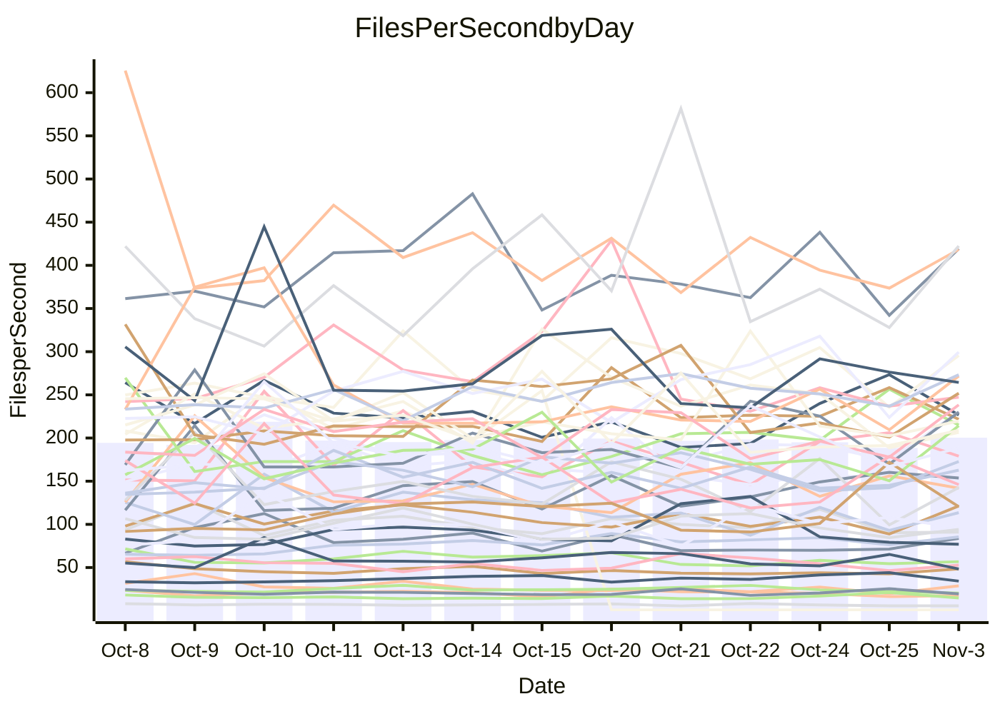

<!---
# This file is auto-generated. Do not edit.
# cspell:disable
--->
# Performance Report

Daily Performance

Time to Process Files

| Repository                                      | Elapsed | Min/Avg/Max          |    SD | SD Graph                |
| ----------------------------------------------- | ------: | :------------------: | ----: | ----------------------- |
| AdaDoom3/AdaDoom3                    |    2.44 | 2.0 /   2.9 /   3.5  |  0.43 | `    ┣━━●━━╋━━┻━━┫    ` |
| alexiosc/megistos                    |    7.48 | 3.9 /   6.6 /   8.1  |  1.26 | `    ┣━━┻━━╋━●┻━━┫    ` |
| apollographql/apollo-server          |    2.59 | 1.4 /   2.4 /   3.0  |  0.43 | `    ┣━━┻━━╋●━┻━━┫    ` |
| aspnetboilerplate/aspnetboilerplate  |    9.27 | 5.1 /   8.4 /  10.2  |  1.50 | `    ┣━━┻━━╋━●┻━━┫    ` |
| aws-amplify/docs                     |   14.25 | 7.7 /  12.8 /  14.6  |  2.37 | `   ┣━━━┻━━╋━●┻━━━┫   ` |
| Azure/azure-rest-api-specs           |    9.14 | 7.3 /  10.5 /  12.2  |  1.27 | `    ┣━━●━━╋━━┻━━┫    ` |
| bitjson/typescript-starter           |    1.10 | 0.7 /   1.0 /   1.2  |  0.17 | `     ┣━┻━━╋━●┻━┫     ` |
| caddyserver/caddy                    |    4.26 | 2.3 /   3.9 /   4.6  |  0.67 | `    ┣━━┻━━╋━●┻━━┫    ` |
| canada-ca/open-source-logiciel-libre |    1.20 | 0.7 /   1.1 /   1.4  |  0.19 | `     ┣━┻━━╋━●┻━┫     ` |
| chef/chef                            |    0.00 | 0.0 /   2.8 /   5.5  |  2.44 | `    ┣━━●━━╋━━┻━━┫    ` |
| dart-lang/sdk                        |   62.16 | 38.8 /  55.9 /  76.1 |  8.75 | `  ┣━━━┻━━━╋━━●┻━━━┫  ` |
| django/django                        |   14.70 | 8.3 /  13.2 /  15.3  |  2.29 | `   ┣━━━┻━━╋━●┻━━━┫   ` |
| eslint/eslint                        |   10.47 | 5.8 /   9.5 /  11.5  |  1.46 | `    ┣━━┻━━╋━●┻━━┫    ` |
| exonum/exonum                        |    2.21 | 2.0 /   3.1 /   3.8  |  0.53 | `    ┣●━┻━━╋━━┻━━┫    ` |
| flutter/samples                      |   10.22 | 7.2 /  11.0 /  13.0  |  1.72 | `    ┣━━┻━●╋━━┻━━┫    ` |
| gitbucket/gitbucket                  |    3.51 | 1.9 /   3.1 /   3.9  |  0.54 | `    ┣━━┻━━╋━●┻━━┫    ` |
| googleapis/google-cloud-cpp          |  130.52 | 72.6 / 118.1 / 138.7 | 18.90 | `  ┣━━━┻━━━╋━━●┻━━━┫  ` |
| graphql/express-graphql              |    1.23 | 0.7 /   1.1 /   1.3  |  0.18 | `     ┣━┻━━╋━●┻━┫     ` |
| graphql/graphql-js                   |    2.67 | 2.1 /   3.2 /   4.1  |  0.68 | `    ┣━━┻●━╋━━┻━━┫    ` |
| graphql/graphql-relay-js             |    1.24 | 0.7 /   1.1 /   1.4  |  0.20 | `     ┣━┻━━╋━●┻━┫     ` |
| graphql/graphql-spec                 |    1.57 | 0.8 /   1.2 /   1.5  |  0.19 | `     ┣━┻━━╋━━┻●┫     ` |
| iluwatar/java-design-patterns        |    7.72 | 7.4 /  12.1 /  14.6  |  2.16 | `   ●┣━━┻━━╋━━┻━━┫    ` |
| ktaranov/sqlserver-kit               |    6.18 | 3.4 /   5.2 /   6.8  |  1.11 | `    ┣━━┻━━╋━━●━━┫    ` |
| liriliri/licia                       |    4.25 | 2.3 /   3.6 /   4.5  |  0.58 | `    ┣━━┻━━╋━━●━━┫    ` |
| MartinThoma/LaTeX-examples           |    6.21 | 4.1 /   6.4 /   7.5  |  0.84 | `    ┣━━┻━●╋━━┻━━┫    ` |
| mdx-js/mdx                           |    1.50 | 1.2 /   1.8 /   2.1  |  0.27 | `     ┣━●━━╋━━┻━┫     ` |
| microsoft/TypeScript-Website         |    3.42 | 3.1 /   5.0 /   6.3  |  0.79 | `    ●━━┻━━╋━━┻━━┫    ` |
| MicrosoftDocs/PowerShell-Docs        |   25.30 | 14.4 /  22.6 /  27.4 |  3.81 | `   ┣━━━┻━━╋━●┻━━━┫   ` |
| neovim/nvim-lspconfig                |    6.00 | 3.2 /   5.4 /   6.8  |  0.92 | `    ┣━━┻━━╋━●┻━━┫    ` |
| pagekit/pagekit                      |    2.68 | 2.1 /   3.4 /   4.1  |  0.55 | `    ┣━●┻━━╋━━┻━━┫    ` |
| php/php-src                          |   25.09 | 13.6 /  22.0 /  26.7 |  4.17 | `   ┣━━━┻━━╋━━●━━━┫   ` |
| plasticrake/tplink-smarthome-api     |    1.49 | 0.8 /   1.2 /   1.5  |  0.20 | `     ┣━┻━━╋━━┻●┫     ` |
| prettier/prettier                    |    8.51 | 4.5 /   7.4 /   8.9  |  1.38 | `    ┣━━┻━━╋━●┻━━┫    ` |
| pycontribs/jira                      |    1.57 | 0.9 /   1.4 /   1.9  |  0.23 | `     ┣━┻━━╋━●┻━┫     ` |
| RustPython/RustPython                |   13.05 | 6.5 /  10.4 /  13.2  |  1.79 | `    ┣━━┻━━╋━━┻━●┫    ` |
| shoelace-style/shoelace              |    1.76 | 1.7 /   2.6 /   3.1  |  0.45 | `    ┣●━┻━━╋━━┻━━┫    ` |
| slint-ui/slint                       |   18.10 | 11.7 /  18.2 /  22.5 |  3.35 | `   ┣━━━┻━━●━━┻━━━┫   ` |
| SoftwareBrothers/admin-bro           |    1.76 | 1.6 /   2.4 /   2.9  |  0.35 | `    ┣●━┻━━╋━━┻━━┫    ` |
| sveltejs/svelte                      |   16.93 | 13.2 /  22.4 /  27.1 |  3.65 | `   ┣━●━┻━━╋━━┻━━━┫   ` |
| TheAlgorithms/Python                 |    6.86 | 3.9 /   6.1 /   7.3  |  1.04 | `    ┣━━┻━━╋━●┻━━┫    ` |
| twbs/bootstrap                       |    1.48 | 1.1 /   1.9 /   2.3  |  0.31 | `     ┣━●━━╋━━┻━┫     ` |
| typescript-cheatsheets/react         |    1.14 | 0.8 /   1.2 /   1.4  |  0.16 | `     ┣━┻━●╋━━┻━┫     ` |
| typescript-eslint/typescript-eslint  |    4.00 | 2.5 /   4.0 /   4.8  |  0.77 | `    ┣━━┻━━●━━┻━━┫    ` |
| vitest-dev/vitest                    |   12.13 | 6.4 /  10.8 /  13.1  |  1.74 | `    ┣━━┻━━╋━●┻━━┫    ` |
| w3c/aria-practices                   |    2.10 | 2.0 /   3.0 /   4.2  |  0.60 | `    ┣━●┻━━╋━━┻━━┫    ` |
| w3c/specberus                        |    1.21 | 1.2 /   1.7 /   2.3  |  0.35 | `     ┣●┻━━╋━━┻━┫     ` |
| webdeveric/webpack-assets-manifest   |    1.30 | 0.9 /   1.2 /   1.4  |  0.12 | `     ┣━┻━━╋━●┻━┫     ` |
| webpack/webpack                      |    5.36 | 5.6 /   8.2 /   9.9  |  1.50 | `    ●━━┻━━╋━━┻━━┫    ` |
| wireapp/wire-desktop                 |    1.60 | 0.9 /   1.4 /   1.7  |  0.24 | `     ┣━┻━━╋━●┻━┫     ` |
| wireapp/wire-webapp                  |    9.58 | 9.1 /  13.7 /  16.4  |  2.37 | `   ┣●━━┻━━╋━━┻━━━┫   ` |

Note:
- Elapsed time is in seconds.

Files per Second over Time

| Repository                                      | Files |    Sec |    Fps |     Rel | Trend Fps              |    N |
| ----------------------------------------------- | ----: | -----: | -----: | ------: | ---------------------- | ---: |
| AdaDoom3/AdaDoom3                    |   103 |   2.44 |  42.25 |  14.81% | `▂█▃▂▅▅▃▂▃▅▂▅▅█▂▅▆▁▂▅` |   30 |
| alexiosc/megistos                    |   583 |   7.48 |  77.95 | -16.31% | `▇▂▂▄▄▂▂▂▇▄█▅▂▄▂▂▂▁▂▂` |   30 |
| apollographql/apollo-server          |   256 |   2.59 |  98.69 | -11.44% | `▄█▁▂▂▂▂▂▂▅▂▂▂▂▁▆▁▄▅▂` |   30 |
| aspnetboilerplate/aspnetboilerplate  |  2308 |   9.27 | 249.05 | -12.49% | `▅▂▄▂▂▄██▂▂▁▂▄▂▂▂▂▂▂▂` |   30 |
| aws-amplify/docs                     |  3039 |  14.25 | 213.30 | -14.71% | `▂▂▂▂▂▂▁▃▂▂▂▂▂▁▁█▁█▂▁` |   30 |
| Azure/azure-rest-api-specs           |  2607 |   9.14 | 285.32 |  13.32% | `▂▂▃█▂▃▃▅▇▂▅▂▂▃▂▆▃▆▂▅` |   30 |
| bitjson/typescript-starter           |    20 |   1.10 |  18.13 | -13.05% | `▅▂▃█▅▁█▅▂█▂▇▃▄▇▂▂▂▂▃` |   30 |
| caddyserver/caddy                    |   402 |   4.26 |  94.29 |  -8.22% | `█▂▅▁▂▂▅▂▁▄▃▂▄▂▇▅▂▂▂▂` |   30 |
| canada-ca/open-source-logiciel-libre |     7 |   1.20 |   5.85 | -14.80% | `▄▃▂▃▇▄▃█▂▂▅▇▄▂▆▃▂▁▃▂` |   30 |
| chef/chef                            |     0 |   0.00 |   0.00 | -99.18% | `█▇▆▆▇█▁▁▁▁▁▁▁▁▁▁▁▁▁▁` |   30 |
| dart-lang/sdk                        | 11839 |  62.16 | 190.45 | -12.01% | `▃▅▃▃▄█▄▄██▃▃▅▁▄▃▃▆▃▃` |   30 |
| django/django                        |  2941 |  14.70 | 200.02 | -13.60% | `▂▇▇▂▂▄▂▇▅▇▂▂▅▂▂▂▂█▂▂` |   30 |
| eslint/eslint                        |  2087 |  10.47 | 199.28 | -11.95% | `▂▂▂▄▂▂█▂▄▁▂▄▂▂▄▄▄▁▅▂` |   30 |
| exonum/exonum                        |   421 |   2.21 | 190.58 |  37.57% | `▅▆▂▂█▂█▂▃▁▄▂▄▅▃▅▅▂▅█` |   30 |
| flutter/samples                      |  1703 |  10.22 | 166.71 |   4.70% | `▃▂▂▂▃▅▆▂█▂▂▅▁▂▂▂▂▂▇▄` |   30 |
| gitbucket/gitbucket                  |   427 |   3.51 | 121.69 | -13.63% | `▂▄▅▄▂▂▁▂▇▁▂█▄▂▄▁▄▄▄▂` |   30 |
| googleapis/google-cloud-cpp          | 22116 | 130.52 | 169.45 | -12.22% | `▂▂▃▂▄▂▂▄▂▁▂█▂▂▂▇▂▂▄▂` |   30 |
| graphql/express-graphql              |    26 |   1.23 |  21.16 | -15.45% | `▂▂▃▇▃▄▃▅█▂▅▇▃▃▃▆▃▁▂▂` |   30 |
| graphql/graphql-js                   |   556 |   2.67 | 208.60 |  15.24% | `▇▂▇▂▂▂▂█▆▁▂▂▃▇█▂▅▂▄▆` |   30 |
| graphql/graphql-relay-js             |    28 |   1.24 |  22.60 | -17.23% | `▅▂▆▅▂▃▃▃▂▆▂▃▅▃▆▆▁█▆▃` |   30 |
| graphql/graphql-spec                 |    19 |   1.57 |  12.07 | -22.96% | `▂▂▅▂▂▂▇▂▃▂▂▃▂▂█▇█▇▂▁` |   30 |
| iluwatar/java-design-patterns        |  2239 |   7.72 | 290.15 |  50.25% | `▂▂▄▂▇▃▂▄▁▂▃▇▇▂▂█▂▅▂▇` |   30 |
| ktaranov/sqlserver-kit               |   490 |   6.18 |  79.27 | -19.62% | `▂▂▇▄▂▂▇▁▁▁█▄▆▄▄▂▅▂▇▂` |   30 |
| liriliri/licia                       |  1442 |   4.25 | 339.21 | -17.76% | `▄▅▄▄▇▂▄▂▄▁▂▂▃▂▂█▂▄▅▂` |   30 |
| MartinThoma/LaTeX-examples           |  1414 |   6.21 | 227.65 |   0.99% | `▂▂▂▂▁▃▂▂▂▁█▆▃▃▃▂▂▂▃▃` |   30 |
| mdx-js/mdx                           |   139 |   1.50 |  92.42 |  15.95% | `▆█▆▂▂▂▄▄▂▂▂▂▂▂▂▂▂▅▂▅` |   30 |
| microsoft/TypeScript-Website         |   765 |   3.42 | 223.84 |  41.48% | `▃▆▃▄▆▃▃▅▃▃▆▃▃▃▂▃▃▂▂█` |   30 |
| MicrosoftDocs/PowerShell-Docs        |  3127 |  25.30 | 123.62 | -13.70% | `▂█▄█▂▇▂▂▅▂▂▁▂▂▂▂▇▂█▂` |   30 |
| neovim/nvim-lspconfig                |   889 |   6.00 | 148.09 | -13.11% | `▂▅▂▅▂▂▅█▃▃▂▂▂▃▂▄▂▂▁▂` |   30 |
| pagekit/pagekit                      |   741 |   2.68 | 276.28 |  22.73% | `▂▂█▁▂▂▂▃▁▂▂▂▅▂▂▆▅▂▂▅` |   30 |
| php/php-src                          |  2403 |  25.09 |  95.79 | -15.67% | `▄█▂▂▄▄▆▂▂▁▁▁▁▂▄▂█▄▆▂` |   30 |
| plasticrake/tplink-smarthome-api     |    62 |   1.49 |  41.56 | -24.07% | `▃▁▅▇▂▂▄▂▆▆█▂▂▅▄▄▂▄▅▁` |   30 |
| prettier/prettier                    |  2791 |   8.51 | 327.97 | -15.57% | `▂▆▂▃▂▅▂▄█▇▂▂▂▂▄▄▂▂█▂` |   30 |
| pycontribs/jira                      |    80 |   1.57 |  50.97 | -12.00% | `▆▆▃▃▃▄█▃▅▅▂▄▃▃▃▃▅▁▃▃` |   30 |
| RustPython/RustPython                |  1069 |  13.05 |  81.91 | -18.19% | `▆▄▄▄▁▂▂▂▅▄█▂▁▅▅▂▂▄▃▂` |   30 |
| shoelace-style/shoelace              |   440 |   1.76 | 250.01 |  40.77% | `▃█▂▂▄▇▂▂▄▄▅▂▂▂█▁▂▂▇█` |   30 |
| slint-ui/slint                       |  5027 |  18.10 | 277.81 |   4.94% | `█▂▆▂▂▄▂▂▄▃▆▂▆▆█▁▂▄▆▄` |   30 |
| SoftwareBrothers/admin-bro           |   441 |   1.76 | 250.60 |  32.94% | `▃▃▃▂▅▂▂▂▂▃▂▅▁▃█▃▃▃█▇` |   30 |
| sveltejs/svelte                      |  9223 |  16.93 | 544.75 |  28.82% | `▂▂█▂▂▂▂▅▂▂▂▅▂▃▂▃▂▁▂▆` |   30 |
| TheAlgorithms/Python                 |  1640 |   6.86 | 238.90 | -13.42% | `▂▂▂▁▅▂█▁▄▄▄▂▂▄▄▆▂▂█▂` |   30 |
| twbs/bootstrap                       |   152 |   1.48 | 102.86 |  31.17% | `▄▂▂▆▂▃▆▂▂▄▄▂▂▁▂█▃▄▂▅` |   30 |
| typescript-cheatsheets/react         |    24 |   1.14 |  20.97 |   0.60% | `▂▃▅▃▁▂▃▂█▃▂▂▂▅▃▃▅▃▂▃` |   30 |
| typescript-eslint/typescript-eslint  |   887 |   4.00 | 221.48 |  -4.49% | `▁▂▂▁▂▇█▂▅▂▂▇▆█▂▁▂▂▂▃` |   30 |
| vitest-dev/vitest                    |  2948 |  12.13 | 243.00 | -11.68% | `▁▄▂▂▂▄▄▅▂▂▂▂█▂▂▂▃▄▂▂` |   30 |
| w3c/aria-practices                   |   417 |   2.10 | 198.56 |  38.48% | `▃▃▄▂▄▃▇▅▅▅▂▂█▂▇█▁▂▂█` |   30 |
| w3c/specberus                        |   190 |   1.21 | 156.39 |  34.28% | `▇▇▅▇▁▅▂▄▅▃▁▂▅▂▂█▂▂▂▇` |   30 |
| webdeveric/webpack-assets-manifest   |    55 |   1.30 |  42.35 |  -8.75% | `▄▇▃▄█▃▄▄▃▂▃▂▂▃▃▄▃▃█▃` |   30 |
| webpack/webpack                      |  1540 |   5.36 | 287.24 |  50.49% | `▇▂▆▂▁▂▄▂▆▂▂▆▄▂▁▇▇▂▄█` |   30 |
| wireapp/wire-desktop                 |    86 |   1.60 |  53.80 | -10.85% | `▂▂▂█▃▄▆▃▃▂▂▂▂▂▅▄▃▂▄▃` |   30 |
| wireapp/wire-webapp                  |  2803 |   9.58 | 292.55 |  40.95% | `▂▂▄█▂▂█▂▄▅▂▂▂▂▅▃▂▅▂█` |   30 |

Data Throughput

| Repository                                      | Files |    Sec |     Kps |     Rel | Trend Kps              |    N |
| ----------------------------------------------- | ----: | -----: | ------: | ------: | ---------------------- | ---: |
| AdaDoom3/AdaDoom3                    |   103 |   2.44 |  897.87 |  14.81% | `▂█▃▂▅▅▃▂▃▅▂▅▅█▂▅▆▁▂▅` |   30 |
| alexiosc/megistos                    |   583 |   7.48 |  612.52 | -16.31% | `▇▂▂▄▄▂▂▂▇▄█▅▂▄▂▂▂▁▂▂` |   30 |
| apollographql/apollo-server          |   256 |   2.59 |  814.94 | -11.44% | `▄█▁▂▂▂▂▂▂▅▂▂▂▂▁▆▁▄▅▂` |   30 |
| aspnetboilerplate/aspnetboilerplate  |  2308 |   9.27 |  614.41 | -12.20% | `▅▂▄▂▂▄██▂▂▁▂▄▂▂▂▂▂▂▂` |   30 |
| aws-amplify/docs                     |  3039 |  14.25 |  838.30 | -14.69% | `▂▂▂▂▂▂▁▃▂▂▂▂▂▁▁█▁█▂▁` |   30 |
| Azure/azure-rest-api-specs           |  2607 |   9.14 |  897.78 |  14.86% | `▂▂▃█▂▃▃▅▇▂▅▂▂▃▂▆▃▆▂▅` |   30 |
| bitjson/typescript-starter           |    20 |   1.10 |   72.53 | -13.05% | `▅▂▃█▅▁█▅▂█▂▇▃▄▇▂▂▂▂▃` |   30 |
| caddyserver/caddy                    |   402 |   4.26 |  921.10 |  -5.16% | `█▂▅▂▂▂▅▂▂▄▃▂▄▂▇▅▂▂▂▃` |   30 |
| canada-ca/open-source-logiciel-libre |     7 |   1.20 |   48.48 | -14.80% | `▄▃▂▃▇▄▃█▂▂▅▇▄▂▆▃▂▁▃▂` |   30 |
| chef/chef                            |  1037 |   4.07 | 1253.33 |  19.94% | `▄▃█▄▄▃▇▃▄▃█▆▃▃▂▃█`    |   16 |
| dart-lang/sdk                        | 11839 |  62.16 | 1338.42 | -11.74% | `▃▅▃▃▄█▄▄██▃▃▅▁▄▃▃▆▃▃` |   30 |
| django/django                        |  2941 |  14.70 | 1299.62 | -13.37% | `▂▇▇▂▂▄▂▇▅▇▂▂▅▂▂▂▂█▂▂` |   30 |
| eslint/eslint                        |  2087 |  10.47 | 1412.12 | -11.79% | `▂▂▂▄▂▂█▂▄▁▂▄▂▂▄▄▄▁▅▂` |   30 |
| exonum/exonum                        |   421 |   2.21 | 1822.94 |  37.57% | `▅▆▂▂█▂█▂▃▁▄▂▄▅▃▅▅▂▅█` |   30 |
| flutter/samples                      |  1703 |  10.22 |  993.68 |   4.70% | `▃▂▂▂▃▅▆▂█▂▂▅▁▂▂▂▂▂▇▄` |   30 |
| gitbucket/gitbucket                  |   427 |   3.51 |  600.75 | -13.00% | `▂▄▅▄▂▂▁▂▇▁▂█▄▂▄▁▄▄▄▂` |   30 |
| googleapis/google-cloud-cpp          | 22116 | 130.52 | 1486.22 | -11.89% | `▂▂▃▂▄▂▂▄▂▁▂█▂▂▂▇▂▃▄▂` |   30 |
| graphql/express-graphql              |    26 |   1.23 |   96.85 | -15.45% | `▂▂▃▇▃▄▃▅█▂▅▇▃▃▃▆▃▁▂▂` |   30 |
| graphql/graphql-js                   |   556 |   2.67 | 1593.73 |  16.97% | `▇▁▇▂▂▂▂█▆▁▂▂▃▇█▂▅▂▄▆` |   30 |
| graphql/graphql-relay-js             |    28 |   1.24 |   88.77 | -17.23% | `▅▂▆▅▂▃▃▃▂▆▂▃▅▃▆▆▁█▆▃` |   30 |
| graphql/graphql-spec                 |    19 |   1.57 |  405.87 | -22.96% | `▂▂▅▂▂▂▇▂▃▂▂▃▂▂█▇█▇▂▁` |   30 |
| iluwatar/java-design-patterns        |  2239 |   7.72 |  900.24 |  50.25% | `▂▂▄▂▇▃▂▄▁▂▃▇▇▂▂█▂▅▂▇` |   30 |
| ktaranov/sqlserver-kit               |   490 |   6.18 | 1201.37 | -19.59% | `▂▂▇▄▂▂▇▁▁▁█▄▆▄▄▂▅▂▇▂` |   30 |
| liriliri/licia                       |  1442 |   4.25 |  406.73 | -17.76% | `▄▅▄▄▇▂▄▂▄▁▂▂▃▂▂█▂▄▅▂` |   30 |
| MartinThoma/LaTeX-examples           |  1414 |   6.21 |  473.01 |   0.99% | `▂▂▂▂▁▃▂▂▂▁█▆▃▃▃▂▂▂▃▃` |   30 |
| mdx-js/mdx                           |   139 |   1.50 |  435.51 |  15.95% | `▆█▆▂▂▂▄▄▂▂▂▂▂▂▂▂▂▅▂▅` |   30 |
| microsoft/TypeScript-Website         |   765 |   3.42 | 1544.65 |  41.55% | `▃▆▃▄▆▃▃▅▃▃▆▃▃▃▂▃▃▂▂█` |   30 |
| MicrosoftDocs/PowerShell-Docs        |  3127 |  25.30 | 1321.07 | -13.70% | `▂█▄█▂▇▂▂▅▂▂▁▂▂▂▂▇▂█▂` |   30 |
| neovim/nvim-lspconfig                |   889 |   6.00 |  468.24 | -12.68% | `▂▅▂▅▂▂▅█▃▃▂▂▂▃▂▄▂▂▁▂` |   30 |
| pagekit/pagekit                      |   741 |   2.68 |  576.06 |  22.73% | `▂▂█▁▂▂▂▃▁▂▂▂▅▂▂▆▅▂▂▅` |   30 |
| php/php-src                          |  2403 |  25.09 | 1704.45 | -15.67% | `▄█▂▂▄▄▆▂▂▁▁▁▁▂▄▂█▄▆▂` |   30 |
| plasticrake/tplink-smarthome-api     |    62 |   1.49 |  224.53 | -24.07% | `▃▁▅▇▂▂▄▂▆▆█▂▂▅▄▄▂▄▅▁` |   30 |
| prettier/prettier                    |  2791 |   8.51 |  457.23 | -15.99% | `▂▆▂▃▂▅▂▄█▇▂▂▂▂▄▄▂▂█▂` |   30 |
| pycontribs/jira                      |    80 |   1.57 |  360.01 | -12.00% | `▆▆▃▃▃▄█▃▅▅▂▄▃▃▃▃▅▁▃▃` |   30 |
| RustPython/RustPython                |  1069 |  13.05 | 2363.51 | -19.49% | `▆▅▅▅▂▂▂▂▅▄█▂▁▅▅▂▂▄▃▂` |   30 |
| shoelace-style/shoelace              |   440 |   1.76 | 1207.43 |  40.77% | `▃█▂▂▄▇▂▂▄▄▅▂▂▂█▁▂▂▇█` |   30 |
| slint-ui/slint                       |  5027 |  18.10 | 1669.23 |   7.56% | `█▂▆▂▂▄▂▂▄▃▇▂▆▆█▂▂▄▇▄` |   30 |
| SoftwareBrothers/admin-bro           |   441 |   1.76 |  552.34 |  32.94% | `▃▃▃▂▅▂▂▂▂▃▂▅▁▃█▃▃▃█▇` |   30 |
| sveltejs/svelte                      |  9223 |  16.93 |  377.07 |  29.03% | `▂▂█▂▂▂▂▅▂▂▂▅▂▃▂▃▂▁▂▆` |   30 |
| TheAlgorithms/Python                 |  1640 |   6.86 |  685.23 | -13.29% | `▂▂▂▁▄▂█▁▄▄▄▂▂▄▄▆▂▂█▂` |   30 |
| twbs/bootstrap                       |   152 |   1.48 |  869.61 |  32.55% | `▄▂▃▆▂▃▆▂▂▄▄▂▂▂▂█▃▄▂▆` |   30 |
| typescript-cheatsheets/react         |    24 |   1.14 |  189.59 |   0.60% | `▂▃▅▃▁▂▃▂█▃▂▂▂▅▃▃▅▃▂▃` |   30 |
| typescript-eslint/typescript-eslint  |   887 |   4.00 |  757.33 |  -4.20% | `▁▂▂▁▂▇█▂▅▂▂▇▆█▂▁▂▂▂▃` |   30 |
| vitest-dev/vitest                    |  2948 |  12.13 |  734.61 | -10.60% | `▁▄▂▂▂▄▄▅▂▂▂▂█▂▂▂▃▄▂▂` |   30 |
| w3c/aria-practices                   |   417 |   2.10 | 1869.40 |  38.48% | `▃▃▄▂▄▃▇▅▅▅▂▂█▂▇█▁▂▂█` |   30 |
| w3c/specberus                        |   190 |   1.21 |  511.96 |  34.28% | `▇▇▅▇▁▅▂▄▅▃▁▂▅▂▂█▂▂▂▇` |   30 |
| webdeveric/webpack-assets-manifest   |    55 |   1.30 |   97.78 |  -8.75% | `▄▇▃▄█▃▄▄▃▂▃▂▂▃▃▄▃▃█▃` |   30 |
| webpack/webpack                      |  1540 |   5.36 | 2497.65 |  48.72% | `▇▂▆▂▁▂▄▂▇▂▂▇▅▂▂█▇▂▄█` |   30 |
| wireapp/wire-desktop                 |    86 |   1.60 |  236.49 |  -9.42% | `▂▃▃█▃▄▆▄▃▂▂▂▂▂▅▅▃▂▅▃` |   30 |
| wireapp/wire-webapp                  |  2803 |   9.58 | 1395.21 |  45.71% | `▂▂▄█▂▂▇▂▄▅▂▂▂▂▅▃▂▆▂█` |   30 |

